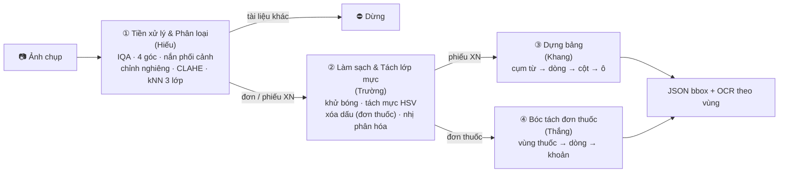

# ĐỒ ÁN MÔN HỌC XỬ LÝ ẢNH SỐ (DIGITAL IMAGE PROCESSING)
## ĐỀ TÀI: NGHIÊN CỨU & XÂY DỰNG PIPELINE TIỀN XỬ LÝ, PHÂN LOẠI BIỂU MẪU VÀ BÓC TÁCH CẤU TRÚC TÀI LIỆU Y TẾ TỪ ẢNH CHỤP THỰC TẾ

> **Khoa:** Trí tuệ Nhân tạo — Học viện Công nghệ Bưu chính Viễn thông  
> **Giảng viên hướng dẫn:** PGS.TS. Phạm Văn Cường  
> **Hình thức đồ án:** **Lựa chọn 2 – Dự án Xử lý ảnh thực tế** (pipeline nhiều bước, có đối chứng và đánh giá định lượng)  
> **Hạn nộp:** **11/11/2026**, gửi file `.zip` về `uyenvnb@ptit.edu.vn`  
> **Nhóm:** Hiếu (nhóm trưởng) · Trường · Khang · Thắng

> [!NOTE]
> File này mô tả đề tài ở **mức tổng quan**. Chi tiết từng bước (phương pháp, đối chứng, chương · slide, công thức), thí nghiệm, tham số, lịch và checklist nằm ở **[kế hoạch toàn nhóm](../team/KeHoach.md)**, là kế hoạch chính của nhóm. Hai file khác nhau thì theo kế hoạch toàn nhóm.

---

## 1. BỐI CẢNH & MỤC TIÊU

### 1.1. Bối cảnh
Hồ sơ y tế ở Việt Nam (đơn thuốc, phiếu xét nghiệm) phần lớn vẫn là giấy in hoặc ảnh chụp bằng điện thoại. Ảnh chụp thực tế có cùng lúc nhiều suy biến:
1. **Hình học:** chụp chéo góc, méo phối cảnh, nghiêng.
2. **Quang học:** mờ do rung tay, lóa đèn flash, bóng đổ, ánh sáng không đều.
3. **Biểu mẫu đa dạng:** mỗi bệnh viện, phòng khám một bố cục; phiếu xét nghiệm thường là bảng **không kẻ lưới**.
4. **Lớp mực chồng nhau:** dấu đỏ, chữ ký đè lên chữ in, trong khi chữ in đỏ cảnh báo trên phiếu xét nghiệm phải được giữ lại.

### 1.2. Bài toán
| Mục | Nội dung |
| :--- | :--- |
| **Đầu vào** | Ảnh chụp đơn thuốc hoặc phiếu xét nghiệm bằng điện thoại |
| **Đầu ra** | (1) Ảnh phẳng, sạch, nhị phân; (2) nhãn loại tài liệu; (3) bbox từng **dòng chỉ số** (phiếu xét nghiệm) hoặc từng **khoản thuốc** (đơn thuốc) để OCR theo vùng |

### 1.3. Mục tiêu kỹ thuật
1. **Kiểm định chất lượng & chuẩn hóa hình học:** đo mờ, lóa; tìm 4 góc, nắn phối cảnh, chỉnh nghiêng; tăng tương phản.
2. **Phân loại biểu mẫu:** 3 lớp *đơn thuốc / phiếu xét nghiệm / tài liệu khác* bằng đặc trưng thủ công + $k$-NN, từ chối tài liệu lạ.
3. **Làm sạch & tách lớp mực:** khử bóng bằng ước lượng nền hình thái, tách mực theo HSV, xóa dấu / chữ ký trên đơn thuốc, giữ chữ đỏ cảnh báo trên phiếu xét nghiệm, nhị phân hóa.
4. **Bóc tách cấu trúc:** dựng bảng không kẻ của phiếu xét nghiệm; tách từng khoản thuốc của đơn thuốc.
5. **Đánh giá định lượng:** mỗi bước có phương pháp đối chứng và độ đo chuẩn; ablation toàn pipeline.

**Phạm vi:** chỉ môn Xử lý ảnh số. Không dùng mô hình học máy ngoài $k$-NN của bài giảng; các bước khác dùng **luật** dựa trên màu, hình dạng, vị trí. OCR chỉ là công cụ đo CER, không phải phương pháp DIP.

---

## 2. PIPELINE TỔNG THỂ

Mỗi giai đoạn gồm **tiền xử lý → xử lý chính → hậu xử lý** (Opening, lọc vùng theo diện tích) theo khung pipeline của thầy (QĐ · S7). Hợp đồng dữ liệu giữa các mắt xích: [code/README.md](../code/README.md) mục 4.

---

## 3. KIẾN THỨC MÔN HỌC ÁP DỤNG

Đề tài áp dụng **8/8 chương**, trục chính là **Chương 3, 5, 7**, khớp gợi ý đề tài số hóa tài liệu của thầy (chương 2, 3, 5, 7; QĐ · S6), mở rộng thêm Chương 4, 6 và 8. Bảng tra từng kỹ thuật → slide → công thức: [kế hoạch toàn nhóm](../team/KeHoach.md) mục 4 và 9.

| Chương | Vai trò trong đề tài |
| :---: | :--- |
| **C1** Nhập môn | Khung các giai đoạn xử lý ảnh để ánh xạ pipeline |
| **C2** Cơ bản | Lấy mẫu, nội suy, độ phân giải; nắn phối cảnh (theo gợi ý đề tài) |
| **C3** Nâng cao chất lượng | Lọc trung vị, Max/Min, lược đồ xám (cơ sở của projection profile), cân bằng lược đồ / CLAHE, toán tử điểm khử bóng |
| **C4** Hệ màu | HSV: phát hiện lóa, tách mực đỏ / xanh, giữ chữ đỏ cảnh báo |
| **C5** Biên & phân vùng | Laplacian đo mờ, Canny tìm mép giấy, Otsu và các ngưỡng đối chứng, vùng liên thông, tách / hợp vùng |
| **C6** Nén ảnh | Đánh giá chất lượng (RMS → PSNR, thang chủ quan); suy biến JPEG trong bộ 5 |
| **C7** Hình thái | **Trục chính:** Closing ước lượng nền, Dilation gom chữ thành cụm từ / khoản thuốc, Opening hậu xử lý, làm đầy vùng mask dấu |
| **C8** Nhận dạng | Đặc trưng HOG / GLCM / lược đồ, $k$-NN, ma trận nhầm lẫn, Precision / Recall / F1 |

---

## 4. DỮ LIỆU & ĐÁNH GIÁ

### 4.1. Dữ liệu
| Bộ | Nguồn | Quy mô | Vai trò |
| :---: | :--- | :--- | :--- |
| 1 | VAIPE (đơn thuốc Việt Nam) | 1.345 ảnh (1.173 có nhãn dòng) | Tách khoản thuốc (chọn tham số trên ~150–200 ảnh, đánh giá trên ≥ 50 ảnh đã soát); lớp đơn thuốc; nguồn ảnh sạch của bộ 5 |
| 2 | Roboflow Report Keywords (phiếu CBC, tiếng Anh, bảng không kẻ) | **57 ảnh gốc**, không dùng bản tăng cường | Dựng bảng (kiểm định chéo 5-fold trên 57 ảnh); lớp phiếu xét nghiệm |
| 3 | RVL-CDIP tập con | 1.000 ảnh | Lớp "tài liệu khác" |
| 4 | Nhóm tự chụp | 83 ảnh (48 phiếu XN, 18 đơn, 17 khác), chỉ có nhãn loại tài liệu | **Chỉ để test**: định lượng cho phân loại 3 lớp; các bước khác kiểm tra định tính bằng ảnh trước / sau |
| 5 | Tổng hợp từ ảnh sạch bộ 1 | 1.500 mẫu | Ground truth chính xác: ma trận biến dạng, 4 góc, ảnh nhị phân chuẩn, mask bóng / lóa / dấu / bút |

Chi tiết nhãn, license: [data/README.md](../data/README.md). Quy tắc chia tập: tham số chọn trên valid, báo cáo trên test; biến thể bộ 5 cùng ảnh gốc nằm chung một tập; mỗi người có tập đánh giá ≥ 50 ảnh (QĐ · S7).

### 4.2. Thí nghiệm chính và độ đo
Mỗi phần có **1 bảng chính + 1 hình chính** trong báo cáo. Danh sách đầy đủ thí nghiệm ở kế hoạch toàn nhóm mục 5.2, 6.2, 7.2, 8.3.

| Phần | Bảng chính | Hình chính | Độ đo |
| :--- | :--- | :--- | :--- |
| ① Hiếu | D2 tìm 4 góc; D10 phân loại 3 lớp | D3 sai số nắn theo góc nghiêng × độ méo | Sai số góc (px), tỉ lệ thành công; Accuracy, Macro-F1, ma trận nhầm lẫn |
| ② Trường | T2 so sánh các cách nhị phân hóa | T3 F-measure theo mức hỏng | PSNR, SSIM, F-measure, pseudo-F; giữ chữ đỏ (T5, định tính trên bộ 4) |
| ③ Khang | K2 so sánh 3 cách tìm cột | K3 độ chính xác theo góc nghiêng còn sót | Độ chính xác gán cụm từ vào dòng / cột, pairwise F1, F1 quan hệ kề |
| ④ Thắng | S1 so sánh các cách gom khoản | S2 F1 khoản theo mức hỏng | F1 khoản (IoU > 0,5), IoU trung bình; CER cả trang vs từng khoản (S3) |
| Toàn pipeline | Ablation (Trường chạy) | — | CER cuối trên test bộ 5 khi tắt lần lượt từng bước |

---

## 5. PHÂN CÔNG

| Thành viên | Phần phụ trách | Module |
| :--- | :--- | :--- |
| **Hiếu** (nhóm trưởng) | ① Tiền xử lý & phân loại; ghép báo cáo, slide, video; đóng gói và nộp | `code/src/preprocessing/`, `code/src/classification/` |
| **Trường** | ② Làm sạch & tách lớp mực; chạy ablation toàn pipeline | `code/src/cleaning/` |
| **Khang** | ③ Dựng bảng phiếu xét nghiệm; bộ OCR dùng chung (công cụ đo CER) | `code/src/table_extraction/`, `code/src/ocr/` |
| **Thắng** | ④ Bóc tách đơn thuốc; sinh bộ 5 cho cả nhóm | `code/src/prescription_segmentation/`, `code/src/synthetic/` |

---

## 6. MỐC THỜI GIAN

Lịch chi tiết theo người: kế hoạch toàn nhóm mục 12.4. Bảng theo dõi: [team/TienDo.md](../team/TienDo.md).

| Ngày | Mốc |
| :---: | :--- |
| 09/11 | Mỗi người xong ground truth và thí nghiệm chính; **tối: chạy cả pipeline trên 10 ảnh mẫu** |
| 10/11 | Thí nghiệm còn lại, phần báo cáo + 2 slide mỗi người; quay đoạn demo; Hiếu ghép, đóng gói, thử trên máy sạch |
| **11/11** | **Nộp đồ án** |

---

## 7. SẢN PHẨM NỘP (QĐ · S8)

Một file `LopXX_NhomYY_MedicalDocProcessing.zip` gửi `uyenvnb@ptit.edu.vn`, tiêu đề email trùng tên file:

1. **Mã nguồn `code/`** (Python: OpenCV, NumPy, scikit-image, scikit-learn, matplotlib), `requirements.txt`, **5–10 ảnh mẫu** trong `samples/` đã che thông tin cá nhân.
2. **`README.md`:** môi trường, cài đặt, lệnh chạy, đầu ra mong đợi, link dữ liệu.
3. **Báo cáo PDF 4–10 trang:** đặt vấn đề → dữ liệu → phương pháp → kết quả thực nghiệm đối chứng → thảo luận → phân công & khai báo sử dụng AI.
4. **Slide** 10–15 trang (`.pptx` + `.pdf`) cho 10 phút trình bày + 5 phút hỏi đáp.
5. **Video demo** ≤ 3 phút, chạy trên ảnh thật.
