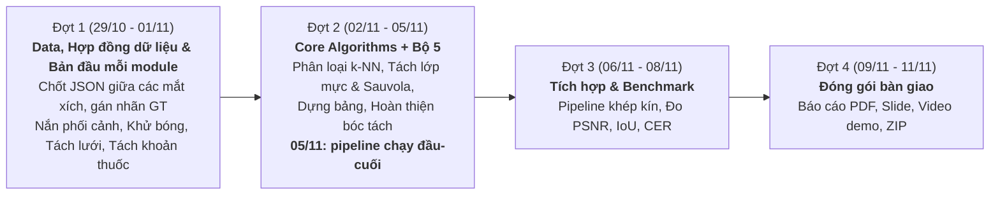

# ĐỒ ÁN MÔN HỌC XỬ LÝ ẢNH SỐ (DIGITAL IMAGE PROCESSING)
## ĐỀ TÀI: NGHIÊN CỨU & XÂY DỰNG PIPELINE TIỀN XỬ LÝ, PHÂN LOẠI BIỂU MẪU VÀ BÓC TÁCH CẤU TRÚC TÀI LIỆU Y TẾ TỪ ẢNH CHỤP THỰC TẾ

> **Khoa:** Trí tuệ Nhân tạo — Học viện Công nghệ Bưu chính Viễn thông  
> **Giảng viên hướng dẫn:** PGS.TS. Phạm Văn Cường  
> **Hình thức đồ án:** **Lựa chọn 2 – Dự án Xử lý ảnh thực tế** (xây dựng pipeline nhiều bước có đối chứng và đánh giá định lượng)  
> **Hạn nộp sản phẩm:** **11/11/2026** (Gửi file `.zip` về email: `uyenvnb@ptit.edu.vn`)  
> **Quy mô nhóm:** 4 sinh viên (Hiếu, Trường, Khang, Thắng)

---

## 📌 1. TÍNH CẤP THIẾT & MỤC TIÊU ĐỀ TÀI

### 1.1. Bối cảnh & Vấn đề thực tế
* Trong hệ thống y tế Việt Nam, hồ sơ sức khỏe (đơn thuốc, phiếu xét nghiệm máu, phiếu tổng phân tích nước tiểu, báo cáo siêu âm/X-quang) phần lớn vẫn tồn tại ở dạng giấy in hoặc ảnh chụp gửi qua điện thoại.
* Ảnh chụp tài liệu thực tế thường xuyên gặp các suy biến quang học nghiêm trọng:
  1. **Méo hình học:** Bị chụp chéo góc, cong vênh mép giấy, sai lệch phối cảnh.
  2. **Suy giảm chất lượng ảnh:** Rung tay mờ nét (motion blur), thiếu sáng, lóa sáng do đèn flash camera, bóng đổ loang lổ.
  3. **Biểu mẫu đa dạng:** Bệnh viện công, bệnh viện tư và phòng khám có quy cách định dạng hoàn toàn khác nhau.
  4. **Cấu trúc phức tạp:** Phiếu xét nghiệm chứa bảng lưới nhiều dòng/cột; đơn thuốc chứa các khối văn bản pháp lý (con dấu đỏ bệnh viện, chữ ký bác sĩ) nằm đan xen.

### 1.2. Mục tiêu kỹ thuật
Xây dựng một chương trình xử lý ảnh tự động hoàn chỉnh, tiếp nhận ảnh chụp tài liệu y tế thực tế, thực hiện chuỗi xử lý khép kín:
1. **Kiểm định chất lượng & Chuẩn hóa hình học:** Tự động phát hiện 4 góc tài liệu, nắn phối cảnh (Perspective Transform) và xoay thẳng góc $0^\circ$ (Deskew).
2. **Nâng cao chất lượng & Khử lóa sáng:** Cân bằng tương phản thích nghi CLAHE và khử vùng lóa flash trên kênh màu chuyên biệt.
3. **Phân loại biểu mẫu tự động:** Ứng dụng kỹ thuật nhận dạng mẫu (Pattern Recognition) để phân loại tài liệu đầu vào (người dùng có thể tải lên bất kỳ loại giấy tờ nào) thành 3 lớp: **Đơn thuốc (Prescription)**, **Phiếu xét nghiệm (Lab Report)** hoặc **Tài liệu khác (Other)**. Chỉ đơn thuốc và phiếu xét nghiệm được chuyển sang các giai đoạn sau; tài liệu khác hoặc có độ tin cậy thấp bị dừng lại.
4. **Làm sạch ảnh & Tách lớp mực:** Khử bóng đổ và nền sáng không đều (ước lượng nền bằng hình thái học), nhị phân hóa thích nghi Sauvola; tách lớp mực bằng không gian màu HSV để xóa con dấu đỏ, chữ ký, chữ viết tay đè lên chữ in (inpainting), đồng thời **giữ lại** chữ in màu đỏ cảnh báo trên phiếu xét nghiệm.
5. **Bóc tách cấu trúc chuyên biệt (Phục vụ trực tiếp MedTrack AI):**
   * *Với Phiếu xét nghiệm:* Ứng dụng hình thái học (Morphological Operations) để bóc tách khung lưới bảng, tách từng ô kết quả và phát hiện các vùng cảnh báo chỉ số bất thường (in đỏ, in đậm, mũi tên `↑`/`↓`, cờ `H`/`L`) để phục vụ vẽ biểu đồ và cảnh báo nguy cơ.
   * *Với Đơn thuốc:* Ứng dụng phép chiếu biên độ (Horizontal Projection Profile) và hình thái học gom cụm (Morphological Dilation) để bóc tách từng khối khoản thuốc độc lập (mỗi khối gồm Tên thuốc + Liều dùng Sáng/Trưa/Chiều/Tối) phục vụ tạo lịch nhắc thuốc.
6. **Đánh giá định lượng:** Đo lường hiệu quả qua các chỉ số khoa học: PSNR, SSIM, F-measure nhị phân hóa, IoU phân đoạn khối thuốc & bảng xét nghiệm, Accuracy, F1-score và Character Error Rate (CER).

---

## 🏗️ 2. SƠ ĐỒ KIẾN TRÚC PIPELINE TỔNG THỂ

```mermaid
flowchart TD
    subgraph IN ["📥 ĐẦU VÀO"]
        A["Ảnh chụp tài liệu y tế thực tế<br>(Nghiêng, méo, lóa sáng, đa dạng biểu mẫu)"]
    end

    subgraph PHASE1 ["GIAI ĐOẠN 1: TIỀN XỬ LÝ & NẮN CHỈNH HÌNH HỌC — Hiếu (Chương 2, 3, 4)"]
        B1["1.1. Đánh giá chất lượng IQA<br>• Đo mờ: Laplacian Variance<br>• Đo lóa: Tách kênh V trong không gian HSV"]
        B2["1.2. Nắn biến đổi phối cảnh (Perspective Transform)<br>Contours Approximation → Tìm 4 đỉnh → Ép phẳng ảnh scan"]
        B3["1.3. Khử góc nghiêng xoay (Radon / Hough Deskew)<br>Xác định góc xoay θ → Xoay ma trận ảnh về 0°"]
        B4["1.4. Tăng tương phản nét chữ<br>Cân bằng thích nghi CLAHE & Lọc nhiễu"]
    end

    subgraph PHASE2 ["GIAI ĐOẠN 2: PHÂN LOẠI BIỂU MẪU TÀI LIỆU Y TẾ — Hiếu (Chương 8)"]
        C1["Trích chọn đặc trưng bố cục & kết cấu<br>(Spatial Density, HOG / GLCM, Tỉ lệ đường lưới)"]
        C2["Mô hình phân loại<br>(k-NN / SVM / CNN nhẹ ResNet-18)"]
        C3{"Phân loại biểu mẫu"}
    end

    subgraph PHASE25 ["GIAI ĐOẠN 3: LÀM SẠCH ẢNH & TÁCH LỚP MỰC — Trường (Chương 3, 4, 5, 7)"]
        F1["Khử bóng đổ & nền không đều<br>Ước lượng nền bằng Closing/Median kích thước lớn → Chia chuẩn hóa"]
        F2["Tách lớp mực theo HSV<br>Con dấu đỏ / Bút bi xanh / Chữ in đen<br>(Đơn thuốc: xóa dấu & chữ ký bằng Inpainting<br>Phiếu XN: giữ chữ in đỏ cảnh báo)"]
        F3["Nhị phân hóa thích nghi Sauvola<br>+ Lọc thành phần liên thông nhiễu"]
    end

    subgraph PHASE3 ["GIAI ĐOẠN 4: BÓC TÁCH CẤU TRÚC PHỤC VỤ MEDTRACK AI (Chương 4, 5, 7)"]
        D1["Nhánh A: Phiếu xét nghiệm — Khang<br><b>Bóc tách Bảng & Cờ bất thường</b><br>• Morphological Line Closing (1 x W & H x 1)<br>• Tách khung lưới & từng ô Cell chỉ số<br>• Phát hiện cờ bất thường: in đỏ (HSV), mũi tên, in đậm"]
        D2["Nhánh B: Đơn thuốc — Thắng<br><b>Bóc tách từng Khối khoản thuốc</b><br>• Horizontal Projection Profile phân đoạn dòng<br>• Morphological Dilation gom khối (Tên thuốc + Liều dùng)"]
    end

    subgraph OUT ["📤 ĐẦU RA"]
        E["Dữ liệu cấu trúc chuẩn hóa cho OCR & MedTrack AI<br>• Ảnh phẳng đã khử nhiễu & nhị phân sạch<br>• Mask lớp mực (in / viết tay / con dấu)<br>• Nhãn định danh loại văn bản<br>• Bounding Box từng khoản thuốc (Tạo lịch nhắc)<br>• Bounding Box ô chỉ số & Cờ bất thường (Vẽ biểu đồ)"]
    end

    A --> B1 --> B2 --> B3 --> B4
    B4 --> C1 --> C2 --> C3
    C3 -->|Đơn thuốc / Phiếu XN<br>Ảnh phẳng + Loại tài liệu| F1 --> F2 --> F3
    C3 -->|Tài liệu khác / Độ tin cậy thấp| REJ["⛔ Dừng pipeline<br>Lưu làm tệp đính kèm"]
    F3 -->|Phiếu xét nghiệm| D1
    F3 -->|Đơn thuốc| D2
    D1 --> E
    D2 --> E
```

---

## 📚 3. MA TRẬN ÁP DỤNG KIẾN THỨC MÔN HỌC (CHƯƠNG 2 $\rightarrow$ 8)

Đề tài bao phủ toàn diện **6/8 chương** của chương trình học:

| Chương | Tên chương | Thuật toán / Toán tử áp dụng | Ý nghĩa kỹ thuật & Sản phẩm đầu ra |
| :---: | :--- | :--- | :--- |
| **02** | **Cơ bản về Xử lý ảnh** | • Xấp xỉ đa giác (`cv2.approxPolyDP`) tìm 4 góc giấy. • Biến đổi phối cảnh 4 điểm (**Perspective Transform**). • Phép xoay ma trận Affine & Biến đổi Hough/Radon (**Deskew**). | Chuyển đổi ảnh chụp nghiêng/chéo góc từ camera điện thoại thành ảnh phẳng vuông vắn như quét máy scanner, xoay đúng góc $0^\circ$. |
| **03** | **Nâng cao chất lượng ảnh** | • Tính phương sai toán tử Laplacian ($\sigma^2_{\text{Laplace}}$) đo độ mờ. • Thuật toán **CLAHE** (Contrast Limited Adaptive Histogram Equalization). • Lọc trung vị (Median Filter) khử nhiễu muối tiêu hạt giấy. • **Khử bóng đổ:** ước lượng nền bằng lọc trung vị kích thước lớn rồi chia chuẩn hóa ảnh cho nền. | Chặn ngay ảnh chụp bị rung tay/mờ nét; Tăng cường độ tương phản cục bộ giúp nét chữ in và chữ viết tay mờ nhạt trở nên rõ nét; Loại bỏ bóng tay/bóng điện thoại đè lên trang giấy. |
| **04** | **Các hệ màu & Kỹ thuật in ấn** | • Chuyển đổi không gian màu sang **HSV**:   + Kênh $V$ (Value): Phát hiện vùng lóa sáng (Glare) do đèn flash camera.   + Kênh $H$ & $S$: **Phát hiện chỉ số xét nghiệm in mực đỏ cảnh báo**; **Phân tách lớp mực chữ viết tay bút bi xanh và con dấu đỏ khỏi chữ in máy màu đen** trên đơn thuốc, xóa vùng bị che bằng **Inpainting**. | Tách riêng lớp chữ in máy chuẩn xác cho OCR; Định vị tức thì các chỉ số xét nghiệm bất thường được bệnh viện in màu đỏ cảnh báo. |
| **05** | **Phát hiện biên & Phân vùng** | • Toán tử dò biên **Canny**. • Phân ngưỡng nhị phân thích nghi (**Adaptive Thresholding** theo Sauvola/Gaussian). | Tách biên đối tượng tài liệu; Nhị phân hóa tài liệu sạch sẽ, loại bỏ bóng loang trên nền giấy, giữ lại chữ và đường kẻ. |
| **07** | **Xử lý hình thái học (Trọng tâm)** | • **Tách khung lưới bảng:** Dùng SE ngang ($1 \times W$) lọc đường kẻ ngang; SE dọc ($H \times 1$) lọc đường kẻ dọc $\rightarrow$ Bóc tách từng ô cell xét nghiệm. • **Bóc tách từng khoản thuốc:** Kết hợp phép chiếu ngang (**Horizontal Projection**) và phép Dilation ngang gom cụm dòng tên thuốc và dòng liều dùng thành từng block khoản thuốc độc lập. | Đầu ra trực quan: Khung lưới bảng chỉ số xét nghiệm và các Bounding Box từng khoản thuốc cắt rời, sẵn sàng đẩy vào module tạo lịch uống thuốc tự động. |
| **08** | **Nhận dạng ảnh (Pattern Recognition)** | • Trích chọn đặc trưng bố cục (mật độ pixel, phân bố viền kẻ bảng, đặc trưng HOG). • Phân loại tài liệu bằng **$k$-Nearest Neighbors ($k$-NN)** (đối chứng với mô hình học máy cơ bản hoặc CNN nhẹ). | Tự động phân loại tài liệu vào 3 nhóm (Đơn thuốc / Phiếu xét nghiệm / Tài liệu khác), chặn tài liệu không được hỗ trợ trước khi vào pipeline; đánh giá bằng ma trận nhầm lẫn (Confusion Matrix). |

---

## 📊 4. KẾ HOẠCH DỮ LIỆU & THỰC NGHIỆM ĐỐI CHỨNG

### 4.1. Quy hoạch tập dữ liệu
Sử dụng **2 bộ dữ liệu công khai chính** cho đơn thuốc (bộ 1) và phiếu xét nghiệm (bộ 2), một tập **tài liệu khác** cho lớp `other` của bộ phân loại (bộ 3), ảnh nhóm tự chụp (bộ 4) và benchmark tổng hợp (bộ 5). Đánh số và quy mô theo [data/README.md](../data/README.md) (cập nhật 08/11/2026: bỏ bộ Roboflow đơn thuốc Ấn Độ; bộ phiếu xét nghiệm chỉ dùng ảnh gốc, không dùng bản tăng cường):

| Nhóm tài liệu | Nguồn dữ liệu | Quy mô | Đặc điểm mẫu |
| :--- | :--- | :---: | :--- |
| **Đơn thuốc** (bộ 1) | [VAIPE Pill 2022](https://www.kaggle.com/datasets/tommyngx/vaipepill2022) (Kaggle) — chỉ dùng phần ảnh đơn thuốc, bỏ ảnh viên thuốc | 1.345 ảnh (1.173 train có nhãn, 172 test) | Đơn thuốc ngoại trú Việt Nam, chữ in và chữ viết tay. Nhãn theo dòng: `drugname`, `usage`, `quantity`, `diagnose`, `date`, `other`. |
| **Phiếu xét nghiệm** (bộ 2) | [Report Keywords Detection](https://universe.roboflow.com/world-of-ai/report-keywords-detection) (Roboflow) | **57 ảnh gốc** (39 / 11 / 7); bản tăng cường không dùng | Ảnh chụp phiếu xét nghiệm máu (CBC) Ấn Độ, tiếng Anh, có nghiêng và chụp màn hình; bảng **không kẻ lưới**. Nhãn theo từng cụm từ: loại phiếu, tên chỉ số, kết quả, đơn vị, khoảng tham chiếu. |
| **Tài liệu khác** (bộ 3, bộ 4) | Tập con RVL-CDIP (form, invoice, letter...) + ảnh nhóm tự chụp (giấy khám, hóa đơn) | 1.000 ảnh RVL-CDIP; 83 ảnh tự chụp (cả 3 lớp) | Chỉ dùng cho lớp `other` của bộ phân loại; ảnh tự chụp giữ làm tập test độc lập. |

### 4.2. Phương pháp thực nghiệm đối chứng (Baseline vs Proposed)

Mỗi bước so sánh **nhiều phương pháp cổ điển**, không chỉ một baseline; mọi tham số đều có lý do chọn (mục 4.5):

1. **Nắn chỉnh phối cảnh & Chỉnh nghiêng (Chương 2):**
   * *So sánh:* Ảnh gốc chưa xử lý · Chỉnh nghiêng bằng Hough · Radon · Projection Profile · Nắn phối cảnh 4 điểm + chỉnh nghiêng tốt nhất.
   * *Đo trên bộ 5:* sai số vị trí 4 góc (pixel) theo góc nghiêng 0°→30° và theo độ méo phối cảnh.
2. **Phân loại biểu mẫu (Chương 8):**
   * *Baseline:* $k$-NN trên Histogram màu toàn ảnh.
   * *Proposed:* HOG + $k$-NN, chặn tài liệu khác bằng ngưỡng khoảng cách.
3. **Làm sạch & Nhị phân hóa (Chương 3, 4, 5):**
   * *So sánh:* Otsu toàn cục · Niblack · Sauvola · Wolf; có và không có bước khử bóng đổ + tách lớp mực HSV & Inpainting.
   * *Đo trên bộ 5:* F-measure theo mức bóng đổ và mức che của dấu đỏ.
4. **Dựng bảng phiếu xét nghiệm (Chương 5, 7):**
   * *So sánh:* gom cụm từ theo khoảng cách cố định · Connected Components + XY-cut · Projection Profile + Dilation thích nghi theo chiều cao chữ.
   * *Đo trên ảnh thật bộ 2 (57 ảnh gốc):* IoU dòng / ô so với nhãn cụm từ có sẵn.
5. **Bóc tách từng khoản thuốc (Chương 7):**
   * *Baseline:* Đưa toàn bộ trang ảnh vào OCR một lần (dễ lẫn tên thuốc và liều dùng giữa các khoản).
   * *Proposed:* Projection ngang tách dòng + Dilation gom từng khoản thuốc độc lập.
6. **Ablation toàn pipeline:** lần lượt tắt từng bước (nắn phẳng, khử bóng, tách lớp mực, nhị phân hóa, tách vùng) và đo CER cuối cùng, để chứng minh mỗi bước đều có đóng góp.

### 4.3. Bộ độ đo định lượng chuẩn (Evaluation Metrics)

* **Nắn chỉnh hình học:** Sai số vị trí 4 góc tài liệu (pixel) so với ma trận biến dạng thật của bộ 5.
* **Chất lượng ảnh sau tiền xử lý:** **PSNR** và **SSIM** so với ảnh sạch gốc của bộ 5.
* **Chất lượng làm sạch & nhị phân hóa:** **F-measure** và **pseudo F-measure** theo chuẩn DIBCO, ảnh nhị phân chuẩn lấy từ ảnh sạch của bộ 5.
* **Độ chính xác phân loại biểu mẫu:** **Accuracy, Precision, Recall, Macro-F1** và Ma trận nhầm lẫn (**Confusion Matrix**); tỉ lệ tài liệu khác lọt vào pipeline.
* **Độ chính xác bóc tách cấu trúc:** **IoU** của từng khoản thuốc (bộ 5 và ~30 ảnh vẽ tay) và từng dòng / ô bảng xét nghiệm (nhãn cụm từ của bộ 2).
* **Độ đo ứng dụng OCR thực tế:** **CER** và **WER** của OCR trước và sau pipeline, vẽ thành **đường cong theo mức độ hỏng** (độ mờ, góc nghiêng, mức bóng đổ).
* **Thời gian chạy:** mili-giây mỗi ảnh cho từng bước và toàn pipeline.

### 4.4. Bộ benchmark tổng hợp (Bộ 5)

Ảnh đơn thuốc VAIPE (bộ 1) là ảnh phẳng, sạch, giữ tỉ lệ gốc. Nhóm làm hỏng ảnh có kiểm soát để có **ground truth chính xác tuyệt đối** mà không phải vẽ tay:

| Loại hỏng | Cách sinh | Mức độ | Ground truth thu được |
| :--- | :--- | :--- | :--- |
| Nghiêng, phối cảnh | Ma trận homography ngẫu nhiên | Góc 0°→30°, độ méo 3 mức | Ma trận biến dạng, vị trí 4 góc, box đã biến đổi |
| Mờ | Gaussian blur, motion blur | 4 mức kích thước kernel | Ảnh sạch gốc |
| Bóng đổ, ánh sáng không đều | Nhân với mặt nạ gradient / hình tay | 3 mức | Ảnh sạch, ảnh nhị phân chuẩn |
| Lóa flash | Cộng vùng sáng elip vào kênh V | 3 mức | Ảnh sạch, mask vùng lóa |
| Dấu đỏ, chữ ký | Dán mẫu dấu đỏ / nét bút xanh lên vùng chữ | 3 mức độ che | Ảnh sạch, mask dấu |

Ảnh thật (bộ 1, bộ 2, ảnh tự chụp bộ 4) dùng để kiểm chứng kết quả trên bộ 5 có đúng với dữ liệu thực.

### 4.5. Bảng tham số & lý do chọn

Theo yêu cầu "mỗi bước ghi rõ tham số và lý do chọn", mỗi module có một bảng gồm: tên tham số, giá trị chọn, khoảng đã thử, lý do (dựa trên đường cong độ đo theo tham số trên tập validation). Ví dụ: ngưỡng phương sai Laplacian, ngưỡng kênh V cho lóa, `clipLimit` và `tileGridSize` của CLAHE, kích thước cửa sổ và hệ số $k$ của Sauvola, ngưỡng H–S cho mực đỏ / xanh, kích thước Structuring Element theo chiều cao chữ.

---

## 👥 5. PHÂN CÔNG NHIỆM VỤ NHÓM 4 SINH VIÊN

| Thành viên | Phân hệ phụ trách | Nhiệm vụ kỹ thuật cụ thể | Sản phẩm bàn giao nghiệm thu |
| :--- | :--- | :--- | :--- |
| **Hiếu** | **Giai đoạn 1 & 2: IQA, Nắn chỉnh hình học & Phân loại biểu mẫu + Nhóm trưởng (ghép, đóng gói, nộp báo cáo)** *(Chương 2, 3, 8)* | • Viết module đo độ mờ (Laplace) và độ lóa flash. • Nắn phối cảnh 4 điểm, xuất ma trận homography $H$; so sánh 3 cách chỉnh nghiêng (Hough, Radon, Projection). • CLAHE; phân loại 3 nhóm tài liệu bằng HOG + $k$-NN, chặn tài liệu khác. • Đường cong sai số nắn theo góc nghiêng trên bộ 5; bảng tham số & lý do chọn. | Module `src/preprocessing/` và `src/classification/`; Bảng sai số góc, PSNR/SSIM, Macro-F1 và Confusion Matrix. |
| **Trường** | **Giai đoạn 3: Làm sạch ảnh & Tách lớp mực** *(Chương 3, 4, 5, 7)* | • Khử bóng đổ bằng ước lượng nền; tách lớp mực HSV, xóa vùng che bằng Inpainting. • So sánh 4 cách nhị phân hóa (Otsu, Niblack, Sauvola, Wolf) trên bộ 5. • Bảng tham số & lý do chọn. • Chạy ablation toàn pipeline. | Module `src/cleaning/`; Bảng F-measure, PSNR, CER trước/sau; Bảng ablation; Báo cáo đồ án PDF. |
| **Khang** | **Giai đoạn 4A: Dựng bảng Phiếu xét nghiệm** *(Chương 5, 7)* | • Nhị phân hóa, Dilation ngang gom cụm từ thành dòng; Projection Profile dọc tìm cột; ghép dòng × cột thành ô. • So sánh 3 cách dựng bảng trên ảnh thật bộ 2 (57 ảnh gốc). • Bảng tham số & lý do chọn. • Mở rộng nếu kịp: bảng có kẻ và cờ chữ đỏ HSV trên phiếu Việt Nam. | Module `src/table_extraction/`; File JSON tọa độ ô kèm vai trò; Bảng IoU và CER. |
| **Thắng** | **Giai đoạn 4B: Bóc tách Đơn thuốc & Benchmark tổng hợp** *(Chương 2, 4, 7)* | • Khoanh vùng bảng thuốc; Projection ngang tách dòng, Dilation gom từng khoản thuốc; vẽ ground truth ~30 ảnh. • Viết bộ sinh **bộ 5** (mục 4.4) cho cả nhóm dùng. • Đường cong IoU / CER theo mức độ hỏng. | Module `src/prescription_segmentation/` và `src/synthetic/`; Bộ 5; Bảng IoU khoản thuốc và CER. |

### 5.1. Liên kết với Bài tập lớn Học máy & Sản phẩm MedTrack AI

Mỗi thành viên phụ trách trọn một mắt xích của pipeline ở cả 3 lớp: **phương pháp xử lý ảnh (môn DIP)** đóng vai trò baseline thủ công và tạo đặc trưng cho **mô hình học máy (môn ML, xem [KeHoach_BTL_MachineLearning.md](../../ml/docs/KeHoach_BTL_MachineLearning.md))**, đầu ra của cả hai nuôi trực tiếp một **tính năng MedTrack AI**.

| Thành viên | Xử lý ảnh (DIP) | Học máy (ML) | Tính năng MedTrack AI |
| :--- | :--- | :--- | :--- |
| **Hiếu** | IQA, nắn phối cảnh, deskew, CLAHE, phân loại HOG + k-NN; nhóm trưởng: ghép, đóng gói, nộp báo cáo DIP | Phân loại biểu mẫu 3 lớp Đơn thuốc / Phiếu xét nghiệm / Khác (5 mô hình bài giảng vs ResNet-18) | Module `01-core`: chụp tài liệu, phân loại, khung ứng dụng |
| **Trường** | Khử bóng, tách lớp mực HSV, so sánh 4 cách nhị phân hóa | Phân loại thành phần liên thông: chữ in / viết tay / con dấu / khác; điểm cộng Active Learning | Module `05-family` + component xác nhận dữ liệu dùng chung (Human-in-the-loop) |
| **Khang** | Dựng bảng không kẻ (Projection + Dilation thích nghi) | Phân loại vai trò từng cụm từ: tên chỉ số / kết quả / đơn vị / khoảng tham chiếu (vs YOLOv8) | Module `03-lab-test`: biểu đồ xu hướng, cảnh báo, chuẩn hóa LOINC/UCUM |
| **Thắng** | Tách khoản thuốc bằng Projection + Dilation; sinh benchmark tổng hợp (bộ 5) | Phân loại dòng trên đơn: Thuốc / Chẩn đoán / Bệnh nhân / Bác sĩ / Khác, nhãn tự sinh (vs YOLOv8) | Module `02-medication`: lịch nhắc thuốc, báo người thân |

**Hợp đồng dữ liệu giữa các mắt xích** (chốt trong Đợt 1 để làm song song bằng dữ liệu giả lập):
* Hiếu → Trường: ảnh phẳng, ma trận $H$, nhãn loại tài liệu, điểm chất lượng (độ mờ, độ lóa).
* Trường → Khang/Thắng: ảnh nhị phân sạch, mask lớp mực, danh sách thành phần liên thông kèm nhãn.
* Khang/Thắng → MedTrack: JSON bounding box + nội dung OCR + cờ bất thường / trường thông tin thuốc.

---

## 📅 6. KẾ HOẠCH TRIỂN KHAI THEO MỐC THỜI GIAN (DEADLINE: 11/11/2026)

---

## 📦 7. SẢN PHẨM BÀN GIAO THEO QUY ĐỊNH CỦA THẦY CƯỜNG

Khi hoàn thành, nhóm đóng gói 01 file duy nhất định dạng: `LopXX_NhomYY_MedicalDocProcessing.zip` gửi về `uyenvnb@ptit.edu.vn`:

1. **Mã nguồn chương trình (`code/`):**
   * Viết bằng Python (`OpenCV`, `NumPy`, `scikit-image`, `scikit-learn`, `matplotlib`).
   * File `requirements.txt` đầy đủ thư viện.
   * Thư mục `samples/` chứa 10 ảnh mẫu đại diện chạy thử ngay lập tức.
2. **File `README.md`:** Hướng dẫn cấu hình môi trường, giải thích tham số dòng lệnh và kết quả đầu ra mong đợi.
3. **Báo cáo đồ án khoa học (`BaoCao_DoAn.pdf`):**
   * Độ dài từ 4–10 trang theo đúng format yêu cầu: Đặt vấn đề $\rightarrow$ Bộ dữ liệu $\rightarrow$ Phương pháp giải quyết $\rightarrow$ Kết quả thực nghiệm đối chứng $\rightarrow$ Thảo luận $\rightarrow$ Phân công & Khai báo sử dụng AI.
4. **Slide thuyết trình (`Slide_ThuyetTrinh.pptx` & `.pdf`):** 10–15 slide chuẩn bị cho 10 phút trình bày + 5 phút phản biện hỏi đáp.
5. **Video Demo (`Demo.mp4`):** Thời lượng tối đa 3 phút, quay màn hình chương trình chạy thực tế trên các ảnh chụp tài liệu thật.
