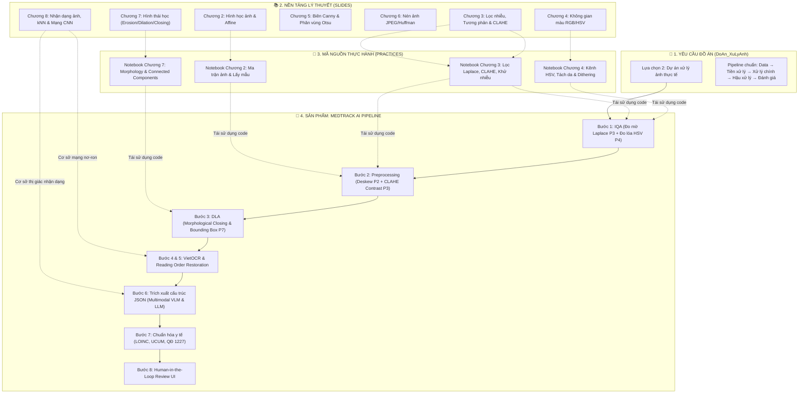
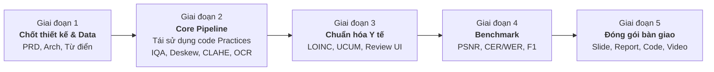

# KHO TÀI LIỆU MÔN XỬ LÝ ẢNH SỐ (DIP)

> [!NOTE]
> Trang này là **tra cứu lý thuyết**: bảng chương ↔ ứng dụng, notebook thực hành. Phạm vi đề tài, pipeline và phân công **hiện hành** nằm ở [DeTai_XuLyAnh_ChiTiet.md](DeTai_XuLyAnh_ChiTiet.md) và [team/PhanCong_TongHop.md](../../team/PhanCong_TongHop.md); các mục "Dự án MedTrack AI" và "Kế hoạch hành động" bên dưới là bản cũ, giữ lại để tham khảo.

> **Môn học:** Xử lý ảnh số (Digital Image Processing) — Khoa Trí tuệ Nhân tạo, Học viện Công nghệ Bưu chính Viễn thông  
> **Giảng viên hướng dẫn:** PGS.TS. Phạm Văn Cường  
> **Dự án thực tế:** **MedTrack AI** — Hệ thống số hóa, phân tích bố cục tài liệu và quản lý hồ sơ y tế gia đình  
> **Hạn chót bàn giao đồ án:** **11/11/2026** (Gửi qua email: `uyenvnb@ptit.edu.vn`)

---

> [!IMPORTANT]
> ### 📌 LƯU Ý VỀ HÌNH ẢNH MINH HỌA TRONG CÁC FILE MARKDOWN (.md)
> Toàn bộ các file bài giảng và tài liệu hướng dẫn trong thư mục này đã được trích xuất nội dung văn bản sang định dạng Markdown (`.md`) để thuận tiện tra cứu, lập trình và đưa vào ngữ cảnh xử lý AI.  
> **Tuy nhiên, các hình ảnh đồ họa, biểu đồ quang phổ, ma trận toán học trực quan và sơ đồ minh họa gốc chưa được nhúng trực tiếp vào file markdown.**  
> 👉 Khi cần quan sát hình ảnh chi tiết, sơ đồ giải thuật hoặc ảnh ví dụ trực quan, bạn hãy mở file **PDF gốc** tương ứng theo các đường dẫn được đính kèm ở từng mục bên dưới.

---

## 🗺️ BẢN ĐỒ LIÊN KẾT TRI THỨC (LOGICAL KNOWLEDGE MAP)

Hệ thống kết nối 3 trụ cột vững chắc: **Yêu cầu & Lý thuyết** $\leftrightarrow$ **Kho thực hành mã nguồn mẫu** $\leftrightarrow$ **Kiến trúc sản phẩm thực tế**:

---

## 1. YÊU CẦU ĐỒ ÁN MÔN HỌC & ĐỀ TÀI CHÍNH THỨC

* 📑 **Bản thuyết minh Đề tài môn Xử lý ảnh (DIP):** [DeTai_XuLyAnh_ChiTiet.md](DeTai_XuLyAnh_ChiTiet.md)
* 🤖 **Bản kế hoạch BTL môn Học máy (Machine Learning):** [ml/docs/KeHoach_BTL_MachineLearning.md](../../ml/docs/KeHoach_BTL_MachineLearning.md) *(Yêu cầu: [ml/references/requirements/require.md](../../ml/references/requirements/require.md))*
* 📄 **File Markdown quy định chung của môn học:** [DoAn_XuLyAnh.md](../references/requirements/DoAn_XuLyAnh.md)
* 📕 **File PDF gốc quy định đồ án:** [DoAn_XuLyAnh.pdf](../references/requirements/DoAn_XuLyAnh.pdf)
* **Thông tin mấu chốt:**
  * **Tên đề tài đã chốt:** *Nghiên cứu & Xây dựng Pipeline Tiền xử lý, Phân loại biểu mẫu và Bóc tách cấu trúc tài liệu y tế từ ảnh chụp thực tế*.
  * **Hình thức:** Nhóm 4–5 sinh viên (nhóm đã phân công 4 thành viên: Hiếu, Trường, Khang, Thắng).
  * **Định hướng lựa chọn:** **Lựa chọn 2 – Dự án xử lý ảnh thực tế** (xây dựng pipeline nhiều bước có đối chứng và đánh giá định lượng).
  * **Yêu cầu gói sản phẩm nộp (File `.zip` gửi về `uyenvnb@ptit.edu.vn`):**
    1. Slide thuyết trình (10–15 slide, file `.pptx` và `.pdf`).
    2. Mã nguồn chương trình (Thư mục `code/`, `requirements.txt`, 5–10 ảnh test trong `samples/`).
    3. Tài liệu hướng dẫn `README.md`.
    4. Báo cáo đồ án khoa học (4–10 trang PDF chuẩn format).
    5. Video demo chương trình chạy thực tế (tối đa 3 phút).

---

## 2. CHỈ MỤC BÀI GIẢNG LÝ THUYẾT & ÁNH XẠ DỰ ÁN

Bảng đối chiếu giữa lý thuyết bài giảng và các module triển khai thực tế trong hệ thống MedTrack AI:

| Chương | Tên chương & Nội dung cốt lõi | File Markdown | File PDF gốc (Xem chi tiết ảnh) | Ứng dụng cụ thể trong MedTrack AI |
| :---: | :--- | :---: | :---: | :--- |
| **01** | **Nhập môn Xử lý ảnh số** • Khái niệm, lịch sử, các bước cơ bản trong hệ thống XLA tổng quát. | [1_XLA1_Gioi thieu.md](../references/lectures/1_XLA1_Gioi%20thieu.md) | [1_XLA1_Gioi thieu.pdf](../references/lectures/1_XLA1_Gioi%20thieu.pdf) | Thiết kế kiến trúc tổng thể toàn bộ pipeline xử lý ảnh y tế. |
| **02** | **Cơ bản về Xử lý ảnh** • Lấy mẫu, lượng tử hóa, biểu diễn ảnh, ma trận ảnh, các phép biến đổi hình học (Affine, xoay, phép nội suy). | [2_XLA2_Co ban ve XLA.md](../references/lectures/2_XLA2_Co%20ban%20ve%20XLA.md) | [2_XLA2_Co ban ve XLA.pdf](../references/lectures/2_XLA2_Co%20ban%20ve%20XLA.pdf) | **Bước 2 (Deskew):** Tự động phát hiện góc nghiêng và xoay thẳng ảnh tài liệu $0^\circ$, căn chỉnh góc phối cảnh. |
| **03** | **Nâng cao chất lượng ảnh** • Biến đổi độ sáng, cân bằng Histogram, CLAHE, lọc không gian (Gauss, Median, Laplace). | [3_XLA3_Nang cao chat luong anh.md](../references/lectures/3_XLA3_Nang%20cao%20chat%20luong%20anh.md) | [3_XLA3_Nang cao chat luong anh.pdf](../references/lectures/3_XLA3_Nang%20cao%20chat%20luong%20anh.pdf) | **Bước 1 & 2:** Đo độ mờ bằng phương sai toán tử Laplace; lọc nhiễu quang học; tăng cường tương phản nét chữ bằng CLAHE. |
| **04** | **Các hệ màu & Kỹ thuật in ấn** • Mô hình màu RGB, CMYK, HSI, Lab, YCbCr; xử lý ảnh màu giả; đặc tính mực in văn bản. | [4_XLA4_ Cac he mau va ky thuat in anh.md](../references/lectures/4_XLA4_%20Cac%20he%20mau%20va%20ky%20thuat%20in%20anh.md) | [4_XLA4_ Cac he mau va ky thuat in anh.pdf](../references/lectures/4_XLA4_%20Cac%20he%20mau%20va%20ky%20thuat%20in%20anh.pdf) | **Bước 1 (Glare check):** Tách kênh độ sáng L/V để phát hiện lóa sáng camera, chuẩn hóa màu nền giấy xét nghiệm. |
| **05** | **Phát hiện biên & Phân vùng ảnh** • Gradient, Sobel, Prewitt, Canny; ngưỡng hóa toàn cục/cục bộ Otsu; phân đoạn vùng. | [5_XLA5_Phat hien bien.md](../references/lectures/5_XLA5_Phat%20hien%20bien.md) | [5_XLA5_Phat hien bien.pdf](../references/lectures/5_XLA5_Phat%20hien%20bien.pdf) | **Bước 3 (DLA):** Nhị phân hóa thích nghi (Adaptive Threshold) và phát hiện các đường kẻ phân tách bảng kết quả xét nghiệm. |
| **06** | **Nén ảnh** • Nén không mất tin (Huffman, RLE, LZW), nén mất tin (DCT, chuẩn JPEG, lượng tử hóa). | [6_XLA6_Nen anh.md](../references/lectures/6_XLA6_Nen%20anh.md) | [6_XLA6_Nen anh.pdf](../references/lectures/6_XLA6_Nen%20anh.pdf) | Tối ưu hóa lưu trữ ảnh y tế trên S3/MinIO và nén ảnh truyền tải giữa Mobile App và FastAPI Backend. |
| **07** | **Xử lý hình thái học** • Phép co (Erosion), giãn (Dilation), mở (Opening), đóng (Closing), Hit-or-Miss, trích xuất khung xương. | [7_XLA7_Xu ly hinh thai.md](../references/lectures/7_XLA7_Xu%20ly%20hinh%20thai.md) | [7_XLA7_Xu ly hinh thai.pdf](../references/lectures/7_XLA7_Xu%20ly%20hinh%20thai.pdf) | **Bước 3 (DLA cốt lõi):** Dùng toán tử Closing ngang dọc với Structuring Element hình chữ nhật để nhóm ký tự thành dòng và ô bảng. |
| **08** | **Nhận dạng ảnh (Pattern Recognition)** • Trích chọn đặc trưng (màu, kết cấu, hình dạng); Phân cụm & phân loại (K-means, Mean-Shift, kNN, BoVW); Mạng nơ-ron (Hopfield, Kohonen, hướng tới CNN). | [8_XLA8_NhanDangAnh.md](../references/lectures/8_XLA8_NhanDangAnh.md) | [8_XLA8_NhanDangAnh.pdf](../references/lectures/8_XLA8_NhanDangAnh.pdf) | **Bước 4 & Bước 6:** Cơ sở lý thuyết cho nhận dạng ký tự tiếng Việt (VietOCR kiến trúc CNN-Transformer) và phân loại ngữ nghĩa tài liệu (đơn thuốc vs phiếu xét nghiệm) bằng Multimodal Vision-LLM. |

---

## 3. BÀI TẬP THỰC HÀNH & KHO MÃ NGUỒN MẪU (PRACTICES HUB)

* 📘 **Tài liệu tổng quan bài thực hành:** [practices/README.md](../references/practices/README.md)
* Toàn bộ mã nguồn thực nghiệm viết bằng Python (`OpenCV`, `NumPy`, `Matplotlib`) đã chạy thành công trên các bộ ảnh mẫu thực tế:

| Phân hệ thực hành | Notebook nghiệm thu | Thuật toán đã kiểm chứng | Khả năng tái sử dụng vào Pipeline MedTrack AI |
| :--- | :--- | :--- | :--- |
| **Chương 1** | [`B23DCVT218_DaoVanKhang_Chuong1.ipynb`](../references/practices/Chuong_1/B23DCVT218_DaoVanKhang_Chuong1.ipynb) | Thao tác ma trận ảnh, chuyển đổi BGR $\leftrightarrow$ RGB, lọc nhiễu và phân ngưỡng sơ bộ. | Tái sử dụng module nạp ảnh an toàn, hiển thị lưới so sánh trước/sau xử lý. |
| **Chương 2** | [`B23DCVT218_DaoVanKhang_Chuong2.ipynb`](../references/practices/Chuong_2/B23DCVT218_DaoVanKhang_Chuong2.ipynb) | Lấy mẫu không gian, lượng tử hóa mức xám, tự code giải thuật Histogram thủ công. | Nền tảng toán học ma trận cho thuật toán xoay nắn ảnh (Deskew) và chuẩn hóa kích thước ảnh. |
| **Chương 3** | [`B23DCVT218_DaoVanKhang_Chuong3.ipynb`](../references/practices/Chuong_3/B23DCVT218_DaoVanKhang_Chuong3.ipynb) | **CLAHE**, biến đổi Gamma/Log, lọc sắc nét Laplacian, lọc trung vị khử nhiễu muối tiêu. | **Trực tiếp đưa vào Bước 1 & Bước 2:** Thuật toán tính phương sai Laplacian đo độ mờ và hàm CLAHE tăng tương phản nét chữ. |
| **Chương 4** | [`B23DCVT218_DaoVanKhang_Chuong4.ipynb`](../references/practices/Chuong_4/B23DCVT218_DaoVanKhang_Chuong4.ipynb) | Phân tích không gian màu **HSV**, khảo sát độ bền ánh sáng (kênh V), phân ngưỡng phát hiện màu, dithering. | **Trực tiếp đưa vào Bước 1:** Phát hiện vùng lóa sáng flash camera (Glare detection) trên kênh V. |
| **Chương 7** | [`B23DCVT218_DaoVanKhang_Chuong7.ipynb`](../references/practices/Chuong_7/B23DCVT218_DaoVanKhang_Chuong7.ipynb) | Phép Co (Erosion), Giãn (Dilation), **Phép Đóng (Closing)**, Tách biên, **Thành phần liên thông (Connected Components)**. | **Trực tiếp đưa vào Bước 3 (DLA):** Gom cụm các ký tự thành dòng chữ bằng SE ngang và bóc tách ô bảng kết quả xét nghiệm. |

---

## 4. DỰ ÁN MEDTRACK AI (THEO CHUẨN QUY TRÌNH PDLC)

Dự án được tài liệu hóa bài bản theo 8 giai đoạn của Product Development Life Cycle:

* 📘 **Tài liệu tổng quan PDLC:** [pdlc/README.md](../../pdlc/README.md)
* 🎯 **Ý tưởng & Tầm nhìn:** [01-ideation/project-overview.md](../../pdlc/01-ideation/project-overview.md) | [idea.md](../../pdlc/01-ideation/idea.md)
* 🔬 **Nghiên cứu thị trường & Pháp lý:** [02-research/feasibility-analysis.md](../../pdlc/02-research/feasibility-analysis.md) *(Tuân thủ NĐ 13/2023/NĐ-CP và NĐ 98/2021/NĐ-CP)* | [core-research.md](../../pdlc/02-research/core-research.md)
* 👥 **Yêu cầu & Phân công nhiệm vụ nhóm:** [03-requirements/task-assignment.md](../../pdlc/03-requirements/task-assignment.md) | [requirements.md](../../pdlc/03-requirements/requirements.md)
* 🏗️ **Thiết kế kỹ thuật chi tiết (Giai đoạn trọng tâm 04-Design):**
  * **Kiến trúc Pipeline OCR:** [04-design/architecture/ocr/pipeline_architecture.md](../../pdlc/04-design/architecture/ocr/pipeline_architecture.md) — Kiến trúc lai kết hợp VietOCR + Multimodal Vision-LLM (Gemini Flash / GPT).
  * **Sơ đồ luồng & Schema Pydantic v2:** [04-design/architecture/ocr/prescription_flows_and_schema.md](../../pdlc/04-design/architecture/ocr/prescription_flows_and_schema.md).
  * **Module Tiền xử lý & IQA:** [04-design/architecture/preprocessing/README.md](../../pdlc/04-design/architecture/preprocessing/README.md) — Xử lý độ mờ, độ lóa và xoay nắn ảnh.
  * **Chuẩn hóa dữ liệu y tế (Task 1):** [04-design/data/normalize-medical/Task1/](../../pdlc/04-design/data/normalize-medical/Task1) — Bao gồm từ điển ánh xạ [Anh_Xa.json](../../pdlc/04-design/data/normalize-medical/Task1/Anh_Xa.json) (~5.6 MB), phương pháp chuẩn hóa LOINC, UCUM và QĐ 1227/QĐ-BYT.
  * **Quy hoạch bộ dữ liệu:** [04-design/data/dataset/Task1 - Thu thập data và chốt dataset.md](../../pdlc/04-design/data/dataset/Task1%20-%20Thu%20thập%20data%20và%20chốt%20dataset.md) — Bộ VAIPE 2022 (đơn thuốc) và 77 mẫu phiếu xét nghiệm thực tế.
  * **Thiết kế UX/UI & Trải nghiệm:** [04-design/ux-ui/README.md](../../pdlc/04-design/ux-ui/README.md) — Luồng nhắc thuốc, biểu đồ chỉ số xét nghiệm, hồ sơ gia đình và chatbot tra cứu có dẫn nguồn.

---

## 5. KẾ HOẠCH HÀNH ĐỘNG THỰC HIỆN ĐỒ ÁN (ACTION PLAN)

Để đảm bảo hoàn thành đồ án chất lượng cao trước hạn chót **11/11/2026**, kế hoạch triển khai được phân rã thành 5 giai đoạn rõ ràng:

### Chi tiết các giai đoạn:

1. **Giai đoạn 1 — Chốt thiết kế & Bộ mẫu (Đã hoàn tất):**
   * Hoàn thiện hồ sơ thiết kế, pipeline architecture, quy ước schema JSON và bộ từ điển ánh xạ y tế.
2. **Giai đoạn 2 — Lập trình Mã nguồn Pipeline (`code/`):**
   * **Trích xuất & module hóa code từ `dip/references/practices/`:**
     * Từ `Chuong_3`: Thuật toán đo độ mờ phương sai Laplacian và thuật toán cân bằng thích nghi CLAHE.
     * Từ `Chuong_4`: Thuật toán tách kênh V (HSV) để kiểm tra độ lóa đèn flash.
     * Từ `Chuong_7`: Thuật toán biến đổi hình thái học (Morphological Closing) và Connected Components để bóc tách dòng văn bản và lưới bảng xét nghiệm.
   * Xây dựng luồng OCR và trích xuất cấu trúc với Multimodal LLM (Gemini Flash / OpenAI Vision).
3. **Giai đoạn 3 — Chuẩn hóa Y tế & Logic nghiệp vụ:**
   * Tích hợp bộ quy tắc đối soát từ điển thuốc và khoảng tham chiếu xét nghiệm (`Anh_Xa.json`).
   * Gắn cờ cảnh báo bất thường (`HIGH`, `LOW`, `NORMAL`).
4. **Giai đoạn 4 — Thử nghiệm & Benchmark thực nghiệm:**
   * Đánh giá hiệu quả tiền xử lý bằng chỉ số PSNR, SSIM.
   * Đánh giá độ chính xác trích xuất trường thông tin: Character Error Rate (CER), Word Error Rate (WER), F1-score trên từng trường (Tên thuốc, Hàm lượng, Tên chỉ số, Giá trị xét nghiệm).
5. **Giai đoạn 5 — Hoàn thiện sản phẩm bàn giao đồ án:**
   * Soạn thảo Báo cáo đồ án khoa học (4–10 trang PDF, tuân thủ cấu trúc: Bài toán $\to$ Dữ liệu $\to$ Phương pháp $\to$ Thực nghiệm $\to$ Thảo luận $\to$ Khai báo AI).
   * Thiết kế Slide thuyết trình (10–15 slide chuẩn bị cho 10 phút bảo vệ + 5 phút Q&A).
   * Quay Video demo chương trình chạy thực tế (tối đa 3 phút).
   * Đóng gói mã nguồn sạch, `requirements.txt`, thư mục `samples/` và file nén `LopXX_NhomYY_MedTrackAI.zip`.
