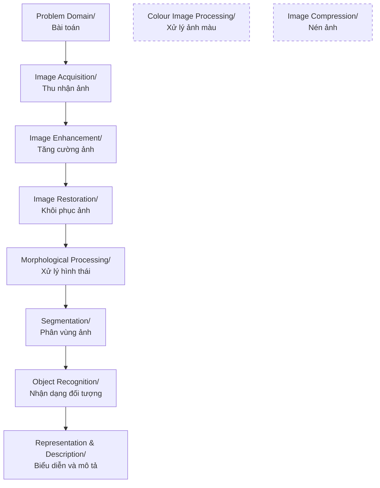

> [!NOTE]
> **Lưu ý về hình ảnh minh họa:** File markdown này được trích xuất nội dung văn bản từ tài liệu gốc. Do định dạng văn bản chưa nhúng trực tiếp toàn bộ ảnh minh họa, biểu đồ và sơ đồ thị giác, nếu cần xem chi tiết hình ảnh trực quan, vui lòng mở file PDF gốc tại: [1_XLA1_Gioi thieu.pdf](1_XLA1_Gioi thieu.pdf)
>

---

## Slide 1 — XỬ LÝ ẢNH SỐ: CHƯƠNG 1. NHẬP MÔN XỬ LÝ ẢNH

# XỬ LÝ ẢNH SỐ:
## CHƯƠNG 1. NHẬP MÔN XỬ LÝ ẢNH

---

## Slide 2 — Tài liệu tham khảo

1. “Digital Image Processing”, Rafael C. Gonzalez & Richard E. Woods, Addison-Wesley, 2002
2. Giáo trình Xử lý ảnh, PTIT, 2018

**Embedded Text in Image:**
- Digital Image Processing
- Second Edition
- ...a
- Rafael C. Gonzalez
- Richard E. Woods

---

## Slide 3 — Mục lục

- ☑ Chương 1: Nhập môn xử lý ảnh số
- ☑ Chương 2: Cơ bản về xử lý ảnh
- ☑ Chương 3: Nâng cao chất lượng ảnh
- ☑ Chương 4: Phân vùng ảnh
- ☑ Chương 5: Nén ảnh
- ☑ Chương 6: Nhận dạng ảnh

---

## Slide 4 — Trọng số các loại điểm kiểm tra

3 tín chỉ = 45 giờ
- Tham gia học tập trên lớp : 10%
- Bài tập: 10%
- Kiểm tra giữa kỳ: 10%
- Kiểm tra cuối kỳ: 70%
- Thông tin giảng viên:
  - TS. Nguyễn Tất Thắng, Khoa CNTT1
  - http://drnguyentt.com/moodle30
  - Email: nguyen.t.t.mech@gmail.com
  - SDT: 0966 969 001

---

## Slide 5 — Nội dung chương 1

- ✓ Ảnh số là gì?
- ✓ Thế nào là xử lý ảnh số?
- ✓ Lịch sử xử lý ảnh số
- ✓ Một số ứng dụng quan trọng của xử lý ảnh số
- ✓ Các bước chính trong xử lý ảnh số

---

## Slide 6 — Ảnh số là gì? (1)

- Một bức ảnh được định nghĩa là một hàm 2 chiều, $f(x,y)$ trong đó $x, y$ là tọa độ không gian (spatial coordinates), $f$ là cường độ sáng hay mức xám (gray level) của ảnh tại tọa độ đó.
- Khi $x,y$ và $f$ là những giá trị hữu hạn và rời rạc thì bức ảnh đó được gọi là ảnh số.
- Tọa độ $(x,y)$ gọi là phần tử ảnh hoặc pixel

---

## Slide 7 — Ảnh số là gì? (2)

- Giá trị pixel thông thường hiển thị mức xám, màu sắc, độ cao,....
- Chú ý rằng số hóa nhấn mạnh rằng ảnh số là xấp xỉ (gần giống) của cảnh thực.

**Embedded Text in Image:**
- 1 pixel

---

## Slide 8 — Ảnh số là gì? (3)

- Các định dạng ảnh phổ biến bao gồm:
  - 1 mẫu trên 1 điểm (B&W or Grayscale)
  - 3 mẫu trên 1 điểm (Red, Green, and Blue)
- Trong phần lớn bài học, ta sẽ tập trung vào ảnh xám (grayscale images).

---

## Slide 9 — Thế nào là xử lý ảnh số (1)

- Xử lý ảnh số là quá trình có đầu vào và đầu ra là các bức ảnh. Quá trình này có thể bao gồm: tách các thuộc tính của ảnh, tăng cường ảnh, nhận dạng ảnh,...
- Xử lý ảnh số tập trung vào 2 nhiệm vụ chính sau:
  - Cải thiện thông tin ảnh để tăng khả năng cảm nhận cho mắt người.
  - Xử lý ảnh để lưu trữ, truyền và hiển thị cho phù hợp với tri giác của máy móc.

---

## Slide 10 — Thế nào là xử lý ảnh số (2)

- Có 3 cấp độ xử lý ảnh số:

| Xử lý mức thấp | Xử lý mức trung | Xử lý mức cao |
| :--- | :--- | :--- |
| **Input:** Ảnh **Output:** Ảnh **Ví dụ:** Loại bỏ nhiễu, tăng độ tương phản, làm sắc nét ảnh | **Input:** Ảnh **Output:** Thuộc tính **Ví dụ:** Nhận dạng đối tượng, phân vùng ảnh | **Input:** Thuộc tính **Output:** Hiểu ảnh **Ví dụ:** phân tích đối tượng, hiểu cảnh, |

---

## Slide 11 — Thế nào là xử lý ảnh số (3)

- Ví dụ về xử lý ảnh mức thấp:

**Original Image With Noise**

**Image After Averaging Filter**

**Image After Median Filter**

---

## Slide 12 — Thế nào là xử lý ảnh số (4)

- Ví dụ về xử lý ảnh mức trung:

**Original Image**
- Embedded text: A, K, Q, J, 10, 01 (upside down 10)

**Thresholded Image**
- Embedded text: A, K, Q, J, 10, 01 (upside down 10)

---

## Slide 13 — Thế nào là xử lý ảnh số (5)

- Ví dụ về xử lý ảnh mức cao:

**Embedded Text in Screenshot 1:**
- Google
- Similar Images
- Search Images
- Refine your image search with visual similarity.
- Similar Images allows you to search for images using pictures rather than words. Click the "Similar images" link under an image to find other images that look like it. Try a search of your own or click on an example below.
- paris
- Similar images | Similar images | Similar images | Similar images

**Embedded Text in Screenshot 2:**
- Google
- Similar Images
- Search Images
- Showing only similar images. Back to results for
- 299 x 330 - 71k - jpg
- 174.133.132.55
- 313 x 344 - 39k
- 317 x 354 - 36k - jpg
- www.sopiews [UNREADABLE TEXT]
- Similar images
- 405 x 500 - 43k - jpg

---

## Slide 14 — Lịch sử xử lý ảnh số (1)

- Đầu những năm 1920: Một trong những ứng dụng đầu tiên của ảnh số là trong lĩnh vực công nghiệp báo giấy.
  - Dịch vụ truyền ảnh qua hệ thống cáp Bartlane
  - Ảnh được truyền bằng cáp biển giữa London và New York
  - Ảnh được mã hóa để truyền trên cáp và được khôi phục lại tại phía thu trên máy in điện tín.

**Ảnh số thời kỳ đầu**

---

## Slide 15 — Lịch sử xử lý ảnh số (2)

- Từ giữa đến cuối những năm 1920s: Những cải tiến của hệ thống Bartlane đã giúp nâng cao chất lượng ảnh.
  - Quy trình tái tạo mới dựa trên kỹ thuật chụp ảnh
  - Tăng số tone trong các bức ảnh được tái tạo lại

**Ảnh số 15 tone thời kỳ đầu**

---

## Slide 16 — Lịch sử xử lý ảnh số (3)

- Những năm 1960s: Tiến bộ trong kỹ thuật máy tính và sự khởi đầu mạnh mẽ của các cuộc đua không gian đã dẫn đến trào lưu nghiên cứu trong lĩnh vực xử lý ảnh số.
  - 1964: Máy tính được sử dụng để cải thiện chất lượng các bức ảnh về mặt trăng được chụp bởi tàu thăm dò vũ trụ Ranger 7.
  - Các kỹ thuật này cũng được sử dụng trong các nhiệm vụ không gian khác bao gồm cả quá trình hạ cánh của Apollo.

**Một bức ảnh về mặt trăng chụp bởi tàu Ranger 7 vài phút trước khi hạ cánh.**

---

## Slide 17 — Lịch sử xử lý ảnh số (4)

- Những năm 1970s: xử lý ảnh số bắt đầu được ứng dụng trong lĩnh vực y tế.
  - 1979: Sir Godfrey N. Hounsfield & Prof. Allan M. Cormack nhận giải Nobel về y tế cho phát minh chụp CT cắt lớp (Computerized Axial Tomography - CAT scans), công nghệ mở rộng từ kỹ thuật chụp X quang.

**Ảnh chụp CT cắt lớp**

---

## Slide 18 — Lịch sử xử lý ảnh số (5)

- 1980s - nay: Việc sử dụng các kỹ thuật xử lý ảnh số đã bùng nổ và được sử dụng trong nhiều công việc thuộc mọi lĩnh vực.
  - Tăng cường/khôi phục ảnh
  - Hiệu ứng mỹ thuật
  - Chuẩn đoán hình ảnh trong y tế
  - Kiểm tra công nghiệp
  - Thi hành luật
  - Giao diện người - máy

---

## Slide 19 — Một số ví dụ về ứng dụng của XLA

- Phân loại ứng dụng XLA trong các lĩnh vực theo nguồn năng lượng tạo ra ảnh

**Embedded Text in Diagram:**
- THE ELECTRO MAGNETIC SPECTRUM
- Wavelength (metres)
  - Radio: $10^{3}$
  - Microwave: $10^{-2}$
  - Infrared: $10^{-5}$
  - Visible: $10^{-6}$
  - Ultraviolet: $10^{-8}$
  - X-Ray: $10^{-10}$
  - Gamma Ray: $10^{-12}$
- Frequency (Hz)
  - $10^{4}$, $10^{8}$, $10^{12}$, $10^{15}$, $10^{16}$, $10^{18}$, $10^{20}$

---

## Slide 20 — Ví dụ: Ảnh sử dụng Gamma-Ray

- Ảnh sử dụng tia gamma được ứng dụng nhiều trong lĩnh vực y tế hạt nhân và quan sát vũ trụ.
  - a. Bone Scan
  - b. Position Emission Tomography (PET) scan showing tumors in brain and lung
  - c. Cygnus Loop: A superheated stationary gas cloud
  - d. Gamma radiation from reactor valse

**Embedded Labels in Image:**
- a
- b
- c
- d

---

## Slide 21 — Ví dụ: Ảnh sử dụng X-Ray

- Tia X được tạo ra do sự giải phóng năng lượng khi cho chùm electron di chuyển từ cathode tới anode trong ống chân không.
  - a. Ảnh chụp X quang
  - b. Ảnh angiogram của động mạch chủ
  - c. Ảnh chụp CT (Computerized axial Tomography)
  - d. Ảnh chụp các lỗi trong sản phẩm bo mạch chủ
  - e. Ảnh chụp Cygnus loop trong dải tần của tia X

**Embedded Labels in Image:**
- a
- b
- c
- d [partially cut off at edge]
- e

---

## Slide 22 — Ví dụ: Ảnh sử dụng tia cực tím

- Chụp ảnh bằng tia cực tím được ứng dụng các lĩnh vực bao gồm do thám, hiển vi, y sinh và quan sát vũ trụ
  - a. Ảnh chụp của mẫu ngô bình thường
  - b. Ảnh chụp mẫu ngô bị bệnh than (do nấm mốc gây ra)
  - c. Ảnh chụp Cygnus loop trong dải tần của tia cực tím

**Embedded Labels in Image:**
- a
- b
- c

---

## Slide 23 — Ví dụ: Hệ thống thông tin địa lý GIS (Geographic Information Systems)

- Các kỹ thuật xử lý ảnh số được sử dụng rộng rãi để chỉnh sửa các bức ảnh vệ tinh.
  - Phân loại địa hình
  - Khí tượng học

**Embedded Labels/Caption on Slide:**
- 1, 2, 3, 4, 5, 6, 7
- Images taken from Gonzalez & Woods, Digital Image Processing (2002)

---

## Slide 24 — Ví dụ: Kiểm tra công nghiệp

- Qúa trình khai thác bằng nhân công rất đắt đỏ, chậm chạp và có độ tin cậy thấp.
- Thay vào đó, người ta sử dụng máy móc để làm.
- Hệ thống quan sát công nghiệp được sử dụng trong tất cả các ngành công nghiệp.

**Caption:**
Images taken from Gonzalez & Woods, Digital Image Processing (2002)

---

## Slide 25 — Ví dụ: Thi hành luật

- Các kỹ thuật xử lý ảnh được sử dụng rộng rãi bởi các nhà thực thi pháp luật.
  - Nhận dạng biển số đối với các hệ thống thu thuế tự động hoặc bắn đo tốc độ.
  - Nhận dạng vân tay.

**Embedded Text in Image 1:**
- 강원28나8126
- 강원28 나8126
- MM PK41965
- PK 41965

**Embedded Text & Formulas in Image 2:**
- $A$
- $B = \begin{bmatrix} 1 & 1 & 1 \\ 1 & 1 & 1 \\ 1 & 1 & 1 \end{bmatrix}$
- $A \ominus B$
- $(A \ominus B) \oplus B = A \circ B$
- $(A \circ B) \oplus B$
- $[(A \circ B) \oplus B] \ominus B = (A \circ B) \bullet B$

**Caption:**
Images taken from Gonzalez & Woods, Digital Image Processing (2002)

---

## Slide 26 — Ví dụ: Y tế

- Lấy một bức ảnh chụp cộng hưởng từ MRI (Magnetic Resonance Imaging) trái tim và tìm biên giữa các loại mô.
  - Bức ảnh với các mức xám hiển thị cường độ của mô.
  - Sử dụng bộ lọc thích hợp để làm nổi rõ các đường biên.

**Bức ảnh MRI gốc chụp trái tim**

**Ảnh phát hiện biên**

**Caption:**
Images taken from Gonzalez & Woods, Digital Image Processing (2002)

---

## Slide 27 — Các giai đoạn chính trong xử lý ảnh số

**Diagram Blocks:**
- Problem Domain/ Bài toán $\rightarrow$ Image Acquisition/ Thu nhận ảnh $\rightarrow$ Image Enhancement/ Tăng cường ảnh $\rightarrow$ Image Restoration/ Khôi phục ảnh $\rightarrow$ Morphological Processing/ Xử lý hình thái $\rightarrow$ Segmentation/ Phân vùng ảnh $\rightarrow$ Object Recognition/ Nhận dạng đối tượng $\rightarrow$ Representation & Description/ Biểu diễn và mô tả
- Colour Image Processing/ Xử lý ảnh màu
- Image Compression/ Nén ảnh

---

## Slide 28 — Các giai đoạn chính trong xử lý ảnh số: Thu nhận ảnh

**Highlighted Block:**
- **Image Acquisition/ Thu nhận ảnh**

**Surrounding Diagram Blocks:**
- Problem Domain/ Bài toán $\rightarrow$ **Image Acquisition/ Thu nhận ảnh** $\rightarrow$ Image Enhancement/ Tăng cường ảnh $\rightarrow$ Image Restoration/ Khôi phục ảnh $\rightarrow$ Morphological Processing/ Xử lý hình thái $\rightarrow$ Segmentation/ Phân vùng ảnh $\rightarrow$ Object Recognition/ Nhận dạng đối tượng $\rightarrow$ Representation & Description/ Biểu diễn và mô tả
- Colour Image Processing/ Xử lý ảnh màu
- Image Compression/ Nén ảnh

**Embedded Text in Central Illustration:**
- Illumination (energy) source
- Scene element
- Imaging system
- (Internal) image plane
- Output (digitized) image

**Caption:**
Images taken from Gonzalez & Woods, Digital Image Processing (2002)

---

## Slide 29 — Các giai đoạn chính trong xử lý ảnh số: Tăng cường ảnh

**Highlighted Block:**
- **Image Enhancement/ Tăng cường ảnh**

**Surrounding Diagram Blocks:**
- Problem Domain/ Bài toán $\rightarrow$ Image Acquisition/ Thu nhận ảnh $\rightarrow$ **Image Enhancement/ Tăng cường ảnh** $\rightarrow$ Image Restoration/ Khôi phục ảnh $\rightarrow$ Morphological Processing/ Xử lý hình thái $\rightarrow$ Segmentation/ Phân vùng ảnh $\rightarrow$ Object Recognition/ Nhận dạng đối tượng $\rightarrow$ Representation & Description/ Biểu diễn và mô tả
- Colour Image Processing/ Xử lý ảnh màu
- Image Compression/ Nén ảnh

**Caption:**
Images taken from Gonzalez & Woods, Digital Image Processing (2002)

---

## Slide 30 — Các giai đoạn chính trong xử lý ảnh số: Khôi phục ảnh

**Highlighted Block:**
- **Image Restoration/ Khôi phục ảnh**

**Surrounding Diagram Blocks:**
- Problem Domain/ Bài toán $\rightarrow$ Image Acquisition/ Thu nhận ảnh $\rightarrow$ Image Enhancement/ Tăng cường ảnh $\rightarrow$ **Image Restoration/ Khôi phục ảnh** $\rightarrow$ Morphological Processing/ Xử lý hình thái $\rightarrow$ Segmentation/ Phân vùng ảnh $\rightarrow$ Object Recognition/ Nhận dạng đối tượng $\rightarrow$ Representation & Description/ Biểu diễn và mô tả
- Colour Image Processing/ Xử lý ảnh màu
- Image Compression/ Nén ảnh

**Caption:**
Images taken from Gonzalez & Woods, Digital Image Processing (2002)

---

## Slide 31 — Các giai đoạn chính trong xử lý ảnh số: Xử lý hình thái

**Highlighted Block:**
- **Morphological Processing/ Xử lý hình thái**

**Surrounding Diagram Blocks:**
- Problem Domain/ Bài toán $\rightarrow$ Image Acquisition/ Thu nhận ảnh $\rightarrow$ Image Enhancement/ Tăng cường ảnh $\rightarrow$ Image Restoration/ Khôi phục ảnh $\rightarrow$ **Morphological Processing/ Xử lý hình thái** $\rightarrow$ Segmentation/ Phân vùng ảnh $\rightarrow$ Object Recognition/ Nhận dạng đối tượng $\rightarrow$ Representation & Description/ Biểu diễn và mô tả
- Colour Image Processing/ Xử lý ảnh màu
- Image Compression/ Nén ảnh

**Embedded Text & Formulas in Central Illustration:**
- $A$
- $B = \begin{bmatrix} 1 & 1 & 1 \\ 1 & 1 & 1 \\ 1 & 1 & 1 \end{bmatrix}$
- $A \ominus B$
- $(A \ominus B) \oplus B = A \circ B$
- $(A \circ B) \oplus B$
- $[(A \circ B) \oplus B] \ominus B = (A \circ B) \bullet B$

**Caption:**
Images taken from Gonzalez & Woods, Digital Image Processing (2002)

---

## Slide 32 — Các giai đoạn chính trong xử lý ảnh số: Phân vùng ảnh

**Highlighted Block:**
- **Segmentation/ Phân vùng ảnh**

**Surrounding Diagram Blocks:**
- Problem Domain/ Bài toán $\rightarrow$ Image Acquisition/ Thu nhận ảnh $\rightarrow$ Image Enhancement/ Tăng cường ảnh $\rightarrow$ Image Restoration/ Khôi phục ảnh $\rightarrow$ Morphological Processing/ Xử lý hình thái $\rightarrow$ **Segmentation/ Phân vùng ảnh** $\rightarrow$ Object Recognition/ Nhận dạng đối tượng $\rightarrow$ Representation & Description/ Biểu diễn và mô tả
- Colour Image Processing/ Xử lý ảnh màu
- Image Compression/ Nén ảnh

**Central Illustrations:**
- 
- 

**Caption:**
Images taken from Gonzalez & Woods, Digital Image Processing (2002)

---

## Slide 33 — Các giai đoạn chính trong xử lý ảnh số: Nhận dạng đối tượng

**Highlighted Block:**
- **Object Recognition/ Nhận dạng đối tượng**

**Surrounding Diagram Blocks:**
- Problem Domain/ Bài toán $\rightarrow$ Image Acquisition/ Thu nhận ảnh $\rightarrow$ Image Enhancement/ Tăng cường ảnh $\rightarrow$ Image Restoration/ Khôi phục ảnh $\rightarrow$ Morphological Processing/ Xử lý hình thái $\rightarrow$ Segmentation/ Phân vùng ảnh $\rightarrow$ **Object Recognition/ Nhận dạng đối tượng** $\rightarrow$ Representation & Description/ Biểu diễn và mô tả
- Colour Image Processing/ Xử lý ảnh màu
- Image Compression/ Nén ảnh

**Central Chart (Scatter Plot):**
- **Y-axis:** $x_2$, Petal width (cm) [Values: $0, 0.5, 1.0, 1.5, 2.0, 2.5$]
- **X-axis:** $x_1$, Petal length (cm) [Values: $0, 1, 2, 3, 4, 5, 6, 7$]
- **Legend:**
  - $\triangle$ *Iris virginica*
  - $\square$ *Iris versicolor*
  - $\circ$ *Iris setosa*

**Caption:**
Images taken from Gonzalez & Woods, Digital Image Processing (2002)

---

## Slide 34 — Các giai đoạn chính trong xử lý ảnh số: Biểu diễn và mô tả

**Highlighted Block:**
- **Representation & Description/ Biểu diễn và mô tả**

**Surrounding Diagram Blocks:**
- Problem Domain/ Bài toán $\rightarrow$ Image Acquisition/ Thu nhận ảnh $\rightarrow$ Image Enhancement/ Tăng cường ảnh $\rightarrow$ Image Restoration/ Khôi phục ảnh $\rightarrow$ Morphological Processing/ Xử lý hình thái $\rightarrow$ Segmentation/ Phân vùng ảnh $\rightarrow$ Object Recognition/ Nhận dạng đối tượng $\rightarrow$ **Representation & Description/ Biểu diễn và mô tả**
- Colour Image Processing/ Xử lý ảnh màu
- Image Compression/ Nén ảnh

**Central Illustrations:**
- 
- 

**Caption:**
Images taken from Gonzalez & Woods, Digital Image Processing (2002)

---

## Slide 35 — Các giai đoạn chính trong xử lý ảnh số: Nén ảnh

**Highlighted Block:**
- **Image Compression/ Nén ảnh**

**Surrounding Diagram Blocks:**
- Problem Domain/ Bài toán $\rightarrow$ Image Acquisition/ Thu nhận ảnh $\rightarrow$ Image Enhancement/ Tăng cường ảnh $\rightarrow$ Image Restoration/ Khôi phục ảnh $\rightarrow$ Morphological Processing/ Xử lý hình thái $\rightarrow$ Segmentation/ Phân vùng ảnh $\rightarrow$ Object Recognition/ Nhận dạng đối tượng $\rightarrow$ Representation & Description/ Biểu diễn và mô tả
- Colour Image Processing/ Xử lý ảnh màu
- **Image Compression/ Nén ảnh**

**Central Screenshot (WinZip):**
- **Window Title:** WinZip (Evaluation Version) - impresarioapi.zip
- **Menu Bar:** File | Actions | View | Jobs | Options | Help
- **Toolbar:** New | Open | Favorites | Add | Extract | Encrypt | View

| Name | Type | Modified | Size | Ratio | Packed |
| :--- | :--- | :--- | :--- | :--- | :--- |
| blackboard.png | PNG Image | 21/09/2005 09:22 | 12,542 | 1% | 12,40[cut off] |
| error.png | PNG Image | 07/04/2005 10:56 | 282 | 13% | 24[cut off] |
| info.png | PNG Image | 07/04/2005 10:35 | 293 | 12% | 25[cut off] |
| macro.png | PNG Image | 01/04/2005 13:16 | 5,153 | 0% | 5,15[cut off] |
| start.png | PNG Image | 07/04/2005 10:36 | 256 | 14% | 22[cut off] |
| stop.png | PNG Image | 07/04/2005 10:36 | 255 | 15% | 21[cut off] |
| valid-xhtml10.png | PNG Image | 30/03/2005 13:29 | 2,580 | 13% | 2,24[cut off] |
| warning.png | PNG Image | 07/04/2005 10:35 | 296 | 12% | 26[cut off] |
| impresario.css | Cascading S... | 22/04/2005 16:06 | 4,780 | 76% | 1,16[cut off] |
| index.html | HTML File | 21/09/2005 08:16 | 5,233 | 68% | 1,69[cut off] |
| macroadvanced.... | HTML File | 21/09/2005 09:08 | 3,242 | 64% | 1,15[cut off] |
| macroblackboar... | HTML File | 21/09/2005 13:34 | 11,029 | 71% | 3,20[cut off] |
| macrocreate.html | HTML File | 21/09/2005 08:16 | 5,664 | 70% | 1,70[cut off] |
| macrogui.html | HTML File | 21/09/2005 15:45 | 4,912 | 63% | 1,83[cut off] |
| macroinformatio... | HTML File | 21/09/2005 08:16 | 4,537 | 69% | 1,40[cut off] |
| macroinput.html | HTML File | 21/09/2005 08:16 | 7,156 | 69% | 2,25[cut off] |

- **Status Bar:** Selected 0 files, 0 bytes | Total 1323 files, 348,884KB

---

## Slide 36 — Các giai đoạn chính trong xử lý ảnh số: Xử lý ảnh màu

**Highlighted Block:**
- **Colour Image Processing/ Xử lý ảnh màu**

**Surrounding Diagram Blocks:**
- Problem Domain/ Bài toán $\rightarrow$ Image Acquisition/ Thu nhận ảnh $\rightarrow$ Image Enhancement/ Tăng cường ảnh $\rightarrow$ Image Restoration/ Khôi phục ảnh $\rightarrow$ Morphological Processing/ Xử lý hình thái $\rightarrow$ Segmentation/ Phân vùng ảnh $\rightarrow$ Object Recognition/ Nhận dạng đối tượng $\rightarrow$ Representation & Description/ Biểu diễn và mô tả
- **Colour Image Processing/ Xử lý ảnh màu**
- Image Compression/ Nén ảnh

**Central Illustrations:**
- 
- 

---

## Slide 37 — Kết luận

- Trong bài này chúng ta đã tìm hiểu:
  - Ảnh số là gì?
  - Thế nào là xử lý ảnh số?
  - Lịch sử của xử lý ảnh số
  - Các ứng dụng tiêu biểu của xử lý ảnh số
  - Các giai đoạn chính trong xử lý ảnh số
- Trong phần tiếp theo, chúng ta sẽ tìm hiểu chúng làm việc như thế nào...