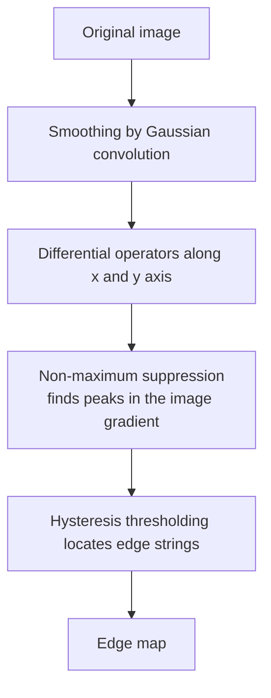

> [!NOTE]
> **Lưu ý về hình ảnh minh họa:** File markdown này được trích xuất nội dung văn bản từ tài liệu gốc. Do định dạng văn bản chưa nhúng trực tiếp toàn bộ ảnh minh họa, biểu đồ và sơ đồ thị giác, nếu cần xem chi tiết hình ảnh trực quan, vui lòng mở file PDF gốc tại: [5_XLA5_Phat hien bien.pdf](5_XLA5_Phat hien bien.pdf)
>

---

Slide 1 — CHƯƠNG 5. PHÁT HIỆN BIÊN (EDGE DETECTION)

1

# CHƯƠNG 5. PHÁT HIỆN BIÊN
## (EDGE DETECTION)

Slide 2 — NỘI DUNG

2

# NỘI DUNG

- Giới thiệu
- Các loại biên
- Các bước trong quá trình phát hiện biên
- Các phương pháp phát hiện biên
  - Phương pháp sử dụng đạo hàm bậc 1
  - Phương pháp sử dụng đạo hàm bậc 2
  - Phương pháp phát hiện biên tối ưu: Phương pháp Canny

Slide 3 — GIỚI THIỆU

3

# GIỚI THIỆU

- **Biên là gì?**  
  Biên là các thay đổi đáng kể của cường độ xám trong một bức ảnh.

- **Mục tiêu của phát hiện biên:**  
  Xác định các vùng có độ tương phản cường độ mạnh hay nói cách khác tạo ra một bản phác thảo ("drawing") của cảnh từ bức ảnh chứa cảnh đó.

- **Phát hiện biên để làm gì?**  
  Để trích xuất thông tin từ bức ảnh, ví dụ: vị trí của các đối tượng trong bức ảnh, hình dạng và kích thước của chúng, làm sắc nét ảnh, tăng cường ảnh, phục vụ cho quá trình nhận dạng ảnh.

Slide 4 — VÍ DỤ

4

# VÍ DỤ

Slide 5 — CÁC LOẠI BIÊN

5

# CÁC LOẠI BIÊN

- Tùy thuộc vào sự thay đổi cường độ sáng/ mức xám mà ta có các loại biên khác nhau:
  - Biên kiểu bước nhảy (step edge)
  - Biên thoai thoải (ramp edge)
  - Biên kiểu mái nhà (roof edge)

Slide 6 — Step edge và ramp edge, roof edge

6

# Step edge và ramp edge, roof edge

- **Step edge (ideal edge):** Cường độ sáng thay đổi một cách đột ngột.
- **Ramp edge:** Cường độ sáng không thay đổi ngay lập tức mà xảy ra trên một khoảng cách nhất định.
- **Roof edge:** Thường là mô hình đường thẳng chạy qua một vùng với độ rộng của mái nhà tùy thuộc vào độ dày và độ sắc nét của đường thẳng.

- A. Step edge
- B. Ramp edge
- C. Roof edge

Slide 7 — BIÊN VÀ ĐẠO HÀM

7

# BIÊN VÀ ĐẠO HÀM

- Như đã thảo luận ở phần trước, trung bình cục bộ thường làm mịn ảnh.
- Cách tính trung bình giống như tích phân vì vậy để xác định các thay đổi cục bộ, đột ngột của cường độ ta có thể sử dụng đạo hàm.
- Vì lý do này, đạo hàm bậc 1 và đạo hàm bậc 2 là giải pháp hoàn hảo để phát hiện biên.

Slide 8 — YÊU CẦU KHI XẤP XỈ ĐẠO HÀM BẬC 1

8

# YÊU CẦU KHI XẤP XỈ ĐẠO HÀM BẬC 1

1. Phải bằng 0 tại các vùng có cường độ sáng không đổi.
2. Phải khác 0 tại điểm bắt đầu của cường độ có thay đổi bước nhảy hoặc thoai thoải (step và ramp).
3. Phải khác 0 tại các điểm dọc theo dốc thoai thoải (ramp).

Slide 9 — YÊU CẦU KHI XẤP XỈ ĐẠO HÀM BẬC 2

9

# YÊU CẦU KHI XẤP XỈ ĐAO HÀM BẬC 2

1. Phải bằng 0 tại các vùng có cường độ sáng không đổi.
2. Phải khác 0 tại điểm bắt đầu và kết thúc của cường độ thay đổi kiểu bước nhảy hoặc thoai thoải.
3. Phải bằng 0 dọc theo các điểm nằm trên đường dốc thoai thoải.

Slide 10 — Ảnh hưởng của nhiễu đến đạo hàm

10

# Ảnh hưởng của nhiễu đến đạo hàm

| | grayscale | $1^{st}\text{ derivative}$ | $2^{nd}\text{ derivative}$ |
|---|---|---|---|
| (a) | | | |
| (b) | | | |
| (c) | | | |
| (d) | | | |

**FIGURE 10.7** First column: images and gray-level profiles of a ramp edge corrupted by random Gaussian noise of mean 0 and $\sigma=0.0, 0.1, 1.0,$ and $10.0,$ respectively. Second column: first-derivative images and gray-level profiles. Third column: second-derivative images and gray-level profiles.

Slide 11 — Ba bước cơ bản để phát hiện biên

11

# Ba bước cơ bản để phát hiện biên

1. **Làm mịn ảnh để giảm nhiễu.**
2. **Phát hiện điểm biên:** Đây là quá trình trích xuất từ ảnh tất cả các điểm ảnh là ứng cử viên tiềm năng của điểm biên.
3. **Định vị biên:** Mục đích của quá trình này là lựa chọn từ các điểm biên ứng cử viên ở bước 2 các điểm là điểm biên thực sự để tạo thành biên.

Slide 12 — Các phương pháp phát hiện biên

12

# Các phương pháp phát hiện biên

- **Đạo hàm bậc 1 / Phương pháp Gradient**
  - Toán tử Roberts
  - Toán tử Sobel
  - Toán tử Prewitt
- **Đạo hàm bậc 2**
  - Laplacian
  - Laplacian of Gaussian
  - Difference of Gaussian
- **Phát hiện biên tối ưu**
  - Phương pháp Canny

Slide 13 — Phát hiện biên sử dụng đạo hàm bậc 1

13

# Phát hiện biên sử dụng đạo hàm bậc 1

- Toán tử Roberts
- Toán tử Sobel
- Toán tử Prewitt

Slide 14 — TÍNH CHẤT CỦA GRADIENT

14

# TÍNH CHẤT CỦA GRADIENT

Gradient của ảnh $f(x,y)$ tại vị trí $(x,y)$ được xác định như sau:

$$\nabla f(x,y) = G[f(x,y)] = \begin{bmatrix} G_x \\ G_y \end{bmatrix} = \begin{bmatrix} \frac{\partial f}{\partial x} \\ \frac{\partial f}{\partial y} \end{bmatrix}$$

Một số tính chất của vector gradient:
- Chỉ ra hướng của tốc độ thay đổi cực đại của ảnh tại vị trí $(x,y)$.
- **Độ lớn:**

$$|G| = \sqrt{G_x^2 + G_y^2} \approx |G_x| + |G_y|$$

- **Góc:**

$$\theta = \tan^{-1}\left(\frac{G_y}{G_x}\right)$$

Slide 15 — Độ lớn và hướng tại một điểm ảnh

15

# Độ lớn và hướng tại một điểm ảnh

- Giả sử cửa sổ kích thước $3\times3$, đạo hàm bậc 1 theo x được tính bằng cách trừ pixel hàng dưới cùng cho hàng trên cùng. Đạo hàm bậc 1 theo y được tính bằng cách trừ pixel hàng bên phải cho hàng ngoài cùng bên trái.
- Pixel màu xám có giá trị 0, pixel màu trắng có giá trị 1.

$$G[f(x,y)] = \begin{bmatrix} G_x \\ G_y \end{bmatrix} = \begin{bmatrix} -2 \\ 2 \end{bmatrix}$$

$$|G| = 2\sqrt{2}$$

$$\theta = \tan^{-1}\left(\frac{G_y}{G_x}\right) = -45^\circ$$

Slide 16 — XẤP XỈ GRADIENT- MẶT NẠ 1D

16

# XẤP XỈ GRADIENT- MẶT NẠ 1D

- Với cách xấp xỉ:

$$\frac{\partial f(x,y)}{\partial x} = f(x+1,y) - f(x,y)$$

$$\frac{\partial f(x,y)}{\partial y} = f(x,y+1) - f(x,y)$$

- Ta có thể thực hiện $\frac{\partial f}{\partial x}$ và $\frac{\partial f}{\partial y}$ sử dụng mặt nạ 1D:

$$\frac{\partial f}{\partial x}: \quad \begin{bmatrix} -1 \\ 1 \end{bmatrix}$$

$$\frac{\partial f}{\partial y}: \quad \begin{bmatrix} -1 & 1 \end{bmatrix}$$

Slide 17 — XẤP XỈ GRADIENT- TOÁN TỬ ROBERTS

17

# XẤP XỈ GRADIENT- TOÁN TỬ ROBERTS

- Một cách xấp xỉ gradient khác theo công thức:

$$\frac{\partial f}{\partial x}(x,y) = f(x,y) - f(x+1,y+1)$$

$$\frac{\partial f}{\partial y}(x,y) = f(x+1,y) - f(x,y+1)$$

- Khi đó $\frac{\partial f}{\partial x}$ và $\frac{\partial f}{\partial y}$ có thể được thực hiện bằng mặt nạ sau (toán tử Roberts):

$$\begin{bmatrix} -1 & 0 \\ 0 & 1 \end{bmatrix} \qquad \begin{bmatrix} 0 & -1 \\ 1 & 0 \end{bmatrix}$$

Slide 18 — MỘT CÁCH XẤP XỈ GRADIENT KHÁC

18

# MỘT CÁCH XẤP XỈ GRADIENT KHÁC

- Xét cửa sổ quanh pixel $(i, j)$:

$3\times3$ neighborhood:

$$\begin{matrix} a_0 & a_1 & a_2 \\ a_7 & [i,j] & a_3 \\ a_6 & a_5 & a_4 \end{matrix}$$

- Các đạo hàm thành phần có thể tính như sau:

$$M_x = (a_2 + ca_3 + a_4) - (a_0 + ca_7 + a_6)$$

$$M_y = (a_6 + ca_5 + a_4) - (a_0 + ca_1 + a_2)$$

- Hằng số $c$ nhấn mạnh rằng các pixel đó gần tâm cửa sổ.

Slide 19 — Toán tử Prewitt và toán tử Sobel

19

# Toán tử Prewitt và toán tử Sobel

- **Toán tử Prewitt ($c=1$):**

$$M_x = \begin{bmatrix} -1 & 0 & 1 \\ -1 & 0 & 1 \\ -1 & 0 & 1 \end{bmatrix} \qquad M_y = \begin{bmatrix} -1 & -1 & -1 \\ 0 & 0 & 0 \\ 1 & 1 & 1 \end{bmatrix}$$

- **Toán tử Sobel ($c=2$):**

$$M_x = \begin{bmatrix} -1 & 0 & 1 \\ -2 & 0 & 2 \\ -1 & 0 & 1 \end{bmatrix} \qquad M_y = \begin{bmatrix} -1 & -2 & -1 \\ 0 & 0 & 0 \\ 1 & 2 & 1 \end{bmatrix}$$

Slide 20 — Các bước phát hiện biên sử dụng gradient

20

# Các bước phát hiện biên sử dụng gradient

(1) Smooth the input image  
$$(\hat{f}(x,y) = f(x,y) * G(x,y))$$

(2) $$\hat{f}_x = \hat{f}(x,y) * M_x(x,y) = \frac{\partial f}{\partial x}$$

(3) $$\hat{f}_y = \hat{f}(x,y) * M_y(x,y) = \frac{\partial f}{\partial y}$$

(4) $$magn(x,y) = |\hat{f}_x| + |\hat{f}_y|$$

(5) $$dir(x,y) = \tan^{-1}(\hat{f}_y / \hat{f}_x)$$

(6) If $$magn(x,y) > T$$ then possible edge point

Slide 21 — Ví dụ (sử dụng toán tử Prewitt)

21

# Ví dụ (sử dụng toán tử Prewitt)

$$M_x = \begin{bmatrix} -1 & 0 & 1 \\ -1 & 0 & 1 \\ -1 & 0 & 1 \end{bmatrix} \qquad M_y = \begin{bmatrix} -1 & -1 & -1 \\ 0 & 0 & 0 \\ 1 & 1 & 1 \end{bmatrix}$$

Ma trận lân cận:
| | $x-1$ | $x$ | $x+1$ |
|---|---|---|---|
| **$y+1$** | 38 | 66 | 65 |
| **$y$** | 14 | 35 | 64 |
| **$y-1$** | 12 | 15 | 42 |

$$f_y = ((38-12)/2 + (66-15)/2 + (65-42)/2) / 3 = (13 + 25 + 11) / 3 = 16$$

$$f_x = ((65-38)/2 + (64-14)/2 + (42-12)/2) / 3 = (13 + 25 + 15) / 3 = 18$$

$$\theta = \tan^{-1}(16/18) = 0.727\text{ rad} = 42\text{ degrees}$$

$$|\nabla f| = (16^2 + 18^2)^{1/2} = 24$$

*Chú ý: Trong ví dụ này, $f_x$ và $f_y$ được chia cho 2 và 3 với mục đích chuẩn hóa.*

Slide 22 — Ví dụ (1)

22

# Ví dụ (1)

$$\frac{d}{dx}I$$

$$\frac{d}{dy}I$$

Slide 23 — Bộ lọc Sobel

23

# Bộ lọc Sobel

Slide 24 — Ví dụ (2)

24

# Ví dụ (2)

$$\nabla = \sqrt{\left(\frac{d}{dx}I\right)^2 + \left(\frac{d}{dy}I\right)^2}$$

$$\nabla \ge \text{Threshold} = 100$$

Slide 25 — Ảnh hưởng của giá trị ngưỡng

25

# Ảnh hưởng của giá trị ngưỡng

- Ngưỡng thấp
- threshold
- Ngưỡng cao

Slide 26 — 4.1(D) Cho ảnh I như sau:

26

# 4.1(D) Cho ảnh I như sau:

$$I = \begin{bmatrix}
2 & 2 & 2 & 2 & 2 & 2 & 2 \\
2 & 2 & 2 & 2 & 2 & 2 & 2 \\
2 & 2 & 15 & 15 & 15 & 2 & 2 \\
2 & 2 & 15 & 15 & 15 & 2 & 2 \\
2 & 2 & 15 & 15 & 15 & 2 & 2 \\
2 & 2 & 2 & 2 & 2 & 2 & 2 \\
2 & 2 & 2 & 2 & 2 & 2 & 2
\end{bmatrix}$$

a. Thực hiện nhân chập ảnh I với các ma trận $H_x$ và $H_y$ rồi cộng với nhau để được ảnh $I_1$

$$H_x = \begin{bmatrix} -1 & 0 & 1 \\ -1 & 0 & 1 \\ -1 & 0 & 1 \end{bmatrix} \quad \text{và} \quad H_y = \begin{bmatrix} -1 & -1 & -1 \\ 0 & 0 & 0 \\ 1 & 1 & 1 \end{bmatrix}$$

Slide 27 — Phát hiện biên sử dụng đạo hàm bậc 2

27

# Phát hiện biên sử dụng đạo hàm bậc 2

- Toán tử Laplacian
- Biến thể của toán tử Laplacian

Slide 28 — Toán tử Laplacian

28

# Toán tử Laplacian

$$\nabla^2 f = \frac{\partial^2 f}{\partial x^2} + \frac{\partial^2 f}{\partial y^2}$$

Trong đó đạo hàm bậc 2 theo hướng x:

$$\frac{\partial^2 f}{\partial x^2} = f(x+1,y) + f(x-1,y) - 2f(x,y)$$

Theo hướng y:

$$\frac{\partial^2 f}{\partial y^2} = f(x,y+1) + f(x,y-1) - 2f(x,y)$$

Slide 29 — Toán tử Laplacian (cont...)

29

# Toán tử Laplacian (cont...)

Toán tử Laplacian được tính bởi:

$$\nabla^2 f = [f(x+1,y) + f(x-1,y) + f(x,y+1) + f(x,y-1)] - 4f(x,y)$$

Bộ lọc Laplacian:

$$\begin{bmatrix}
0 & 1 & 0 \\
1 & -4 & 1 \\
0 & 1 & 0
\end{bmatrix}$$

Slide 30 — Toán tử Laplacian (cont...)

30

# Toán tử Laplacian (cont...)

Sử dụng bộ lọc Laplacian ta được ảnh mới trong đó biên của các đối tượng hoặc các vùng không liên tục sẽ được làm rõ

- Original Image
- Laplacian Filtered Image
- Laplacian Filtered Image Scaled for Display

Slide 31 — Toán tử Laplacian (cont...)

31

# Toán tử Laplacian (cont...)

Bản thân bộ lọc Laplacian không làm tăng cường chất lượng ảnh mà chỉ làm rõ nét các vị trí thay đổi trong ảnh.

Để tăng cường chất lượng ảnh, ta phải thực hiện công việc sau:

$$g(x,y) = f(x,y) - \nabla^2 f$$

*Laplacian Filtered Image Scaled for Display*

Slide 32 — Tăng cường ảnh bằng Laplacian

32

# Tăng cường ảnh bằng Laplacian

- Original Image  
- Laplacian Filtered Image  
- $=$ Sharpened Image  

Slide 33 — Tăng cường ảnh bằng Laplacian

33

# Tăng cường ảnh bằng Laplacian

Toàn bộ quá trình trên có thể thực hiện bằng bộ lọc như sau:

$$g(x,y) = f(x,y) - \nabla^2 f$$

$$= f(x,y) - [f(x+1,y) + f(x-1,y) + f(x,y+1) + f(x,y-1) - 4f(x,y)]$$

$$= 5f(x,y) - f(x+1,y) - f(x-1,y) - f(x,y+1) - f(x,y-1)$$

Slide 34 — Tăng cường ảnh bằng Laplacian

34

# Tăng cường ảnh bằng Laplacian

$$\begin{bmatrix}
0 & -1 & 0 \\
-1 & 5 & -1 \\
0 & -1 & 0
\end{bmatrix}$$

Slide 35 — Biến thể của bộ lọc Laplacian

35

# Biến thể của bộ lọc Laplacian

| Simple Laplacian | Variant of Laplacian | Variant of Laplacian |
|:---:|:---:|:---:|
| $\begin{bmatrix} 0 & 1 & 0 \\ 1 & -4 & 1 \\ 0 & 1 & 0 \end{bmatrix}$ | $\begin{bmatrix} 1 & 1 & 1 \\ 1 & -8 & 1 \\ 1 & 1 & 1 \end{bmatrix}$ | $\begin{bmatrix} -1 & -1 & -1 \\ -1 & 9 & -1 \\ -1 & -1 & -1 \end{bmatrix}$ |

Slide 36 — PHÁT HIỆN BIÊN TỐI ƯU PHƯƠNG PHÁP CANNY

36

# PHÁT HIỆN BIÊN TỐI ƯU
# PHƯƠNG PHÁP CANNY

Slide 37 — ĐẶC ĐIỂM CỦA PHƯƠNG PHÁP CANNY

37

# ĐẶC ĐIỂM CỦA PHƯƠNG PHÁP CANNY

- **Tỉ lệ lỗi thấp:** Tìm tất cả các biên và không gì ngoài biên. Điều đó nghĩa là biên tìm thấy phải gần nhất có thể so với biên gốc.
- **Xác định tốt vị trí biên:** Khoảng cách giữa biên tìm thấy và biên thực cần phải tối thiểu.
- **Đáp ứng điểm biên duy nhất:** Bộ phát hiện biên trả về duy nhất một điểm đối với mỗi điểm biên thực. Điều đó có nghĩa là bộ phát hiện biên không được xác định nhiều pixel biên khi chỉ có duy nhất một pixel biên tồn tại.

Slide 38 — Flow-chart of Canny Edge Detector

38

# Flow-chart of Canny Edge Detector*
### (J. Canny'1986)

Slide 39 — CÁC BƯỚC CỦA PHƯƠNG PHÁP CANNY

39

# CÁC BƯỚC CỦA PHƯƠNG PHÁP CANNY

1. **Smoothing (làm mịn):** Sử dụng bộ lọc Gaussian để giảm nhiễu cho ảnh.
2. **Gradient operator:** Tính độ lớn và hướng của gradient theo trục x và y sử dụng toán tử roberts hoặc Sobel.
3. **Non-maximum suppression:** Loại bỏ những điểm không đạt giá trị cực đại.
4. **Hysteresis thresholding:** Phân ngưỡng kép để tìm ra điểm đầu và cuối của biên

Slide 40 — Bước 1: Giảm nhiễu

40

# Bước 1: Giảm nhiễu

- Do bộ lọc Gaussian sử dụng cửa sổ lọc đơn giản nên được sử dụng để giảm nhiễu trong thuật toán Canny.
- Kích thước cửa sổ lọc càng lớn thì độ nhạy đối với nhiễu của thuật toán càng giảm.

Ví dụ một xấp xỉ của bộ lọc Gaussian:

$$B = \frac{1}{159} \begin{bmatrix}
2 & 4 & 5 & 4 & 2 \\
4 & 9 & 12 & 9 & 4 \\
5 & 12 & 15 & 12 & 5 \\
4 & 9 & 12 & 9 & 4 \\
2 & 4 & 5 & 4 & 2
\end{bmatrix} * A$$

Slide 41 — Bước 2: Tính gradient thành phần

41

# Bước 2: Tính gradient thành phần

- Sự rõ ràng của biên được phát hiện bằng cách tính gradient của ảnh.
- Có thể tính gradient sử dụng toán tử Roberts hoặc toán tử Sobel.
- Ví dụ:

$$G_x = \begin{bmatrix} -1 & 0 & +1 \\ -2 & 0 & +2 \\ -1 & 0 & +1 \end{bmatrix} \qquad G_y = \begin{bmatrix} +1 & +2 & +1 \\ 0 & 0 & 0 \\ -1 & -2 & -1 \end{bmatrix}$$

- $|G| = |G_x| + |G_y|$
- Hướng của biên:

$$\theta = \tan^{-1}\left(\frac{G_y}{G_x}\right)$$

Slide 42 — Bước 2 (tiếp)

42

# Bước 2 (tiếp)

- Khi đã biết hướng của biên, bước tiếp theo là liên hệ hướng này với một hướng có thể lần theo trong ảnh.
- Ví dụ các pixel của ảnh kích thước $5\times5$ như sau:

$$\begin{matrix}
X & X & X & X & X \\
X & X & X & X & X \\
X & X & a & X & X \\
X & X & X & X & X \\
X & X & X & X & X
\end{matrix}$$

Khi xem xét "a", chỉ có thể có 4 hướng khi mô tả các pixel lân cận - 0 độ (theo hướng nằm ngang), 45 độ (theo hướng dương của đường chéo), 90 độ (theo hướng dọc), hoặc 135 độ (theo hướng âm của đường chéo).

- Vì thế biên được định hướng vào một trong 4 hướng này tùy thuộc vào hướng của biến gần cái nào nhất.

Slide 43 — Bước 2 (tiếp)

43

# Bước 2 (tiếp)

- Nếu hướng biên rơi vào trong dải màu vàng (0 đến 22.5 & 157.5 đến 180 độ) thì được coi là 0 độ.
- Nếu hướng biên rơi vào dải màu xanh lá cây (22.5 đến 67.5 độ) được coi là 45 độ.
- Nếu hướng biên rơi vào dải màu xanh da trời (67.5 đến 112.5 độ) thì được coi là 90 độ.
- Nếu hướng biên rơi vào dải màu đỏ (112.5 đến 157.5 độ) thì được coi là 135 độ.

Slide 44 — Bước 3: Loại bỏ các giá trị không phải cực đại

44

# Bước 3: Loại bỏ các giá trị không phải cực đại

- Đây là kỹ thuật nhằm làm mảnh đường biên.
- Thực hiện tìm kiếm để xác định độ lớn gradient có phải là giá trị cực đại địa phương theo hướng gradient hay không.
- Tại mỗi pixel:
  - Hoặc là thiết lập giá trị pixel bằng 0 nếu độ lớn của nó không lớn hơn độ lớn của 2 lân cận theo hướng gradient
  - Hoặc là giữ lại pixel nếu giá trị của nó là cực đại địa phương so với 2 pixel lân cận theo hướng gradient.

Slide 45 — Ví dụ bước 3

45

# Ví dụ bước 3

- Nếu góc gradient được làm tròn thành 0 độ (nghĩa là biên theo hướng bắc- nam), điểm đó được coi là nằm trên biên nếu độ lớn gradient lớn hơn độ lớn tại các pixel theo hướng đông và tây.
- Nếu góc gradient được làm tròn thành 90 độ (nghĩa là biên theo hướng đông- tây), điểm đó được coi là nằm trên biên nếu độ lớn gradient lớn hơn độ lớn tại các pixel theo hướng nam và bắc.
- Nếu góc gradient được làm tròn thành 135 độ (nghĩa là biên theo hướng đông bắc- tây nam), điểm đó được coi là nằm trên biên nếu độ lớn gradient lớn hơn độ lớn tại các pixel theo hướng tây bắc và đông nam.
- Nếu góc gradient được làm tròn thành 45 độ (nghĩa là biên theo hướng tây bắc- đông nam), điểm đó được coi là nằm trên biên nếu độ lớn gradient lớn hơn độ lớn tại các pixel theo hướng đông bắc và tây nam.

Slide 46 — Ví dụ (bước 3)

46

# Ví dụ (bước 3)

- Ví dụ minh hoạ quá trình loại bỏ các giá trị không phải cực đại.
  - Độ lớn gradient tại mỗi pixel được biểu diễn bằng màu và số, trong khi hướng của gradient được biểu diễn bằng các mũi tên.
  - Các pixel biên kết quả được đánh dấu bằng đường viền màu trắng.

Slide 47 — Bước 4: Phát hiện biên bằng phân ngưỡng kép

47

# Bước 4: Phát hiện biên bằng phân ngưỡng kép

- Sử dụng ngưỡng T để giảm số biên giả.
- Tất cả các pixel có giá trị nhỏ hơn T được thiết lập giá trị 0
- Chọn giá trị T phù hợp rất khó.
- Nếu chọn T quá thấp sẽ xuất hiện nhiều biên giả.
- Nếu chọn T quá cao sẽ làm mất một số biên thực.

**Giải pháp:** Sử dụng 2 ngưỡng T1 cao và T2 thấp (thường chọn $T_1 = 2 T_2$)

Slide 48 — Bước 4: Phát hiện biên bằng phân ngưỡng kép

48

# Bước 4: Phát hiện biên bằng phân ngưỡng kép

- Nếu pixel có giá trị lớn hơn T1 sẽ được coi là điểm biên ngay lập tức.
- Các pixel có giá trị nhỏ hơn T2 sẽ không được coi là điểm biên.
- Pixel có giá trị nằm giữa T2 và T1 sẽ được xem xét tiếp: nếu pixel này có kết nối với một trong số các điểm biên khác thì sẽ được coi là điểm biên, ngược lại sẽ không coi là điểm biên.

Slide 49 — Ví dụ về các bước của phương pháp Canny

49

# Ví dụ về các bước của phương pháp Canny

- (a) Original
- (b) Smoothed
- (c) Gradient magnitudes
- (d) Edges after non-maximum suppression
- (e) Double thresholding
- (f) Edge tracking by hysteresis
- (g) Final output

Slide 50 — So sánh Sobel, LOG và Canny (Lena)

50

## Slide 50

- original image
- LOG
- Sobel
- Canny

Slide 51 — So sánh LOG, Sobel và Canny (Toucan)

51

## Slide 51

- original image
- LOG
- Sobel
- Canny

Slide 52 — So sánh LOG, Sobel và Canny (Venice)

52

## Slide 52

- original image
- LOG
- Sobel
- Canny

Slide 53 — Bài tập nhân chập với Hz

53

## Slide 53

Cho ảnh I như sau:

$$I = \begin{bmatrix}
2 & 2 & 2 & 2 & 2 & 2 & 2 \\
2 & 2 & 2 & 2 & 2 & 2 & 2 \\
2 & 2 & 15 & 15 & 15 & 2 & 2 \\
2 & 2 & 15 & 15 & 15 & 2 & 2 \\
2 & 2 & 15 & 15 & 15 & 2 & 2 \\
2 & 2 & 2 & 2 & 2 & 2 & 2 \\
2 & 2 & 2 & 2 & 2 & 2 & 2
\end{bmatrix}$$

Thực hiện nhân chập ảnh I ở trên với $H_z$ dưới đây để được $I_2$:

$$H_z = \begin{bmatrix}
0 & -1 & 0 \\
-1 & 4 & -1 \\
0 & -1 & 0
\end{bmatrix}$$

Slide 54 — PHÂN VÙNG ẢNH

54

# PHÂN VÙNG ẢNH

Slide 55 — Khái niệm phân vùng ảnh

55

# Khái niệm phân vùng ảnh

Phân vùng ảnh là quá trình chia bức ảnh thành các vùng đồng nhất hoặc các đối tượng có cùng đặc điểm theo các tiêu chí định trước.

Các tiêu chí có thể là: cường độ, lược đồ xám, giá trị trung bình (mean), phương sai (variance),...

*Video Renderer 0001*

Slide 56 — Khái niệm phân vùng ảnh

56

# Khái niệm phân vùng ảnh

Phần lớn các thuật toán phân vùng đều dựa vào một trong hai đặc điểm cơ bản của giá trị cường độ: sự không liên tục và tính tương đồng (discontinuity and similarity).

Slide 57 — Phân vùng ảnh

57

# Phân vùng ảnh

- **Cách tiếp cận 1:** phân chia bức ảnh dựa vào sự thay đổi đột ngột của mức xám (ví dụ biên) hay còn gọi là phân vùng dựa vào biên.
  - Phát hiện biên

- **Cách tiếp cận 2:** phân chia bức ảnh thành các vùng tương tự nhau theo một tập các tiêu chí cho trước - phân vùng dựa vào miền.
  - Phân ngưỡng biên độ
  - Phân vùng theo miền đồng nhất
  - Phân vùng theo kết cấu bề mặt

Slide 58 — Phân vùng dựa vào biên và phân vùng ảnh dựa vào miền

58

# Phân vùng dựa vào biên và phân vùng ảnh dựa vào miền

Slide 59 — Ví dụ về phân vùng ảnh

59

# Ví dụ về phân vùng ảnh

*Images taken from Gonzalez & Woods, Digital Image Processing (2002)*

Slide 60 — PHÂN VÙNG ẢNH

60

# PHÂN VÙNG ẢNH

$R$ biểu diễn toàn bộ ảnh. Phân vùng ảnh là quá trình phân chia $R$ thành $n$ vùng $R_1, R_2, ..., R_n$ sao cho:

(1) $\bigcup_{i=1}^{n} R_i = R$

(2) $R_i$ là tập kết nối

(3) $R_i \cap R_j = \emptyset$

(4) $P(R_i) = \text{TRUE}, \forall i=1,2,..,n$

(5) $P(R_i \cup R_j) = \text{FALSE}$ với $R_i$ và $R_j$ kề cận nhau

Slide 61 — PHÂN VÙNG THEO NGƯỠNG BIÊN ĐỘ

61

# PHÂN VÙNG THEO NGƯỠNG BIÊN ĐỘ

- Thuật toán OTSU
- Thuật toán đẳng liệu (isodata)
- Thuật toán đối xứng nền (background symmetry)
- Thuật toán tam giác (triangle)

Slide 62 — LÀM TRƠN LƯỢC ĐỒ XÁM

62

# LÀM TRƠN LƯỢC ĐỒ XÁM

- Trong hầu hết các trường hợp, ngưỡng được chọn một cách tự động từ lược đồ xám của ảnh.
- Để loại bỏ các dao động nhỏ về độ sáng, các thuật toán thường sử dụng kỹ thuật làm trơn lược đồ xám ban đầu nhưng không dịch chuyển vị trí đỉnh bằng công thức sau:

$$h_{smooth}(b) = \frac{1}{W} \sum_{w=-(W-1)/2}^{(W-1)/2} h_{raw}(b-w)$$

- $W$ thường chọn là số lẻ (3 hoặc 5)

Slide 63 — TÁCH NGƯỠNG

63

# TÁCH NGƯỠNG

- Xét lược đồ xám của ảnh như hình bên:
- Lược đồ xám cho thấy ảnh này gồm các đối tượng sáng trên một nền tối.
- Các giá trị cường độ của pixel đối tượng và pixel nền được nhóm lại thành hai miền rõ rệt.
- **Như vậy:** Để tách các đối tượng khỏi nền ta chọn ngưỡng T sao cho nó phân tách được 2 miền này.

Slide 64 — TÁCH NGƯỠNG TOÀN CỤC CƠ BẢN

64

# TÁCH NGƯỠNG TOÀN CỤC CƠ BẢN

- **Ngưỡng là gì?**
- Bất cứ điểm $(x,y)$ nào thỏa mãn $f(x,y) > T$ được gọi là điểm đối tượng, ngược lại nó được gọi là điểm nền.

Ngưỡng đơn được cho theo công thức sau:

$$g(x,y) = \begin{cases}
1 & \text{if } f(x,y) > T \\
0 & \text{if } f(x,y) \le T
\end{cases}$$

Khi T không đổi trên toàn bộ ảnh, ta gọi đây là phân ngưỡng toàn cục (global thresholding).

Slide 65 — PHÂN NGƯỠNG TOÀN CỤC TỐI ƯU SỬ DỤNG PHƯƠNG PHÁP OTSU

65

# PHÂN NGƯỠNG TOÀN CỤC TỐI ƯU SỬ DỤNG PHƯƠNG PHÁP OTSU

- Phân ngưỡng được xem như bài toán lý thuyết quyết định theo thống kê ở đó mục tiêu là tối thiểu sai số trung bình xảy ra khi ấn định pixel vào 2 miền (nhóm).
- Giải pháp là dựa vào luật quyết định của Bayes (Bayes decision rule) và dựa trên 2 tham số: hàm mật độ xác suất (PDF: Probability density function) của các mức sáng của mỗi nhóm và xác suất xảy ra của mỗi nhóm trong các ứng dụng.
- Vấn đề là ước lượng PDF không dễ vì thế bài toán thường được đơn giản hóa bằng cách giả định về dạng của PDF, ví dụ chúng có phân bố Gaussian.
- Tuy nhiên thậm chí khi đã đơn giản hóa, quá trình thực hiện giải pháp sử dụng các giả định này cũng rất phức tạp và không phải lúc nào cũng phù hợp với các ứng dụng thực tế.

$\rightarrow$ **Sử dụng giải pháp thay thế: Phương pháp OTSU**

Slide 66 — PHÂN NGƯỠNG TOÀN CỤC TỐI ƯU SỬ DỤNG PHƯƠNG PHÁP OTSU

66

# PHÂN NGƯỠNG TOÀN CỤC TỐI ƯU SỬ DỤNG PHƯƠNG PHÁP OTSU

Phương pháp này tối ưu theo nghĩa là tối đa hóa phương sai giữa các nhóm (Between class variance).

Ý tưởng cơ bản của phương pháp là các nhóm được phân ngưỡng tốt phải khác biệt với các giá trị cường độ của các pixel của chúng. Ngược lại, ngưỡng nào cho sự phân biệt tốt nhất giữa các nhóm (theo khía cạnh giá trị cường độ) sẽ được coi là ngưỡng tối ưu.

Phương pháp này dựa hoàn toàn vào việc tính toán trên lược đồ xám của ảnh.

Slide 67 — THUẬT TOÁN OTSU

67

# THUẬT TOÁN OTSU

1. Tính lược đồ xám chuẩn hóa của ảnh đầu vào. Tính các giá trị $p_i = n_i / MN$ ($i = 0, 1, ..., L-1$).
2. Tính tổng tích lũy $P_1(k)$ với $k = 0, ..., L-1$ theo công thức:

$$P_1(k) = \sum_{i=0}^k p_i$$

3. Tính trung bình tích lũy đến mức $k$ là $m(k)$:

$$m(k) = \sum_{i=0}^k i \cdot p_i$$

4. Tính trung bình cường độ toàn cục $m_G$ (cường độ trung bình của toàn bộ ảnh):

$$m_G = \sum_{i=0}^{L-1} i \cdot p_i$$

5. Tính phương sai giữa các nhóm $\sigma_B^2(k)$:

$$\sigma_B^2(k) = \frac{[m_G P_1(k) - m(k)]^2}{P_1(k)[1 - P_1(k)]}$$

6. Ngưỡng Otsu $k^*$ là giá trị $k$ thỏa mãn điều kiện $\sigma_B^2(k)$ đạt cực đại. Nếu cực đại không duy nhất thì $k^*$ được tính là trung bình các giá trị $k$ tương ứng với các cực đại tìm thấy được.

Slide 68 — Example (no obvious valley in the histogram)

68

# Example (no obvious valley in the histogram)

- Image
- Histogram
- Basic method
- Otsu's method

Slide 69 — Ví dụ

69

# Ví dụ

- Tìm ngưỡng tự động theo phương pháp Otsu của ảnh sau:

$$I = \begin{pmatrix}
0 & 1 & 2 & 3 & 4 & 5 \\
0 & 0 & 1 & 2 & 3 & 4 \\
0 & 0 & 0 & 1 & 2 & 3 \\
0 & 0 & 0 & 0 & 1 & 2 \\
0 & 0 & 0 & 0 & 0 & 1
\end{pmatrix}$$

Slide 70 — Bài giải

70

# Bài giải

| $i$ | $p_i$ | $P_1(k)$ | $m(k)$ | $m_G$ | $\sigma_B^2(k)$ |
|:---:|:---:|:---:|:---:|:---:|:---:|
| 0 | $15/30$ | 0.5000 | 0.0000 | 1.1667 | 1.36 |
| 1 | $5/30$ | 0.6667 | 0.1667 | 1.1667 | 1.68 |
| 2 | $4/30$ | 0.8000 | 0.4333 | 1.1667 | 1.56 |
| 3 | $3/30$ | 0.9000 | 0.7333 | 1.1667 | 1.11 |
| 4 | $2/30$ | 0.9667 | 1.0000 | 1.1667 | 0.51 |
| 5 | $1/30$ | 1.0000 | 1.1667 | 1.1667 | 0.00 |

- Như vậy ngưỡng $T=1$ với $\sigma_B^2(k) = 1.68$

Slide 71 — Bài tập

71

# Bài tập

- Sử dụng thuật toán tìm ngưỡng tự động để tách ngưỡng ảnh I, được biết ảnh có 10 mức xám:

$$I = \begin{bmatrix}
1 & 4 & 1 & 1 & 2 & 3 & 2 & 3 \\
3 & 2 & 4 & 2 & 5 & 2 & 6 & 2 \\
2 & 1 & 8 & 2 & 5 & 2 & 5 & 6 \\
2 & 5 & 2 & 4 & 7 & 9 & 1 & 4 \\
2 & 2 & 3 & 0 & 0 & 1 & 2 & 1 \\
1 & 5 & 7 & 1 & 2 & 4 & 5 & 6
\end{bmatrix}$$

Slide 72 — THUẬT TOÁN ĐẲNG LIỆU (ISODATA ALGORITHM)

72

# THUẬT TOÁN ĐẲNG LIỆU
## (ISODATA ALGORITHM)

Ngưỡng toàn cục cơ bản T được tính như sau:

1. Chọn giá trị ước lượng ban đầu cho $T = t_0$ (thông thường là mức xám trung bình trong bức ảnh).
2. Phân vùng bức ảnh sử dụng $t_k$ để tạo ra 2 nhóm pixel: $G_1$ gồm các pixel với mức xám $\le t_k$ và $G_2$ gồm các pixel có mức xám $> t_k$
3. Tính mức xám trung bình của các pixel trong $G_1$ là $\mu_1(t_k)$ và trong $G_2$ là $\mu_2(t_k)$

Slide 73 — THUẬT TOÁN ĐẲNG LIỆU (ISODATA ALGORITHM)

73

# THUẬT TOÁN ĐẲNG LIỆU
## (ISODATA ALGORITHM)

4. Tính giá trị ngưỡng mới:

$$t_{k+1} = \frac{\mu_1(t_k) + \mu_2(t_k)}{2} = \frac{1}{2} \left[ \frac{\sum_{z=0}^{t_k} z \cdot p(z)}{\sum_{z=0}^{t_k} p(z)} + \frac{\sum_{z=t_k+1}^{L-1} z \cdot p(z)}{\sum_{z=t_k+1}^{L-1} p(z)} \right]$$

5. Lặp lại các bước 2 – 4 cho đến khi sự khác nhau giữa các T trong các vòng lặp liên tiếp nhỏ hơn một giá trị giới hạn định trước $\Delta T$ hay $|t_{k+1} - t_k| < \Delta T$

Thuật toán này làm việc hiệu quả trong việc tìm giá trị ngưỡng T khi ảnh có lược đồ xám thích hợp.

Slide 74 — Bài tập

74

# Bài tập

- Sử dụng thuật toán tìm ngưỡng toàn cục đơn giản (hay còn gọi là thuật toán lặp, thuật toán đẳng liệu) cho bức ảnh với lược đồ xám chuẩn hóa với ngưỡng khởi đầu $t_0 = 3$:

| $z$ | 0 | 1 | 2 | 3 | 4 | 5 |
|:---:|:---:|:---:|:---:|:---:|:---:|:---:|
| $P(z)$ | 0,5 | 0,167 | 0,133 | 0,1 | 0,067 | 0,033 |

Slide 75 — Bài giải Isodata

75

## Slide 75

| $z$ | 0 | 1 | 2 | 3 | 4 | 5 |
|:---:|:---:|:---:|:---:|:---:|:---:|:---:|
| $p(z)$ | 0.500 | 0.167 | 0.133 | 0.100 | 0.067 | 0.033 |
| $z \cdot p(z)$ | 0.000 | 0.167 | 0.267 | 0.300 | 0.267 | 0.167 |

- $t_0 = 3$
- $t_1 = 2.574$
- $t_2 = 2.104$
- $t_3 = 2.104$

Vậy ngưỡng $t = 2$

Slide 76 — THUẬT TOÁN ĐỐI XỨNG NỀN (BACKGROUND SYMMETRY ALGORITHM)

76

# THUẬT TOÁN ĐỐI XỨNG NỀN
## (BACKGROUND SYMMETRY ALGORITHM)

- Giả định trong lược đồ xám có đỉnh nằm ở phần nền và đối xứng quanh giá trị cực đại đó.
- Giá trị đỉnh ($maxp$) được xác định bằng cách tìm giá trị cực đại trong lược đồ xám.
- Thuật toán tìm kiếm phía các pixel không phải đối tượng quanh giá trị cực đại để tìm điểm $p\%$ (Điểm có giá trị mức sáng $a$ sao cho $P(a) = p\%$).

Slide 77 — VÍ DỤ

77

# VÍ DỤ

- Trong hình trước, các pixel đối tượng nằm ở bên trái của đỉnh nền (đỉnh nền nằm ở mức sáng $maxp = 183$).
- Do đó việc tìm kiếm thực hiện ở bên phải của đỉnh. Ví dụ chọn $p = 95\%$
- Điểm bên phải tương ứng với 95% mức sáng cực đại có độ sáng 216 ($p\% = 216$)
- Do giả định về tính đối xứng, ta tính được ngưỡng nằm ở bên trái của giá trị cực đại theo công thức:

$$\theta = maxp - (p\% - maxp)$$

- Ngưỡng $\theta = 183 - (216 - 183) = 150$

Slide 78 — THUẬT TOÁN TAM GIÁC (TRIANGLE ALGORITHM)

78

# THUẬT TOÁN TAM GIÁC
## (TRIANGLE ALGORITHM)

- Thuật toán này do Zack đề xuất được mô tả ở hình bên.
- Vẽ một đường thẳng $\Delta$ nối 2 điểm trên lược đồ xám (điểm cao nhất lược đồ xám có giá trị cường độ sáng $b_{max}$ và điểm có giá trị nhỏ nhất $b_{min}$, $p = 0\%$).

- Tại mỗi giá trị $b$ từ $b = b_{min}$ to $b = b_{max}$ tính khoảng cách $d$ giữa đường thẳng $\Delta$ và lược đồ xám $h[b]$.
- Giá trị $b_0$ nào cho $d$ lớn nhất sẽ được coi là ngưỡng hay $\theta = b_0$

Slide 79 — Bài tập

79

# Bài tập

- Thực hiện tìm ngưỡng tự động với thuật toán đối xứng nền cho bức ảnh I có biểu đồ tần suất sau:

| $g$ | 0 | 1 | 2 | 3 | 4 | 5 | 6 | 7 | 8 | 9 |
|:---:|:---:|:---:|:---:|:---:|:---:|:---:|:---:|:---:|:---:|:---:|
| $h(g)$ | 2 | 3 | 4 | 5 | 7 | 8 | 12 | 47 | 10 | 2 |

Được biết độ chính xác cần tính là 88%.

Slide 80 — PHÂN VÙNG DỰA VÀO MIỀN ĐỒNG NHẤT

80

# PHÂN VÙNG DỰA VÀO MIỀN ĐỒNG NHẤT

Slide 81 — GIỚI THIỆU

81

# GIỚI THIỆU

Không giống với phân vùng dựa vào biên (dựa vào sự không liên tục của cường số sáng), phân vùng dựa vào miền tìm ra các vùng một cách trực tiếp dựa trên sự tương đồng của các pixel lân cận nhau.

Một số thuật toán cơ bản:
- Phát triển vùng (region growing)
- Hợp vùng (region merge)
- Tách vùng (region split)
- Chia tách và hợp vùng (Region splitting and merging)

Slide 82 — Minh họa phân vùng phong cảnh

82

## Slide 82

Slide 83 — Phân vùng dựa vào miền

83

# Phân vùng dựa vào miền

- Thực hiện chia ảnh $R$ thành các vùng nhỏ hơn $R_1, R_2, ..., R_n$

- Giả sử $P(R_i)$ là một mệnh đề logic mà giá trị pixel trong vùng $R_i$ thỏa mãn (ví dụ, giá trị mức xám nằm trong khoảng từ 100 và 120).

Slide 84 — Phân vùng dựa vào miền

84

# Phân vùng dựa vào miền

Các vùng nhỏ phải thỏa mãn các điều kiện sau:

(1) $R_1 \cup R_2 \cup \dots \cup R_n = R$

(2) $R_i$ is connected

(3) $R_i \cap R_j = empty$

(4) $P(R_i) = \text{True}$ (P() is a predicate)

(5) $P(R_i \cup R_j) = \text{False}$

Slide 85 — Phát triển vùng

85

# Phát triển vùng

- Phát triển vùng khai thác trực tiếp vào thực tế là các pixel gần nhau thường có giá trị mức xám tương tự nhau.
- Thuật toán bắt đầu với một pixel đơn lẻ (hạt giống - seed) và dần thêm vào các pixel khác theo một tập các tiêu chuẩn đã định trước.
- **Thuật toán:**
  (1) Chọn pixel hạt giống
  (2) Kiểm tra các pixel lân cận và thêm vào vùng nếu nó tương tự pixel hạt giống.
  (3) Lặp lại bước 2 cho mỗi pixel mới thêm vào; dừng lại khi không có pixel mới nào được thêm vào.

Slide 86 — Ví dụ

86

# Ví dụ

- **Hàng trên:**
  - After few iterations
  - after 5000 iterations
  - Convergence obtained after 10119 iterations
- **Hàng dưới:**
  - After few iterations
  - after 5000 iterations
  - Convergence obtained after 10085 iterations

Slide 87 — HỢP VÙNG

87

# HỢP VÙNG

- Hợp vùng nhằm loại bỏ các biên và vùng giả bằng cách hợp nhất các vùng lân cận cùng thuộc một đối tượng.
- Cơ chế hợp nhất bắt đầu với một vùng thỏa mãn điều kiện (4) (ví dụ, các vùng được tạo ra nhờ phân ngưỡng)
- Sau đó, tiếp tục quá trình để thỏa mãn điều kiện (5) bằng cách hợp dần các vùng lân cận nhau.

(4) $P(R_i) = \text{True}$  
(5) $P(R_i \cup R_j) = \text{False}$

Slide 88 — Thuật toán hợp vùng

88

# Thuật toán hợp vùng

1. Chọn các vùng khởi tạo trong bức ảnh.
2. Xây dựng lược đồ lân cận vùng (regions adjacency graph – RAG).
3. Đối với mỗi vùng thực hiện:
   - (3.1) Xét vùng lân cận của nó và kiểm tra xem có tương tự vùng đang xét không.
   - (3.2) Nếu các vùng này tương tự nhau (có nghĩa là $P(R_i \cup R_j) = \text{TRUE}$) thì thực hiện hợp nhất chúng và cập nhật lại RAG.
4. Lặp lại bước 3 cho đến khi không có vùng nào được hợp nhất.

Slide 89 — TÁCH VÙNG

89

# TÁCH VÙNG

- Chia tách vùng là cách tiếp cận đối lập với phát triển vùng.
- Đây là cách tiếp cận top-down và bắt đầu với giả định là toàn bộ bức ảnh là đồng nhất.
- Nếu điều này không đúng, bức ảnh được chia thành 4 ảnh nhỏ.
- Quá trình chia tách này được lặp lại cho đến khi ta chia tách bức ảnh thành các vùng đồng nhất.

Slide 90 — TÁCH VÙNG

90

# TÁCH VÙNG

- Tách vùng thực hiện thêm các biên còn thiếu bằng cách chia tách các vùng chứa các phần đối tượng khác nhau.
- Cơ chế tách bắt đầu với một phần thỏa mãn điều kiện (5), ví dụ toàn bộ bức ảnh.

(5) $P(R_i \cup R_j) = \text{False}$

- Sau đó, chúng tiếp tục quá trình để thỏa mãn điều kiện (4) bằng cách chia tách dần các vùng ảnh.

(4) $P(R_i) = \text{True}$

Slide 91 — TÁCH VÙNG

91

# TÁCH VÙNG

- Giả sử ảnh gốc có kích thước $N\times N$, với $N$ là lũy thừa của 2.
- Tất cả các vùng được tạo ra từ thuật toán chia tách có kích thước $M\times M$, ở đó $M$ cũng là lũy thừa của 2.
- Bởi vì quá trình này được lặp lại, nó tạo ra cách biểu diễn có thể mô tả bằng cây ở đó mỗi node có 4 nhánh.
- Cây này được gọi là cây tứ phân (Quadtree)

Slide 92 — TÁCH VÙNG

92

# TÁCH VÙNG

- Vùng: $R0, R1, R2, R3$
- Các vùng con: $R00, R01, R02, R03$

Slide 93 — Ví dụ

93

# Ví dụ

- Initial image
- Building of the corresponding Quadtree

Slide 94 — TÁCH VÀ HỢP VÙNG

94

# TÁCH VÀ HỢP VÙNG

- Kỹ thuật tách vùng có nhược điểm là chúng tạo ra những vùng có thể cận kề và đồng nhất nhưng không được hợp nhất với nhau.
- Phương pháp tách và hợp vùng là thuật toán lặp trong đó bao gồm cả quá trình tách và hợp trong mỗi vòng lặp.

Slide 95 — TÁCH VÀ HỢP VÙNG

95

# TÁCH VÀ HỢP VÙNG

- Nếu vùng $R_i$ là không đồng nhất ($P(R_i) = \text{False}$) thì tách $R_i$ thành 4 vùng con.
- Nếu 2 vùng kề cận nhau $R_i, R_j$ là đồng nhất ($P(R_i \cup R_j) = \text{TRUE}$) thì hợp nhất chúng với nhau.
- Thuật toán dừng lại khi không thể tách hay hợp nhất.

Slide 96 — Xây dựng lược đồ lân cận

96

# Xây dựng lược đồ lân cận

- Initial image
- Design of the corresponding adjacency graph

Slide 97 — Khai thác lược đồ lân cận

97

# Khai thác lược đồ lân cận

- Initial image
- Building of the corresponding region-based segmentation

Slide 98 — Kết quả - Phát triển vùng

98

# Kết quả - Phát triển vùng

Slide 99 — Kết quả - Tách vùng

99

# Kết quả - Tách vùng

Slide 100 — Kết quả - Tách và hợp vùng

100

# Kết quả - Tách và hợp vùng

