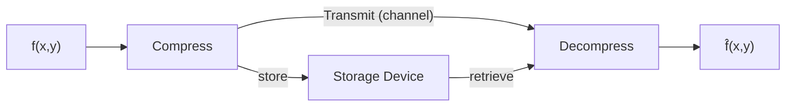
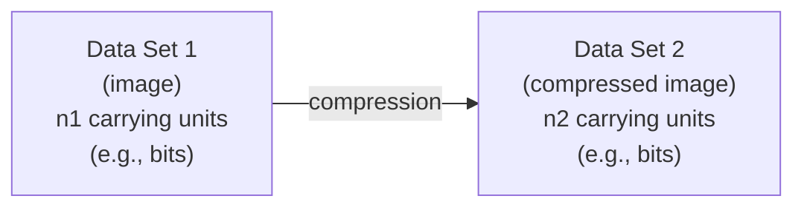
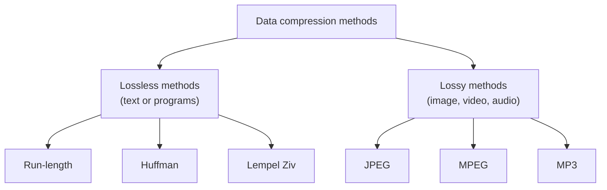
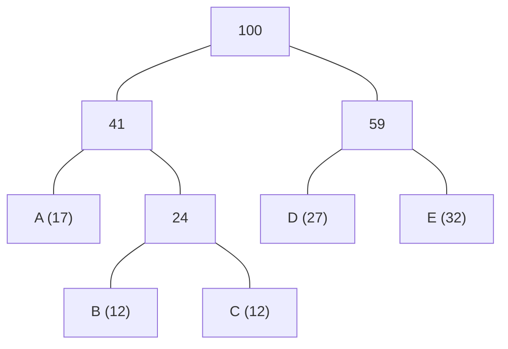
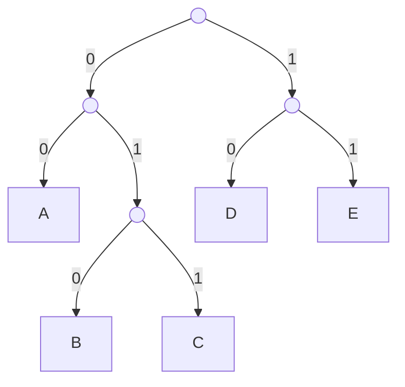
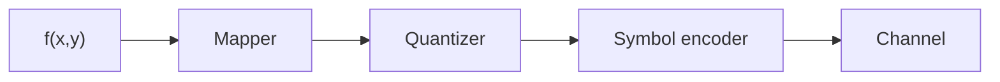
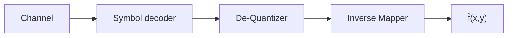
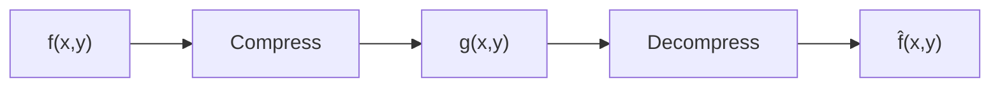
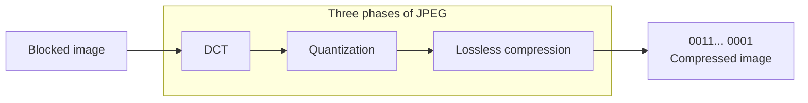

> [!NOTE]
> **Lưu ý về hình ảnh minh họa:** File markdown này được trích xuất nội dung văn bản từ tài liệu gốc. Do định dạng văn bản chưa nhúng trực tiếp toàn bộ ảnh minh họa, biểu đồ và sơ đồ thị giác, nếu cần xem chi tiết hình ảnh trực quan, vui lòng mở file PDF gốc tại: [6_XLA6_Nen anh.pdf](6_XLA6_Nen anh.pdf)
>

---

# Slide 1 — XỬ LÝ ẢNH SỐ

**XỬ LÝ ẢNH SỐ**

**Chương 6. Nén ảnh**

# Slide 2 — Nội dung

**Nội dung**

Trong phần này chúng ta sẽ tìm hiểu về các kỹ thuật được áp dụng để nén ảnh:

- Mục đích của nén ảnh
- Các kiểu dư thừa dữ liệu
- Các bước trong mô hình nén và giải nén
- Các thuật toán mã hóa và giải mã

# Slide 3 — Mục đích của nén ảnh

**Mục đích của nén ảnh**

* Ảnh số không được nén sẽ cần một lượng lớn không gian để lưu trữ và băng thông để truyền
  * Ví dụ ảnh màu kích thước $640 \times 480$ cần không gian lưu trữ lên tới 1MB.
* Mục đích của việc nén ảnh là để giảm lượng dữ liệu cần để biểu diễn ảnh. Do đó sẽ giảm không gian cần để lưu trữ và tăng được tốc độ đường truyền



# Slide 4 — Các cách tiếp cận

**Các cách tiếp cận**

- ☑ **Phương pháp nén bảo toàn thông tin**
  - Thông tin được bảo toàn
  - Tỷ lệ nén thấp (thông thường)
- ☑ **Phương pháp nén làm mất thông tin**
  - Thông tin không được bảo toàn
  - Tỷ lệ nén cao (thông thường)

**Cân nhắc:** chất lượng ảnh và tỷ lệ nén

# Slide 5 — Dữ liệu vs. thông tin

**Dữ liệu vs. thông tin**

- Dữ liệu (data) là phương tiện được dùng để truyền tải thông tin
- Nén dữ liệu là phương pháp giảm lượng dữ liệu cần để biểu diễn 1 lượng thông tin cho trước với tiêu chí giữ lại được càng nhiều thông tin càng tốt

# Slide 6 — Tỷ lệ nén

**Tỷ lệ nén**



Tỷ lệ nén:

$$C_R = \frac{n_1}{n_2}$$

# Slide 7 — Các kiểu dư thừa dữ liệu

**Các kiểu dư thừa dữ liệu**

1. Dư thừa mã hóa
2. Dư thừa không gian

# Slide 8 — Các phương pháp nén dữ liệu

**Các phương pháp nén dữ liệu**



# Slide 9 — NÉN DỮ LIỆU KHÔNG TỔN THẤT

**NÉN DỮ LIỆU KHÔNG TỔN THẤT**

- Giới thiệu
- Run-length coding (RLC)
- Huffman coding
- Lempel-Ziv

# Slide 10 — Nén dữ liệu không tổn thất

**Nén dữ liệu không tổn thất**

- Trong nén dữ liệu không tổn thất, tính toàn vẹn của dữ liệu được bảo toàn.
  - Dữ liệu gốc và dữ liệu sau khi nén và giải nén giống nhau hoàn toàn vì trong các phương pháp này, thuật toán nén và giải nén chính xác là biến đổi ngược của nhau.
  - Dữ liệu dư thừa được loại bỏ trong quá trình nén và được thêm vào trong quá trình giải nén.
  - Nén dữ liệu không tổn thất thường được sử dụng khi chúng ta không muốn mất mát thông tin.

# Slide 11 — Run-length coding (RLC)

**Run-length coding (RLC)**

- Mã hoá chiều dài chạy (RLC) là kỹ thuật mã hoá đơn giản nhất và được sử dụng rộng rãi.
- Sử dụng mã này không cần biết tần suất xuất hiện các ký tự và rất hiệu quả trong trường hợp dữ liệu được hiển thị bằng các bit 0 và 1.
- Ta thay thế một chuỗi các ký tự lặp đi lặp lại nhiều lần bằng một cặp (chiều dài chạy, ký tự).
  - Đối với ảnh, chiều dài chạy cực đại chính là kích thước của một hàng.

# Slide 12 — Ví dụ mã RLC

**Ví dụ mã RLC**

**a. Original data**
```
BBBBBBBBBAAAAAAAAAAAAAAAANMMMMMMMMMM
```

**b. Compressed data**
```
B09A16N01M10
```

# Slide 13 — Ví dụ mã RLC

**Ví dụ mã RLC**

**a. Original data**
```
0 0 0 0 0 0 0 0 0 0 0 0 0 0 1 0 0 0 0 1 1 0 0 0 0 0 0 0 0 0 0 0 0
```
- Count of 0s between 1s:
  - 14
  - 4
  - 0
  - 12

**b. Compressed data**
```
1110 0100 0000 1100
```
*(I.e. the number of 0s in between two 1s)*

# Slide 14 — Mã hóa Huffman

**Mã hóa Huffman**

*Forward Pass*

1. Sắp xếp xác suất các ký hiệu theo thứ tự
2. Gộp 2 xác suất thấp nhất
3. Lặp lại bước 2 cho đến khi tổng các xác suất bằng 1.
4. Ấn định từ mã cho ký tự bằng cách đọc đường dẫn từ gốc đến ký tự đó.

# Slide 15 — Ví dụ

**Ví dụ**

Cho tập 5 ký tự A, B, C, D, E với tần suất xuất hiện tương ứng trong bảng dưới đây. Thực hiện mã hoá Huffman cho tập ký tự này.

**Table 15.1**
*Frequency of characters*

| Character | A | B | C | D | E |
| :--- | :--- | :--- | :--- | :--- | :--- |
| **Frequency** | 17 | 12 | 12 | 27 | 32 |

# Slide 16 — Cây mã hoá Huffman

**Cây mã hoá Huffman**

```
a.
(A:17) (B:12) (C:12) (D:27) (E:32)
         \     /
          (24)

b.
(A:17)  (24)  (D:27) (E:32)
   \    /
    (41)

c.
(41)    (D:27) (E:32)
           \    /
            (59)

d.
   (41)    (59)
     \      /
       (100)
```

**e. Final Tree:**



# Slide 17 — Cây mã hoá Huffman

**Cây mã hoá Huffman**

- Đọc từ mã tương ứng với ký tự theo đường dẫn từ gốc qua các nhánh đến ký tự đó.



**Code Table:**
- **A** : 00
- **B** : 010
- **C** : 011
- **D** : 10
- **E** : 11

# Slide 18 — Mã hoá

**Mã hoá**

- Hình dưới đây mô tả quá trình mã hoá đoạn văn bản sử dụng bộ mã vừa tạo ra. Đầu vào là đoạn văn bản gốc và đầu ra là kết quả sau mã hoá.

**Text:** `EAEBAECDEA`

**Encoder:**
- A $\rightarrow$ 00
- B $\rightarrow$ 010
- C $\rightarrow$ 011
- D $\rightarrow$ 10
- E $\rightarrow$ 11

**Huffman code:** `1100110100011011101100`

# Slide 19 — Giải mã

**Giải mã**

- Phía thu thực hiện giải mã chuỗi dữ liệu nhận được như hình vẽ dưới đây:

**Huffman code:** `1100110100011011101100`

**Decoder:**
- 00 $\rightarrow$ A
- 010 $\rightarrow$ B
- 011 $\rightarrow$ C
- 10 $\rightarrow$ D
- 11 $\rightarrow$ E

**Text:** `EAEBAECDEA`

# Slide 20 — Đặc điểm của mã Huffman

**Đặc điểm của mã Huffman**

- Quá trình mã hóa các ký tự được thực hiện chỉ 1 lần.
- Mã Huffman được gọi là mã khối vì mỗi ký tự được biểu diễn bằng một từ mã cố định.
- Việc giải mã từng ký hiệu được thực hiện tức thời vì không phụ thuộc ký hiệu trước và sau.
- Nhược điểm của mã này là phải biết xác suất xuất hiện của các ký tự trước khi mã hoá.

# Slide 21 — Slide 21

**3.8(D)** Thực hiện mã hóa ảnh sau bằng thuật toán Huffman. Được biết ảnh được chia làm các khối kích thước $2 \times 2$ để làm đơn vị mã hóa (Mỗi khối này sẽ như là một chữ cái của bức ảnh).

$$I = \begin{bmatrix} 1 & 1 & 1 & 0 & 1 & 1 & 1 & 1 & 1 & 1 & 0 & 1 & 1 & 1 & 1 & 1 & 0 & 0 & 1 & 1 \\ 1 & 1 & 0 & 1 & 1 & 1 & 1 & 1 & 1 & 0 & 1 & 0 & 1 & 1 & 1 & 1 & 0 & 1 & 0 & 0 \\ 1 & 1 & 0 & 1 & 0 & 1 & 1 & 1 & 1 & 1 & 0 & 0 & 1 & 1 & 1 & 0 & 0 & 0 & 0 & 0 \\ 0 & 1 & 0 & 1 & 1 & 0 & 0 & 0 & 1 & 0 & 0 & 1 & 1 & 0 & 1 & 1 & 1 & 1 & 0 & 0 \\ 1 & 1 & 1 & 0 & 1 & 1 & 1 & 1 & 1 & 1 & 0 & 0 & 0 & 0 & 0 & 0 & 0 & 1 & 1 & 1 \\ 0 & 0 & 0 & 1 & 1 & 1 & 1 & 0 & 1 & 0 & 1 & 1 & 1 & 0 & 0 & 0 & 0 & 1 & 1 & 1 \end{bmatrix}$$

# Slide 22 — Mã LZW – Lempel-Ziv-Welch

**Mã LZW – Lempel-Ziv-Welch**

- Ý tưởng là tạo ra từ điển (1 bảng) các chuỗi được sử dụng trong phiên truyền thông.
  - LZW sử dụng các từ mã chiều dài cố định để biểu diễn các chuỗi ký tự chiều dài thay đổi thường xảy ra cùng nhau, ví dụ các từ trong đoạn văn bản.
- Bộ mã hoá và giải mã LZW cùng xây dựng một bộ từ điển trong quá trình nhận dữ liệu.
- Nếu cả bên gửi và bên nhận đều có bản copy của cuốn từ điển (dictionary) thì các chuỗi đã gặp trước đó sẽ được thay thế bằng mục lục của chúng để làm giảm lượng thông tin cần truyền.

# Slide 23 — Mã LZW – Lempel-Ziv-Welch

**Mã LZW – Lempel-Ziv-Welch**

**Ví dụ 1:** Mã hóa dãy ký tự sau: **B A B H A H A A B A A A**

1. **BA** is not in the Dictionary; insert **BA**, output the code for its prefix: **code(B)**
2. **AB** is not in the Dictionary; insert **AB**, output the code for its prefix: **code(A)**
3. **BA** is in the Dictionary.
   **BAA** is not in Dictionary; insert **BAA**, output the code for its prefix: **code(BA)**
4. **AB** is in the Dictionary.
   **ABA** is not in the Dictionary; insert **ABA**, output the code for its prefix: **code(AB)**
5. **AA** is not in the Dictionary; insert **AA**, output the code for its prefix: **code(A)**
6. **AA** is in the Dictionary and it is the last pattern; output its code: **code(AA)**

| output | Code Word | Dictionary String |
| :--- | :--- | :--- |
| 66 | 256 | BA |
| 65 | 257 | AB |
| 256 | 258 | BAA |
| 257 | 259 | ABA |
| 65 | 260 | AA |
| 260 | | |

The compressed message is: `<66><65><256><257><65><260>`

# Slide 24 — Mã LZW – Lempel-Ziv-Welch

**Mã LZW – Lempel-Ziv-Welch**

**Ví dụ 2:** Mã hóa dãy ký tự sau: **B A B A A B R R R A**

1. **BA** is not in the Dictionary; insert **BA**, output the code for its prefix: **code(B)**
2. **AB** is not in the Dictionary; insert **AB**, output the code for its prefix: **code(A)**
3. **BA** is in the Dictionary.
   **BAA** is not in Dictionary; insert **BAA**, output the code for its prefix: **code(BA)**
4. **AB** is in the Dictionary.
   **ABR** is not in the Dictionary; insert **ABR**, output the code for its prefix: **code(AB)**
5. **RR** is not in the Dictionary; insert **RR**, output the code for its prefix: **code(R)**
6. **RR** is in the Dictionary.
   **RRA** is not in the Dictionary and it is the last pattern; insert **RRA**, output code for its prefix: **code(RR)**, then output code for last character: **code(A)**

| output | Code Word | Dictionary String |
| :--- | :--- | :--- |
| 66 | 256 | BA |
| 65 | 257 | AB |
| 256 | 258 | BAA |
| 257 | 259 | ABR |
| 82 | 260 | RR |
| 260 | 261 | RRA |
| 65 | | |

The compressed message is: $<66><65><256><257><82><260><65>$

# Slide 25 — Mã LZW – Lempel-Ziv-Welch

**Mã LZW – Lempel-Ziv-Welch**

**Ví dụ:** Chuỗi chưa nén: **aaabbbbbbaabaaba**

Số lượng bits (chưa nén) = $\text{Tổng số ký tự} \times 8 = 16 \times 8 = 128 \text{ bits}$

Sau khi nén ta được chuỗi từ mã:

`<97><256><98><258><259><257><261>`

Số lượng bits (sau nén) = $\text{Tổng số từ mã} \times 12 = 7 \times 12 = 84 \text{ bits}$

*Chú ý:* Mỗi ô nhớ của từ điển có kích thước 12 bit

# Slide 26 — Mã LZW - Lempel-Ziv-Welch- Giải mã

**Mã LZW - Lempel-Ziv-Welch- Giải mã**

Sử dụng mã LZW để giải nén cho chuỗi đầu ra `<66><65><256><257><65><260>`

`<66><65><256><257><65><260>`

| Dictionary | | |
| :--- | :--- | :--- |
| output | index | string |
| B | | |
| A | 256 | BA |
| BA | 257 | AB |
| AB | 258 | BAA |
| A | 259 | ABA |
| AA | 260 | AA |

1. **66** is in Dictionary; output **string(66)** i.e. **B**
2. **65** is in Dictionary; output **string(65)** i.e. **A**, insert **BA**
3. **256** is in Dictionary; output **string(256)** i.e. **BA**, insert **AB**
4. **257** is in Dictionary; output **string(257)** i.e. **AB**, insert **BAA**
5. **65** is in Dictionary; output **string(65)** i.e. **A**, insert **ABA**
6. **260** is not in Dictionary; output **previous output + previous output first character: AA**, insert **AA**

# Slide 27 — Mã LZW - Lempel-Ziv-Welch- Giải mã

**Mã LZW - Lempel-Ziv-Welch- Giải mã**

Giải mã LZW cho chuỗi `<67><70><256><258><259><257>`

`<67><70><256><258><259><257>`

| Dictionary | | |
| :--- | :--- | :--- |
| output | index | string |
| C | | |
| F | 256 | CF |
| CF | 257 | FC |
| CFC | 258 | CFC |
| CFCC | 259 | CFCC |
| FC | 260 | CFCCF |

1. **67** is in Dictionary; output **string(67)** i.e. **C**
2. **70** is in Dictionary; output **string(70)** i.e. **F**, insert **CF**
3. **256** is in Dictionary; output **string(256)** i.e. **CF**, insert **FC**
4. **258** is not in Dictionary; output **previous output + C** i.e. **CFC**, insert **CFC**
5. **259** is not in Dictionary; output **previous output + C** i.e. **CFCC**, insert **CFCC**
6. **257** is in Dictionary; output **string(257)** i.e. **FC**, insert **CFCCF**

# Slide 28 — Slide 28

Thực hiện mã hóa ảnh sau bằng kỹ thuật LZW. Được biết ảnh được chia làm các khối kích thước $1 \times 2$ để làm đơn vị mã hóa. Và từ điển gốc bao gồm 4 đơn vị mã hóa sau 00, 01, 10, 11 tương đương với giá trị từ 0 đến 3, từ điển sẽ được xây dựng tiếp theo từ giá trị 4. Bức ảnh sẽ được đọc từ trái qua phải và từ trên xuống dưới.

a. Thực hiện mã hóa và giải mã ảnh trên với LZW. Coi từ điển là đủ lớn để không thiếu chỗ.

b. Ý tưởng cơ bản của mã hóa LZW là ở đâu? LZW có vấn đề gì và có cách nào để giải quyết nó không?

$$I = \begin{bmatrix} 10 & 00 & 01 & 10 & 0 \\ 11 & 10 & 01 & 11 & 1 \\ 11 & 00 & 01 & 10 & 1 \\ 01 & 11 & 10 & 00 \end{bmatrix}$$

# Slide 29 — Mã LZW – Lempel-Ziv-Welch- Bài tập

**Mã LZW – Lempel-Ziv-Welch- Bài tập**

Mã hóa bức ảnh sau bằng mã LZW:

| | | | |
| :--- | :--- | :--- | :--- |
| 39 | 39 | 126 | 126 |
| 39 | 39 | 126 | 126 |
| 39 | 39 | 126 | 126 |
| 39 | 39 | 126 | 126 |

# Slide 30 — Mã LZW – Lempel-Ziv-Welch- Bài tập

**Mã LZW – Lempel-Ziv-Welch- Bài tập**

| Currently Recognized Sequence | Pixel Being Processed | Encoded Output | Dictionary Location (Code Word) | Dictionary Entry |
| :--- | :--- | :--- | :--- | :--- |
| | 39 | | | |
| 39 | 39 | 39 | 256 | 39-39 |
| 39 | 126 | 39 | 257 | 39-126 |
| 126 | 126 | 126 | 258 | 126-126 |
| 126 | 39 | 126 | 259 | 126-39 |
| 39 | 39 | | | |
| 39-39 | 126 | 256 | 260 | 39-39-126 |
| 126 | 126 | | | |
| 126-126 | 39 | 258 | 261 | 126-126-39 |
| 39 | 39 | | | |
| 39-39 | 126 | | | |
| 39-39-126 | 126 | 260 | 262 | 39-39-126-126 |
| 126 | 39 | | | |
| 126-39 | 39 | 259 | 263 | 126-39-39 |
| 39 | 126 | | | |
| 39-126 | 126 | 257 | 264 | 39-126-126 |
| 126 | | 126 | | |

# Slide 31 — Bài tập

**Bài tập**

- Mã hóa và giải mã bức ảnh sau bằng thuật toán LZW với bộ từ điển gốc gồm các khối ảnh kích thước $1 \times 3$ tương ứng với các giá trị từ 0 đến 7, từ điển sẽ được xây dựng tiếp theo từ giá trị 8 và coi từ điển là đủ lớn.

$$I = \begin{bmatrix} 1 & 0 & 0 & 1 & 1 & 1 & 0 & 1 & 0 \\ 0 & 0 & 0 & 1 & 0 & 1 & 1 & 1 & 0 \\ 0 & 0 & 1 & 0 & 1 & 1 & 1 & 1 & 1 \\ 1 & 1 & 1 & 0 & 0 & 1 & 1 & 0 & 1 \end{bmatrix}$$

# Slide 32 — MÔ HÌNH MÃ HÓA ẢNH VÀ CHUẨN JPEG

**MÔ HÌNH MÃ HÓA ẢNH VÀ CHUẨN JPEG**

# Slide 33 — Mô hình mã hóa ảnh

**Mô hình mã hóa ảnh**

*Encoder*



- **no interpixel redundancies (reversible):** Focus on Mapper
- **no psychovisual redundancies (not reversible in general):** Focus on Quantizer
- **no coding redundancies (reversible):** Focus on Symbol encoder

**Mapper:** Biến đổi ảnh đầu vào theo cách có thể làm giảm dư thừa thông tin giữa các pixel

# Slide 34 — Mô hình mã hóa ảnh

**Mô hình mã hóa ảnh**

*Encoder*


- **Quantizer:** Lượng tử hóa là bước tăng hoặc giảm các giá trị đầu ra của bước mapper theo các mức ngưỡng đã đặt ra và theo tiêu chí về chất lượng ảnh mong muốn

# Slide 35 — Mô hình mã hóa ảnh

**Mô hình mã hóa ảnh**

*Encoder*


- **Symbol encoder:** Mã hóa ký tự là bước gán mã có độ dài ngắn nhất cho ký tự có tần suất xảy ra nhiều nhất.

# Slide 36 — Mô hình giải mã ảnh

**Mô hình giải mã ảnh**

*Decoder*



- Tại phía giải mã, các bước của mã hóa được thực hiện theo thứ tự ngược lại.
- Riêng bước giải lượng tử không thể khôi phục lại các giá trị như ban đầu trước khi lượng tử

# Slide 37 — Tiêu chí đánh giá chất lượng

**Tiêu chí đánh giá chất lượng**



$$\hat{f}(x,y) = f(x,y) + e(x,y)$$

Trong quá trình nén ảnh, ngoài việc quan tâm tới tỷ lệ nén, chất lượng ảnh sau khi giải nén cũng phải được xem xét.

Đánh giá chất lượng ảnh đầu ra bằng cách so sánh $f(x,y)$ và $\hat{f}(x,y)$

**Tiêu chí đánh giá:**
- Chủ quan dựa vào ý kiến người quan sát
- Khách quan: dựa vào công cụ toán học để tính

# Slide 38 — Đánh giá chủ quan

**Đánh giá chủ quan**

| Value | Rating | Description |
| :--- | :--- | :--- |
| **1** | Excellent | An image of extremely high quality, as good as you could desire. |
| **2** | Fine | An image of high quality, providing enjoyable viewing. Interference is not objectionable. |
| **3** | Passable | An image of acceptable quality. Interference is not objectionable. |
| **4** | Marginal | An image of poor quality; you wish you could improve it. Interference is somewhat objectionable. |
| **5** | Inferior | A very poor image, but you could watch it. Objectionable interference is definitely present. |
| **6** | Unusable | An image so bad that you could not watch it. |

# Slide 39 — Đánh giá khách quan

**Đánh giá khách quan**

**Root mean square error (RMS)**

$$e_{rms} = \sqrt{\frac{1}{MN} \sum_{x=0}^{M-1} \sum_{y=0}^{N-1} (\hat{f}(x,y) - f(x,y))^2}$$

**Mean-square signal-to-noise ratio (SNR)**

$$SNR_{rms} = \frac{\sum_{x=0}^{M-1} \sum_{y=0}^{N-1} (\hat{f}(x,y))^2}{\sum_{x=0}^{M-1} \sum_{y=0}^{N-1} (\hat{f}(x,y) - f(x,y))^2}$$

# Slide 40 — Chuẩn nén ảnh JPEG

**Chuẩn nén ảnh JPEG**

- Lý do ra đời của JPEG
- Sơ đồ tổng quan
- Biến đổi DCT
- Lượng tử hóa
- Mã hóa entropy

# Slide 41 — LÝ DO RA ĐỜI CỦA JPEG

**LÝ DO RA ĐỜI CỦA JPEG**

- Tỷ lệ nén của các phương pháp không tổn thất (ví dụ Huffman, Arithmetic, LZW) là không đủ cao đối với nén ảnh và nén video.
- ☑ JPEG sử dụng mã hóa chuyển đổi, và phần lớn dựa vào các quan sát dưới đây.

# Slide 42 — LÝ DO RA ĐỜI CỦA JPEG

**LÝ DO RA ĐỜI CỦA JPEG**

**Quan sát 1:** Phần lớn nội dung quan trọng của ảnh thay đổi tương đối chậm trên toàn bộ bức ảnh. Điều đó có nghĩa là giá trị cường độ ít khi thay đổi lên xuống nhiều lần trong một vùng nhỏ, ví dụ trong một block ảnh $8 \times 8$. Khi chuyển một bức ảnh sang miền tần số, các thành phần tần số thấp chứa nhiều thông tin hơn thành phần tần số cao. Thành phần tần số cao thường tương ứng với nhiễu và các chi tiết ít hữu ích.

**Quan sát 2:** Các thí nghiệm cho thấy mắt người khó phát hiện ra các mất mát ở vùng tần số cao so với vùng tần số thấp.

# Slide 43 — CHIA ẢNH

**CHIA ẢNH**

Trong JPEG, ảnh xám được chia thành các khối $8 \times 8$ để làm giảm số các phép tính.

$$\begin{matrix} 8 \times 8 & 8 \times 8 & \dots & 8 \times 8 \\ 8 \times 8 & 8 \times 8 & \dots & 8 \times 8 \\ \vdots & \vdots & \ddots & \vdots \\ 8 \times 8 & 8 \times 8 & \dots & 8 \times 8 \end{matrix}$$

*Ví dụ ảnh xám kích thước $640 \times 480$ pixels*

# Slide 44 — QUÁ TRÌNH MÃ HOÁ

**QUÁ TRÌNH MÃ HOÁ**

- Ý tưởng chính của JPEG là biến đổi ảnh thành một tập (vector) các số tuyến tính để loại bỏ sự dư thừa.
- Sự dư thừa có thể được loại bỏ sử dụng một trong các phương pháp nén không tổn thất trình bày ở trên.
- Mô hình dưới đây mô tả đơn giản quá trình mã hoá JPEG



# Slide 45 — Biến đổi cosin rời rạc DCT

**Biến đổi cosin rời rạc DCT**

- Trong bước này, mỗi khối 64 pixel trải qua một bước chuyển đổi gọi là biến đổi cosin rời rạc DCT (discrete cosine transform).
- DCT tạo ra 64 giá trị sao cho mối quan hệ tương đối giữa các pixel được giữ nguyên nhưng làm bộc lộ sự dư thừa.

**1-D DCT:**

$$F(\omega) = \frac{a(u)}{2} \sum_{n=0}^{N-1} f(n) \cos \frac{(2n+1)\omega\pi}{16}$$

**1-D Inverse DCT:**

$$f'(n) = \frac{a(u)}{2} \sum_{\omega=0}^{N-1} F(\omega) \cos \frac{(2n+1)\omega\pi}{16}$$

$$a(0) = \frac{1}{\sqrt{2}}, \quad a(p) = 1 \quad [p \neq 0]$$

# Slide 46 — Biến đổi DCT 2 chiều

**Biến đổi DCT 2 chiều**

**Forward DCT**

$$F(u,v) = \frac{2}{N} C(u) C(v) \sum_{x=0}^{N-1} \sum_{y=0}^{N-1} f(x,y) \cos\left[\frac{\pi(2x+1)u}{2N}\right] \cos\left[\frac{\pi(2y+1)v}{2N}\right]$$

for $u=0,\dots,N-1$ and $v=0,\dots,N-1$ where $N=8$ and $C(k) = \begin{cases} 1/\sqrt{2} & \text{for } k=0 \\ 1 & \text{otherwise} \end{cases}$

**Inverse DCT**

$$f(x,y) = \frac{2}{N} \sum_{u=0}^{N-1} \sum_{v=0}^{N-1} C(u) C(v) F(u,v) \cos\left[\frac{\pi(2x+1)u}{2N}\right] \cos\left[\frac{\pi(2y+1)v}{2N}\right]$$

for $x=0,\dots,N-1$ and $y=0,\dots,N-1$ where $N=8$

# Slide 47 — Ưu điểm của DCT

**Ưu điểm của DCT**

- Biến đổi DCT có thể tập trung năng lượng của tín hiệu được chuyển đổi vào tần số thấp.
- Đối với nén ảnh, DCT có thể giảm hiệu ứng blocking.

# Slide 48 — VÍ DỤ VỀ DCT (1)

**VÍ DỤ VỀ DCT (1)-**
*Ảnh có mức xám đồng nhất*

**Block $8 \times 8$ ($P(x,y)$ - Giá trị trước khi biến đổi):**

$$\begin{bmatrix} 20 & 20 & 20 & 20 & 20 & 20 & 20 & 20 \\ 20 & 20 & 20 & 20 & 20 & 20 & 20 & 20 \\ 20 & 20 & 20 & 20 & 20 & 20 & 20 & 20 \\ 20 & 20 & 20 & 20 & 20 & 20 & 20 & 20 \\ 20 & 20 & 20 & 20 & 20 & 20 & 20 & 20 \\ 20 & 20 & 20 & 20 & 20 & 20 & 20 & 20 \\ 20 & 20 & 20 & 20 & 20 & 20 & 20 & 20 \\ 20 & 20 & 20 & 20 & 20 & 20 & 20 & 20 \end{bmatrix}$$

**$T(m,n)$ - Giá trị sau khi biến đổi DCT:**

$$\begin{bmatrix} 160 & 0 & 0 & 0 & 0 & 0 & 0 & 0 \\ 0 & 0 & 0 & 0 & 0 & 0 & 0 & 0 \\ 0 & 0 & 0 & 0 & 0 & 0 & 0 & 0 \\ 0 & 0 & 0 & 0 & 0 & 0 & 0 & 0 \\ 0 & 0 & 0 & 0 & 0 & 0 & 0 & 0 \\ 0 & 0 & 0 & 0 & 0 & 0 & 0 & 0 \\ 0 & 0 & 0 & 0 & 0 & 0 & 0 & 0 \\ 0 & 0 & 0 & 0 & 0 & 0 & 0 & 0 \end{bmatrix}$$

# Slide 49 — VÍ DỤ VỀ DCT (2)

**VÍ DỤ VỀ DCT (2)-**
*Ảnh gồm 2 phần*

*Figure 15.13 Case 2: two sections*

**Block $8 \times 8$ ($P(x,y)$):**

$$\begin{bmatrix} 20 & 20 & 20 & 20 & 50 & 50 & 50 & 50 \\ 20 & 20 & 20 & 20 & 50 & 50 & 50 & 50 \\ 20 & 20 & 20 & 20 & 50 & 50 & 50 & 50 \\ 20 & 20 & 20 & 20 & 50 & 50 & 50 & 50 \\ 20 & 20 & 20 & 20 & 50 & 50 & 50 & 50 \\ 20 & 20 & 20 & 20 & 50 & 50 & 50 & 50 \\ 20 & 20 & 20 & 20 & 50 & 50 & 50 & 50 \\ 20 & 20 & 20 & 20 & 50 & 50 & 50 & 50 \end{bmatrix}$$

**$T(m,n)$:**

$$\begin{bmatrix} 280 & -100 & 0 & 39 & 0 & -25 & 0 & 22 \\ 0 & 0 & 0 & 0 & 0 & 0 & 0 & 0 \\ 0 & 0 & 0 & 0 & 0 & 0 & 0 & 0 \\ 0 & 0 & 0 & 0 & 0 & 0 & 0 & 0 \\ 0 & 0 & 0 & 0 & 0 & 0 & 0 & 0 \\ 0 & 0 & 0 & 0 & 0 & 0 & 0 & 0 \\ 0 & 0 & 0 & 0 & 0 & 0 & 0 & 0 \\ 0 & 0 & 0 & 0 & 0 & 0 & 0 & 0 \end{bmatrix}$$

# Slide 50 — VÍ DỤ VỀ DCT (3)

**VÍ DỤ VỀ DCT (3)**
*Ảnh có mức xám thay đổi dần dần*

**Block $8 \times 8$ ($P(x,y)$):**

$$\begin{bmatrix} 20 & 30 & 40 & 50 & 60 & 70 & 80 & 90 \\ 20 & 30 & 40 & 50 & 60 & 70 & 80 & 90 \\ 20 & 30 & 40 & 50 & 60 & 70 & 80 & 90 \\ 20 & 30 & 40 & 50 & 60 & 70 & 80 & 90 \\ 20 & 30 & 40 & 50 & 60 & 70 & 80 & 90 \\ 20 & 30 & 40 & 50 & 60 & 70 & 80 & 90 \\ 20 & 30 & 40 & 50 & 60 & 70 & 80 & 90 \\ 20 & 30 & 40 & 50 & 60 & 70 & 80 & 90 \end{bmatrix}$$

**$T(m,n)$:**

$$\begin{bmatrix} 400 & -146 & 0 & -31 & -1 & 3 & -1 & -8 \\ 0 & 0 & 0 & 0 & 0 & 0 & 0 & 0 \\ 0 & 0 & 0 & 0 & 0 & 0 & 0 & 0 \\ 0 & 0 & 0 & 0 & 0 & 0 & 0 & 0 \\ 0 & 0 & 0 & 0 & 0 & 0 & 0 & 0 \\ 0 & 0 & 0 & 0 & 0 & 0 & 0 & 0 \\ 0 & 0 & 0 & 0 & 0 & 0 & 0 & 0 \\ 0 & 0 & 0 & 0 & 0 & 0 & 0 & 0 \end{bmatrix}$$

# Slide 51 — Lượng tử hóa

**Lượng tử hóa**

- Sau khi tạo bảng các giá trị T, các giá trị này được lượng tử hóa để giảm số bit mã hóa.
- Lượng tử hóa chia các giá trị trong bảng này cho một hằng số và sau đó lấy phần nguyên.
- Trong thực tế, một bảng lượng tử ($8 \times 8$) sẽ quyết định mỗi giá trị được lượng tử hóa bao nhiêu.
- Hệ số lượng tử hóa phụ thuộc vào vị trí của giá trị trong bảng T.

# Slide 52 — Lượng tử hóa

**Lượng tử hóa**

**Lý do – Để giảm số bit trên một mẫu**

$$T'(u,v) = \text{round}(T(u,v)/q(u,v))$$

*Ví dụ:* $101101 = 45$ (6 bits).

- Cắt xuống 4 bits: $1011 = 11$ (So sánh $11 \times 4 = 44$ với 45)
- Cắt xuống 3 bits: $101 = 5$ (So sánh $5 \times 8 = 40$ với 45)

*Chú ý:* Cắt càng nhiều bit, tính chính xác càng giảm. Sai số lượng tử hóa là nguyên nhân chính của nén có tổn thất.

# Slide 53 — Ví dụ về lượng tử hóa

**Ví dụ về lượng tử hóa**

**DCT result:**

$$\begin{bmatrix} 479 & -35 & 52 & -30 & -7 & -27 & 10 & -3 \\ 141 & 11 & -62 & 11 & 56 & 14 & 5 & -5 \\ -41 & -54 & 48 & 98 & -35 & -19 & -14 & 8 \\ 22 & -16 & 56 & -48 & -48 & 17 & -24 & -3 \\ -45 & -6 & -16 & 14 & -15 & -15 & 9 & 0 \\ -10 & 20 & -11 & 9 & -7 & -15 & 22 & 12 \\ -9 & 12 & -12 & 5 & -40 & 14 & 3 & 0 \\ -2 & 6 & -2 & 3 & -30 & 8 & -2 & 0 \end{bmatrix}$$

**Quantization Matrix:**

$$\begin{bmatrix} 16 & 11 & 10 & 16 & 24 & 40 & 51 & 61 \\ 12 & 12 & 14 & 19 & 26 & 58 & 60 & 55 \\ 14 & 13 & 16 & 24 & 40 & 57 & 69 & 56 \\ 14 & 17 & 22 & 29 & 51 & 87 & 80 & 62 \\ 18 & 22 & 37 & 56 & 68 & 109 & 103 & 77 \\ 24 & 35 & 55 & 64 & 81 & 104 & 113 & 92 \\ 49 & 64 & 78 & 87 & 103 & 121 & 120 & 101 \\ 72 & 92 & 95 & 98 & 112 & 100 & 103 & 99 \end{bmatrix}$$

**Quantization result:**

$$\begin{bmatrix} 30 & -3 & 5 & -2 & 0 & -1 & 0 & 0 \\ 12 & 1 & -4 & 1 & 2 & 0 & 0 & 0 \\ -3 & -4 & 3 & 4 & -1 & 0 & 0 & 0 \\ 2 & -1 & 3 & -2 & -1 & 0 & 0 & 0 \\ -3 & 0 & 0 & 0 & 0 & 0 & 0 & 0 \\ 0 & 1 & 0 & 0 & 0 & 0 & 0 & 0 \\ 0 & 0 & 0 & 0 & 0 & 0 & 0 & 0 \\ 0 & 0 & 0 & 0 & 0 & 0 & 0 & 0 \end{bmatrix}$$

# Slide 54 — Lượng tử hóa

**Lượng tử hóa**

Sau khi lượng tử hóa, các giá trị trong bảng được đọc theo đường zig-zag chứ không phải theo hàng hay theo cột.

Mục đích là để nhóm các bit 0 lại với nhau để phục vụ cho quá trình mã hóa entropy ở bước tiếp theo (RLE).

**$T(m,n)$:**

$$\begin{bmatrix} 20 & 15 & 12 & 9 & 0 & 0 & 0 & 0 \\ 15 & 17 & 0 & 0 & 0 & 0 & 0 & 0 \\ 12 & 0 & 0 & 0 & 0 & 0 & 0 & 0 \\ 0 & 0 & 0 & 0 & 0 & 0 & 0 & 0 \\ 0 & 0 & 0 & 0 & 0 & 0 & 0 & 0 \\ 0 & 0 & 0 & 0 & 0 & 0 & 0 & 0 \\ 0 & 0 & 0 & 0 & 0 & 0 & 0 & 0 \\ 0 & 0 & 0 & 0 & 0 & 0 & 0 & 0 \end{bmatrix}$$

**Result:**

`20 15 15 12 17 12 0 0 0 0 0 ... 0`

# Slide 55 — MÃ HÓA ENTROPY

**MÃ HÓA ENTROPY**

- Các hệ số DC được mã hóa bằng mã Điều chế xung mã vi sai DPCM.
- Các hệ số AC được mã hóa bằng mã RLE.
- Sau đó các hệ số đã được mã hóa này được tiếp tục mã hóa bằng mã hóa Entropy (mã Huffman).

# Slide 56 — Quét zig-zac

**Quét zig-zac**

- **Lý do –** để nhóm các hệ số tần số thấp vào phần đầu của vector và hệ số tần số cao vào phần sau.
- Ánh xạ ma trận $8 \times 8$ thành vector $1 \times 64$

$$8 \times 8 \longrightarrow 1 \times 64$$

# Slide 57 — Mã DPCM cho thành phần DC

**Mã DPCM cho thành phần DC**

- Giá trị thành phần DC trong mỗi khối $8 \times 8$ là lớn và thay đổi tùy theo khối nhưng nói chung khá gần thành phần DC của khối trước.
- **Điều chế xung mã vi sai DPCM:** Mã hóa sự khác nhau giữa khối $8 \times 8$ hiện thời và khối trước đó. Nên nhớ rằng, số càng nhỏ thì cần càng ít bit.

```
Khối 1 (1x64): [45] [ ] [ ] ...
Khối 2 (1x64): [54] [ ] [ ] ...
Khối 3 (1x64): [48] [ ] [ ] ...
...
Khối N-1 (1x64): [32] [ ] [ ] ...
Khối N (1x64): [36] [ ] [ ] ...

---> Sau DPCM:

Khối 1 (1x64): [45] [ ] [ ] ...
Khối 2 (1x64): [9]  [ ] [ ] ...   (54 - 45 = 9)
Khối 3 (1x64): [-6] [ ] [ ] ...   (48 - 54 = -6)
...
Khối N-1 (1x64): [12] [ ] [ ] ...
Khối N (1x64): [4]   [ ] [ ] ...   (36 - 32 = 4)
```

# Slide 58 — Mã RLE cho thành phần AC

**Mã RLE cho thành phần AC**

- Vector $1 \times 64$ có nhiều bit 0 và càng nhiều ở phía cuối của vector.
  - Giá trị của vector ở các thành phần tần số càng cao có xu hướng chứa càng ít nội dung.
  - Có thể coi như kết quả của việc sử dụng bảng lượng tử.
- Mã hóa một chuỗi các bit 0 với cặp (skip, value), ở đó skip là số các bit 0 và value là thành phần khác 0 kế tiếp.
- Gửi (0,0) là giá trị kết thúc khối.

**Ví dụ Vector $1 \times 64$:**
`... 0 0 0 0 0 1 1 0 0 0 0 0 0 0 2 0 ...`

$\longrightarrow$ Cặp RLE: `(5, 1)`, `(0, 1)`, `(7, 2)`

# Slide 59 — Kết luận

**Kết luận**

Trong phần này, chúng ta đã được giới thiệu về:
- ☑ Mã RLC
- ☑ Mã Huffman
- ☑ Mã LZW
- ☑ Chuẩn JPEG