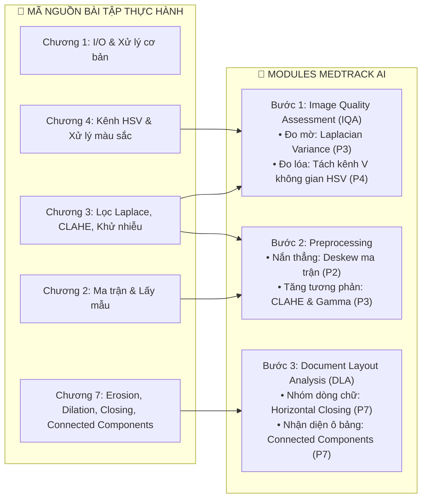

# TỔNG HỢP BÀI TẬP THỰC HÀNH MÔN XỬ LÝ ẢNH

> **Sinh viên:** Đào Văn Khang  
> **Mã sinh viên:** B23DCVT218  
> **Học phần:** Xử lý ảnh số (Digital Image Processing) — Học viện Công nghệ Bưu chính Viễn thông  
> **Mục đích:** Lưu trữ các notebook bài tập thực hành theo từng chương, làm kho thư viện thuật toán mẫu có thể tái sử dụng trực tiếp cho dự án **MedTrack AI**.

---

## 📂 DANH MỤC CÁC CHƯƠNG THỰC HÀNH

| Thư mục | Notebook chính | Kỹ thuật cốt lõi đã cài đặt | Dữ liệu ảnh thực nghiệm | Ứng dụng sang MedTrack AI |
| :--- | :--- | :--- | :--- | :--- |
| [**Chuong_1**](Chuong_1) | [`B23DCVT218_DaoVanKhang_Chuong1.ipynb`](Chuong_1/B23DCVT218_DaoVanKhang_Chuong1.ipynb) | • Đọc/ghi và ma trận điểm ảnh với `cv2`, `numpy`, `matplotlib` • Xử lý chuyển đổi kênh màu BGR $\leftrightarrow$ RGB • Minh họa 3 mức xử lý ảnh: Thấp (khử nhiễu), Trung (phân ngưỡng), Mở rộng (hàm hiển thị lưới ảnh) | `deer_salt.jpg`, `statue_bright.jpg`, ảnh test 1–5 | Xây dựng module load ảnh, chuẩn hóa hiển thị và trực quan hóa kết quả kiểm định chất lượng ảnh (IQA). |
| [**Chuong_2**](Chuong_2) | [`B23DCVT218_DaoVanKhang_Chuong2.ipynb`](Chuong_2/B23DCVT218_DaoVanKhang_Chuong2.ipynb) | • Lấy mẫu ảnh (Spatial Sampling) và khảo sát độ phân giải không gian • Lượng tử hóa mức xám (Gray-level Quantization) • Tách kênh màu B, G, R • Tự cài đặt thuật toán xây dựng Histogram thủ công • Khảo sát không gian màu và điều kiện chiếu sáng | `HoGuom.jpg`, `gao3.png`, tập 10 mảnh `pieces_yellow/` (rub00–09) | Thuật toán phân tích ma trận điểm ảnh phục vụ nắn thẳng tài liệu (Deskew) và chuẩn hóa kích thước đầu vào camera. |
| [**Chuong_3**](Chuong_3) | [`B23DCVT218_DaoVanKhang_Chuong3.ipynb`](Chuong_3/B23DCVT218_DaoVanKhang_Chuong3.ipynb) | • Biến đổi âm bản (Negative) & phân ngưỡng (Thresholding) • Biến đổi Log và hàm mũ (Gamma correction) • Cân bằng Histogram toàn ảnh và **CLAHE (Contrast Limited Adaptive Histogram Equalization)** • Bộ lọc trung bình, lọc làm sắc nét (Laplacian Sharpening) • Khử nhiễu muối - tiêu bằng lọc trung vị (Median filter) • Bài tập cải thiện ảnh tối & dải tương phản hẹp | `moon_dark.jpg`, `balloon.jpg`, `girl1_dark.jpg`, `deer_salt.jpg`, `needle1/2.png` | **Core Module Tiền xử lý:** 1. Đo độ mờ ảnh bằng phương sai toán tử Laplacian. 2. Tăng cường độ tương phản nét chữ y tế bằng CLAHE. 3. Khử nhiễu hạt giấy và cải thiện ảnh đơn thuốc chụp thiếu sáng. |
| [**Chuong_4**](Chuong_4) | [`B23DCVT218_DaoVanKhang_Chuong4.ipynb`](Chuong_4/B23DCVT218_DaoVanKhang_Chuong4.ipynb) | • Chuyển đổi và phân tích các hệ màu RGB, CMY, CMYK, **HSV** • Khảo sát độ bền của các kênh màu dưới điều kiện chiếu sáng thay đổi (tách kênh V khỏi H/S) • **Phát hiện da người bằng ngưỡng không gian màu** • Kỹ thuật in ảnh: Tách ngưỡng, khuếch tán lỗi 1D/2D (Floyd–Steinberg), Halftone ma trận ngưỡng • Mô phỏng in ấn 4 bản màu CMYK | Tập ảnh Rubik đa màu (`pieces/`), bộ ảnh da (`skin1–3.jpg`), `himym.jpg`, `HoGuom.jpg` | **Core Module IQA & Tiền xử lý:** 1. Phát hiện vùng lóa sáng camera (Glare Assessment) thông qua tách kênh cường độ sáng V. 2. Chuẩn hóa màu nền giấy xét nghiệm và phân tách chữ in/chữ viết tay. |
| [**Chuong_7**](Chuong_7) | [`B23DCVT218_DaoVanKhang_Chuong7.ipynb`](Chuong_7/B23DCVT218_DaoVanKhang_Chuong7.ipynb) | • **Xử lý hình thái học (Morphological Operations)**: Tự cài đặt phép Co (Erosion) và Giãn (Dilation) bằng Python thuần $\leftrightarrow$ đối chuẩn `cv2.erode` / `cv2.dilate` • Phép Mở (Opening) và Phép Đóng (Closing) • Khử nhiễu muối tiêu trên ảnh nhị phân • Tách biên hình thái học & Làm đầy vùng (Region Filling) • Trích xuất thành phần liên thông (Connected Components) • Tách đối tượng dính nhau và đếm số lượng | Bộ ảnh Rubik (`rubik/rub00–09.jpg`), `gao3.png` | **Core Module Document Layout Analysis (DLA):** 1. Sử dụng Structuring Element hình chữ nhật ngang để thực hiện phép Closing nối liền chữ thành dòng. 2. Trích xuất thành phần liên thông để gom cụm dòng chữ và bóc tách cấu trúc lưới ô trong bảng xét nghiệm. |

---

## 🧩 SƠ ĐỒ TÍCH HỢP TỪ BÀI TẬP THỰC HÀNH VÀO MEDTRACK AI

