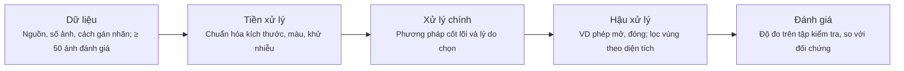

> [!NOTE]
> **Lưu ý về hình ảnh minh họa:** File markdown này được trích xuất nội dung văn bản từ tài liệu gốc. Do định dạng văn bản chưa nhúng trực tiếp toàn bộ ảnh minh họa, biểu đồ và sơ đồ thị giác, nếu cần xem chi tiết hình ảnh trực quan, vui lòng mở file PDF gốc tại: [DoAn_XuLyAnh.pdf](DoAn_XuLyAnh.pdf)
>

---

# Slide 1 — Đồ án Xử lý ảnh

**Học viện Công nghệ Bưu chính Viễn thông**  
**KHOA TRÍ TUỆ NHÂN TẠO**  
*Faculty of Artificial Intelligence*

## Xử lý ảnh
### Đồ án Xử lý ảnh

**Giảng viên:** PGS.TS. Phạm Văn Cường

---

# Slide 2 — Thông tin chung

| Hạng mục | Quy định |
| :--- | :--- |
| **Hình thức** | Nhóm 4-5 sinh viên; cử 1 trưởng nhóm đại diện nộp bài |
| **Loại dự án** | Chọn 1 trong 2: (1) Khảo sát các phương pháp SOTA; (2) Dự án xử lý ảnh thực tế |
| **Kiến thức** | Sử dụng ít nhất 1 chương của học phần (chương 1-8), ghi rõ trong báo cáo |
| **Công cụ** | Python (OpenCV, scikit-image, NumPy; PyTorch),... |
| **Sản phẩm nộp** | 01 file .zip ghi tên số nhóm: slide, mã nguồn + README, báo cáo 4-10 trang |
| **Hạn chót nộp bài** | Ngày 11/11/2026 qua email uyenvnb@ptit.edu.vn |

*Học viện Công nghệ Bưu chính Viễn thông*  
*Trang 2*

---

# Slide 3 — Hai lựa chọn đề tài

### Lựa chọn 1 – Khảo sát SOTA
- Phân tích, so sánh các phương pháp tiên tiến cho một bài toán xử lý ảnh
- Đi từ phương pháp cổ điển đã học đến học sâu
- Chạy mã nguồn mở có sẵn, so sánh trên tập dữ liệu chuẩn

### Lựa chọn 2 – Dự án thực tế
- Xây dựng chương trình giải một bài toán thực tế
- Pipeline nhiều bước, có phương pháp đối chứng
- Đánh giá định lượng bằng độ đo chuẩn của bài toán

*Học viện Công nghệ Bưu chính Viễn thông*  
*Trang 3*

---

# Slide 4 — Lựa chọn 1 – Gợi ý chủ đề khảo sát SOTA

| Chủ đề | Từ phương pháp trong môn | Đến phương pháp hiện đại | Dữ liệu chuẩn |
| :--- | :--- | :--- | :--- |
| Khử nhiễu ảnh / Tăng cường ảnh thiếu sáng | Lọc trung bình, trung vị, Gauss (chương 3) Cân bằng lược đồ, CLAHE (chương 3) | BM3D, DnCNN, Restormer Retinex, RetinexNet, Zero-DCE | BSD68, Set12 LOL |
| Phát hiện biên | Sobel, Canny (chương 5) | HED, các mạng học sâu phát hiện biên | BSDS500 |
| Phân vùng ảnh / Nén ảnh | Otsu, K-means, Mean-Shift (chương 5, 8) Huffman, JPEG (chương 6) | U-Net, Segment Anything (SAM) JPEG 2000, nén ảnh bằng học sâu | ISIC 2018 Kodak (24 ảnh) |
| Phân loại ảnh | KNN, túi từ trực quan (chương 8) | CNN, Vision Transformer | CIFAR-10 |

*Học viện Công nghệ Bưu chính Viễn thông*  
*Trang 4*

---

# Slide 5 — Lựa chọn 1 – Yêu cầu

1. **Bài toán**  
   Nêu rõ định nghĩa bài toán, đầu vào, đầu ra và khó khăn cốt lõi

2. **So sánh 3-5 phương pháp**  
   Tổng hợp, phân loại, so sánh ưu và nhược điểm; ít nhất 1 phương pháp cổ điển đã học

3. **Thử nghiệm**  
   Chạy mã nguồn mở có sẵn; bảng so sánh hiệu năng và hình kết quả trên cùng ảnh đầu vào

*Học viện Công nghệ Bưu chính Viễn thông*  
*Trang 5*

---

# Slide 6 — Lựa chọn 2 – Gợi ý đề tài thực tế

| Đề tài | Chương | Dữ liệu gợi ý | Độ đo |
| :--- | :--- | :--- | :--- |
| Số hóa tài liệu chụp bằng điện thoại: nắn phối cảnh, cân bằng sáng, nhị phân hóa | 2, 3, 5, 7 | DIBCO; ảnh tự chụp | F-measure, PSNR |
| Nâng cao chất lượng ảnh thiếu sáng | 3, 4 | LOL | PSNR, SSIM |
| Khử nhiễu ảnh (Gauss, muối tiêu) | 3 | BSD68 + nhiễu nhân tạo | PSNR, SSIM |
| Phân vùng tổn thương da hoặc mạch máu võng mạc | 5, 7 | ISIC 2018; DRIVE | Dice, IoU |
| Đếm và đo kích thước đối tượng (tế bào, đồng xu, hạt) | 5, 7, 8 | BBBC; ảnh tự chụp | Sai số đếm, sai số kích thước |
| Phân loại biển báo giao thông | 4, 8 | GTSRB | Accuracy, F1 |
| Tự cài đặt bộ nén JPEG cơ bản (DCT, lượng tử hóa, Huffman) | 6 | Kodak (24 ảnh) | Tỉ số nén, PSNR |

*Học viện Công nghệ Bưu chính Viễn thông*  
*Trang 6*

---

# Slide 7 — Lựa chọn 2 – Pipeline

*Mỗi bước ghi rõ tham số và lý do chọn; lựa chọn 1 áp dụng cho phần thử nghiệm*

*Học viện Công nghệ Bưu chính Viễn thông*  
*Trang 7*

---

# Slide 8 — Sản phẩm nộp

01 file `LopXX_NhomYY_TenDeTai.zip` gửi qua email `uyenvnb@ptit.edu.vn`, tiêu đề email ghi cùng tên

| Thành phần | Nội dung | Định dạng |
| :--- | :--- | :--- |
| **Slide thuyết trình** | 10-15 slide cho 10 phút trình bày + 5 phút hỏi đáp | `.pptx` và `.pdf` |
| **Mã nguồn** | Thư mục `code/`, `requirements.txt`, 5-10 ảnh mẫu trong `samples/` | `.py` hoặc `.ipynb` |
| **README** | Môi trường, cài đặt, lệnh chạy, đầu ra mong đợi, đường dẫn tải dữ liệu | `.md` |
| **Báo cáo** | 4-10 trang: bài toán, dữ liệu, phương pháp, kết quả, thảo luận, phân công, khai báo sử dụng AI | `.pdf` |
| **Video demo (khuyến khích)** | Tối đa 3 phút, chạy chương trình trên ảnh thật | `.mp4` hoặc đường dẫn |

*Học viện Công nghệ Bưu chính Viễn thông*  
*Trang 8*