# KẾ HOẠCH CHI TIẾT ĐỒ ÁN XỬ LÝ ẢNH SỐ — TOÀN NHÓM MEDTRACK

> **Phạm vi:** chỉ nội dung môn **Xử lý ảnh số (DIP)**. Không gồm phần Học máy. Phần app chỉ dùng làm giao diện cho video demo (mục 11).
> **Nhóm:** Hiếu (nhóm trưởng) · Trường · Khang · Thắng. **Hạn nộp:** **11/11/2026**, email `uyenvnb@ptit.edu.vn`.
> **Căn cứ:** [quy định đồ án](../docs/references/requirements/DoAn_XuLyAnh.pdf) ([bản md](../docs/references/requirements/DoAn_XuLyAnh.md)) · [bài giảng chương 1–8](../docs/references/lectures/) · [notebook thực hành](../docs/references/practices/) · [đề tài đã chốt](../docs/DeTai_XuLyAnh_ChiTiet.md) · [tiến độ](TienDo.md)
> **Phiên bản:** ngày 09/11/2026. Mọi trích dẫn chương / slide đã đối chiếu với nội dung slide gốc.

---

## CÁCH ĐỌC FILE

| Ký hiệu | Nghĩa |
| :--- | :--- |
| **C7 · S19** | Chương 7, slide 19 của bài giảng. **Số slide trùng số trang PDF** (đã kiểm: C1 37 tr., C2 40, C3 84, C4 66, C5 100, C6 59, C7 50, C8 74) |
| **QĐ · S6** | Slide 6 của file quy định đồ án `DoAn_XuLyAnh.pdf` |
| **TH · C3** | Notebook thực hành chương 3 trong `docs/references/practices/Chuong_3/` |
| ✅ | Kỹ thuật **có trong bài giảng**, có slide và công thức |
| ➕ | **Mở rộng trực tiếp** từ một khái niệm trong bài giảng. Báo cáo ghi "mở rộng từ C? · S?" kèm trích Gonzalez & Woods |
| 📘 | **Không có slide**, nhưng có trong **gợi ý đề tài của thầy** (QĐ · S4, S6). Được phép dùng, ghi nguồn tài liệu ngoài |
| ⚠️ | Không có trong bài giảng lẫn gợi ý. Chỉ dùng làm **đối chứng** hoặc **công cụ**, ghi rõ trong báo cáo |

**Mỗi người đọc:** mục 2 (yêu cầu của thầy), mục 3 (dữ liệu), mục 4 (bảng tra kiến thức), **mục của mình** (5, 6, 7 hoặc 8), mục 9–12.

---

## MỤC LỤC

1. [Bài toán và pipeline](#1-bài-toán-và-pipeline)
2. [Yêu cầu của thầy và cách nhóm đáp ứng](#2-yêu-cầu-của-thầy-và-cách-nhóm-đáp-ứng)
3. [Dữ liệu](#3-dữ-liệu)
4. [Bảng tra kiến thức bài giảng (dùng chung)](#4-bảng-tra-kiến-thức-bài-giảng)
5. [Hiếu — ① Tiền xử lý & Phân loại](#5-hiếu--①-tiền-xử-lý--phân-loại)
6. [Trường — ② Làm sạch & Tách lớp mực](#6-trường--②-làm-sạch--tách-lớp-mực)
7. [Khang — ③ Dựng bảng phiếu xét nghiệm](#7-khang--③-dựng-bảng-phiếu-xét-nghiệm)
8. [Thắng — ④ Bóc tách đơn thuốc & Bộ 5](#8-thắng--④-bóc-tách-đơn-thuốc--bộ-5)
9. [Ma trận kiến thức toàn nhóm](#9-ma-trận-kiến-thức-toàn-nhóm)
10. [Đánh giá toàn pipeline (ablation)](#10-đánh-giá-toàn-pipeline-ablation)
11. [Video demo trên app mobile](#11-video-demo-trên-app-mobile)
12. [Báo cáo, slide, gói nộp, lịch, checklist](#12-báo-cáo-slide-gói-nộp-lịch-checklist)

---

## 1. BÀI TOÁN VÀ PIPELINE

### 1.1. Định nghĩa bài toán

| Mục | Nội dung |
| :--- | :--- |
| **Đầu vào** | Ảnh chụp đơn thuốc hoặc phiếu xét nghiệm bằng điện thoại. Có thể nghiêng, méo phối cảnh, mờ, lóa, bóng đổ, dấu đỏ, chữ ký |
| **Đầu ra** | (1) Ảnh phẳng, sạch, nhị phân; (2) nhãn loại tài liệu; (3) bbox từng **dòng chỉ số** (phiếu XN) hoặc từng **khoản thuốc** (đơn thuốc) để OCR theo vùng |
| **Khó khăn cốt lõi** | Suy biến hình học và quang học cùng lúc; biểu mẫu đa dạng; bảng không kẻ lưới; dấu đỏ đè chữ nhưng phải giữ chữ đỏ cảnh báo |
| **Khung lý thuyết** | Các giai đoạn xử lý ảnh **C1 · S27**: Thu nhận → Tăng cường → Khôi phục → Hình thái → Phân vùng → Nhận dạng → Biểu diễn & mô tả, cộng thêm xử lý ảnh màu và nén |

### 1.2. Pipeline và ánh xạ vào các giai đoạn của C1 · S27

```mermaid
flowchart LR
    IN["📷 Ảnh chụp"] --> A
    subgraph P1 ["① Hiếu · Thu nhận + Tăng cường + Nhận dạng"]
        A["IQA: mờ (Laplacian), lóa (HSV)"] --> B["Canny → 4 góc → nắn phối cảnh<br>→ chỉnh nghiêng (projection)"]
        B --> C["Khử nhiễu (trung vị) · CLAHE"] --> D{"Đặc trưng + kNN<br>3 lớp"}
    end
    D -->|other| X["⛔ Dừng"]
    D -->|đơn / phiếu XN| E
    subgraph P2 ["② Trường · Khôi phục + Ảnh màu + Phân vùng"]
        E["Ước lượng nền (Closing / Max–Min)<br>chia chuẩn hóa"] --> F["Tách mực HSV · nhận dấu (độ tròn)"]
        F --> G["Xóa dấu (đơn thuốc)"] --> H["Nhị phân Sauvola<br>(đối chứng Otsu, ISODATA, ...)<br>+ Opening lọc nhiễu"]
    end
    H -->|phiếu XN| K
    H -->|đơn thuốc| T
    subgraph P3 ["③ Khang · Hình thái + Phân vùng"]
        K["Dilation ngang → cụm từ"] --> K2["Projection ngang → dòng"] --> K3["Projection dọc / tách vùng → cột"] --> K4["Hợp vùng → ô"]
    end
    subgraph P4 ["④ Thắng · Hình thái + Phân vùng"]
        T["Dilation → vùng thuốc"] --> T2["Projection ngang → dòng"] --> T3["Dilation dọc → khoản"] --> T4["Opening → bỏ khoản giả"]
    end
    K4 --> O["OCR theo vùng (công cụ đo CER)"]
    T4 --> O
```

| Giai đoạn C1 · S27 | Slide | Bước trong pipeline | Người |
| :--- | :---: | :--- | :--- |
| Thu nhận ảnh | C1 · S28 | Ảnh điện thoại; mô hình suy biến của bộ 5 | Thắng |
| Tăng cường ảnh | C1 · S29 | Khử nhiễu, CLAHE | Hiếu |
| Khôi phục ảnh | C1 · S30 | Nắn phối cảnh, chỉnh nghiêng, khử bóng, xóa dấu | Hiếu, Trường |
| Xử lý ảnh màu | C1 · S27 | HSV: lóa, mực đỏ / xanh | Hiếu, Trường |
| Xử lý hình thái | C1 · S31 | Closing nền, Dilation gom chữ, Opening lọc nhiễu | Trường, Khang, Thắng |
| Phân vùng ảnh | C1 · S32 | Nhị phân hóa, dòng, cột, khoản thuốc | Trường, Khang, Thắng |
| Nhận dạng | C1 · S33 | Phân loại 3 lớp bằng kNN | Hiếu |
| Biểu diễn & mô tả | C1 · S34 | Đặc trưng HOG / lược đồ / GLCM; bbox + JSON | Hiếu, Khang, Thắng |
| Nén ảnh | C1 · S27 | Suy biến JPEG trong bộ 5 | Thắng |

### 1.3. Giữ / bỏ khi chỉ làm DIP

| Nội dung | Quyết định |
| :--- | :--- |
| Phân loại 3 lớp bằng **đặc trưng + kNN** | **Giữ.** Thuộc C8 (S12–17, S37–42) |
| Mọi mô hình ML khác (ResNet, YOLO, phân loại thành phần / vai trò / dòng bằng ML) | **Bỏ.** Thay bằng **luật** dựa trên màu, hình dạng, vị trí |
| OCR | Chỉ là **công cụ đo CER**, không trình bày là phương pháp DIP |
| Cờ bất thường so số, tách trường thuốc bằng regex | Hậu xử lý văn bản, làm tối thiểu, không tính là đóng góp DIP |

---

## 2. YÊU CẦU CỦA THẦY VÀ CÁCH NHÓM ĐÁP ỨNG

| Yêu cầu | Nguồn | Cách đáp ứng | Kiểm ở đâu |
| :--- | :---: | :--- | :--- |
| Nhóm 4–5 SV, 1 trưởng nhóm nộp | QĐ · S2 | 4 SV, Hiếu nộp | — |
| Dùng ≥ 1 chương, **ghi rõ trong báo cáo** | QĐ · S2 | Dùng **8/8 chương**; mỗi phần phương pháp ghi chương và slide | Mục 9 |
| Lựa chọn 2: pipeline nhiều bước, **có đối chứng**, **đánh giá định lượng bằng độ đo chuẩn** | QĐ · S3 | Mỗi bước ≥ 1 đối chứng; độ đo F-measure, PSNR (đúng gợi ý QĐ · S6), IoU, F1, CER | Mục 5–8 |
| Đề tài gợi ý "Số hóa tài liệu chụp…" chương **2, 3, 5, 7**, độ đo **F-measure, PSNR** | QĐ · S6 | Phần lõi của nhóm khớp gợi ý này; mở rộng thêm C4, C6, C8 | Mục 9 |
| **≥ 50 ảnh đánh giá**; nêu nguồn, số ảnh, cách gán nhãn | QĐ · S7 | Mỗi module có tập đánh giá ≥ 50 ảnh | Mục 3.3 |
| Tiền xử lý: chuẩn hóa kích thước, màu, khử nhiễu | QĐ · S7 | Hiếu: resize, CLAHE, lọc trung vị | Mục 5 |
| Xử lý chính: phương pháp cốt lõi **và lý do chọn** | QĐ · S7 | Mỗi bước có cột "Vì sao chọn" | Mục 5–8 |
| **Hậu xử lý**: phép mở, đóng; lọc vùng theo diện tích | QĐ · S7 | Trường, Khang, Thắng đều có bước Opening + lọc diện tích | Mục 6–8 |
| Đánh giá trên tập kiểm tra, so với đối chứng | QĐ · S7 | Chọn tham số trên valid, báo trên test | Mục 3.2 |
| **Mỗi bước ghi tham số và lý do chọn** | QĐ · S7 | Bảng "Tham số – lý do" mỗi người | Mục 5–8 |
| Slide 10–15 trang (10' + 5' hỏi đáp), `.pptx` + `.pdf` | QĐ · S8 | Mục 12.2 | — |
| Mã nguồn `code/`, `requirements.txt`, **5–10 ảnh mẫu** `samples/` | QĐ · S8 | Mục 12.3 | — |
| README: môi trường, cài đặt, lệnh chạy, đầu ra mong đợi, link dữ liệu | QĐ · S8 | Mục 12.3 | — |
| Báo cáo **4–10 trang**: bài toán, dữ liệu, phương pháp, kết quả, thảo luận, phân công, **khai báo dùng AI** | QĐ · S8 | Mục 12.1 | — |
| Video demo **≤ 3 phút, chạy trên ảnh thật** | QĐ · S8 | Mục 11 | — |
| Tên file `LopXX_NhomYY_TenDeTai.zip`, tiêu đề email trùng tên | QĐ · S8 | Mục 12.3 | — |

---

## 3. DỮ LIỆU

### 3.1. Các bộ dữ liệu

| # | Bộ | Quy mô | Nhãn có sẵn | Dùng cho |
| :---: | :--- | :--- | :--- | :--- |
| 1 | VAIPE đơn thuốc (Việt Nam) | 1.345 ảnh: **1.173 có nhãn**, 172 **không nhãn** | Box từng dòng: `drugname`, `usage`, `quantity`, `diagnose`, `date`, `other` | Thắng; lớp `prescription` (Hiếu); nguồn sạch của bộ 5 |
| 2 | Report Keywords (phiếu CBC, tiếng Anh) | **57 ảnh gốc** (39 / 11 / 7), ép 640 × 640 | Box từng cụm từ: `Report Type`, `parameter`, `value`, `unit`, `reference value` | Khang; lớp `lab_report` (Hiếu) |
| 3 | RVL-CDIP tập con | 800 ảnh (8 lớp × 100) + 200 ảnh lớp lạ | Nhãn lớp | Lớp `other` (Hiếu) |
| 4 | Ảnh nhóm tự chụp | 83 ảnh: 48 phiếu XN, 18 đơn thuốc, 17 khác | **Chỉ có nhãn loại tài liệu** (theo thư mục `lab_report/`, `prescription/`, `other/`); không gán nhãn chi tiết | **Chỉ để test**: đo định lượng duy nhất là D10; các phần khác dùng làm **ảnh trước / sau, kiểm tra định tính** và video demo |
| 5 | Benchmark tổng hợp (Thắng sinh từ ảnh sạch bộ 1) | 1.500 mẫu, chia theo ảnh gốc 60 / 10 / 30 | Ảnh sạch, ma trận biến dạng, 4 góc, ảnh nhị phân chuẩn, mask bóng / lóa / dấu / bút, mức hỏng | GT chính xác cho cả nhóm |

### 3.2. Quy tắc chia tập và chống rò rỉ

| Quy tắc | Căn cứ |
| :--- | :--- |
| Chia **huấn luyện / kiểm định / kiểm tra**; tập kiểm tra chỉ dùng **một lần ở cuối** | C8 · S41 |
| Tham số (ngưỡng, kích thước SE, k của kNN) **chọn trên valid**, không chọn theo test | C8 · S41 ("siêu tham số không học được từ tập huấn luyện") |
| Đánh giá trên ảnh **không dùng khi huấn luyện**; trích đặc trưng giống hệt nhau ở hai pha | C8 · S10 |
| Biến thể bộ 5 của cùng ảnh gốc nằm chung một tập | Tránh kết quả ảo |
| Phương pháp **dựa trên luật** (③, ④) không học gì, nên được lấy ảnh phần "train" của bộ dữ liệu gốc làm tập đánh giá, miễn là tách riêng tập valid | — |
| Bộ 4 không dùng để chỉnh tham số; ảnh phải che họ tên, ngày sinh, mã bệnh nhân, số điện thoại | — |
| **Bộ 4 không có nhãn chi tiết** (không kịp gán): chỉ D10 đo định lượng trên bộ 4 (nhãn lấy theo thư mục, soát nhanh 83 ảnh). Mọi phần khác trên bộ 4 là **ảnh trước / sau, kiểm tra định tính**, không báo số liệu | Quyết định nhóm 09/11 |
| **Bộ 2 cho phần ③ dùng kiểm định chéo 5-fold:** chia 57 ảnh gốc thành 5 phần (chia theo ảnh, seed cố định, không theo split gốc của Roboflow). Mỗi lượt chọn tham số trên 4 phần (~45 ảnh), đo trên phần còn lại (~11 ảnh). Sau 5 lượt, **mỗi ảnh được đánh giá đúng 1 lần bằng tham số chọn không có ảnh đó**, nên tập đánh giá = **57 ảnh** (≥ 50, QĐ · S7). Báo cáo trung bình ± độ lệch chuẩn qua 5 lượt; tham số cuối cho pipeline = bộ tham số được chọn nhiều nhất | **C8 · S41** (5-fold) |

### 3.3. Tập đánh giá ≥ 50 ảnh của từng người (QĐ · S7)

| Người | Tập chọn tham số | Tập đánh giá | Số ảnh đánh giá | Cách có ground truth |
| :--- | :--- | :--- | :---: | :--- |
| Hiếu | Valid bộ 5; valid bộ 1–3 | Test bộ 5 (30 ảnh gốc × biến thể, ~450 mẫu); test bộ 1–3; **bộ 4** cho phân loại | ≥ 450 | Ma trận biến dạng, 4 góc của bộ 5; nhãn lớp theo nguồn (bộ 4: theo thư mục) |
| Trường | Valid bộ 5; **crop dòng VAIPE thuộc tập chọn tham số của Thắng** (chọn phương pháp nhị phân theo CER) | Test bộ 5; **CER trên ảnh thật**: crop dòng VAIPE thuộc tập đánh giá của Thắng + 50 crop `dataset2_50` (phiếu XN chụp thật); bộ 4 (phiếu có chữ đỏ): ảnh trước / sau, định tính | ≥ 450 (+ ≥ 50 ảnh thật) | Ảnh nhị phân chuẩn bộ 5 (Otsu trên ảnh sạch) + **mask dải viền bỏ qua**; mask dấu bộ 5; chữ chuẩn có sẵn trong nhãn VAIPE và `dataset2_50` |
| Khang | 4 fold (~45 ảnh) mỗi lượt của 5-fold | **57 ảnh** bộ 2, mỗi ảnh đo 1 lần trên fold giữ lại; bộ 4 chỉ minh họa định tính | 57 | Suy dòng / cột từ box cụm từ có sẵn, **soát bằng mắt** từng ảnh |
| Thắng | **~150–200 ảnh VAIPE**, GT khoản gom tự động (soát ngẫu nhiên ~10 ảnh để kiểm luật gom) | **≥ 50 ảnh VAIPE** khác, GT gom tự động rồi **soát bằng mắt từng ảnh** + test bộ 5; bộ 4 chỉ minh họa định tính | ≥ 50 (+ bộ 5) | Gom nhãn dòng `drugname` + các dòng `usage`/`quantity` ngay dưới thành khoản; bộ 5 có box biến đổi sẵn. Chọn tham số và đánh giá đều lấy từ 1.173 ảnh `train` có nhãn (172 ảnh `test` không có nhãn), **chia theo cụm ảnh gần trùng (pHash)** để ảnh cùng cụm nằm chung một tập |

---

## 4. BẢNG TRA KIẾN THỨC BÀI GIẢNG

Bảng dùng chung: kỹ thuật → slide → công thức. Mục 5–8 trích lại từ đây.

### 4.1. Chương 2 — Cơ bản về xử lý ảnh

| Kiến thức | Slide | Nội dung / công thức | Dùng ở |
| :--- | :---: | :--- | :--- |
| Thu nhận ảnh: chiếu sáng cảnh, thu năng lượng phản xạ | S22 | Nguồn sáng → phần tử cảnh → hệ thu → mặt phẳng ảnh → ảnh số | Mô hình bóng đổ: ảnh ≈ chiếu sáng × phản xạ (➕) — Trường, Thắng |
| Lấy mẫu và lượng tử hóa; ảnh số chỉ là xấp xỉ | S23–24 | Rời rạc hóa tọa độ và mức xám | Nội suy khi nắn / xoay (Hiếu, Thắng) |
| Biểu diễn ảnh dạng ma trận $f(x,y)$ | S25 | — | Mọi bước |
| Độ phân giải không gian | S26, S32–33 | Số pixel quyết định độ chi tiết | Lý do đặt kích thước SE và ngưỡng **theo chiều cao chữ**, không theo pixel cố định |
| Nắn phối cảnh (theo gợi ý đề tài của thầy) | 📘 QĐ · S6 | $\begin{bmatrix}x'\\y'\\w\end{bmatrix} = H\begin{bmatrix}x\\y\\1\end{bmatrix}$, $H$ là ma trận 3 × 3, xác định từ 4 cặp điểm (Gonzalez & Woods) | Hiếu; bộ 5 (Thắng) |

### 4.2. Chương 3 — Nâng cao chất lượng ảnh

| Kiến thức | Slide | Công thức | Dùng ở |
| :--- | :---: | :--- | :--- |
| Miền không gian và miền tần số | S8 | Xử lý trực tiếp pixel, hoặc qua Fourier | Hiếu: đối chứng đo mờ bằng năng lượng tần số cao |
| Toán tử điểm | S10–11 | $g(x,y) = T[f(x,y)]$; $s = T(r)$ | Chia ảnh cho nền (Trường); giảm phơi sáng trong bộ 5 (Thắng) |
| Phân ngưỡng | S14, S39 | $s = 1$ nếu $r > \theta$, ngược lại $0$ | Nhị phân hóa |
| Lược đồ xám | S23 | $p(r_k) = n_k / n$ | **Cơ sở của Projection Profile** (đếm pixel mực theo hàng / cột) — Hiếu, Khang, Thắng |
| Cân bằng lược đồ xám | S32–33 | $s_k = (L-1)\sum_{j=0}^{k} n_j / n$ | Đối chứng của CLAHE (Hiếu) |
| CLAHE | 📘 QĐ · S4; TH · C3 | Cân bằng theo từng ô, giới hạn độ dốc hàm biến đổi bằng `clipLimit` | Hiếu |
| Lọc không gian (tích chập) | S47–48 | $g(x,y) = \sum_{s=-a}^{a}\sum_{t=-b}^{b} w(s,t)\, f(x+s, y+t)$ | Mờ chuyển động trong bộ 5 (Thắng); mọi bộ lọc |
| Lọc trung bình; trung bình có trọng số | S50–53 | Nhân $\frac{1}{9}\mathbf{1}_{3\times3}$; nhân $\frac{1}{16}[1\,2\,1;\,2\,4\,2;\,1\,2\,1]$ | Làm trơn profile (Khang, Thắng); mờ Gaussian bộ 5 |
| Lọc trung vị | S56, S73 | $\hat f(x,y) = \operatorname{median}_{(s,t)\in S_{xy}} \{g(s,t)\}$; hiệu quả với nhiễu muối tiêu, ít làm mờ | Khử nhiễu (Hiếu); ước lượng nền (Trường); **chiều cao chữ = trung vị** (Khang, Thắng) |
| **Bộ lọc Max và Min** | **S74** | $\hat f = \max_{S_{xy}} g$; $\hat f = \min_{S_{xy}} g$ | **Closing trên ảnh xám = Max rồi Min**: cơ sở ước lượng nền giấy (Trường) |
| Lọc điểm giữa | S75 | $\hat f = \frac12[\max + \min]$ | Đối chứng khử nhiễu (Hiếu, nếu cần) |
| Mô hình nhiễu | S65–66 | $g(x,y) = f(x,y) + \eta(x,y)$; nhiễu Gaussian thông dụng nhất | Bộ 5 (Thắng) |

### 4.3. Chương 4 — Hệ màu và kỹ thuật in ảnh

| Kiến thức | Slide | Nội dung | Dùng ở |
| :--- | :---: | :--- | :--- |
| Nén không tổn thất / có tổn thất; JPG | S15, S18 | File càng nhỏ thì chất lượng càng giảm | Bộ 5: suy biến JPEG (Thắng) |
| Hệ màu RGB | S29–31 | 3 kênh cộng màu | Đọc ảnh BGR |
| **HSV** | S37–41 | **H** độ màu (S38); **S** = lượng ánh sáng trắng trộn vào màu (S39); **V** độ sáng (S40); HSV tách cường độ khỏi màu (S41) | Lóa = V cao, S thấp (Hiếu); mực đỏ / xanh theo H, S (Trường); cờ chữ đỏ (Khang); bộ 5 lóa, dấu (Thắng) |

### 4.4. Chương 5 — Phát hiện biên và phân vùng

| Kiến thức | Slide | Công thức | Dùng ở |
| :--- | :---: | :--- | :--- |
| Độ lớn và hướng gradient | S15 | $\lvert G\rvert = \sqrt{G_x^2 + G_y^2}$, $\theta = \tan^{-1}(G_y/G_x)$ | Tenengrad (Hiếu) |
| Prewitt, Sobel | S19, S23 | Sobel $M_x = [-1\,0\,1;\,-2\,0\,2;\,-1\,0\,1]$ | Tenengrad (Hiếu) |
| **Laplacian** | S28–29 | $\nabla^2 f = f(x{+}1,y) + f(x{-}1,y) + f(x,y{+}1) + f(x,y{-}1) - 4f(x,y)$, nhân $[0\,1\,0;\,1\,{-4}\,1;\,0\,1\,0]$ | **Đo mờ** (Hiếu); kiểm độ nét bộ 5 (Thắng) |
| **Canny** 4 bước | S36–49 | (1) Gaussian 5 × 5 hệ số $\frac{1}{159}$ (S40); (2) gradient (S41); (3) loại điểm không cực đại (S44); (4) **ngưỡng kép, thường $T_1 = 2T_2$** (S47) | Tìm mép giấy (Hiếu) |
| Phân vùng: dựa vào biên / dựa vào miền | S55–58 | Tiêu chí: cường độ, lược đồ, trung bình, phương sai | Khung lý thuyết cho ③ ④ |
| **Làm trơn lược đồ** | **S62** | $h_{smooth}(b) = \frac1W \sum_{w=-(W-1)/2}^{(W-1)/2} h_{raw}(b-w)$, $W$ = 3 hoặc 5 | **Làm trơn projection profile** (Khang, Thắng) |
| Tách ngưỡng tại thung lũng; ngưỡng toàn cục | S63–64 | $g = 1$ nếu $f > T$ | Tách khe dòng / cột (Khang, Thắng) |
| **Otsu** | S65–67 | $P_1(k) = \sum_{i\le k} p_i$; $m(k) = \sum_{i \le k} i\,p_i$; $m_G = \sum i\,p_i$; $\sigma_B^2(k) = \frac{[m_G P_1(k) - m(k)]^2}{P_1(k)[1-P_1(k)]}$; $k^* = \arg\max \sigma_B^2$ | **Đối chứng chính** của nhị phân hóa (Trường); ảnh nhị phân chuẩn bộ 5 (Thắng) |
| **ISODATA** | S72–73 | $t_{k+1} = \frac{\mu_1(t_k) + \mu_2(t_k)}{2}$, lặp tới $\lvert t_{k+1} - t_k\rvert < \Delta T$ | Đối chứng nhị phân (Trường) |
| Đối xứng nền | S76 | Đỉnh nền $maxp$, tìm điểm $p\%$ phía đối diện | Đối chứng nhị phân (Trường) |
| **Tam giác** (Zack) | S78 | Nối đỉnh lược đồ với $b_{min}$; ngưỡng tại $b_0$ có khoảng cách $d$ lớn nhất | Đối chứng nhị phân (Trường) |
| Điều kiện phân vùng; **$R_i$ liên thông** | S83–84 | $\bigcup R_i = R$; $R_i$ liên thông; $P(R_i) = \text{True}$; $P(R_i \cup R_j) = \text{False}$ | Thành phần liên thông (mọi người) |
| Phát triển vùng | S85 | Hạt giống → thêm lân cận tương tự → lặp | Gán nhãn thành phần liên thông (➕) |
| **Hợp vùng** | S87 | Hợp các vùng lân cận cùng đối tượng | Gom cụm từ → ô (Khang); dòng → khoản (Thắng) |
| **Tách vùng** (top-down) | S89–90 | Toàn ảnh → chia nhỏ đến khi $P(R_i) = \text{True}$ | **XY-cut đệ quy** (Khang, ➕) |
| Tách và hợp vùng | S94 | Lặp cả tách và hợp | Khang |

### 4.5. Chương 6 — Nén ảnh

| Kiến thức | Slide | Công thức | Dùng ở |
| :--- | :---: | :--- | :--- |
| Tiêu chí đánh giá; ảnh khôi phục $\hat f = f + e$ | S37 | — | Khung đánh giá chất lượng |
| **Đánh giá chủ quan** (thang 1–6) | S38 | Excellent … Unusable | Chấm bộ 5 có "giống thật" (Thắng); D7 nếu làm |
| **Đánh giá khách quan RMS, SNR** | S39 | $e_{rms} = \sqrt{\frac{1}{MN}\sum\sum(\hat f - f)^2}$; $SNR_{rms} = \frac{\sum\sum \hat f^2}{\sum\sum(\hat f - f)^2}$ | **PSNR** $= 20\log_{10}(255 / e_{rms})$ (➕) — Hiếu, Trường |
| JPEG: khối 8 × 8, DCT, lượng tử hóa | S40–54 | Thành phần tần số cao bị lượng tử thô → mất chi tiết, hiện khối | Giải thích suy biến JPEG bộ 5 (Thắng) |

### 4.6. Chương 7 — Xử lý hình thái (trục chính của đề tài)

| Kiến thức | Slide | Công thức / ý chính | Dùng ở |
| :--- | :---: | :--- | :--- |
| Phần tử cấu trúc (SE) | S5 | Ma trận 0 / 1, tâm ở giữa; **hình dạng SE quyết định hướng tác động** | Mọi bước hình thái |
| **Fit / Hit** | S6–7 | Fit: mọi pixel 1 của SE trùng pixel 1 của ảnh; Hit: có ít nhất một pixel trùng | Giải thích Opening giữ đường kẻ (Khang) |
| **Erosion** | S9, S12–14 | $f \ominus s$: $g = 1$ nếu $s$ fit $f$; tách đối tượng gần nhau, thu nhỏ đối tượng | Hậu xử lý |
| **Dilation** | S19, S22–24 | $f \oplus s$: $g = 1$ nếu $s$ hit $f$; **S23 là ví dụ Dilation trên ảnh văn bản**; nối chỗ đứt, phóng to đối tượng (S24) | Gom ký tự → cụm từ (Khang); gom khối, gom khoản (Thắng) |
| **Opening** | S28, S34 | $f \circ s = (f \ominus s) \oplus s$; bỏ mảnh nhỏ, cắt eo hẹp | **Hậu xử lý lọc nhiễu** (Trường, Thắng); giữ đường kẻ (Khang); đặc trưng đường kẻ (Hiếu) |
| **Closing** | S35, S38 | $f \bullet s = (f \oplus s) \ominus s$; lấp khoảng trống nhỏ | Ước lượng nền (Trường); đối chứng gom khoản (Thắng); nối đường kẻ đứt (Khang) |
| Ví dụ kết hợp mở rồi đóng | S39 | $(A \circ B) \bullet B$ | Lọc nhiễu hai phía |
| **Tách biên** | S40 | $\beta(A) = A - (A \ominus B)$ | Lấy vành dấu (Trường); mở rộng thành **dải viền** $(A\oplus B)-(A\ominus B)$ bỏ qua khi chấm bộ 5 (Thắng, Trường) |
| **Làm đầy vùng** | S43–45 | $X_k = (X_{k-1} \oplus B) \cap A^c$, lặp tới $X_k = X_{k-1}$; kết quả $X_k \cup A$ | **Mask dấu đặc từ vành dấu** (Trường) |
| Thực hành | TH · C7 | Tự cài Erosion / Dilation, Opening / Closing, tách biên, làm đầy vùng, thành phần liên thông | Mọi người tham khảo |

### 4.7. Chương 8 — Nhận dạng ảnh

| Kiến thức | Slide | Công thức | Dùng ở |
| :--- | :---: | :--- | :--- |
| Cấu trúc hệ nhận dạng; huấn luyện / kiểm tra | S9–10 | Trích đặc trưng → phân lớp → đánh giá | Hiếu |
| Đặc trưng toàn cục / cục bộ (có nêu **HOG**, LBP) | S12 | — | Hiếu |
| **Lược đồ màu** | S13 | Chuẩn hóa chia tổng pixel; so sánh bằng $L_1$, giao $\sum \min(h_1,h_2)$, $\chi^2$ | **Đối chứng** phân loại (Hiếu) |
| **GLCM** | S14 | $C(i,j) = \#\{(p_1,p_2): I(p_1)=i, I(p_2)=j\}$, $d$, $\theta \in \{0°,45°,90°,135°\}$ | Đặc trưng kết cấu (Hiếu) |
| **Haralick** | S15 | Năng lượng $\sum P^2$; entropy $-\sum P\log_2 P$; tương phản $\sum(i-j)^2P$; đồng nhất $\sum \frac{P}{1+(i-j)^2}$ | Hiếu |
| **Hình dạng: diện tích, chu vi, tỉ số dài / rộng, độ tròn** | **S16** | $C = 4\pi A / P^2$ (tròn: 1; vuông: 0,785); mômen $M(p,q)$, Hu | **Nhận dạng dấu tròn** (Trường); lọc thành phần (Khang, Thắng) |
| Lược đồ hướng gradient (SIFT) | S17 | Ô 4 × 4, lược đồ hướng 8 bin | Giải thích HOG (Hiếu) |
| **kNN** | S37–39 | Lớp đa số trong k láng giềng; trọng số theo khoảng cách; **chọn k lẻ** | Hiếu |
| **Độ đo khoảng cách, chuẩn hóa** | S40 | Euclid, Manhattan, Cosine, $\chi^2$; **z-score** $x' = (x-\mu)/\sigma$ | Hiếu |
| **Chọn k: kiểm định chéo** | S41 | 70 / 15 / 15; **5-fold** | Hiếu; quy tắc chia tập của cả nhóm |
| **Ma trận nhầm lẫn** | S48 | TP, FN, FP, TN; nhiều lớp: $C \times C$ | Hiếu; đúng / thừa / thiếu (Khang, Thắng) |
| **Accuracy, Precision, Recall, F1** | S49 | $P = \frac{TP}{TP+FP}$; $R = \frac{TP}{TP+FN}$; $F1 = \frac{2PR}{P+R}$; dữ liệu lệch lớp nên dùng F1; tăng ngưỡng thì P tăng, R giảm | **F-measure** nhị phân (Trường); F1 khoản / dòng (Khang, Thắng); đường đánh đổi ngưỡng (Hiếu) |

### 4.8. Kỹ thuật ngoài bài giảng (bắt buộc ghi nguồn)

| Kỹ thuật | Loại | Người | Ghi trong báo cáo |
| :--- | :---: | :--- | :--- |
| Biến đổi phối cảnh 4 điểm | 📘 QĐ · S6 | Hiếu, Thắng | "Chương 2 (theo gợi ý đề tài), công thức theo Gonzalez & Woods" |
| CLAHE | 📘 QĐ · S4 | Hiếu | "Mở rộng của cân bằng lược đồ (C3 · S32–33)" |
| Projection Profile | ➕ | Hiếu, Khang, Thắng | "Lược đồ đếm pixel theo hàng / cột (C3 · S23), làm trơn (C5 · S62), tách ngưỡng (C5 · S63)" |
| XY-cut | ➕ | Khang | "Tách vùng đệ quy (C5 · S89–90)" |
| **Sauvola** (phương pháp chính); Niblack, Wolf (đối chứng) | ➕ | Trường | "Ngưỡng cục bộ: mở rộng ngưỡng toàn cục (C5 · S64) theo trung bình $m$ và độ lệch chuẩn $s$ của cửa sổ w × w: Sauvola $T(x,y) = m\left[1 + k\left(\frac{s}{R} - 1\right)\right]$, $R = 128$; Niblack $T = m + k\,s$" (Sauvola 2000, Niblack 1986) |
| Gán nhãn thành phần liên thông | ➕ | Mọi người | "Vùng liên thông $R_i$ (C5 · S84), phát triển vùng (C5 · S85)" |
| `approxPolyDP`, Hough, Radon | ⚠️ | Hiếu | Đối chứng / dự phòng |
| Inpainting (Telea, Navier–Stokes) | ⚠️ | Hiếu, Trường | Phương án chính có đối chứng "tô màu nền" (toán tử điểm C3 · S10) |
| SSIM, DRD, IoU | 📘 / ⚠️ | Hiếu, Trường, Khang, Thắng | IoU, Dice có trong QĐ · S6; SSIM có trong QĐ · S6 (đề tài thiếu sáng) |
| CER, WER, OCR | ⚠️ | Cả nhóm | Độ đo ứng dụng, đo bằng thư viện ngoài |
| PCA | ⚠️ | Hiếu | Công cụ giảm chiều; có thể bỏ nếu kNN đủ nhanh |
| Hệ màu Lab | ⚠️ | Trường | **Bỏ** khỏi phương pháp chính |

---

## 5. HIẾU — ① TIỀN XỬ LÝ & PHÂN LOẠI

**Mục tiêu:** ảnh chụp → ảnh phẳng, thẳng, tương phản tốt; chặn ảnh quá mờ / lóa; phân loại 3 lớp để chỉ đơn thuốc và phiếu XN đi tiếp.
**Chương chính:** C2 (📘 phối cảnh, nội suy), **C3**, C4, **C5**, **C8**.
**Đầu ra cho Trường:** ảnh màu đã nắn + chỉnh nghiêng (**chưa CLAHE**), ma trận biến đổi tổng $H$ (gồm cả xoay), 4 góc, loại tài liệu, điểm mờ / lóa.

### 5.1. Các bước

| # | Bước | Mục tiêu | Phương pháp chính | Đối chứng | Kiến thức · slide | Vì sao chọn |
| :---: | :--- | :--- | :--- | :--- | :--- | :--- |
| H1 | Chuẩn hóa kích thước | Tham số dò không phụ thuộc độ phân giải | Resize cạnh dài 1.000 px cho bước dò; nắn trên ảnh gốc | — | C2 · S26, S32 | Độ phân giải điện thoại rất khác nhau |
| H2 | Khử nhiễu | Bỏ nhiễu hạt trước khi dò biên | **Lọc trung vị** 3 × 3 | Trung bình, Gaussian, điểm giữa | C3 · S50–53, S56, S73, S75 | Trung vị bỏ nhiễu muối tiêu mà ít làm mờ biên (C3 · S73) |
| H3 | Đo mờ | Chặn ảnh rung tay | $B = \operatorname{Var}(\nabla^2 f)$, nhân Laplacian 4-lân cận | Tenengrad $= \operatorname{mean}(G_x^2 + G_y^2)$ (Sobel); năng lượng tần số cao | C5 · S28–29; C5 · S15, S19; C3 · S8 | Đạo hàm bậc 2 nhạy với biên; ảnh mờ ít biên nên phương sai nhỏ |
| H4 | Đo lóa | Phát hiện vùng cháy sáng | Mask $\{V > \tau_V\} \cap \{S < \tau_S\}$; bỏ thành phần liên thông nhỏ; tỉ lệ diện tích | Ngưỡng toàn cục trên ảnh xám | C4 · S39–41; C5 · S64, S84 | Lóa là ánh sáng trắng: V cao và S thấp theo đúng định nghĩa S (C4 · S39) |
| H5 | Khử lóa (lóa nhẹ) | Lấy lại chữ dưới vùng lóa | Inpainting | Không khử | ⚠️ | Chỉ chạy khi tỉ lệ lóa 1–8 %; lóa nặng thì báo chụp lại |
| H6 | Tìm 4 góc | Xác định tờ giấy | **Canny** → đường bao lớn nhất → xấp xỉ tứ giác; dự phòng: Hough → hình chữ nhật bao nhỏ nhất → cả ảnh | Từng phương án riêng | **C5 · S36–49** (Canny); ⚠️ đường bao, Hough | Canny cho biên mảnh, ít biên giả nhờ ngưỡng kép |
| H7 | Nắn phối cảnh | Ảnh như scan | Tính $H$ từ 4 cặp góc; ánh xạ ngược, nội suy bicubic | Nội suy bilinear | 📘 QĐ · S6 (chương 2); nội suy C2 · S23–24 | Đúng gợi ý đề tài của thầy |
| H8 | Chỉnh nghiêng | Dòng chữ nằm ngang | $\theta^* = \arg\max_\theta \operatorname{Var}(P_\theta)$, với $P_\theta(y) = \sum_x B_\theta(x,y)$ | Hough, Radon | ➕ C3 · S23 | Khi dòng chữ ngang, profile có đỉnh / thung lũng rõ nhất nên phương sai lớn nhất |
| H9 | Tăng tương phản | Rõ nét chữ cho phân loại | **CLAHE** | **Cân bằng lược đồ toàn cục** $s_k = (L-1)\sum n_j / n$ | 📘 QĐ · S4; C3 · S32–33; TH · C3 | Ảnh chụp sáng không đều; cân bằng toàn cục dùng một hàm cho cả ảnh |
| H10 | Trích đặc trưng | Mô tả bố cục tài liệu | **HOG** + **GLCM / Haralick** + mật độ mực lưới 3 × 3, 6 × 6 + tỉ lệ đường kẻ (Opening SE 1 × 40, 40 × 1) | **Lược đồ màu** | C8 · S12–17; C7 · S28; C5 · S65 | Đơn thuốc và phiếu XN khác nhau ở bố cục (dòng, bảng), không phải màu |
| H11 | Phân loại | 3 lớp + từ chối tài liệu lạ | **kNN** trên đặc trưng chuẩn hóa z-score; k lẻ chọn bằng 5-fold; từ chối khi khoảng cách láng giềng gần nhất > ngưỡng | Lược đồ màu + kNN | **C8 · S37–42** | Không cần huấn luyện; dễ giải thích; ngưỡng khoảng cách cho phép từ chối |

### 5.2. Thí nghiệm

| # | Câu hỏi | Dữ liệu | Độ đo | Hình / bảng | Ưu tiên |
| :---: | :--- | :--- | :--- | :--- | :---: |
| D1 | Laplacian có phát hiện mờ / lóa tốt hơn đối chứng không? | Bộ 5 | Precision, Recall, F1 (C8 · S49) theo ngưỡng → đường đánh đổi (ROC); IoU mask lóa | Đường đánh đổi 3 phương pháp | ⭐ |
| D2 | Cách tìm góc nào thành công nhiều nhất? | Bộ 5 (bỏ mẫu mất góc) | Tỉ lệ thành công (sai số < 2 % đường chéo), sai số px | Bảng 4 phương án | ⭐ |
| **D3** | Sai số nắn tăng thế nào theo góc nghiêng và độ méo? | Test bộ 5 (lưới 5 góc × 3 mức méo) | Sai số 4 góc (px) | **Đường cong — hình chính** | ⭐ |
| D4 | Chỉnh nghiêng: projection vs Hough vs Radon | Bộ 5 chỉ xoay; bộ 2 | Sai số góc (°), ms | Bảng | ⭐ |
| D5 | Khử lóa có giúp không? | Bộ 5 | PSNR trong vùng lóa (C6 · S39) | Ảnh trước / sau | Phụ |
| D6 | Tiền xử lý giúp OCR bao nhiêu? CLAHE vs cân bằng toàn cục? | Test bộ 5 (CER theo text dòng VAIPE); bộ 4: ảnh trước / sau | CER, PSNR | Bảng | ⭐ |
| **D10** | Phân loại 3 lớp | Chọn tham số trên bộ 1–3; **kết quả chính trên bộ 4** (83 ảnh, nhãn theo thư mục) | Accuracy, Macro-F1, **ma trận nhầm lẫn** (C8 · S48–49); tỉ lệ tài liệu lạ lọt qua | **Ma trận nhầm lẫn — bảng chính** | ⭐ |
| D9 | Thời gian | Bộ 5 | ms / ảnh | Phụ lục | Phụ |

### 5.3. Tham số và lý do chọn

| Tham số | Khởi điểm | Khoảng thử | Chọn bằng | Ghi chú bài giảng |
| :--- | :---: | :--- | :--- | :--- |
| Ngưỡng mờ $\tau_B$ | 100 | 20–400 | F1 lớn nhất trên valid (D1) | C8 · S49 |
| $\tau_V$, $\tau_S$ lóa | 240, 30 | 220–250, 20–60 | IoU mask lóa | C4 · S39–40 |
| Ngưỡng Canny $(T_2, T_1)$ | (50, 100) | $T_2$ 30–100 với **$T_1 = 2T_2$**; thử thêm $T_1 = 3T_2$ | Tỉ lệ thành công D2 | **C5 · S47** khuyến nghị $T_1 = 2T_2$ |
| Sai số xấp xỉ tứ giác | 0,02 × chu vi | 0,01–0,05 | Tỉ lệ thành công D2 | — |
| Bước góc chỉnh nghiêng | 0,25° | 0,1–1° | Đánh đổi sai số / thời gian (D4) | — |
| `clipLimit`, ô CLAHE | 2,0; 8 × 8 | 1–4; 4 × 4–16 × 16 | CER thấp nhất (D6) | — |
| k của kNN; độ đo khoảng cách | 5; Euclid | k ∈ {1, 3, 5, 7}; Euclid, Cosine, $\chi^2$ | **5-fold** trên train | **C8 · S39–41** (k lẻ) |
| Ngưỡng từ chối | phân vị 95 % | 90–99 % | Macro-F1 + tỉ lệ lạ lọt qua trên valid | — |

### 5.4. Hỏi đáp

| Câu hỏi | Trả lời có trích slide |
| :--- | :--- |
| Vì sao Laplacian đo được mờ? | $\nabla^2 f$ là đạo hàm bậc 2 (C5 · S28), lớn tại biên. Ảnh mờ ít biên sắc nên phương sai nhỏ. Ngưỡng chọn bằng F1 trên valid |
| Vì sao ngưỡng Canny tỉ lệ 2 : 1? | C5 · S47: một ngưỡng thì khó chọn; dùng hai ngưỡng, thường $T_1 = 2T_2$ |
| Vì sao CLAHE? | Cân bằng toàn cục (C3 · S33) dùng một hàm cho cả ảnh; ảnh chụp sáng không đều nên cần cân bằng theo ô. Thầy gợi ý CLAHE ở QĐ · S4. D6 có số liệu |
| Nắn phối cảnh ở chương nào? | Chương 2 theo gợi ý đề tài của thầy (QĐ · S6). Công thức ma trận $H$ lấy từ Gonzalez & Woods; nội suy theo C2 · S23–24 |
| kNN chọn k thế nào? | 5-fold cross-validation (C8 · S41), k lẻ để tránh hòa (C8 · S39), chuẩn hóa z-score trước khi tính khoảng cách (C8 · S40) |
| Vì sao không dùng lược đồ màu? | Đó là đối chứng (C8 · S13): bỏ qua vị trí không gian, mà đơn thuốc và phiếu XN khác nhau chủ yếu ở bố cục |

---

## 6. TRƯỜNG — ② LÀM SẠCH & TÁCH LỚP MỰC

**Mục tiêu:** ảnh phẳng → ảnh xám sạch (không bóng) + ảnh nhị phân (mực = 255) + mask lớp mực; xóa dấu / chữ ký trên **đơn thuốc**, **giữ chữ đỏ cảnh báo** trên **phiếu XN**.
**Chương chính:** C2, **C3**, **C4**, **C5**, **C7**, C8 (hình dạng, F-measure).
**Đầu ra cho Khang, Thắng:** ảnh xám sạch, ảnh nhị phân, mask (dấu, bút, chữ đỏ), danh sách thành phần liên thông kèm nhãn (chữ in / viết tay / dấu / khác), tham số đã dùng. **Giữ nguyên kích thước và tọa độ** ảnh đầu vào.

### 6.1. Các bước

| # | Bước | Mục tiêu | Phương pháp chính | Đối chứng | Kiến thức · slide | Vì sao chọn |
| :---: | :--- | :--- | :--- | :--- | :--- | :--- |
| R1 | Ước lượng nền | Lấy thành phần chiếu sáng $\hat B$ | **Closing ảnh xám** SE lớn hơn nét chữ = **lọc Max rồi Min**; sau đó trung vị | Trung vị cỡ lớn trực tiếp · Không khử | **C3 · S74** (Max / Min); **C7 · S35, S38** (Closing); C3 · S73 (trung vị) | Chữ tối và hẹp hơn SE nên bị lấp bởi nền sáng; phần còn lại là ánh sáng |
| R2 | Khử bóng | Nền đều | Toán tử điểm $I_{clean}(x,y) = \min\left(255, \frac{I(x,y)}{\hat B(x,y)} \cdot 255\right)$ | — | **C3 · S10–11**; C2 · S22 (➕ ảnh ≈ chiếu sáng × phản xạ) | Chia cho chiếu sáng thì còn lại phản xạ của giấy và mực |
| R3 | Tách lớp mực | Tách đỏ (dấu, chữ đỏ), xanh (bút), đen (in) | Ngưỡng H, S trong HSV: đỏ $H \in [0,10]\cup[170,180], S > \tau$; xanh $H \in [100,130], S > \tau$; còn lại là đen | — | **C4 · S37–41** | HSV tách màu (H, S) khỏi độ sáng (V), nên bền với bóng còn sót (C4 · S41) |
| R4 | Phân biệt dấu / chữ đỏ | Không xóa nhầm chữ đỏ cảnh báo | Với mỗi thành phần liên thông của mask đỏ: diện tích $A$, chu vi $P$, **độ tròn $C = 4\pi A/P^2$**, tỉ số dài / rộng. Dấu = $A$ lớn **và** $C$ cao **và** có vành kín | — | **C5 · S84**; **C8 · S16** | Dấu tròn / elip có $C$ gần 1; chữ đỏ nhỏ, dẹt, $C$ thấp |
| R5 | Mask dấu đặc | Phủ cả phần chữ nằm trong vành dấu | Vành $\beta(A) = A - (A \ominus B)$; **làm đầy vùng** $X_k = (X_{k-1}\oplus B) \cap A^c$ | Chỉ dùng mask vành | **C7 · S40**; **C7 · S43–45** | Mực dấu bên trong vành mờ, không đủ S; làm đầy vùng lấy toàn bộ diện tích dấu |
| R6 | Xóa dấu / chữ ký (**chỉ đơn thuốc**) | Chữ in dưới dấu đọc được | Inpainting | **Tô màu nền** (toán tử điểm) · Không xóa | ⚠️; C3 · S10 | Phiếu XN không chạy bước này để giữ chữ đỏ |
| R7 | Nhị phân hóa | Ảnh mực / nền | **Sauvola** sau khử bóng: $T(x,y) = m(x,y)\left[1 + k\left(\frac{s(x,y)}{R} - 1\right)\right]$, cửa sổ w ≈ 2–3 × chiều cao chữ | **Otsu** (đối chứng chính), **ISODATA**, **Tam giác**, **Đối xứng nền**, Niblack, Wolf; mỗi cách chạy **có và không** khử bóng | ➕ ngưỡng cục bộ (mở rộng C5 · S64); đối chứng **C5 · S65–67**, **S72–78** | Otsu giả định lược đồ hai đỉnh, một ngưỡng cho cả ảnh (C5 · S66), nên hỏng khi bóng còn sót, mép giấy tối, hoặc dòng / ô tô nền xám (biến thành khối đen, làm hỏng projection của ③ ④). Sauvola tính ngưỡng theo từng cửa sổ nên chịu được các trường hợp này; khử bóng + Sauvola là **hai lớp bảo vệ** |
| R8 | **Hậu xử lý** | Bỏ chấm nhiễu (Sauvola dễ để lại lấm tấm ở nền có vân, vùng sau xóa dấu) | **Opening** 2 × 2; bỏ thành phần diện tích < ngưỡng | Trung vị 3 × 3 | **C7 · S28, S34**; C3 · S73; QĐ · S7 | Đúng yêu cầu hậu xử lý của thầy; dọn đúng nhược điểm của Sauvola |
| R9 | Thành phần + nhãn | Danh sách vùng cho ③ ④ | Gán nhãn liên thông; nhãn bằng **luật**: màu từ R3 + hình dạng từ R4 | — | C5 · S84–85; C4 · S38; C8 · S16 | Không dùng ML |

### 6.2. Thí nghiệm

| # | Câu hỏi | Dữ liệu | Độ đo | Hình / bảng | Ưu tiên |
| :---: | :--- | :--- | :--- | :--- | :---: |
| T1 | Ước lượng nền nào tốt nhất? | Bộ 5 (3 mức bóng) | PSNR (C6 · S39), SSIM | Bảng + ảnh trước / sau | ⭐ (đã có: Closing 81, PSNR 49,81 dB) |
| **T2** | Cách nhị phân nào tốt nhất? (7 cách × có / không khử bóng; quét w, k của Sauvola trên valid) | Bộ 5 | **F-measure** (C8 · S49 ở mức pixel) **bỏ qua dải viền 1 px**, pseudo-F, PSNR | **Bảng chính** | ⭐ (đã có 5 cách; chấm lại có dải viền; thêm ISODATA, Tam giác) |
| **T2-CER** | **Tiêu chí chọn phương pháp chính** (chốt trước khi chạy): Sauvola hay Otsu cho CER thấp hơn trên ảnh thật? | Chọn: crop dòng VAIPE tập chọn tham số. Báo cáo: crop dòng VAIPE tập đánh giá + 50 crop `dataset2_50` | CER (tổng lỗi / tổng ký tự) | Bảng nhỏ | ⭐ |
| **T3** | Kết quả thay đổi theo mức bóng, mờ, dấu ra sao? **Khi nào cần ngưỡng cục bộ?** | Test bộ 5 | F-measure (bỏ qua dải viền) theo mức hỏng, **Sauvola vs Otsu**, có và không khử bóng | **Đường cong — hình chính** | ⭐ (đã có; chấm lại có dải viền) |
| T4 | Phát hiện và xóa dấu / bút | Bộ 5 (mask dấu) | IoU mask; CER vùng bị che trước / sau xóa | Bảng + ảnh | ⭐ (đã có, phạm vi bộ 5) |
| **T5** | **An toàn:** có giữ đủ chữ đỏ trên phiếu XN không? | ≥ 5 phiếu bộ 4 có chữ đỏ | **Kiểm tra định tính**: ảnh trước / sau, mask chữ đỏ phủ màu; ghi số phiếu có chữ đỏ bị xóa nhầm (đếm bằng mắt) | Lưới ảnh trước / sau | ⭐ |
| T6 | Làm sạch giúp OCR bao nhiêu? | Bộ 5, bộ 1, bộ 2 | CER | Bảng | Phụ |
| T8 | Ablation toàn pipeline (mục 10) | Test bộ 5 | CER cuối | Bảng ablation | ⭐ |

### 6.3. Tham số và lý do chọn

| Tham số | Khoảng thử | Chọn bằng | Ghi chú |
| :--- | :--- | :--- | :--- |
| Kích thước SE ước lượng nền | 15–81 px (≈ 3–5 × chiều cao chữ) | PSNR trên valid (T1) | Đã chọn **81** |
| Ngưỡng H, S mực đỏ / xanh | H ± 5°, S 40–120 | IoU mask dấu (T4) | C4 · S38–39 |
| Ngưỡng độ tròn $C$ và diện tích dấu | $C$ 0,4–0,8; diện tích 1–10 % trang | IoU dấu cao nhất (T4), không xóa nhầm chữ đỏ trên ảnh T5 | C8 · S16 |
| Phương pháp nhị phân | 7 cách | **CER trên crop ảnh thật tập chọn tham số (T2-CER)**; F-measure bộ 5 (T2) để tham khảo | Hướng chốt: **Sauvola sau Closing 81** |
| Cửa sổ w, hệ số k của **Sauvola (phương pháp chính)** | w 15–61 px (≈ 2–3 × chiều cao chữ); k 0,1–0,5 | F-measure bỏ qua dải viền trên valid bộ 5 (T2) | w nhỏ hơn nét đậm thì thủng ruột chữ; k lớn thì mất mực nhạt |
| SE Opening; ngưỡng diện tích nhiễu | 1 × 1 – 3 × 3; 2–30 px | F-measure + CER | C7 · S34 |

### 6.4. Lưu ý trung thực khi viết báo cáo

- **Đáp án bộ 5 được tạo bằng Otsu trên ảnh sạch**, nên khi chấm, Otsu có lợi ở viền nét chữ. Cách xử lý: **không chấm dải viền 1 px** quanh nét, $(A\oplus B)-(A\ominus B)$ với B = 3 × 3 (mở rộng C7 · S40). Trên ảnh sạch, các phương pháp chỉ khác nhau ở viền, nên phần còn lại có đáp án rõ ràng. Báo kèm hai con số: tỉ lệ pixel bị bỏ qua, và tỉ lệ pixel Otsu / Sauvola bất đồng **ngoài** dải viền trên ảnh sạch (kỳ vọng gần 0 %).
- **Quyết định cuối dựa trên CER ảnh thật (T2-CER)**, không phụ thuộc đáp án nhị phân nào. Tiêu chí này ghi rõ **trước khi chạy**; không chọn lại sau khi xem kết quả test.
- Số liệu T2 cũ (chấm bằng đáp án Otsu, chưa bỏ dải viền) cho Otsu nhỉnh hơn sau khử bóng. Khi viết báo cáo: nêu rằng trên ảnh tổng hợp đã khử bóng hai cách **gần ngang nhau**; ưu thế của Sauvola thể hiện ở **bóng nặng / không khử bóng (T3)** và **ảnh thật (T2-CER)**. Nếu số liệu mới vẫn cho Otsu tốt hơn thì báo cáo đúng số liệu: "khử bóng tốt thì ngưỡng toàn cục là đủ, Sauvola chỉ cần ở mức bóng nặng".
- Ca lỗi minh họa (nên có): 1 ảnh Otsu biến vùng bóng / nền xám thành mảng đen; 1 ảnh Sauvola để lại lấm tấm nhiễu và Opening dọn sạch.

### 6.5. Hỏi đáp

| Câu hỏi | Trả lời |
| :--- | :--- |
| Vì sao Closing ước lượng được nền? | Trên ảnh xám, Closing = lọc Max rồi Min (C3 · S74, C7 · S35). Nét chữ tối, hẹp hơn SE nên bị giá trị nền sáng lấp |
| Vì sao chọn Sauvola chứ không Otsu? | Otsu là ngưỡng toàn cục tối ưu (C5 · S65–67) nhưng giả định lược đồ hai đỉnh (C5 · S66). Ảnh chụp thật còn bóng sót, mép tối, ô tô nền xám nên lược đồ không còn hai đỉnh rõ. Sauvola tính ngưỡng theo từng cửa sổ từ $m$ và $s$. Bằng chứng: T3 (bóng nặng) và CER ảnh thật (T2-CER) |
| Sauvola có trong bài giảng không? | Không có slide riêng. Là mở rộng của ngưỡng toàn cục (C5 · S64): thay một ngưỡng T cho cả ảnh bằng ngưỡng riêng cho từng cửa sổ. Otsu, ISODATA, Tam giác trong bài giảng đều có mặt làm đối chứng |
| Đáp án bộ 5 tạo bằng Otsu thì có thiên vị Otsu không? | Có, ở viền nét chữ. Vì vậy không chấm dải viền 1 px (C7 · S40 mở rộng); ngoài dải viền, Otsu và Sauvola trên ảnh sạch gần như không bất đồng. Quyết định cuối dựa trên CER ảnh thật, không dùng đáp án nhị phân |
| Làm sao không xóa nhầm chữ đỏ? | Dấu có độ tròn $C = 4\pi A/P^2$ cao và diện tích lớn (C8 · S16); chữ đỏ nhỏ và dẹt. Phiếu XN không chạy xóa dấu. T5 kiểm tra trên ảnh thật bộ 4 (ảnh trước / sau) |
| Lấy mask dấu đặc thế nào? | Tách vành (C7 · S40), rồi làm đầy vùng $X_k = (X_{k-1}\oplus B)\cap A^c$ (C7 · S45) |

---

## 7. KHANG — ③ DỰNG BẢNG PHIẾU XÉT NGHIỆM

**Mục tiêu:** ảnh nhị phân phiếu XN (bảng **không kẻ** của bộ 2) → cụm từ → dòng → cột → ô → dòng chỉ số (tên, kết quả, đơn vị, khoảng tham chiếu, cờ).
**Chương chính:** C3 (lược đồ, trung vị), **C5** (ngưỡng, vùng liên thông, tách / hợp vùng), **C7** (Dilation, Opening), C4 (chữ đỏ, mở rộng).
**Đầu ra:** JSON các dòng chỉ số kèm bbox.

### 7.1. Các bước

| # | Bước | Mục tiêu | Phương pháp chính | Đối chứng | Kiến thức · slide | Vì sao chọn |
| :---: | :--- | :--- | :--- | :--- | :--- | :--- |
| K1 | Chiều cao chữ $h$ | Đơn vị đo để SE và ngưỡng thích nghi | $h$ = **trung vị** chiều cao các thành phần liên thông (bỏ quá nhỏ / quá lớn) | Tham số cố định theo pixel (thí nghiệm K4) | C5 · S84; C3 · S73; C2 · S26 | Trung vị bền với dấu chấm và khung |
| K2 | Tách cụm từ | Nối ký tự thành cụm từ | **Dilation ngang** SE $1 \times (a\cdot h)$, rồi lấy vùng liên thông | — | **C7 · S5, S19, S23–24** | SE ngang chỉ nối khe giữa ký tự cùng dòng (S23 chính là ví dụ trên văn bản) |
| K3 | Gom dòng | Nhóm cụm từ cùng dòng | **Projection ngang** $P(y) = \sum_x B(x,y)$ trên ảnh đã Dilation ngang (SE ≈ $3h$); làm trơn; tách tại thung lũng $P(y) \le T$ | Gom theo tâm y với khoảng cách cố định | ➕ **C3 · S23**; **C5 · S62**; **C5 · S63–64** | Đếm mực theo hàng giống lược đồ; khe giữa dòng là thung lũng |
| K4 | Tìm cột | Ranh giới cột | **Projection dọc** $Q(x) = \sum_y B(x,y)$ trên vùng thân bảng; cột tách tại dải trắng rộng ≥ $w\cdot h$ xuyên qua ≥ $p\%$ số dòng | **XY-cut đệ quy** · khoảng cách x cố định | ➕ như K3; XY-cut ➕ **C5 · S89–90** | Bảng không kẻ: khe trắng dọc chính là đường kẻ "ẩn" |
| K5 | Ghép ô | Gán cụm từ vào ô | Giao dòng × cột; cụm từ vào ô có diện tích giao lớn nhất | — | **C5 · S87** (hợp vùng) | — |
| K6 | **Hậu xử lý** | Bỏ dòng / cột giả | Bỏ dòng cao < $0{,}5h$; gộp cột hẹp hơn $h$ vào cột kề; Opening nhỏ trước projection | — | C7 · S28, S34; QĐ · S7 | Đúng yêu cầu hậu xử lý |
| K7 | Vai trò cột, cờ | tên / kết quả / đơn vị / khoảng; HIGH / LOW / NORMAL | Luật thứ tự cột + kiểu chữ (số, đơn vị); so kết quả với khoảng | — | Hậu xử lý văn bản (không phải DIP) | Không dùng ML |
| *K8* | *Mở rộng: bảng có kẻ (bộ 4, minh họa định tính)* | Lấy lưới kẻ | **Opening** SE $1 \times (W/20)$ và $(H/20) \times 1$ để **giữ** đường kẻ; **Closing** để nối chỗ kẻ đứt | — | **C7 · S6** (fit), **S28**, **S35, S38** | Chỉ đoạn thẳng dài hơn SE mới "fit" nên còn lại sau Opening |
| *K9* | *Mở rộng: cờ chữ đỏ* | Chỉ số in đỏ | Mask chữ đỏ từ ② giao với ô kết quả | — | C4 · S37–41 | — |

> **Sửa so với kế hoạch cũ:** kế hoạch cũ ghi "Closing ngang / dọc lấy lưới". Theo C7 · S6 và S28, phép **giữ lại** cấu trúc vừa khít SE là **Opening**; Closing chỉ dùng để nối chỗ đứt (C7 · S38).

### 7.2. Thí nghiệm

| # | Câu hỏi | Dữ liệu | Độ đo | Hình / bảng | Ưu tiên |
| :---: | :--- | :--- | :--- | :--- | :---: |
| K0 | Ground truth dòng / cột | 57 ảnh gốc bộ 2, soát bằng mắt | — | Ảnh overlay trong phụ lục | ⭐ |
| K1 | Gom dòng: projection vs tâm y cố định | 57 ảnh, 5-fold (chọn tham số trên 4 fold, đo trên fold còn lại) | Độ chính xác gán cụm từ vào dòng; **pairwise F1** (C8 · S49) | Bảng | ⭐ |
| **K2** | Tìm cột: projection vs XY-cut vs cố định | 57 ảnh, 5-fold | Độ chính xác gán cột; **F1 quan hệ kề** (cặp cùng dòng / cùng cột) | **Bảng chính** | ⭐ |
| K3 | Độ bền theo góc nghiêng còn sót 0→5° | 57 ảnh xoay thêm, dùng tham số cuối | Độ chính xác gán dòng | **Đường cong — hình chính** | ⭐ |
| K4 | SE theo $h$ vs SE cố định | 57 ảnh, 5-fold (nhiều cỡ chữ) | Như K1, K2 | Bảng | ⭐ |
| K5 | OCR theo ô vs cả trang | 57 ảnh, dùng tham số cuối | CER; tỉ lệ dòng đủ 4 trường | Bảng | ⭐ |
| K6 | Phiếu Việt Nam | 3–5 phiếu bộ 4 | **Định tính**: ảnh overlay dòng / cột, nhận xét ca đúng / sai | Ví dụ | Phụ |

### 7.3. Tham số và lý do chọn

| Tham số | Khoảng thử | Chọn bằng |
| :--- | :--- | :--- |
| $a$: SE tách cụm từ (× $h$) | 0,3–0,8 | Tỉ lệ tách đúng cụm từ so với box nhãn (trên 4 fold chọn tham số) |
| SE gom dòng (× $h$); cửa sổ làm trơn $W$ | 2–5; $W \in \{1, 3, 5\}$ | K1 (C5 · S62 khuyến nghị $W$ = 3 hoặc 5) |
| Ngưỡng thung lũng $T$ (% đỉnh) | 0–20 % | K1 |
| Độ rộng khe cột $w$ (× $h$); % dòng xuyên qua $p$ | 0,5–2; 40–80 % | K2 |
| Ngưỡng gán cụm từ vào ô (IoU) | 0,3–0,7 | K2 |

Mọi tham số chọn bằng grid search trên 4 fold, lặp cho cả 5 lượt. Phụ lục ghi bộ tham số chọn được ở từng lượt: nếu 5 lượt chọn giống nhau thì đó là bằng chứng tham số ổn định.

### 7.4. Lưu ý trung thực

- Pilot cũ chỉ có 4 ảnh, dòng GT được đề xuất bằng tâm y rồi soát lại, nên phương án "tâm y cố định" được lợi (cả hai đạt F1 = 1,00). GT chính thức trên 57 ảnh phải lấy theo **nhãn vai trò + soát tay**, không dùng chính thuật toán đối chứng để đề xuất.
- Bộ 2 là phiếu Ấn Độ, tiếng Anh, ép 640 × 640. Mọi số liệu của ③ đo trên dữ liệu này; bộ 4 không có nhãn chi tiết nên chỉ là ví dụ minh họa định tính.
- Bộ 2 dùng 5-fold trên 57 ảnh chứ không theo split gốc 39 / 11 / 7 của Roboflow; ghi rõ trong báo cáo mục 2.2. Lý do: 57 ảnh quá ít để vừa có tập chọn tham số đủ đa dạng vừa có ≥ 50 ảnh đánh giá.

### 7.5. Hỏi đáp

| Câu hỏi | Trả lời |
| :--- | :--- |
| Bảng không kẻ thì tìm cột thế nào? | Projection dọc đếm mực theo cột (như lược đồ, C3 · S23); dải bằng 0 xuyên qua đa số dòng là khe cột (tách ngưỡng tại thung lũng, C5 · S63) |
| Vì sao Dilation ngang? | Hình dạng SE quyết định hướng giãn (C7 · S5, S19). SE ngang chỉ nối ký tự cùng dòng. Ví dụ trên văn bản ở C7 · S23 |
| XY-cut là gì? | Tách vùng top-down (C5 · S89): cắt đệ quy theo khe trắng ngang rồi dọc đến khi mỗi vùng đồng nhất |
| Vì sao SE theo chiều cao chữ? | Ảnh khác độ phân giải (C2 · S26); K4 chứng minh SE cố định sai trên chữ to / nhỏ |
| Lấy đường kẻ bằng phép gì? | Opening với SE đường thẳng: chỉ đoạn kẻ đủ dài mới "fit" SE (C7 · S6, S28) |
| Bộ 2 chỉ 57 ảnh, chọn tham số và đánh giá thế nào? | Kiểm định chéo 5-fold (C8 · S41): chọn tham số trên 4 phần, đo trên phần còn lại, lặp 5 lần; mỗi ảnh được đánh giá đúng 1 lần bằng tham số chưa thấy nó, nên đánh giá đủ 57 ảnh mà không rò rỉ |

---

## 8. THẮNG — ④ BÓC TÁCH ĐƠN THUỐC & BỘ 5

**Mục tiêu:** tách từng **khoản thuốc** (dòng tên + các dòng liều ngay dưới) để OCR theo khoản; sinh **bộ 5** với ground truth chính xác cho cả nhóm.
**Chương chính:** **C7** (trục chính), **C5**, C3; bộ 5 dùng C2, C3, C4, C6.
**Đầu ra:** JSON các khoản thuốc kèm bbox (+ tên, hàm lượng, liều nếu OCR đọc được).

### 8.1. Các bước tách khoản thuốc

| # | Bước | Mục tiêu | Phương pháp chính | Đối chứng | Kiến thức · slide | Vì sao chọn |
| :---: | :--- | :--- | :--- | :--- | :--- | :--- |
| S-B0 | Chiều cao chữ $h$ | Đơn vị đo chung | Trung vị chiều cao thành phần liên thông | — | C5 · S83–84; C3 · S73 | Như Khang |
| S-B1 | Khoanh vùng thuốc | Bỏ phần hành chính (tên viện, bệnh nhân, chữ ký) | **Dilation** SE $k\cdot h$ gom khối văn bản; chọn khối có nhiều dòng bắt đầu bằng số thứ tự ở lề trái | Lấy cả trang | **C7 · S19, S22–24**; C5 · S55, S57 | Dilation gom chữ gần nhau thành khối (S23 là ví dụ trên văn bản); SE càng lớn khối càng rộng (S22) |
| S-B2 | Tách dòng | Ranh giới từng dòng | **Projection ngang** $P(y) = \sum_x B(x,y)$; làm trơn cửa sổ $W$; khe dòng là $P(y) \le T$; bỏ dòng cao < $0{,}3h$ | Thành phần liên thông gom theo tâm y | ➕ **C3 · S23**; **C5 · S62–64**; đối chứng C5 · S84–85 | Đơn thuốc in máy, dòng gần như thẳng sau bước ① |
| S-B3 | **Gom khoản** (bước cốt lõi) | Một khoản = dòng tên + các dòng liều | **Dilation dọc** SE $1 \times (s\cdot h)$ nối khe nhỏ trong khoản, không lấp khe lớn giữa hai khoản; cộng **luật**: dòng có số thứ tự ở lề trái hoặc lề trái lệch < `indent_tol`·$h$ so với dòng tên trước thì mở khoản mới | (a) mỗi dòng một khoản; (b) khe cố định; (c) số dòng cố định; (d) chỉ Dilation; (f) **Closing dọc** | **C7 · S5, S19, S24**; **C7 · S35, S38**; **C5 · S87** (hợp vùng) | SE dọc chỉ giãn theo trục y; Closing giữ kích thước khối nên bbox sát hơn |
| S-B4 | **Hậu xử lý** | Bỏ khoản giả | Opening 3 × 3 trước projection; bỏ khoản cao < $0{,}5h$ hoặc ít mực | — | **C7 · S28, S34**; C7 · S9, S14; QĐ · S7 | Đúng yêu cầu hậu xử lý |
| S-B5 | OCR + trường | JSON | Cắt ảnh xám sạch theo bbox, OCR từng khoản; luật regex cho tên, hàm lượng, số ngày | OCR cả trang | Không phải DIP | — |

### 8.2. Bộ 5 — mô hình suy biến và kiến thức áp dụng

| Loại hỏng | Mô hình sinh | Mức | Ground truth | Kiến thức · slide |
| :--- | :--- | :--- | :--- | :--- |
| Phối cảnh | Dịch ngẫu nhiên 4 góc, $H$ 3 × 3, ánh xạ ngược; nội suy cubic (ảnh), nearest (mask) | 5 / 10 / 20 % cạnh | $H$, 4 góc, box biến đổi | 📘 QĐ · S6; C2 · S23–24 |
| Xoay | Ma trận xoay | 0, ±2, ±5, ±10, ±15, 20, 30° | Góc thật | 📘; C2 · S23–24 |
| Mờ Gaussian | Tích chập nhân Gaussian | 4 mức | Ảnh sạch | **C3 · S47–53**; C5 · S40 |
| Mờ chuyển động | Tích chập nhân đường thẳng | 4 mức | Ảnh sạch | **C3 · S47–48** |
| Bóng đổ | $I' = I \cdot M$ với $M$ là mặt nạ chiếu sáng (gradient, bàn tay đã làm mờ) | 3 mức | Mask bóng, ảnh sạch | ➕ C2 · S22; **C3 · S10–11** |
| Lóa | Tăng V, giảm S trong vùng elip Gaussian; giảm phơi sáng 0,80–0,92 trước | 3 mức | Mask lóa, ảnh sạch đã giảm phơi sáng | **C4 · S39–41**; C3 · S10 |
| Dấu đỏ, bút xanh / đen | Vẽ dấu tròn có chữ, đường cong ngẫu nhiên, trộn trong suốt | 3 mức che | Mask dấu / bút | **C4 · S29–31, S38** |
| Nén JPEG | Chất lượng 30–90 | 3 mức | — | **C4 · S15, S18**; **C6 · S40–54** |
| Nhiễu Gaussian | $g = f + \eta$ | 3 mức | — | **C3 · S65–66** |
| Ảnh nhị phân chuẩn | Otsu trên ảnh sạch (ảnh scan, lược đồ hai đỉnh rõ) + **mask dải viền bỏ qua** $(A\oplus B)-(A\ominus B)$, B = 3 × 3 | — | Ảnh nhị phân + mask bỏ qua; tỉ lệ pixel Otsu / Sauvola bất đồng ngoài dải viền | **C5 · S65–67**; mở rộng **C7 · S40** |

**Kiểm chứng bộ 5 "giống thật":**

| Cách kiểm | Kiến thức · slide |
| :--- | :--- |
| So phân bố $\operatorname{Var}(\nabla^2 f)$ (độ nét) giữa bộ 5 và ảnh thật bộ 4 | C5 · S28–29 |
| So lược đồ xám (độ sáng, tương phản) | C3 · S23–31 |
| Hai bạn chấm 20 ảnh bộ 5 trộn 20 ảnh thật theo thang chủ quan 1–6 | **C6 · S38** |
| $e_{rms}$, PSNR giữa ảnh hỏng và ảnh sạch theo từng mức | **C6 · S39** |

### 8.3. Thí nghiệm

| # | Câu hỏi | Dữ liệu | Độ đo | Hình / bảng | Ưu tiên |
| :---: | :--- | :--- | :--- | :--- | :---: |
| **S1** | Cách gom khoản nào tốt nhất? (6 cách × 2 cách tách dòng) | ≥ 50 ảnh VAIPE đánh giá, GT đã soát (chọn tham số trên ~150–200 ảnh, GT gom tự động) | **F1 khoản** (khớp khi IoU > 0,5; C8 · S49), IoU trung bình | **Bảng chính** | ⭐ |
| **S2** | Độ bền theo mức hỏng | Test bộ 5 | F1 khoản theo góc, mờ, bóng, JPEG | **Đường cong — hình chính** | ⭐ |
| **S3** | Tách khoản có giúp OCR không? | Như S1 | CER: cả trang vs từng dòng vs từng khoản | Bảng | ⭐ |
| S4 | Khoanh vùng thuốc vs cả trang | VAIPE (vùng chuẩn = khung bao box `drugname`/`usage`/`quantity`) | IoU vùng | Bảng nhỏ | Phụ |
| S5 | Đơn thật | 3–5 đơn bộ 4 | **Định tính**: ảnh khung từng khoản, nhận xét ca đúng / sai | Ví dụ | Phụ |
| S6 | Thời gian; kiểm chứng bộ 5 | Bộ 5, bộ 4 | ms / ảnh; thống kê mục 8.2 | Phụ lục | Phụ |
| *S7* | *Đánh giá mở rộng (tùy chọn)* | *Phần còn lại của 1.173 ảnh VAIPE, GT gom tự động chưa soát* | *F1 khoản* | *1 dòng phụ lục, ghi rõ GT chưa soát* | *Phụ* |

### 8.4. Tham số và lý do chọn

| Tham số | Khoảng thử | Chọn bằng | Ghi chú |
| :--- | :--- | :--- | :--- |
| $k$: SE khoanh vùng (× $h$) | 1–4 | S4 trên tập chọn tham số | C7 · S22 |
| $T$: ngưỡng khe dòng (% đỉnh); $W$ | 0–20 %; 1, 3, 5 | Tỉ lệ tách đúng dòng (tập chọn tham số) | C5 · S62 |
| $s$: SE dọc gom khoản (× $h$) | **0,1–1,5** | S1 trên tập chọn tham số | Khe trong khoản ~0,15–0,25 $h$ trên VAIPE |
| `indent_tol` (× $h$) | 0,5–3 | S1 trên tập chọn tham số | — |
| SE Opening hậu xử lý | tắt, 2 × 2, 3 × 3 | S1 trên tập chọn tham số | C7 · S34 |

Tập chọn tham số là ~150–200 ảnh VAIPE với GT khoản gom tự động (mục 3.3). Tập lớn giúp phủ nhiều mẫu đơn khác nhau; chỉ tốn thêm thời gian máy, không tốn công soát tay.

### 8.5. Hỏi đáp

| Câu hỏi | Trả lời |
| :--- | :--- |
| Vì sao Dilation **dọc**? | Cần nối khe giữa các dòng trong một khoản mà không nối ngang sang cột khác; SE $1 \times (s\cdot h)$ chỉ giãn theo y (C7 · S5, S19) |
| Dilation khác Closing thế nào? | Dilation làm khối phình nên bbox to hơn thật (C7 · S24). Closing = Dilation rồi Erosion, lấp khe mà giữ kích thước (C7 · S35, S38). S1 so IoU cả hai |
| Projection có trong bài không? | Là lược đồ đếm mực theo hàng (C3 · S23), làm trơn theo C5 · S62, tách ngưỡng thung lũng theo C5 · S63 |
| Bộ 5 có thực tế không? | Dùng để so phương pháp với GT chính xác; kết luận kiểm lại trên VAIPE và minh họa trên ảnh thật bộ 4; có kiểm thống kê và chấm chủ quan (C6 · S38) |
| Vì sao chia biến thể theo ảnh gốc? | Biến thể cùng ảnh gốc gần như giống nhau; chia lẫn làm kết quả ảo (C8 · S41: tập kiểm tra phải độc lập) |
| Chọn tham số trên bao nhiêu ảnh? | ~150–200 ảnh VAIPE, GT khoản gom tự động từ nhãn dòng (có soát ngẫu nhiên). Đánh giá trên ≥ 50 ảnh khác đã soát từng ảnh. Hai tập chia theo cụm ảnh gần trùng nên không rò rỉ (C8 · S41) |

---

## 9. MA TRẬN KIẾN THỨC TOÀN NHÓM

● = phương pháp chính · ○ = đối chứng, đánh giá hoặc bộ 5

| Chương | Slide chính | Hiếu | Trường | Khang | Thắng |
| :---: | :--- | :---: | :---: | :---: | :---: |
| **C1** Nhập môn | S27–34: các giai đoạn xử lý ảnh | ○ | ○ | ○ | ○ |
| **C2** Cơ bản | S22–26, S32: thu nhận, lấy mẫu, độ phân giải; 📘 phối cảnh (QĐ · S6) | ● | ○ | ○ | ○ |
| **C3** Nâng cao chất lượng | S10–11, S23, S32–33, S47–56, S65–66, S73–75 | ● | ● | ● | ● |
| **C4** Hệ màu | S15, S18, S29–31, S37–41 | ● | ● | ○ | ○ |
| **C5** Biên & phân vùng | S15–29, S36–49, S55–78, S83–94 | ● | ● | ● | ● |
| **C6** Nén ảnh | S37–39, S40–54 | ○ | ○ | — | ○ |
| **C7** Hình thái | S5–9, S19–24, S28–39, S40–45 | ○ | ● | ● | ● |
| **C8** Nhận dạng | S9–17, S37–42, S48–49 | ● | ○ | ○ | ○ |

**Câu chốt cho báo cáo và slide:** "Đề tài áp dụng 8/8 chương, trục chính là **Chương 3, 5, 7**, khớp gợi ý đề tài số hóa tài liệu của thầy (chương 2, 3, 5, 7; QĐ · S6), mở rộng thêm Chương 4 (HSV), 6 (đánh giá chất lượng) và 8 (phân loại kNN)."

---

## 10. ĐÁNH GIÁ TOÀN PIPELINE (ABLATION)

**Người chạy:** Trường. **Cả nhóm cung cấp** cách tắt bước của mình.

| Cấu hình | Tắt bước | Người |
| :--- | :--- | :--- |
| Đầy đủ | — | — |
| − nắn phối cảnh + chỉnh nghiêng | ① | Hiếu |
| − khử nhiễu, CLAHE, khử lóa | ① | Hiếu |
| − khử bóng | ② | Trường |
| − tách mực + xóa dấu | ② | Trường |
| − nhị phân hóa (OCR ảnh xám) | ② | Trường |
| − tách vùng (OCR cả trang) | ③ ④ | Khang, Thắng |

**Dữ liệu:** test bộ 5 (bộ 4 không có transcript nên không đo CER). **Độ đo:** CER cuối (tổng lỗi / tổng ký tự). **Kỳ vọng:** mỗi bước bị tắt làm CER tăng, chứng minh từng bước đều có đóng góp (đề tài mục 4.2.6).

---

## 11. VIDEO DEMO TRÊN APP MOBILE

### 11.1. Nguyên tắc

| Nguyên tắc | Lý do |
| :--- | :--- |
| Video **≤ 3 phút**, chạy trên **ảnh thật** (bộ 4 hoặc chụp trực tiếp) | QĐ · S8 |
| App chỉ là **giao diện**: chụp ảnh → gửi cho pipeline DIP → hiển thị kết quả **từng bước** | Điểm môn DIP nằm ở xử lý ảnh, nên video phải **cho thấy ảnh trung gian**, không chỉ kết quả cuối |
| Mỗi bước hiện **ảnh trước / sau** và tên kỹ thuật kèm chương (ví dụ "Closing – Chương 7") | Giảng viên nhìn thấy ngay kiến thức đã áp dụng |
| Có một ca **lỗi / từ chối** (ảnh mờ bị báo chụp lại, tài liệu lạ bị chặn) | Cho thấy hệ thống có kiểm soát chất lượng |
| Ảnh trong video đã **che thông tin cá nhân** | Bảo mật |
| Quay sẵn **bản dự phòng** chạy bằng dòng lệnh (`run_pipeline.py samples/`) nếu app lỗi | Không để video phụ thuộc vào app |

### 11.2. Dữ liệu DIP cần trả cho app (để hiển thị)

| Màn hình app | Ảnh / dữ liệu cần từ pipeline | Người cung cấp |
| :--- | :--- | :--- |
| Kiểm tra chất lượng | Điểm mờ, điểm lóa, mask lóa phủ đỏ lên ảnh; thông báo "đạt / chụp lại" | Hiếu |
| Nắn phẳng | Ảnh gốc có 4 góc vẽ đè → ảnh đã nắn và chỉnh nghiêng | Hiếu |
| Loại tài liệu | Nhãn + độ tin cậy | Hiếu |
| Làm sạch | Ảnh trước / sau khử bóng; mask dấu đỏ; ảnh sau xóa dấu; ảnh nhị phân | Trường |
| Phiếu XN | Ảnh có khung từng dòng / cột; bảng chỉ số; dòng bất thường tô đỏ | Khang |
| Đơn thuốc | Ảnh có khung từng khoản thuốc (mỗi khoản một màu); danh sách khoản → lịch nhắc thuốc | Thắng |

### 11.3. Kịch bản video (3 phút)

| Thời gian | Nội dung | Ảnh dùng | Người dựng đoạn |
| :---: | :--- | :--- | :--- |
| 0:00–0:15 | Giới thiệu bài toán, pipeline 4 bước (1 khung hình sơ đồ mục 1.2) | — | Hiếu |
| 0:15–0:45 | Mở app, chụp một **đơn thuốc nghiêng, có bóng**: hiện điểm mờ / lóa, 4 góc, ảnh nắn phẳng, nhãn "Đơn thuốc" | Bộ 4 | Hiếu |
| 0:45–1:15 | Làm sạch: trước / sau khử bóng, phát hiện dấu đỏ (độ tròn), xóa dấu, ảnh nhị phân **Sauvola đặt cạnh Otsu** (Otsu để lại mảng đen ở vùng tối) | Cùng ảnh | Trường |
| 1:15–1:45 | Đơn thuốc: khung vùng thuốc → dòng → **từng khoản**; danh sách thuốc → lịch nhắc | Cùng ảnh | Thắng |
| 1:45–2:20 | Chụp **phiếu xét nghiệm**: nắn, làm sạch (giữ chữ đỏ), khung dòng / cột, bảng chỉ số có cờ HIGH / LOW | Bộ 4 hoặc bộ 2 | Khang (+ Trường phần giữ chữ đỏ) |
| 2:20–2:40 | Ca từ chối: ảnh quá mờ → báo chụp lại; hóa đơn → "tài liệu khác" | Bộ 4 | Hiếu |
| 2:40–3:00 | Một khung số liệu chính (bảng ablation CER) và kết thúc | — | Trường, Hiếu |

**Mỗi người nộp đoạn của mình (≤ 35 giây) cho Hiếu ghép**, kèm chữ chú thích kỹ thuật và chương ở góc màn hình.

---

## 12. BÁO CÁO, SLIDE, GÓI NỘP, LỊCH, CHECKLIST

### 12.1. Báo cáo (4–10 trang, QĐ · S8)

| Mục | Người | Trang | Phải có |
| :--- | :--- | :---: | :--- |
| 1. Đặt vấn đề | Hiếu | 0,5 | Bài toán, đầu vào / ra, khó khăn (mục 1.1) |
| 2.1–2.2 Dữ liệu, chia tập | Hiếu | 0,75 | Bảng 3.1; quy tắc 3.2; bảng ≥ 50 ảnh 3.3 |
| 2.3 Bộ 5 | Thắng | 0,5 | Bảng 8.2 rút gọn + kiểm chứng |
| 3.0 Tổng quan pipeline | Hiếu | 0,5 | Sơ đồ 1.2; ma trận chương mục 9 |
| 3.1–3.4 Phương pháp | mỗi người | 0,75 × 4 | Các bước + **chương, slide, công thức chính**; đối chứng; bảng tham số rút gọn |
| 4.1 Thiết lập, độ đo | Hiếu | 0,25 | Công thức F1, F-measure, PSNR (từ C6 · S39), IoU, CER |
| 4.2–4.5 Kết quả | mỗi người | 1 × 4 | 1 bảng chính + 1 hình chính + 2–3 câu nhận xét có số + 1–2 ca lỗi kèm ảnh (ưu tiên ảnh trước / sau trên bộ 4) |
| 4.6 Ablation | Trường | 0,25 | Bảng mục 10 |
| 4.7 Thời gian | Hiếu | 0,25 | ms / ảnh từng bước |
| 5. Thảo luận | Hiếu | 0,5 | Hạn chế (bộ 5 tổng hợp, bộ 2 tiếng Anh, GT Otsu, bộ 4 chỉ có nhãn loại tài liệu nên kết quả trên ảnh thật Việt Nam chủ yếu định tính), hướng phát triển |
| 6. Phân công | Hiếu | 0,25 | Bảng ai làm gì |
| 7. Khai báo dùng AI | Hiếu | 0,25 | Công cụ AI đã dùng, dùng vào việc gì |
| Phụ lục A–D | mỗi người | — | Bảng tham số đầy đủ, đường cong theo tham số, thí nghiệm phụ |

| Người | Bảng chính | Hình chính |
| :--- | :--- | :--- |
| Hiếu | D2 tìm góc + D10 ma trận nhầm lẫn | D3 sai số nắn theo góc |
| Trường | T2 các cách nhị phân | T3 F-measure theo mức hỏng |
| Khang | K2 các cách tìm cột | K3 độ chính xác theo góc nghiêng |
| Thắng | S1 các cách gom khoản | S2 F1 theo mức hỏng |

### 12.2. Slide (10–15 trang, 10 phút + 5 phút hỏi đáp)

| Slide | Nội dung | Người |
| :---: | :--- | :--- |
| 1 | Tên đề tài, nhóm | Hiếu |
| 2 | Bài toán, đầu vào / ra | Hiếu |
| 3 | Dữ liệu 5 bộ, ≥ 50 ảnh đánh giá | Hiếu |
| 4 | Pipeline + ma trận chương | Hiếu |
| 5–6 | ① Phương pháp (kèm chương / slide) + kết quả D3, D10 | Hiếu |
| 7–8 | ② Phương pháp + kết quả T2, T3, T5 | Trường |
| 9–10 | ③ Phương pháp + kết quả K2, K3 | Khang |
| 11–12 | ④ + bộ 5, kết quả S1, S2 | Thắng |
| 13 | Ablation toàn pipeline | Trường |
| 14 | Thảo luận, hạn chế | Hiếu |
| 15 | Phân công, khai báo AI | Hiếu |

### 12.3. Gói nộp `LopXX_NhomYY_MedicalDocProcessing.zip` (QĐ · S8)

- [ ] `code/` + `requirements.txt` + **5–10 ảnh** trong `samples/` (đã che thông tin)
- [ ] `README.md`: môi trường, cài đặt, lệnh chạy, đầu ra mong đợi, link Drive dữ liệu
- [ ] Báo cáo `.pdf` 4–10 trang (phụ lục không tính)
- [ ] Slide `.pptx` + `.pdf`
- [ ] Video `.mp4` ≤ 3 phút hoặc đường dẫn
- [ ] Tiêu đề email trùng tên file `.zip`

### 12.4. Lịch đến hạn

| Ngày | Hiếu | Trường | Khang | Thắng |
| :---: | :--- | :--- | :--- | :--- |
| **09/11** | Chốt đặc trưng + kNN, D10; D3; chọn 10 ảnh mẫu | Nối các bước ② đầu-cuối (R7 = Sauvola); quét w, k; chấm lại T2, T3 có dải viền; T2-CER; T5; thêm ISODATA, Tam giác vào T2 | GT 57 ảnh (soát); K1, K2 bằng 5-fold | Chia VAIPE theo cụm pHash; GT tự gom cho ~150–200 ảnh chọn tham số; GT ≥ 50 ảnh đánh giá (soát); S1, S3; **mask dải viền bộ 5 + tỉ lệ bất đồng Otsu / Sauvola** (gửi Trường sớm) |
| **09/11 tối** | 🎯 **Chạy cả pipeline trên 10 ảnh mẫu** | ← | ← | ← |
| **10/11 sáng** | Ghép báo cáo, slide | T8 ablation; phần báo cáo + 2 slide | K3, K4, K5; phần báo cáo + 2 slide | S2; phần báo cáo + 2 slide |
| **10/11 chiều** | Quay đoạn demo của mình; ghép video | Quay đoạn demo | Quay đoạn demo | Quay đoạn demo |
| **10/11 tối** | Đóng gói; một bạn cài lại trên máy sạch để thử | Đọc chéo báo cáo | Đọc chéo báo cáo | Đọc chéo + thử máy sạch |
| **11/11** | **Nộp** | Tập thuyết trình | Tập thuyết trình | Tập thuyết trình |

### 12.5. Thứ tự cắt khi thiếu thời gian

| Người | Cắt trước (từ trái sang) | Không cắt |
| :--- | :--- | :--- |
| Hiếu | D9 → D5 → GLCM | D2, D3, D6, D10, ghép và nộp |
| Trường | T6 → Đối xứng nền → ISODATA / Tam giác | T1, T2, T3, T5, T8 |
| Khang | K8, K9 (mở rộng) → K6 → K3 | GT 57 ảnh, K1, K2, K4, K5 |
| Thắng | S6 → S5 → S4 → Closing dọc | GT ≥ 50 ảnh, S1, S2, S3 |
| Video | Ca từ chối → khung số liệu | Đoạn đơn thuốc và phiếu XN chạy trên ảnh thật |

### 12.6. Checklist tự kiểm (mỗi người đánh dấu phần của mình)

**Chung (cả nhóm)**
- [ ] Đã đọc mục 1–4, đồng ý cách ghi chương (✅ / ➕ / 📘 / ⚠️)
- [ ] Mỗi bước trong phần của mình có: mục tiêu, phương pháp, đối chứng, **chương + slide + công thức**, tham số kèm lý do
- [ ] Có bước **hậu xử lý** (trừ Hiếu)
- [ ] Tập đánh giá ≥ 50 ảnh, tham số chọn trên valid
- [ ] Đã mở PDF bài giảng kiểm lại các slide mình trích

**Hiếu**
- [ ] D2, D3, D6, D10 có số liệu; ma trận nhầm lẫn trên bộ 4
- [ ] Ngưỡng Canny đã thử tỉ lệ $T_1 = 2T_2$ theo C5 · S47
- [ ] CLAHE có đối chứng cân bằng lược đồ toàn cục
- [ ] 10 ảnh mẫu; báo cáo ≤ 10 trang; slide; video; `.zip`

**Trường**
- [ ] T5 có lưới ảnh trước / sau chữ đỏ trên bộ 4; T8 có bảng ablation
- [ ] Nhận dạng dấu dùng độ tròn $C = 4\pi A/P^2$ (C8 · S16) và làm đầy vùng (C7 · S45)
- [ ] R7 dùng **Sauvola**; w, k chọn trên valid; Otsu và các cách C5 làm đối chứng, có và không khử bóng
- [ ] T2, T3 chấm **bỏ qua dải viền**; T2-CER có kết quả; ghi rõ tiêu chí chọn trước khi chạy
- [ ] Ghi rõ hạn chế "đáp án bộ 5 tạo bằng Otsu" và cách đã giảm thiên vị

**Khang**
- [ ] GT 57 ảnh đã soát, không dùng thuật toán đối chứng để đề xuất GT
- [ ] K1, K2, K4 có số liệu 5-fold trên 57 ảnh (trung bình ± độ lệch chuẩn); K5 có số liệu với tham số cuối
- [ ] Phần bảng có kẻ (nếu làm) dùng **Opening** để lấy đường kẻ

**Thắng**
- [ ] Tập chọn tham số ~150–200 ảnh (GT tự gom) và tập đánh giá ≥ 50 ảnh (GT đã soát) tách theo cụm pHash, không trùng nhau
- [ ] S1, S2, S3 có số liệu; bảng tham số đã điền
- [ ] Bộ 5 có phần kiểm chứng "giống thật" (C6 · S38–39)
- [ ] Bộ 5 có **mask dải viền bỏ qua** và con số tỉ lệ bất đồng Otsu / Sauvola ngoài dải viền, đã gửi Trường
