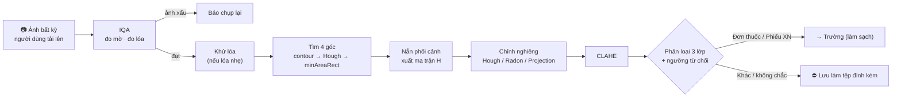

# KẾ HOẠCH CHI TIẾT — HIẾU

> **Vai trò:** Nhóm trưởng  
> **Phần phụ trách:** Mắt xích ① của pipeline — Thu nhận ảnh, Tiền xử lý & Phân loại tài liệu  
> **Việc nhóm trưởng:** khung báo cáo, ghép báo cáo / slide / video, đóng gói `.zip` và nộp bài — xem mục 4  
> **Áp dụng cho:** Đồ án Xử lý ảnh (DIP, hạn **11/11/2026**)  
> **Tài liệu liên quan:** [PhanCong_TongHop.md](PhanCong_TongHop.md) · [DeTai_XuLyAnh_ChiTiet.md](../docs/DeTai_XuLyAnh_ChiTiet.md)

Mục tiêu của tài liệu: đưa phần của Hiếu từ mức "chắc ăn nhưng ít điểm mới" lên **mức tối đa**, bằng cách bổ sung các phần còn thiếu sau:

| Điểm yếu hiện tại | Cách khắc phục trong kế hoạch này |
| :--- | :--- |
| DIP: nắn phối cảnh, deskew, CLAHE là kỹ thuật quen thuộc, có sẵn trong notebook thực hành | Đánh giá như một **bài toán đo lường** trên bộ 5 (ground truth chính xác), so sánh nhiều phương pháp, có **phương án dự phòng** khi không tìm được 4 góc, thêm **khử lóa**, và **so sánh với app scan thương mại** |
| DIP: IQA (đo mờ, đo lóa) chỉ là ngưỡng đặt tay | Đánh giá IQA như **bộ phát hiện** có ROC/AUC; chọn ngưỡng bằng dữ liệu, không đặt tay |

---

## 1. VỊ TRÍ CỦA HIẾU TRONG PIPELINE



**Hợp đồng dữ liệu gửi cho Trường** (✅ chốt với Trường ngày 31/10; code: `code/src/common/contracts.py`, class `PreprocessResult`). Quy ước:

* `rectified_path`: ảnh **màu BGR, đã nắn phối cảnh và chỉnh nghiêng, chưa CLAHE**. CLAHE chỉ chạy trên bản sao dùng cho phân loại. Trường giữ nguyên kích thước và hệ tọa độ của ảnh này khi làm sạch.
* `homography`: **toàn bộ** biến đổi ảnh gốc → `rectified_path`, **gồm cả phép xoay chỉnh nghiêng** ($H = R \cdot H_{persp}$); `skew_deg` chỉ để báo cáo. Muốn chiếu một box trên ảnh đã nắn về ảnh gốc (màn hình xác nhận của Trường) thì nhân với **nghịch đảo** của `H` — hàm `PreprocessResult.to_source()`.
* `corners_src` theo thứ tự **trên-trái, trên-phải, dưới-phải, dưới-trái** trên ảnh gốc; `corner_method = "full_image"` khi không tìm được 4 góc (dùng cả ảnh, chỉ chỉnh nghiêng).
* `doc_type = "other"` thì pipeline dừng, không gửi sang Trường.

Kiểm tra bằng test: `code/tests/test_preprocessing.py` (`test_preprocess_homography_includes_deskew`, `test_preprocess_saves_image_before_clahe`).

```json
{
  "image_id": "rx_000123",
  "rectified_path": "out/rx_000123_rect.png",
  "homography": [[1.02, 0.03, -12.1], [0.01, 0.98, -8.4], [0.0, 0.0, 1.0]],
  "corners_src": [[34, 51], [980, 40], [1002, 1390], [20, 1401]],
  "corner_method": "contour",
  "skew_deg": -2.4,
  "doc_type": "prescription",
  "doc_confidence": 0.94,
  "quality": {"blur_var": 182.5, "glare_ratio": 0.012, "is_blurry": false, "has_glare": false, "glare_removed": false}
}
```

---

## 2. DỮ LIỆU HIẾU DÙNG

| Bộ | Vai trò với Hiếu | Việc cần làm |
| :--- | :--- | :--- |
| **1** VAIPE (đơn thuốc VN, **ảnh phẳng, sạch**) | Lớp `prescription`; **nguồn ảnh sạch của bộ 5** (giữ đúng tỉ lệ, độ phân giải cao) | Không cần gán nhãn |
| **2** Roboflow Report Keywords (phiếu CBC, ảnh chụp) | Lớp `lab_report`; ảnh chụp thật nghiêng | Không cần gán nhãn; **chỉ dùng 57 ảnh gốc** ở `data/2_roboflow_report_keywords/`, bản tăng cường để riêng |
| **3** Tài liệu khác | Lớp `other` | ✅ **Đã lấy (31/10)** bằng `code/scripts/fetch_rvl_cdip.py`: tập con RVL-CDIP gồm các lớp `form`, `invoice`, `letter`, `memo`, `email`, `news article`, `scientific report`, `questionnaire` — mỗi lớp 100 ảnh (50/25/25), tổng 800 ảnh; thêm `openset/` 200 ảnh lớp `budget`, `resume` **không dùng khi chọn tham số** (mục 3.5). Ghi chú license: RVL-CDIP chỉ dùng cho nghiên cứu |
| **4** Ảnh tự chụp | **Tập test độc lập** cho cả nắn phẳng và phân loại | Chụp ≥ 15 ảnh: đơn thuốc, phiếu XN, giấy khám, hóa đơn, CCCD đã che; gán nhãn lớp; **thêm 10 ảnh "loại lạ"** (giấy ra viện, kết quả siêu âm, biên lai) để test open-set |
| **5** Benchmark tổng hợp (Thắng sinh) | Ground truth cho sai số nắn, PSNR/SSIM, phát hiện mờ/lóa | ✅ Đã chốt với Thắng (31/10) — xem checklist nghiệm thu bên dưới |

**Checklist nghiệm thu bộ 5** (Thắng xác nhận 31/10; Thắng giữ manifest + checklist giao nhận; v1 **02/11**, v2 thêm lóa + mask lóa **04/11**):

1. `gt.json` mỗi ảnh: mức độ **mọi** loại hỏng (kể cả 0); `H` ảnh sạch → ảnh hỏng (gộp phối cảnh + xoay); 4 góc giấy trên ảnh hỏng (TL, TR, BR, BL). *H khác chiều với H của tiền xử lý — không sao, chấm bằng 4 góc.*
2. Mẫu âm sinh **độc lập**: ~30% ảnh `blur = 0`, ~30% ảnh `glare = 0`; có cả ảnh không mờ nhưng lóa và ngược lại; **val và test đều có mẫu âm lẫn dương**.
3. Lưới D3 **nằm trong test**: 3 mức phối cảnh (5, 10, 20%) × 5 góc (0, 5, 10, 20, 30°) = 15 ô, mỗi ô ≥ 10 ảnh từ **10 ảnh gốc khác nhau** (≥ 150 ảnh); các ảnh gốc này không xuất hiện ở train / val. Tham số chọn trên tập val hỗn hợp riêng.
4. Tập D4 chỉ xoay: 0, ±2, ±5, ±10, ±15°; giữ kích thước; vùng trống tô màu trung vị viền ảnh sạch (không viền đen, không REPLICATE); `angle_deg` dương = ngược chiều kim đồng hồ.
5. `glare_mask.png` (lóa = 255) cùng hệ tọa độ ảnh hỏng — từ v2.
6. Chia train / val / test theo ảnh gốc.

**Nghiệm thu v1.1** (Hiếu kiểm tra độc lập 02/11 bằng manifest + toàn bộ `labels/*.json`; v1 ngày 01/11 chưa đạt điểm 3, 4):

| # | Kết quả |
| :---: | :--- |
| 1 | ✅ Chiếu 4 góc ảnh sạch qua `H_clean_to_degraded` khớp `corners` trên cả 1.000 mẫu (lệch tối đa 0,005 px); ảnh hỏng / ảnh sạch cùng kích thước; 0 file thiếu. Mức hỏng bằng 0 không ghi trong JSON nhưng đủ trong manifest |
| 2 | ✅ Train, val: 60% không mờ, 60% không bóng. Test: 85% / 85% (lưới D3, tập D4 không có mờ / bóng) → còn ~45 ảnh mờ trong test, đủ vẽ ROC |
| 3 | ✅ **Lưới D3 đủ 15/15 ô**: 3 mức phối cảnh (5, 10, 20%) × 5 góc (0, 5, 10, 20, 30°), mỗi ô 10–12 ảnh từ đúng 10 ảnh gốc khác nhau; 0 ảnh gốc trùng train / val. Thêm ô 2° và 15° (2 ảnh / ô) |
| 4 | ✅ Tập chỉ xoay trong test: **±2, ±5, ±10, ±15°**, mỗi góc 10 ảnh. Nền màu giấy (~245, 0 pixel đen), giữ kích thước, góc dương ngược chiều kim đồng hồ. ⚠️ **Không có 0°** → D4 đo mức 0° trên `clean/` |
| 5 | ✅ **v2.1 (03/11):** `glare_mask/` cùng kích thước ảnh hỏng, rỗng ⇔ `glare_level = 0`, diện tích khớp `glare_area_ratio`; ngoài mask ảnh không đổi. 13% mẫu lóa mỗi tập, 3 mức đều nhau (diện tích 0,3 / 3,3 / 11,5% ảnh); val chỉ 20 mẫu lóa. v2 (sáng 03/11) giấy scan = 255 nên lóa không làm giấy sáng thêm (bộ phát hiện IoU = 0) → Thắng sửa v2.1: giảm phơi sáng 0,80–0,92 trước khi thêm lóa, thêm `clean_exposed/` cho D5; IoU bộ phát hiện hiện tại 0,13 / 0,61 / 0,76 theo mức. v1 khớp checksum 6.000/6.000 |
| 6 | ✅ 60 / 10 / 30 ảnh gốc, không trùng giữa các tập |

**Lưu ý khi chạy D2, D3:** 290 mẫu chỉ xoay (không phối cảnh) có góc giấy **nằm ngoài khung** (giữ kích thước nên xoay làm mất góc) → loại khỏi D2, D3; chỉ dùng cho D4. Mẫu chỉ mờ / chỉ bóng có 4 góc trùng khung ảnh → kết quả đúng là `full_image`. Cấu trúc thư mục từ 02/11: `<split>/images|labels|clean|clean_binary|shadow_mask|page_mask/<sample_id>`.

**Thực tế dữ liệu đã tải** (kiểm tra 31/10, bộ 1–2 lấy từ Drive chung của nhóm — xem `code/README.md` mục 7; cập nhật 08/11: bỏ bộ Roboflow đơn thuốc Ấn Độ, Report Keywords chỉ giữ ảnh gốc):

| Bộ | File train / valid / test | **Ảnh gốc thật** | Kích thước | Nhãn |
| :--- | :--- | :---: | :--- | :--- |
| 1 | 1.173 / 0 / 172 | 1.345 | Giữ tỉ lệ gốc (760×1070, 1150×1600, …) | JSON từng dòng chữ (`text`, `label`, `box`); tập test không có nhãn |
| 2 | 39 / 11 / 7 | **57** (bản tăng cường của train để riêng ở `2_roboflow_report_keywords_augmented/`, không dùng) | **Toàn bộ bị ép về 640×640** | YOLO 5 lớp: Report Type, parameter, reference value, unit, value |

Hệ quả cho phần Hiếu:

* **Bộ 1 là ảnh phẳng** (nguồn sạch cho bộ 5); ảnh chụp thật để thử nắn phẳng lấy từ bộ 2 và bộ 4.
* **Bộ 2 đã mất tỉ lệ khung gốc** (ép 640×640) → đo được góc / tìm 4 góc trên ảnh thật, nhưng tỉ lệ khung ảnh sau nắn không có ý nghĩa; sai số nắn định lượng chỉ đo trên bộ 5.
* **Mất cân bằng nặng:** `lab_report` chỉ 57 ảnh gốc so với ~1.300 ảnh `prescription` → cần thêm phiếu XN từ bộ 4 (ưu tiên khi chụp) và có thể nguồn khác; báo cáo Balanced Accuracy / Macro-F1, undersample `prescription` khi train.
* **Nguy cơ học thuộc nguồn rất cao:** kích thước 640×640, ảnh xám hóa, nhiễu muối tiêu do tăng cường Roboflow đủ để đoán nguồn → bắt buộc chuẩn hóa ảnh (mục 3.5) và kiểm chứng trên bộ 4.
* **Bản tăng cường Roboflow:** từ 08/11 không dùng; bộ 2 chỉ còn một ảnh cho mỗi ảnh gốc (phần tên trước `.rf.`).

---

## 3. MÔN DIP — CHI TIẾT

### 3.1. Các bước và thuật toán

| Bước | Thuật toán chính | Phương án so sánh | Tham số khởi điểm (sẽ tinh chỉnh ở 3.3) |
| :--- | :--- | :--- | :--- |
| **Chuẩn hóa kích thước** | Resize cạnh dài về 1000 px cho các bước dò tìm; giữ ảnh gốc để nắn | — | `long_side = 1000` |
| **Đo mờ** | Phương sai toán tử Laplacian trên ảnh xám | Tenengrad (Sobel), năng lượng tần số cao FFT | ngưỡng mờ ≈ 100 (chọn bằng ROC) |
| **Đo lóa** | Tỉ lệ pixel có V > ngưỡng và S < ngưỡng (vùng trắng cháy) trong HSV; lọc thành phần liên thông nhỏ | Ngưỡng toàn cục trên ảnh xám | `V > 240`, `S < 30`; **< 1%**: không lóa · **1–8%**: lóa nhẹ → khử · **> 8%**: báo chụp lại |
| **Khử lóa** *(mới)* | Inpainting vùng lóa: Telea và Navier–Stokes | Không khử | bán kính 5 px; chỉ chạy khi lóa nhẹ (1–8%) |
| **Tìm 4 góc** | Canny → `findContours` → `approxPolyDP` lấy tứ giác lồi lớn nhất | **Dự phòng 1:** Hough lines, chọn 2 cạnh ngang + 2 cạnh dọc trội nhất, lấy giao điểm. **Dự phòng 2:** `minAreaRect` của contour lớn nhất | Canny 50/150, `epsilon = 0.02 × chu vi`, diện tích tứ giác ≥ 20% ảnh |
| **Nắn phối cảnh** | `getPerspectiveTransform` + `warpPerspective` với nội suy bicubic; xuất ma trận `H` | Nội suy bilinear | kích thước đích theo độ dài cạnh lớn nhất |
| **Chỉnh nghiêng** | Projection Profile: xoay thử, chọn góc cho phương sai profile ngang lớn nhất | Hough lines (góc trung vị), Radon transform | dải ±15°, bước 0,25° |
| **CLAHE** | CLAHE trên kênh L của Lab | Cân bằng histogram toàn cục | `clipLimit = 2.0`, `tileGridSize = 8×8` |
| **Phân loại** | HOG + $k$-NN, ngưỡng từ chối theo khoảng cách | Histogram màu + $k$-NN | xem mục 3.5 |

### 3.2. Thí nghiệm và độ đo

| # | Thí nghiệm | Dữ liệu | Độ đo | Hình / bảng đưa vào báo cáo |
| :---: | :--- | :--- | :--- | :--- |
| **D1** | IQA như bộ phát hiện: mờ / không mờ, lóa / không lóa | Bộ 5 (biết mức mờ, mask lóa) | **ROC, AUC**, F1 tại ngưỡng chọn; IoU mask lóa | Đường ROC của Laplacian vs Tenengrad vs FFT |
| **D2** | Tìm 4 góc: contour vs Hough vs minAreaRect vs **kết hợp có dự phòng** | Bộ 5 | **Tỉ lệ thành công** (sai số < 2% đường chéo), sai số góc trung bình (px và % đường chéo) | Bảng 4 phương án |
| **D3** | Sai số nắn theo mức độ méo | Bộ 5 | Sai số góc theo góc nghiêng 0°→30° và 3 mức phối cảnh | **Đường cong** — hình chính của phần Hiếu |
| **D4** | Chỉnh nghiêng: Hough vs Radon vs Projection | Bộ 5, **tập con chỉ xoay** (không phối cảnh, chạy chỉnh nghiêng trực tiếp — nếu nắn phối cảnh trước thì ảnh đã thẳng, không còn góc để đo) + ảnh chụp thật bộ 2, bộ 4 | Sai số góc (độ), thời gian (ms) | Bảng 3 phương án |
| **D5** | Khử lóa: không khử vs Telea vs Navier–Stokes | Bộ 5 (có ảnh sạch) | PSNR / SSIM **trong vùng lóa**, CER sau OCR | Ảnh trước–sau + bảng |
| **D6** | Hiệu quả toàn bước tiền xử lý lên OCR | Bộ 5 + bộ 2 + bộ 4 | **CER** ảnh gốc vs sau tiền xử lý; PSNR / SSIM so với ảnh sạch (bộ 5) | Bảng + đường CER theo mức hỏng |
| **D7** | **So sánh với app scan thương mại** *(mới)* | 20 ảnh bộ 4 chụp thật | CER sau OCR, tỉ lệ nắn đúng (đánh giá bằng mắt, 2 người chấm), thời gian | Bảng: Pipeline nhóm vs Google Drive Scan / Adobe Scan / CamScanner *(kiểm tra app còn hoạt động trước khi làm; Microsoft Lens đã có thông báo ngừng hỗ trợ)* |
| **D8** | Ablation phần Hiếu | Bộ 5 | CER khi tắt lần lượt: khử lóa, nắn phối cảnh, chỉnh nghiêng, CLAHE | Bảng ablation |
| **D9** | Thời gian chạy | Bộ 5 | ms/ảnh từng bước trên CPU | Bảng nhỏ |
| **D10** | Phân loại 3 lớp (phần DIP) | Bộ 1–4 | Accuracy, Macro-F1, Confusion Matrix; tỉ lệ tài liệu khác lọt vào pipeline | Confusion Matrix |

> **D7 thực hiện thế nào:** dùng app trên điện thoại chụp lại đúng 20 tờ giấy của bộ 4 trong cùng điều kiện ánh sáng, xuất ảnh, cho qua **cùng một bộ OCR** với ảnh của pipeline nhóm. Ghi rõ trong báo cáo đây là so sánh tham khảo vì app thương mại dùng thuật toán và camera khác.

### 3.3. Bảng tham số & lý do chọn (yêu cầu của đề)

Mỗi tham số chọn trên **tập validation của bộ 5**, có hình "độ đo theo tham số" trong phụ lục:

| Tham số | Khoảng thử | Chọn bằng | Ghi vào báo cáo |
| :--- | :--- | :--- | :--- |
| Ngưỡng phương sai Laplacian | 20 → 400 | Điểm tối ưu F1 trên đường ROC (D1) | Giá trị + AUC |
| Ngưỡng V, S cho lóa | V 220–250, S 20–60 | IoU mask lóa lớn nhất | Giá trị + IoU |
| `epsilon` của `approxPolyDP` | 0,01–0,05 × chu vi | Tỉ lệ thành công tìm góc (D2) | Giá trị + tỉ lệ |
| Ngưỡng Canny | (30,90) → (100,200) | Tỉ lệ thành công tìm góc | Giá trị |
| Bước góc chỉnh nghiêng | 0,1° – 1° | Đánh đổi sai số góc và thời gian (D4) | Giá trị |
| `clipLimit`, `tileGridSize` của CLAHE | 1–4; 4×4–16×16 | CER thấp nhất (D6) | Giá trị |

### 3.4. Cấu trúc code

```
code/src/preprocessing/
├── quality.py        # blur_score(), glare_mask(), assess_quality()
├── glare.py          # remove_glare(method="telea" | "ns")
├── corners.py        # find_corners_contour(), find_corners_hough(), find_corners_minrect(), find_corners()  ← có dự phòng
├── rectify.py        # rectify(img, corners) -> (warped, H)
├── deskew.py         # deskew_projection(), deskew_hough(), deskew_radon()
├── enhance.py        # apply_clahe()
└── pipeline.py       # preprocess(img) -> dict theo hợp đồng dữ liệu ở mục 1
code/src/classification/
├── features.py       # hog_features(), lbp_hist(), layout_density(), line_ratio()
└── classify.py       # train_knn(), predict_with_reject()
code/experiments/
├── d1_iqa_roc.py … d9_runtime.py   # mỗi thí nghiệm một script, xuất CSV + hình vào results/
code/tests/
└── test_preprocessing.py           # kiểm tra trên 5 ảnh mẫu: tìm được góc, H khả nghịch, ảnh ra đúng kích thước
```

### 3.5. Đặc trưng và chuẩn hóa ảnh cho phân loại (D10)

Đặc trưng trích trong `classification/features.py`, dùng cho HOG + $k$-NN và phương án đối chứng Histogram màu + $k$-NN:

| Nhóm | Chi tiết | Số chiều (ước lượng) |
| :--- | :--- | :---: |
| **HOG** | Ảnh xám 256×256; 9 hướng, ô 16×16, khối 2×2 | ~8.100 → PCA còn 100–200 |
| **LBP** | LBP P = 8, R = 1, `method="nri_uniform"` (scikit-image, 59 bin; nếu dùng `"uniform"` thì chỉ còn 10 bin); histogram toàn ảnh + lưới 2×2 | 59 × 5 |
| **Mật độ bố cục** | Tỉ lệ pixel mực trên lưới 3×3 và 6×6 sau nhị phân hóa | 9 + 36 |
| **Đường kẻ** | Tỉ lệ pixel đường kẻ ngang / dọc (opening với SE 1×40 và 40×1) | 2 |
| **Khối văn bản** | Số dòng (projection), độ rộng dòng trung bình, tỉ lệ vùng trắng | ~5 |

Để bộ phân loại không học "kiểu ảnh của từng nguồn" thay vì loại tài liệu:

* **Chuẩn hóa ảnh trước khi trích đặc trưng:** ảnh xám, CLAHE, nhị phân hóa, cắt bỏ viền, resize cố định, nén lại JPEG cùng chất lượng, lọc trung vị để xóa nhiễu muối tiêu do tăng cường Roboflow → xóa bớt "dấu vân tay" của từng nguồn (bộ 2 640×640, bộ 1 giữ tỉ lệ gốc).
* Kết quả chính của D10 báo cáo trên **bộ 4** (ảnh tự chụp, không thuộc nguồn nào lúc chọn tham số).
* Tài liệu lạ: 10 ảnh tự chụp mang dáng y tế (giấy ra viện, kết quả siêu âm, biên lai) và `openset/` của bộ 3 (lớp RVL-CDIP **không dùng khi chọn tham số**) — báo cáo riêng tỉ lệ bị xếp vào `other` hoặc bị từ chối bằng ngưỡng khoảng cách.

---

## 4. VIỆC NHÓM TRƯỞNG: KHUNG, GHÉP, ĐÓNG GÓI, NỘP

| Mốc | Việc |
| :--- | :--- |
| **01–02/11** | Gửi khung báo cáo DIP (4–10 trang): Đặt vấn đề → Dữ liệu (gồm bộ 5) → Phương pháp (4 module) → Thực nghiệm → Thảo luận → Phân công & khai báo AI. Mỗi người ~1,5–2 trang, **1 bảng + 1 hình chính**, phần còn lại vào phụ lục |
| **08/11** | Nhận phần của Trường (kèm bảng ablation T8), Khang, Thắng; kiểm tra số liệu, hình, bảng tham số; nhận phần nào ghép phần đó |
| **09/11** | Ghép báo cáo, slide 10–15 trang; dựng video ≤ 3 phút từ đoạn demo 30 giây của mỗi người; gửi cả nhóm duyệt |
| **10/11** | Đóng gói `LopXX_NhomYY_TenDeTai.zip`: `code/`, `requirements.txt`, `samples/` (5–10 ảnh), `README.md`, báo cáo PDF, slide `.pptx` + `.pdf`, video; kiểm tra chạy được trên máy sạch |
| **11/11** | Nộp qua email `uyenvnb@ptit.edu.vn`, tiêu đề trùng tên file |

---

## 5. LỊCH LÀM VIỆC (ĐẾN HẠN 11/11)

| Ngày | Việc | Kết quả kiểm tra được |
| :--- | :--- | :--- |
| **30–31/10** | Tải bộ 1–2, lấy tập con RVL-CDIP; chụp 15 + 10 ảnh bộ 4; gửi Thắng yêu cầu cho bộ 5; chốt JSON với Trường | Thư mục `data/` có đủ, file JSON mẫu |
| **01/11** | `quality.py`, `corners.py` (contour), `rectify.py`, `enhance.py` chạy trên 10 ảnh | 10 ảnh trước/sau |
| **02/11** | Hough + minAreaRect dự phòng; `deskew.py` 3 cách; `glare.py` | Unit test xanh |
| **03/11** | Có bộ 5 v1 (Thắng, 02/11) → D1 **phần mờ**, D2, D4 | 3 bảng / hình đầu tiên |
| **04/11** | Phân loại HOG + k-NN (D10); nhận bộ 5 v2 (có mask lóa) | Confusion Matrix |
| **05/11** | **Mốc tích hợp:** `preprocess()` chạy đầu-cuối cùng module của Trường, Khang, Thắng | Pipeline chạy trên 5 ảnh |
| **06/11** | D1 **phần lóa**, D5 khử lóa (cần mask lóa của v2); D3 đường cong | Đường ROC lóa, bảng D5, đường cong D3 |
| **07/11** | D6 CER (dùng bộ OCR của Khang), D8 ablation, D9 thời gian; bảng tham số 3.3 | Đủ hình / bảng cho báo cáo |
| **08/11** | Viết phần Hiếu trong báo cáo DIP (1,5–2 trang), 2–3 slide, đoạn demo 30 giây, README module; nhận phần của 3 bạn | Đủ 4 phần trước tối 08/11 |
| **09/11** | Ghép báo cáo, slide, video (mục 4); D7 so sánh app thương mại nếu kịp → phụ lục | Bản ghép gửi nhóm duyệt |
| **10/11** | Đóng gói `.zip`, chạy thử trên máy sạch; tập trình bày, sửa theo góp ý | File `.zip` |
| **11/11** | **Nộp đồ án DIP** qua email | Đã nộp |

**Phụ thuộc vào bạn khác:** bộ 5 v1 (Thắng, 02/11) và v2 có mask lóa (04/11) · bộ OCR `src/ocr/` (Khang, 01/11) cho D6, D7 · ảnh VAIPE (Thắng kiểm tra 31/10).

---

## 6. RỦI RO & PHƯƠNG ÁN DỰ PHÒNG

| Rủi ro | Dấu hiệu | Phương án |
| :--- | :--- | :--- |
| Bộ 5 của Thắng trễ | Đến 03/11 chưa có | Tự sinh bản đơn giản (chỉ phối cảnh + mờ) bằng `warpPerspective` + `GaussianBlur` trên 50 ảnh bộ 1 (ảnh phẳng, sạch) |
| Thiếu phiếu xét nghiệm | Bộ 2 chỉ 57 ảnh gốc | Ưu tiên phiếu XN khi chụp bộ 4 (nhờ cả nhóm); tìm thêm nguồn phiếu XN công khai; báo cáo theo Macro-F1, Balanced Accuracy |
| Không tìm được 4 góc trên ảnh chụp màn hình / giấy sát mép | Tỉ lệ thành công D2 < 70% | Dùng toàn ảnh làm vùng tài liệu, chỉ chỉnh nghiêng; ghi rõ là hạn chế |
| Phân loại đạt ~100% nhưng sập trên bộ 4 | Khoảng cách > 15 điểm | Đây chính là phát hiện "học thuộc nguồn" — trình bày cùng D10 (mục 3.5), không giấu |
| Thiếu ảnh "loại lạ" | < 10 ảnh | Dùng thêm 2 lớp RVL-CDIP không có trong train |
| Không kịp D7 | Đến 08/11 chưa làm | Bỏ D7 (là phần cộng thêm), giữ D1–D6 |

**Thứ tự cắt khi thiếu thời gian (cắt từ dưới lên):** D7 → D5 → D9. **Không cắt:** D2, D3, D6, D10, bộ 4.

---

## 7. CHUẨN BỊ HỎI ĐÁP

| Câu hỏi dễ gặp | Hướng trả lời |
| :--- | :--- |
| Vì sao dùng phương sai Laplacian để đo mờ? | Laplacian là toán tử đạo hàm bậc 2, nhạy với cạnh; ảnh mờ ít cạnh sắc → phương sai nhỏ. Đã so với Tenengrad và FFT bằng ROC (D1) |
| Ngưỡng mờ chọn thế nào? | Không đặt tay: chọn điểm tối ưu F1 trên đường ROC của tập validation bộ 5 |
| Khi không tìm được 4 góc thì sao? | Có 2 lớp dự phòng (Hough, minAreaRect); tỉ lệ thành công từng phương án ở D2 |
| Vì sao chỉnh nghiêng sau khi đã nắn phối cảnh? | Nắn phối cảnh dựa trên mép giấy; khi mép giấy không song song với dòng chữ (giấy in lệch) vẫn còn góc nghiêng nhỏ |
| Vì sao CLAHE thay vì cân bằng histogram toàn cục? | Ảnh chụp có ánh sáng không đều; CLAHE cân bằng theo từng ô và giới hạn khuếch đại nhiễu |
| Bộ 5 là ảnh tổng hợp, có thực tế không? | Bộ 5 cho ground truth chính xác để so sánh phương pháp; kết luận được kiểm chứng lại trên ảnh chụp thật (bộ 2, bộ 4) và so với app thương mại (D7) |
| Bộ phân loại có học thuộc nguồn không? | Chuẩn hóa ảnh trước khi trích đặc trưng (mục 3.5); con số chính báo cáo trên bộ 4 |
| Gặp giấy chưa từng thấy thì sao? | Ngưỡng từ chối theo khoảng cách $k$-NN; đo tỉ lệ tài liệu lạ lọt vào pipeline (D10, mục 3.5) |

---

## 8. CHECKLIST CUỐI

**DIP**
- [ ] Module `preprocessing/`, `classification/` có unit test, chạy được từ một lệnh
- [ ] D1–D6, D8–D10 có số liệu; D7 nếu kịp
- [ ] Đường cong sai số nắn theo góc nghiêng (D3)
- [ ] Bảng tham số & lý do chọn
- [ ] Phần báo cáo 1,5–2 trang, 2–3 slide, đoạn demo 30 giây, README module

**Chung**
- [ ] 25 ảnh bộ 4 (15 thường + 10 loại lạ) đã che thông tin cá nhân
- [ ] JSON hợp đồng dữ liệu đã chốt với Trường
- [ ] Trả lời được câu hỏi về phần của 3 bạn còn lại
