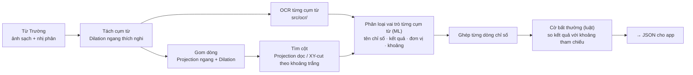

# KẾ HOẠCH CHI TIẾT — KHANG

> **Phần phụ trách:** Mắt xích ③ của pipeline — Phiếu xét nghiệm: dựng bảng, vai trò từng cụm từ (ô kết quả), cờ bất thường  
> **Áp dụng cho:** Đồ án Xử lý ảnh (DIP, hạn **11/11/2026**) · Bài tập lớn Học máy (ML) · Mobile App MedTrack (module `03-lab-test`)  
> **Việc dùng chung:** bộ OCR (`src/ocr/`) — Khang cần OCR sớm nhất nên dựng trước, cả nhóm dùng lại  
> **Tài liệu liên quan:** [PhanCong_TongHop.md](PhanCong_TongHop.md) · [DeTai_XuLyAnh_ChiTiet.md](../dip/docs/DeTai_XuLyAnh_ChiTiet.md) · [KeHoach_BTL_MachineLearning.md](../ml/docs/KeHoach_BTL_MachineLearning.md)

| Điểm yếu / rủi ro hiện tại | Cách khắc phục trong kế hoạch này |
| :--- | :--- |
| DIP: dựng bảng **không kẻ lưới** là bài khó nhất đề tài, dễ không xong | Chia nhỏ thành dòng → cột → ô, mỗi tầng có độ đo riêng; ước lượng tham số theo **chiều cao chữ của từng ảnh** thay vì cố định; có phương án dự phòng |
| DIP: chưa có ground truth cấu trúc bảng | Suy ra dòng / cột chuẩn từ **nhãn cụm từ (ô kết quả) có sẵn** của bộ 3 — không phải vẽ tay |
| ML: bài toán cũ có nhãn lộ vào đặc trưng | Đổi sang **phân loại vai trò từng cụm từ**; cờ bất thường là luật chạy sau |
| ML: đặc trưng từng cụm từ độc lập dễ nhầm (đơn vị ↔ kết quả) | Thêm **đặc trưng ngữ cảnh** (cụm bên trái / phải, cột), so sánh có / không ngữ cảnh |
| OCR chưa ai phụ trách | Khang dựng `src/ocr/` trước 01/11, cả nhóm dùng |

---

## 1. VỊ TRÍ TRONG PIPELINE



**Hợp đồng dữ liệu gửi cho app:**

```json
{
  "image_id": "lab_000045",
  "report_type": "CBC",
  "rows": [
    {"bbox": [60, 410, 820, 28], "parameter": "HB", "result": 14.9, "unit": "g/dl",
     "range": [13.5, 17.5], "flag": "NORMAL", "loinc": "718-7", "confidence": 0.91}
  ]
}
```

---

## 2. DỮ LIỆU

| Bộ | Vai trò | Việc cần làm |
| :--- | :--- | :--- |
| **3** Report Keywords (phiếu CBC, ảnh chụp, bảng không kẻ) | Dữ liệu chính cho DIP và ML; **nhãn vai trò từng cụm từ** có sẵn | **31/10:** xác nhận tên nhãn chính xác và số ảnh; viết script suy ra dòng / cột chuẩn từ nhãn (gom box cụm từ theo tọa độ y, x) |
| **5** Ảnh tự chụp | Phiếu xét nghiệm Việt Nam (có bảng kẻ, chữ đỏ, H/L) để kiểm chứng | Bản local hiện có **48 ảnh lab** trong bộ 5; Khang review/ẩn danh các ảnh được giao, gán box + role cho ~10 phiếu, chép transcript thủ công cho crop dùng đánh giá OCR |
| `Anh_Xa.json` | Chuẩn hóa tên chỉ số → LOINC, đơn vị → UCUM | Dùng cho app và cho đặc trưng từ điển |

Bộ 5 hiện chia theo thư mục loại tài liệu nhưng **chưa review nội dung, chưa gán nhãn chi tiết và chưa chia split**. Trạng thái ẩn danh chưa được xác nhận; cần duyệt/che thông tin cá nhân trước khi dùng benchmark. Theo phân công ban đầu, bộ 5 là tập kiểm thử độc lập, không dùng train/tinh chỉnh; sau khi review và gán nhãn, nhóm chốt danh sách test theo task, không tách ảnh cùng tài liệu sang nhiều tập. Không tự đưa bộ 5 vào train/valid nếu nhóm chưa thống nhất đổi quy định.

**Ground truth cấu trúc bảng suy ra từ bộ 3:** dòng chuẩn = nhóm các box cụm từ có tâm y gần nhau (khoảng cách < 0,5 chiều cao box trung vị); cột chuẩn = theo nhãn vai trò (cột tên chỉ số, kết quả, đơn vị, khoảng). Kiểm tra bằng mắt 20 ảnh để chắc cách suy ra đúng.

---

## 3. VIỆC DÙNG CHUNG: BỘ OCR

| Hạng mục | Chi tiết |
| :--- | :--- |
| Tiếng Anh (bộ 2, bộ 3) | Tesseract 5 (`--psm 7` cho từng cụm từ / dòng) và PaddleOCR; chọn bộ tốt hơn theo CER trên 50 cụm từ của bộ 3 |
| Tiếng Việt (bộ 1, bộ 5) | VietOCR (mô hình `vgg_transformer`) cho từng dòng |
| Giao diện | `ocr_word(img_crop, lang)`, `ocr_line(img_crop, lang)` → `(text, confidence)`; cache kết quả theo hash ảnh |
| Đánh giá | Hàm `cer(pred, gt)`, `wer(pred, gt)` dùng thư viện `jiwer`, cả nhóm dùng chung |
| Hạn | **01/11** — Hiếu, Trường, Thắng cần để đo CER |

---

## 4. MÔN DIP — CHI TIẾT

### 4.1. Các bước và thuật toán

| Bước | Thuật toán chính | Phương án so sánh | Tham số khởi điểm |
| :--- | :--- | :--- | :--- |
| **Ước lượng chiều cao chữ** | Trung vị chiều cao các thành phần liên thông | — | lọc thành phần quá nhỏ / quá lớn |
| **Tách cụm từ** | Dilation ngang SE ≈ 0,5 × chiều cao chữ → nối nét thành các cụm từ liên thông | — | 0,3–0,8 × chiều cao chữ |
| **Gom dòng** | Projection Profile ngang trên ảnh đã Dilation ngang (SE ≈ 3 × chiều cao chữ); tách dòng tại cực tiểu | Gom cụm từ theo tâm y với khoảng cách cố định | độ rộng SE 2–5 × chiều cao chữ |
| **Tìm cột** | Projection Profile dọc; cột tách tại các dải trắng liên tục xuyên qua đa số dòng | **Connected Components + XY-cut đệ quy** · Gom theo khoảng cách x cố định | dải trắng ≥ 1 × chiều cao chữ, xuyên ≥ 60% số dòng |
| **Ghép ô** | Giao dòng × cột; gán mỗi cụm từ vào ô có diện tích giao lớn nhất | — | — |
| **Ảnh chụp màn hình / nghiêng nhẹ** | Dựa vào chỉnh nghiêng của Hiếu; với nghiêng còn sót < 3°, gom dòng theo đường hồi quy tâm y thay vì projection thẳng | — | — |
| *Mở rộng nếu kịp* | Bảng có kẻ: Closing ngang (SE 1 × W/20) và dọc (SE H/20 × 1) lấy lưới; cờ chữ đỏ HSV trên phiếu VN | — | — |

### 4.2. Thí nghiệm và độ đo

| # | Thí nghiệm | Dữ liệu | Độ đo | Hình / bảng |
| :---: | :--- | :--- | :--- | :--- |
| **K1** | Gom dòng: Projection + Dilation vs gom tâm y cố định | Bộ 3 | **Độ chính xác gán cụm từ vào dòng**, IoU dòng | Bảng |
| **K2** | Tìm cột: 3 phương án (Projection, XY-cut, khoảng cách cố định) | Bộ 3 | Độ chính xác gán cụm từ vào cột; **F1 quan hệ kề** (cặp ô cùng dòng / cùng cột, kiểu ICDAR table structure) | **Bảng chính** của phần Khang |
| **K3** | Độ bền theo độ nghiêng | Bộ 3 xoay thêm 0°→5° | Độ chính xác gán dòng theo góc | Đường cong |
| **K4** | Tham số tự thích nghi vs cố định | Bộ 3 (ảnh có độ phân giải khác nhau) | Độ chính xác gán dòng / cột | Bảng — chứng minh lợi ích của việc ước lượng theo chiều cao chữ |
| **K5** | OCR theo ô cụm từ vs OCR cả trang | Bộ 3 (+ bộ 5) | CER, tỉ lệ dòng chỉ số đọc đúng đủ 4 trường | Bảng |
| **K6** | Kiểm chứng trên phiếu Việt Nam | Bộ 5 | Như K1, K2 | Bảng nhỏ + ví dụ |
| **K7** | Thời gian chạy | Bộ 3 | ms/ảnh | Bảng nhỏ |

### 4.3. Bảng tham số & lý do chọn

| Tham số | Khoảng thử | Chọn bằng |
| :--- | :--- | :--- |
| Hệ số SE tách cụm từ (× chiều cao chữ) | 0,3–0,8 | Tỉ lệ tách đúng cụm từ so với box nhãn bộ 3 |
| Hệ số SE gom dòng | 2–5 | K1 |
| Độ rộng dải trắng tách cột; % dòng phải xuyên qua | 0,5–2 × chiều cao chữ; 40–80% | K2 |
| Ngưỡng gán cụm từ vào ô (IoU) | 0,3–0,7 | K2 |

### 4.4. Cấu trúc code

```
code/src/ocr/                # dùng chung
├── engines.py   # ocr_word(), ocr_line()
└── metrics.py   # cer(), wer()
code/src/table_extraction/
├── geometry.py  # char_height(), words_from_binary() (trích xuất cụm từ)
├── rows.py      # rows_projection(), rows_fixed()
├── columns.py   # columns_projection(), columns_xycut(), columns_fixed()
├── cells.py     # assign_words_to_cells()
├── flags.py     # parse_number(), parse_range(), flag(result, range)
└── pipeline.py  # extract_table(img) -> JSON theo hợp đồng
code/experiments/k1_rows.py … k7_runtime.py
code/tests/test_table.py
```

---

## 5. MÔN ML — BÀI TOÁN 3: PHÂN LOẠI VAI TRÒ TỪNG CỤM TỪ (Ô KẾT QUẢ)

### 5.1. Bài toán

* **Đơn vị mẫu:** mỗi cụm từ (bounding box nhãn) trên phiếu xét nghiệm.
* **Lớp:** `report_type`, `parameter`, `result`, `unit`, `range` (+ `other` nếu bộ 3 có box không gán nhãn).
* **Câu hỏi nghiên cứu:**
  1. Đặc trưng thủ công + mô hình cổ điển so với YOLOv8 học đầu-cuối trên cụm từ thế nào?
  2. Ngữ cảnh (cụm lân cận, cột) đóng góp bao nhiêu?
  3. Lỗi vai trò lan sang cờ bất thường đến mức nào?

### 5.2. Đặc trưng

| Nhóm | Chi tiết |
| :--- | :--- |
| Hình học | Tâm x, y chuẩn hóa theo trang và theo dòng; chiều rộng, chiều cao box; thứ tự cụm từ trong dòng; chỉ số cột (từ DIP) |
| Ký tự (từ OCR) | Độ dài; tỉ lệ chữ số / chữ cái / ký hiệu; có dạng số thập phân; có dạng khoảng `a-b`; có `^`, `/`, `%`; viết hoa toàn bộ |
| Từ vựng | TF-IDF n-gram ký tự (2–4); có trong từ điển đơn vị (UCUM) hoặc tên chỉ số (`Anh_Xa.json`) |
| **Ngữ cảnh** | Các đặc trưng ký tự của cụm bên trái, bên phải; vai trò phổ biến của cột; số cụm trong dòng |
| Độ tin cậy OCR | Confidence của OCR |

### 5.3. Mô hình và đánh giá

| Hạng mục | Cách làm |
| :--- | :--- |
| Mô hình | $k$-NN, Naive Bayes, Logistic Regression, Random Forest, SVM |
| **Chia dữ liệu** | `GroupKFold`, **group = phiếu** |
| Chọn siêu tham số | Nested CV |
| Độ đo | Macro-F1, F1 từng lớp, Confusion Matrix |
| Ablation | Hình học · ký tự · từ vựng · ngữ cảnh: bỏ từng nhóm |
| Kiểm định | Bootstrap 95% theo phiếu; McNemar giữa mô hình tốt nhất và YOLOv8 |
| Learning curve | Macro-F1 theo số phiếu train |

### 5.4. Điểm cộng: YOLOv8 học đầu-cuối

* Huấn luyện YOLOv8-Nano trên nhãn vai trò cụm từ có sẵn của bộ 3 (ảnh → box cụm từ + vai trò).
* So sánh với "DIP tách cụm từ + OCR + mô hình cổ điển" trên cùng tập test: Macro-F1 vai trò (khớp box IoU > 0,5), mAP@0.5, thời gian, khả năng chạy trên phiếu Việt Nam (bộ 5).
* Câu chuyện: học đầu-cuối mạnh khi cùng phân phối, đặc trưng thủ công bền hơn khi đổi mẫu phiếu (hoặc ngược lại — báo cáo đúng kết quả).

### 5.5. Lan truyền lỗi sang cờ bất thường

* Cờ bất thường = luật: `result < range.low → LOW`, `> range.high → HIGH`.
* Đo độ chính xác cờ khi dùng (1) vai trò thật, (2) vai trò dự đoán, (3) vai trò dự đoán + OCR → biết lỗi đến từ đâu.

### 5.6. Phân tích lỗi

Nhóm lỗi: đơn vị bị nhầm thành kết quả (`10^3/uL`, `%`) · khoảng tham chiếu bị tách đôi (`13.5` `-` `17.5`) · tên chỉ số viết tắt nhầm thành đơn vị (`MCV`, `fL`) · OCR đọc sai làm hỏng đặc trưng ký tự. Mỗi nhóm: tỉ lệ %, ví dụ, SHAP.

### 5.7. Kết quả cần có trong báo cáo ML (phần Khang)

Bảng 5 mô hình + YOLOv8 (Macro-F1 ± CI) · Confusion Matrix · Bảng ablation nhóm đặc trưng (nhấn mạnh ngữ cảnh) · Learning curve · Bảng lan truyền lỗi sang cờ · Phân loại lỗi.

---

## 6. MOBILE APP — `03-lab-test`

> **Ưu tiên thấp đến sau 11/11.**

| Màn hình | Nội dung |
| :--- | :--- |
| `l01` tổng quan · `l04` danh sách phiếu | Danh sách theo thời gian, nơi khám |
| `l02`, `l03` xác nhận phiếu · `l10` phiếu gốc khoanh vùng | Dùng **component xác nhận của Trường**, đổ JSON hợp đồng ở mục 1 |
| `l05` chi tiết dạng thanh · `l09` chi tiết một chỉ số | Thanh so với khoảng tham chiếu in trên phiếu |
| `l06`, `l07`, `l08` biểu đồ xu hướng | Nhiều điểm, mục tiêu bác sĩ, tách chuỗi khi đổi đơn vị / phòng xét nghiệm |
| `l11` chế độ người cao tuổi | Chữ to, ít thông tin |
| Thành phần chung | Component biểu đồ; chuẩn hóa tên chỉ số → LOINC, đơn vị → UCUM theo `Anh_Xa.json` |

---

## 7. LỊCH LÀM VIỆC

### 7.1. Đến hạn DIP (11/11)

| Ngày | Việc | Kết quả kiểm tra được |
| :--- | :--- | :--- |
| **30–31/10** | ✅ Tải bộ 3, xác nhận tên nhãn. 🔄 Thử nghiệm script suy dòng/cột trên 20 ảnh; chờ ảnh sạch từ Hiếu và Trường trước khi chốt ground truth. 🔄 Hợp đồng JSON ② → ③ đang chờ Trường phản hồi. | Đã thống kê 135 ảnh, 5 nhãn, 8.198 box; script sinh 397 dòng ứng viên, chưa nghiệm thu. Chi tiết cập nhật 31/10 ở mục 11. |
| **01/11** | ✅ Hoàn thành bộ OCR dùng chung (`src/ocr/engines.py`), `flags.py`, và nghiệm thu handoff fixture ② → ③ | `engines.py` bọc 3 engine (Tesseract/Paddle/VietOCR) với lazy load & cache model; test nhận diện crop mẫu conf=0.91, test tiếng Việt CER=0.0, WER=0.0. `flags.py` đạt 14/14 test. Nghiệm thu mẫu `handoff_lab_report_001` của Trường đạt PASS 100%. |
| **02/11** | `geometry.py`, `rows.py` → K1 | ✅ Bản đầu K1 + bảng benchmark pilot (mục 11.5) |
| **03/11** | Tiếp tục K2/K4; rà bộ 5 và chốt cách lưu nhãn cho khoảng 10 phiếu lab | Bản local hiện có 48 ảnh lab; privacy review, annotation và split còn chờ |
| **03–04/11** | `columns.py` 3 phương án, `cells.py` → K2, K4 | **Bảng K2** |
| **05/11** | **Mốc tích hợp** đầu-cuối; `flags.py` | Pipeline chạy trên 5 ảnh |
| **06/11** | K3 độ nghiêng, K5 OCR theo ô | Đường cong + bảng |
| **07/11** | K6 phiếu VN, K7 thời gian; bảng tham số 4.3 | Đủ số liệu |
| **08/11** | Viết phần Khang (1,5–2 trang), 2–3 slide, đoạn demo 30 giây, README module → gửi Hiếu | Đã gửi |
| **09–11/11** | Tập trình bày, hỏi đáp thử | Nộp |

### 7.2. Môn ML

| Tuần | Việc |
| :--- | :--- |
| **1** | OCR toàn bộ cụm từ của bộ 3 (cache); trích đặc trưng; fold theo phiếu |
| **2** | 5 mô hình, nested CV, ablation nhóm đặc trưng, learning curve |
| **3** | YOLOv8-Nano; so sánh; lan truyền lỗi sang cờ |
| **4** | Phân tích lỗi; viết phần mình gửi Hiếu ghép |

---

## 8. RỦI RO & PHƯƠNG ÁN

| Rủi ro | Phương án |
| :--- | :--- |
| Bộ 3 ít ảnh hoặc nhãn không đúng như dự đoán | Báo nhóm ngay 31/10; dùng nhãn hiện có và gán thêm vai trò cụm từ cho ~30 ảnh |
| Tìm cột thất bại trên phiếu nhiều cột / chữ lệch | Dùng phương án dự phòng: gán cột theo vai trò ML dự đoán (cột = nhóm cụm từ cùng vai trò, cùng dải x) |
| OCR tiếng Anh kém trên ảnh chụp màn hình | Thử tiền xử lý thêm (phóng to ×2, Sauvola của Trường); báo cáo CER theo loại ảnh |
| YOLOv8 huấn luyện lâu | Dùng Google Colab GPU, ảnh 640 px, 50 epoch; nếu không kịp chỉ báo cáo mAP |
| Không kịp phần mở rộng bảng có kẻ | Bỏ — không ảnh hưởng phần chính |

**Thứ tự cắt khi thiếu thời gian:** phần mở rộng → K7 → K3 → K6. **Không cắt:** K1, K2, K4, K5, `src/ocr/`.

---

## 9. CHUẨN BỊ HỎI ĐÁP

| Câu hỏi | Hướng trả lời |
| :--- | :--- |
| Bảng không có đường kẻ thì tìm cột thế nào? | Dải trắng dọc xuyên qua đa số dòng chính là ranh giới cột; Projection Profile dọc tìm các dải đó |
| Vì sao kích thước SE theo chiều cao chữ? | Ảnh có độ phân giải khác nhau; SE cố định đúng với ảnh này sẽ sai với ảnh khác — K4 chứng minh |
| Ground truth cấu trúc bảng lấy đâu? | Suy ra từ nhãn vai trò cụm từ có sẵn của bộ 3, đã kiểm tra bằng mắt 20 ảnh |
| Vì sao không dùng ML để đoán bất thường? | Bất thường suy ra trực tiếp từ kết quả và khoảng tham chiếu — một phép so sánh là đủ; ML được dùng đúng chỗ khó hơn là nhận vai trò từng cụm từ |
| Vì sao chia theo phiếu? | Cụm từ cùng phiếu cùng font và bố cục; chia ngẫu nhiên làm điểm số ảo cao |
| YOLO tốt hơn sao không dùng YOLO luôn? | Trình bày kết quả so sánh: độ chính xác, thời gian, khả năng chạy trên phiếu VN, dữ liệu cần |

---

## 10. CHECKLIST CUỐI

**DIP:** `src/ocr/` gửi cả nhóm trước 01/11 · module `table_extraction/` có unit test · K1, K2, K4, K5 có số liệu · bảng tham số · phần báo cáo, slide, demo gửi Hiếu trước 08/11  
**ML:** 5 mô hình + YOLOv8, `GroupKFold` theo phiếu · ablation có / không ngữ cảnh · lan truyền lỗi sang cờ · phân loại lỗi · gửi phần mình cho Hiếu  
**Chung:** ≥ 15 ảnh lab bộ 5 được review/ẩn danh · gán box/role và transcript thủ công cho khoảng 10 phiếu · dùng bộ 5 làm kiểm thử độc lập theo quy định ban đầu · JSON hợp đồng đã chốt · trả lời được câu hỏi về phần của 3 bạn còn lại

---

## 11. CẬP NHẬT TIẾN ĐỘ — 31/10/2026

### 11.1. Bộ 3 — xác nhận tên nhãn ✅

Đã kiểm tra dataset `data/3_roboflow_report_keywords/`: 135 ảnh (train 117, validation 11, test 7), 8.198 box thuộc 5 class. Ánh xạ role: `Report Type` → `report_type` (113 box), `parameter` → `parameter` (2.170), `reference value` → `range` (1.751), `unit` → `unit` (2.011), `value` → `result` (2.153). Có một file nhãn validation rỗng; cần xác nhận đó là ảnh negative có chủ ý hay annotation thiếu.

### 11.2. Sinh ground truth — pilot ảnh dễ đã review ✅

Thí nghiệm đầu [k0_dataset3_ground_truth.py](../code/experiments/k0_dataset3_ground_truth.py) chọn 20 nhóm ảnh train ngẫu nhiên và sinh 397 dòng ứng viên. Bộ này vẫn hữu ích để khảo sát lỗi, nhưng **không dùng làm GT chính thức**: ảnh nghiêng, box dài/nhiều dòng, bảng nhiều cột và grouping theo tâm y gây nhập nhằng.

Pilot mới ưu tiên phiếu phẳng, sắc nét, bảng ít nhập nhằng. Sau khi xem overlay, loại mẫu `COMPLETE-HAEMOGRAM...`: box ghi chú “Reticulocyte production index” kéo qua nhiều dòng, không phù hợp làm mẫu dễ. Giữ **4 ảnh train thuộc 4 nhóm nguồn riêng**, tất cả `corner_method=full_image`, `skew_deg=0`, `H=identity`; tổng 275 box annotation nguồn (272 box thuộc các dòng bảng; 3 box report type được tách riêng) và 68 dòng ứng viên. Các hàng tiêu đề mục trong hai ảnh chụp/số hóa được đánh dấu `section_header`, không gộp vào metric hàng xét nghiệm. Danh sách:

| Pilot | Ảnh | Đặc điểm | Box | Dòng đề xuất |
|---|---|---|---:|---:|
| `gt_easy_01` | `12082022__A3570C12845043051592_RLS_page-0002...jpg` | Bảng in nét, cột rõ, nhiều dòng | 113 | 28 |
| `gt_easy_02` | `384893793_kz0cffivo0hpuajea10emesf_page-0005...jpg` | Phiếu số hóa rõ, bảng đơn giản | 12 | 3 |
| `gt_easy_04` | `WhatsApp-Image-2023-05-20-at-3-52-30-PM-2-...jpg` | Ảnh chụp màn hình rõ, cột phân biệt được | 69 | 17 |
| `gt_easy_05` | `1_png.rf.20ce7e2b5d3c5e53308928815d9499af.jpg` | Bản số hóa phẳng, bảng nhiều dòng | 81 | 20 |

Ảnh phase 1, ảnh xám/nhị phân pilot, JSON ứng viên và overlay review nằm local tại `results/khang_gt_pilot/`; cấu hình/danh sách ở `results/khang_gt_pilot/README.md`, contact sheet ở `results/khang_gt_pilot/review/contact_sheet.jpg`. Thư mục `results/` bị gitignore.

**Đã review:** 4 overlay; các dòng ứng viên và tiêu đề mục đã được kiểm tra, mẫu có chú thích dài nhiều dòng đã loại. Pilot là GT cấu trúc đã duyệt cho các ảnh này; role/cột theo nhãn YOLO nguồn (`parameter`, `result`, `unit`, `range`), box nguồn được giữ để truy vết. GT transcript không suy ra từ OCR: để `text_gt: null` cho tới khi được chép độc lập.

Lưu ý triển khai trong checkout hiện tại: `preprocessing.preprocess()` chạy được, nhưng `cleaning.pipeline.clean()` vẫn là stub. Ảnh phase 2 pilot được tạo trực tiếp bằng `estimate_background(median, kernel=41)`, `remove_shadow()` và `sauvola(window=31, k=0.2)`. Khi `clean()` được ghép xong, tái tạo ảnh sạch và xác nhận ảnh không resize/crop để box giữ cùng hệ tọa độ. Với ảnh nghiêng/phối cảnh về sau, biến đổi bốn góc bbox bằng homography `H` trước khi gom dòng trên ảnh rectified.

**JSON mẫu ground-truth** (minh họa cấu trúc để nhóm tham khảo; không phải dữ liệu của ảnh thật):

```json
{
  "image_id": "lab_example_001",
  "source": {
    "dataset": "3_roboflow_report_keywords",
    "split": "train",
    "image_path": "data/3_roboflow_report_keywords/train/images/example.jpg",
    "image_size_px": [640, 640]
  },
  "processing": {
    "coordinate_space": "rectified",
    "rectified_image_path": "results/example_rect.png",
    "source_to_rectified_homography": [[1, 0, 0], [0, 1, 0], [0, 0, 1]]
  },
  "rows": [
    {
      "row_id": 0,
      "row_kind": "analyte",
      "row_bbox_xyxy": [60, 180, 560, 205],
      "fields": [
        {
          "role": "parameter",
          "source_class": "parameter",
          "bbox_xyxy_source": [65, 182, 190, 202],
          "bbox_xyxy_rectified": [65, 182, 190, 202],
          "text_gt": null
        },
        {
          "role": "result",
          "source_class": "value",
          "bbox_xyxy_source": [300, 182, 340, 202],
          "bbox_xyxy_rectified": [300, 182, 340, 202],
          "text_gt": null
        },
        {
          "role": "unit",
          "source_class": "unit",
          "bbox_xyxy_source": [390, 182, 430, 202],
          "bbox_xyxy_rectified": [390, 182, 430, 202],
          "text_gt": null
        },
        {
          "role": "range",
          "source_class": "reference value",
          "bbox_xyxy_source": [470, 182, 560, 202],
          "bbox_xyxy_rectified": [470, 182, 560, 202],
          "text_gt": null
        }
      ]
    }
  ]
}
```

Box trong ví dụ dùng tọa độ pixel `[x1, y1, x2, y2]`; nếu ảnh không biến đổi thì box nguồn và box rectified trùng nhau. `text_gt` chỉ điền sau khi chép/đối chiếu thủ công, tuyệt đối không lấy kết quả OCR làm đáp án chuẩn.

### 11.3. Chốt hợp đồng JSON ② → ③ — Nghiệm thu fixture với Trường ✅

Đã nghiệm thu thành công qua fixture `code/examples/cleaning_handoff_v1/handoff_lab_report_001/`:
* Tệp `cleaning_result.json` tuân thủ hợp đồng `CleaningResult` trong `code/src/common/contracts.py` (`image_id`, `clean_gray_path`, `binary_path`, `masks`, `components`, `params`).
* Ảnh nhị phân `binary.png` và ảnh xám sạch `clean_gray.png` kích thước $1100 \times 800$, mực = 255, nền = 0, tọa độ khớp ảnh đã nắn của Hiếu.
* Kiểm tra toàn vẹn mã băm SHA-256 qua `read_sample.py` đạt kết quả `PASS: both interface samples readable`. Khang xác nhận mắt xích ③ sẵn sàng nhận dữ liệu từ Trường.

### 11.4. Nhật ký hoàn thành nhiệm vụ ngày 01/11 ✅

1. **Bộ OCR dùng chung (`code/src/ocr/engines.py`):**
   * Hoàn thành wrapper Tesseract, PaddleOCR và VietOCR cho `ocr_word`/`ocr_line`; `ocr_page` hỗ trợ Tesseract/PaddleOCR. VietOCR là recognizer theo dòng, nên `ocr_page(..., engine="vietocr")` báo không hỗ trợ tách trang độc lập.
   * Lazy import và cache instance model/predictor PaddleOCR, VietOCR để không nạp lại model mỗi lần gọi. Không cache kết quả OCR theo crop; giao diện các hàm OCR giữ nguyên như skeleton.
   * Chạy thử thực tế với Tesseract 5 trên crop chỉ số xét nghiệm đạt confidence 0.91; test tiếng Việt có dấu (`lang="vie"`) đạt $\text{CER} = 0.0$ và $\text{WER} = 0.0$ qua `code/src/ocr/metrics.py`.
   * Benchmark Tesseract 5.5.4 và PaddleOCR 2.10.0 trên 50 crop có transcript người dùng xác nhận (`data/dataset3_50/`, 15 phiếu; 13 parameter, 13 value, 12 unit, 12 reference value), dùng `ocr_line`/Tesseract PSM 7, ảnh xám gốc, không resize/tăng cường. Corpus: **Tesseract CER 0.2543, WER 0.7011; PaddleOCR CER 0.3839, WER 0.8276**. Tesseract tốt hơn về CER/WER trên tập này; median latency PaddleOCR thấp hơn (6.4 ms so với 108.7 ms). Mỗi engine được warm-up một lượt, không tính vào độ trễ 50 crop. CER theo vùng cho thấy cả hai yếu ở `value` và `unit`; không suy rộng kết quả sang tiếng Việt hoặc mọi loại phiếu.
   * Script tái lập: `code/experiments/k0_ocr_benchmark.py`; hướng dẫn ở `code/experiments/README.md`. CSV từng mẫu và JSON tổng hợp nằm ở `results/ocr_benchmark_dataset3_50_line/` (local, bị gitignore).
2. **Bộ luật phân tích số liệu & cờ bất thường (`code/src/table_extraction/flags.py`):**
   * `parse_number`: Bóc tách số thực, số dấu phẩy kiểu Việt (`14,9`), số khoa học (`1.2e3`), xử lý nhãn định tính (`abc`, `âm tính` $\rightarrow$ `None`).
   * `parse_range`: Bóc tách khoảng 2 đầu (`13.5 - 17.5`, `~`, `đến`) và khoảng 1 đầu (`< 5`, `> 40`).
   * `flag`: So sánh giá trị với khoảng tham chiếu, trả về nhãn hợp đồng `LAB_FLAGS` trong `code/src/common/contracts.py` (`LOW`, `NORMAL`, `HIGH`, `UNKNOWN`).
   * Kiểm thử `pytest code/tests/test_table.py` đạt **14/14 passed**.
3. **Môi trường & Package (`.venv/`):**
   * Khởi tạo `.venv` dùng chung tại thư mục gốc với `uv` (Python 3.11.18).
   * Điều chỉnh `pillow>=10.2.0` trong `code/requirements.txt` đảm bảo tương thích 100% với VietOCR. Chạy toàn bộ pytest xanh.
   * Kiểm chứng test hiện tại: **19 passed, 2 skipped** ở `test_ocr_metrics.py` và `test_table.py`; hai test `char_height` và `rows_fixed` được skip do phần trích xuất bảng chưa triển khai. Fixture handoff đọc được, nhưng chỉ kiểm tra hợp đồng/ảnh crop, không chạy OCR.

### 11.5. K1 — gom dòng trên pilot Bộ 3 (02/11/2026) ✅

Đã triển khai `char_height()` và `words_from_binary()` trong `code/src/table_extraction/geometry.py`, hai cách gom dòng `rows_projection()` / `rows_fixed()` trong `rows.py`, và thí nghiệm tái lập `code/experiments/k1_rows.py`. Chạy trên 4 ảnh train đã review, tổng 68 dòng GT và 272 box role trong bảng (3 box `Report Type` nằm ngoài bảng). Để cô lập K1, benchmark đưa các box phrase đã gán nhãn vào hai thuật toán gom dòng; chưa đo lỗi phát hiện cụm từ, OCR hay pipeline đầu-cuối.

| Phương pháp | Pairwise precision | Pairwise recall | Pairwise F1 | Exact row accuracy |
| :--- | ---: | ---: | ---: | ---: |
| Fixed y, `y_tol=0.3` | 1.000 | 1.000 | 1.000 | 1.000 |
| Fixed y, `y_tol=0.5` | 1.000 | 1.000 | 1.000 | 1.000 |
| Fixed y, `y_tol=0.7` | 1.000 | 1.000 | 1.000 | 1.000 |
| Horizontal projection | 1.000 | 1.000 | 1.000 | 1.000 |

Kết quả từng ảnh, tổng hợp, hình và cấu hình nằm local trong `results/k1/` (bị Git ignore); chạy lại bằng `cd code && python experiments/k1_rows.py`. **Giới hạn:** pilot chỉ gồm ảnh phẳng, rõ; các dòng ban đầu được đề xuất bằng tâm y rồi người dùng review, nên điểm fixed-y không phải so sánh độc lập và không đại diện ảnh nghiêng/khó. Cần bộ GT độc lập hoặc ảnh khó hơn trước khi kết luận ưu thế phương pháp; `words_from_binary()` cũng chưa được tính điểm phát hiện cụm từ trong benchmark này.

### 11.6. Bộ 5 — ảnh phiếu xét nghiệm tự chụp (03/11/2026)

Bản bộ 5 ở `data/5_self_captured/` hiện có **83 ảnh**: 48 phiếu xét nghiệm, 18 đơn thuốc và 17 tài liệu khác; tên ảnh dùng ID liên tục theo loại, dạng `sc_lab_report_NNN` (lab), `sc_prescription_NNN` và `sc_other_NNN`. Bản hiện tại đã được tải lên Drive cùng `manifest.csv`. Manifest chưa có người đóng góp, nhóm ảnh cùng tài liệu hay split. Ảnh chưa được Khang review nội dung hoặc gán nhãn chi tiết; trạng thái ẩn danh còn cần xác nhận.

**Việc Khang còn làm:**
- Review các phiếu lab được giao, kiểm tra/che thông tin cá nhân trước khi đưa vào đánh giá; ghi contributor và `document_group_id` vào manifest để nhận diện ảnh chụp cùng tài liệu.
- Chọn khoảng 10 phiếu đa dạng để gán bbox và role `report_type`, `parameter`, `result`, `unit`, `range`; chép `text_gt` độc lập cho crop dùng tính CER/WER, không lấy OCR làm ground truth.
- Lưu annotation riêng, liên kết bằng `image_id`; không sửa ảnh nguồn hoặc ghi đè manifest.
- Chưa chia bộ 5 thành train/valid/test. Theo quy định ban đầu, giữ bộ 5 làm test độc lập; sau review và gán nhãn, chốt danh sách test theo task và đảm bảo ảnh cùng một tài liệu không rơi vào các tập khác nhau.

Lưu ý: 48 ảnh lab đáp ứng ngưỡng số lượng 15 ảnh trong kế hoạch, nhưng **chưa thể tính là hoàn tất yêu cầu** cho đến khi Khang review/ẩn danh ảnh mình phụ trách và hoàn thiện nhãn test. Cả nhóm dùng bản đã tải lên Drive khi bắt đầu gán nhãn.
