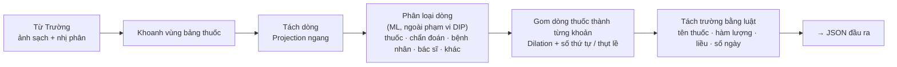

# KẾ HOẠCH CHI TIẾT — THẮNG

> **Phần phụ trách:** Mắt xích ④ của pipeline — Đơn thuốc: bóc tách khoản thuốc  
> **Việc thêm:** **Bộ sinh benchmark tổng hợp (bộ 5)** cho cả nhóm  
> **Áp dụng cho:** Đồ án Xử lý ảnh (DIP, hạn **11/11/2026**)  
> **Tài liệu liên quan:** [PhanCong_TongHop.md](PhanCong_TongHop.md) · [DeTai_XuLyAnh_ChiTiet.md](../docs/DeTai_XuLyAnh_ChiTiet.md)

| Điểm yếu hiện tại | Cách khắc phục trong kế hoạch này |
| :--- | :--- |
| DIP: tách khoản thuốc bằng projection là kỹ thuật đơn giản | Đánh giá theo **mức độ hỏng** trên bộ 5, so sánh nhiều cách, đo hiệu quả thật lên OCR từng trường |
| Cả nhóm thiếu ground truth | **Bộ 5** là đóng góp lớn nhất của Thắng: ground truth chính xác cho mọi module |

---

## 1. VỊ TRÍ TRONG PIPELINE



**Hợp đồng dữ liệu đầu ra** (`PrescriptionResult` trong `code/src/common/contracts.py`):

```json
{
  "image_id": "rx_000123",
  "patient": {"bbox": [24, 280, 420, 50], "text": "Nguyễn Văn A, 37 tuổi"},
  "diagnosis": {"bbox": [24, 350, 170, 55], "text": "Viêm họng cấp"},
  "items": [
    {"bbox": [24, 480, 380, 90], "name": "Amoxicillin 500mg", "strength": "500 mg",
     "dose": {"morning": 1, "noon": 0, "evening": 1}, "days": 7, "note": "sau ăn", "confidence": 0.88}
  ]
}
```

---

## 2. VIỆC THÊM: BỘ SINH BENCHMARK TỔNG HỢP (BỘ 5)

**Ý tưởng:** ảnh đơn thuốc của bộ 1 (VAIPE) là ảnh phẳng, sạch, giữ tỉ lệ gốc. Làm hỏng có kiểm soát → mọi ground truth đều biết chính xác.

### 2.1. Đặc tả

| Loại hỏng | Cách sinh | Mức độ | Ground truth lưu kèm |
| :--- | :--- | :--- | :--- |
| Phối cảnh | Dịch ngẫu nhiên 4 góc rồi `warpPerspective`, đặt lên nền bàn / vải | 3 mức (5%, 10%, 20% cạnh) | Ma trận `H`, vị trí 4 góc, box đã biến đổi |
| Nghiêng | Xoay | 0°, 5°, 10°, 20°, 30° | Góc thật |
| Mờ | Gaussian blur; motion blur (kernel đường thẳng) | 4 mức | Mức mờ |
| Bóng đổ | Nhân với mặt nạ gradient tuyến tính / hình bàn tay đã làm mờ | 3 mức | Mặt nạ bóng |
| Lóa flash | Cộng vùng sáng elip Gaussian vào kênh V, giảm S | 3 mức | **Mask lóa** (cho Hiếu) |
| Dấu đỏ | Sinh dấu tròn đỏ có chữ (vẽ bằng OpenCV) với độ trong suốt, dán đè lên vùng chữ | 3 mức độ che | **Mask dấu** (cho Trường) |
| Chữ ký / bút xanh | Đường Bézier ngẫu nhiên màu xanh / đen | 2 mức | Mask nét bút |
| Nén & nhiễu | JPEG chất lượng 30–90; nhiễu Gaussian | 3 mức | — |

* Mỗi ảnh hỏng lưu: ảnh hỏng, **ảnh sạch gốc**, **ảnh nhị phân chuẩn** (Otsu trên ảnh sạch — ảnh sạch nên gần như hoàn hảo), các mask, JSON mức độ.
* **Chia theo ảnh gốc:** mọi biến thể của cùng một ảnh gốc nằm cùng một tập (train / val / test) để tránh rò rỉ.
* **Tái lập:** seed cố định; `python -m synthetic.generate --config config.yaml`.
* Quy mô: ~100 ảnh gốc × ~10 biến thể ≈ 1.000 ảnh; tập test cố định ~300 ảnh.

### 2.2. Mốc bàn giao

| Phiên bản | Hạn | Nội dung |
| :--- | :--- | :--- |
| **v1** | **02/11** | Phối cảnh, nghiêng, mờ, bóng đổ + ảnh sạch, `H`, box, ảnh nhị phân chuẩn |
| **v2** | **04/11** | Thêm lóa (mask lóa), dấu đỏ (mask dấu), bút xanh, nén & nhiễu |

### 2.3. Kiểm chứng bộ 5 có "giống thật"

* So sánh thống kê ảnh bộ 5 và ảnh chụp thật (bộ 2, bộ 4): phân bố phương sai Laplacian, độ sáng, độ tương phản.
* 20 ảnh bộ 5 trộn với 20 ảnh thật, 2 bạn trong nhóm đoán ảnh nào là tổng hợp → nêu trong phần hạn chế.

---

## 3. DỮ LIỆU

| Bộ | Vai trò | Việc cần làm |
| :--- | :--- | :--- |
| **1** VAIPE (đơn VN, ảnh phẳng) | Dữ liệu đơn thuốc chính; nguồn ảnh sạch cho bộ 5; **có nhãn dòng** `drugname`/`usage`/`quantity`/`diagnose`/`date`/`other` | **31/10:** kiểm tra có ảnh đơn + file nhãn không, nhãn theo vùng hay theo dòng; báo cả nhóm |
| **4** Ảnh tự chụp | Đơn thuốc VN để test khác mẫu | Chụp ≥ 15 ảnh đơn nhiều viện; gán nhãn dòng cho ~10 đơn |
| **5** Benchmark tổng hợp | Ground truth cho DIP | Thắng sinh |
| Ground truth từng khoản thuốc | DIP | Vẽ tay ~30 ảnh bộ 1 (gom từ nhãn dòng rồi sửa tay); trên bộ 5, box khoản thuốc tự biến đổi theo `H` |

> **Cập nhật 08/11:** bỏ bộ Roboflow đơn thuốc Ấn Độ (Practo, bộ 2 cũ). Phần đơn thuốc chỉ dùng bộ 1 (VAIPE), bộ 4 (ảnh tự chụp) và bộ 5 (tổng hợp).

---

## 4. MÔN DIP — CHI TIẾT

### 4.1. Các bước và thuật toán

| Bước | Thuật toán chính | Phương án so sánh | Tham số khởi điểm |
| :--- | :--- | :--- | :--- |
| **Khoanh vùng bảng thuốc** | Dilation lớn gom khối văn bản → chọn khối có nhiều dòng bắt đầu bằng số thứ tự / chứa đơn vị (`mg`, `viên`, `tablet`) | Lấy cả trang | SE ≈ 2 × chiều cao chữ |
| **Tách dòng** | Projection Profile ngang trong vùng thuốc | Connected Components gom theo tâm y | ngưỡng cực tiểu theo chiều cao chữ |
| **Gom khoản thuốc** | Dilation dọc nhỏ + quy tắc: dòng mới bắt đầu khoản khi có số thứ tự ở lề trái hoặc thụt lề nhỏ hơn dòng trước | Mỗi dòng là một khoản · khoảng cách dọc cố định | SE dọc 0,5–1,5 × chiều cao chữ |
| **Tách trường** | Luật trên chữ OCR: tên thuốc (dòng đầu), hàm lượng (số + `mg`/`ml`), liều (`sáng 1`, `0-0-1`, `1 unit`), số ngày | — | — |

### 4.2. Thí nghiệm và độ đo

| # | Thí nghiệm | Dữ liệu | Độ đo | Hình / bảng |
| :---: | :--- | :--- | :--- | :--- |
| **S1** | Tách khoản thuốc: 3 phương án gom | ~30 ảnh vẽ tay | **F1 khoản thuốc** (khớp khi IoU > 0,5), IoU trung bình | Bảng chính |
| **S2** | Độ bền theo mức hỏng | Bộ 5 | F1 / IoU khoản thuốc theo góc nghiêng, mức mờ, mức bóng | **Đường cong** — hình chính |
| **S3** | OCR cả trang vs từng dòng vs từng khoản | ~30 ảnh vẽ tay + bộ 5 | CER; **độ chính xác từng trường** (tên thuốc, hàm lượng, liều) | Bảng — chứng minh lợi ích thực tế |
| **S4** | Khoanh vùng bảng thuốc | Bộ 1 (vùng chuẩn = khung bao các box `drugname`/`usage`/`quantity`) | IoU vùng | Bảng nhỏ |
| **S5** | Kiểm chứng đơn Việt Nam | Bộ 1 + bộ 4 | Như S1, S3 | Bảng nhỏ + ví dụ |
| **S6** | Thời gian chạy; kiểm chứng bộ 5 giống thật (2.3) | Bộ 5, bộ 2, bộ 4 | ms/ảnh; thống kê so sánh | Phụ lục |

### 4.3. Bảng tham số & lý do chọn

| Tham số | Khoảng thử | Chọn bằng |
| :--- | :--- | :--- |
| SE gom khối văn bản | 1–4 × chiều cao chữ | S4 |
| Ngưỡng cực tiểu projection tách dòng | 0–20% đỉnh | Tỉ lệ tách đúng dòng |
| SE dọc gom khoản | 0,5–1,5 × chiều cao chữ | S1 |
| Độ lệch thụt lề nhận diện dòng mới | 0,5–3 × chiều cao chữ | S1 |

### 4.4. Cấu trúc code

```
code/src/synthetic/          # bộ 5, cả nhóm dùng
├── degrade.py    # perspective(), rotate(), blur(), shadow(), glare(), stamp(), pen(), jpeg_noise()
├── generate.py   # sinh bộ 5 theo config.yaml, lưu ảnh + GT + JSON mức độ
└── config.yaml
code/src/prescription_segmentation/
├── region.py     # find_medicine_region()
├── lines.py      # lines_projection(), lines_components()
├── items.py      # group_items_rules(), group_items_fixed()
├── fields.py     # parse_item_fields()
└── pipeline.py   # extract_prescription(img) -> JSON theo hợp đồng
code/experiments/s1_items.py … s6_runtime.py
code/tests/test_synthetic.py, test_prescription.py
```

---

## 5. LỊCH LÀM VIỆC (ĐẾN HẠN 11/11)

| Ngày | Việc | Kết quả kiểm tra được |
| :--- | :--- | :--- |
| **30–31/10** | **Kiểm tra bộ 1 (VAIPE) và báo nhóm**; chụp bộ 4; chốt JSON với Trường; thu yêu cầu bộ 5 từ Hiếu, Trường | Báo cáo nhanh về bộ 1; danh sách yêu cầu |
| **01/11** | `degrade.py`: phối cảnh, nghiêng, mờ, bóng | Ảnh mẫu từng loại hỏng |
| **02/11** | **Bộ 5 v1** gửi cả nhóm | Thư mục bộ 5 + README |
| **03/11** | `region.py`, `lines.py`, `items.py`; vẽ GT ~30 ảnh | Unit test xanh |
| **04/11** | **Bộ 5 v2** (lóa, dấu, bút, nhiễu); S1 | Bảng S1 |
| **05/11** | **Mốc tích hợp** đầu-cuối; `fields.py` | Pipeline chạy trên 5 ảnh |
| **06–07/11** | S2 đường cong, S3 OCR từng trường, S4, S5; bảng tham số 4.3 | Đủ số liệu |
| **08/11** | S6; viết phần Thắng (1,5–2 trang), 2–3 slide, đoạn demo 30 giây, README module → gửi Hiếu | Đã gửi |
| **09–11/11** | Tập trình bày, hỏi đáp thử | Nộp |

## 6. RỦI RO & PHƯƠNG ÁN

| Rủi ro | Phương án |
| :--- | :--- |
| Bộ 5 trễ → cả nhóm trễ | Ưu tiên tuyệt đối v1 (02/11), chỉ 4 loại hỏng; v2 làm sau |
| Dấu / lóa tổng hợp không giống thật | Kiểm chứng ở mục 2.3; kết luận chính dựa trên ảnh thật |
| Khoanh vùng bảng thuốc sai trên đơn Việt Nam | Dùng phương án lấy cả trang (mục 4.1) làm dự phòng; báo cáo cả hai |
| Không kịp S5 | Giữ ít nhất 10 đơn Việt Nam cho S1 |

**Thứ tự cắt khi thiếu thời gian:** S6 → S4 → bút xanh trong bộ 5. **Không cắt:** bộ 5 v1, S1, S2, S3.

---

## 7. CHUẨN BỊ HỎI ĐÁP

| Câu hỏi | Hướng trả lời |
| :--- | :--- |
| Ảnh tổng hợp có thực tế không? | Bộ 5 dùng để so sánh phương pháp với ground truth chính xác; kết luận kiểm chứng lại trên ảnh thật; có kiểm tra thống kê và thử phân biệt bằng mắt (2.3) |
| Vì sao chia biến thể theo ảnh gốc? | Biến thể cùng ảnh gốc gần như giống nhau; chia lẫn làm kết quả ảo |
| Vì sao tách khoản thuốc trước khi OCR? | OCR cả trang lẫn tên thuốc và liều giữa các khoản; S3 đo độ chính xác từng trường tăng bao nhiêu |

---

## 8. CHECKLIST CUỐI

**DIP:** bộ 5 v1 (02/11), v2 (04/11) có README · module `prescription_segmentation/` có unit test · S1, S2, S3 có số liệu · đường cong S2 · bảng tham số · phần báo cáo, slide, demo gửi Hiếu trước 08/11  
**Chung:** ≥ 15 ảnh bộ 4 (đơn VN) đã che thông tin, gán nhãn dòng ~10 đơn · báo nhóm về bộ 1 ngày 31/10 · JSON hợp đồng đã chốt · trả lời được câu hỏi về phần của 3 bạn còn lại
