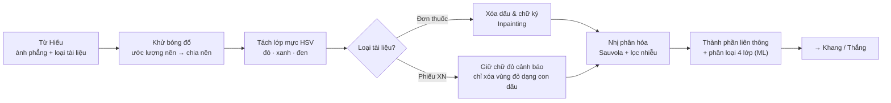

# KẾ HOẠCH CHI TIẾT — TRƯỜNG

> **Phần phụ trách:** Mắt xích ② của pipeline — Làm sạch ảnh & Tách lớp mực  
> **Áp dụng cho:** Đồ án Xử lý ảnh (DIP, hạn **11/11/2026**) · Bài tập lớn Học máy (ML) · Mobile App MedTrack (module `05-family` + component xác nhận)  
> **Việc thêm:** ablation toàn pipeline (T8).  
> **Tài liệu liên quan:** [PhanCong_TongHop.md](PhanCong_TongHop.md) · [DeTai_XuLyAnh_ChiTiet.md](../dip/docs/DeTai_XuLyAnh_ChiTiet.md) · [KeHoach_BTL_MachineLearning.md](../ml/docs/KeHoach_BTL_MachineLearning.md)

| Điểm yếu hiện tại | Cách khắc phục trong kế hoạch này |
| :--- | :--- |
| DIP: so sánh nhị phân hóa là dạng bài kinh điển (kiểu DIBCO) | Đo theo **từng loại và mức độ hỏng** trên bộ 6; thêm **ràng buộc an toàn y tế**: không được xóa chữ đỏ cảnh báo trên phiếu xét nghiệm, có độ đo riêng |
| DIP: thiếu ảnh có dấu đỏ, chữ viết tay thật | Bộ 6 dán dấu / nét bút có kiểm soát (ground truth chính xác) + kiểm chứng trên ảnh thật của bộ 1 và bộ 5 |
| ML: nhãn sinh từ luật nên mô hình có thể chỉ bắt chước luật | Tập test sửa tay hoàn toàn; thí nghiệm **nhãn nhiễu**: huấn luyện trên nhãn luật vs nhãn đã sửa |
| ML: rò rỉ dữ liệu vì nhiều thành phần liên thông cùng một ảnh | Chia dữ liệu **theo ảnh** (`GroupKFold`, group = ảnh) |
| ML: điểm cộng dễ bị coi là phụ | Active Learning làm thành thí nghiệm có lặp lại nhiều seed, có khoảng tin cậy, gắn với vòng sửa nhãn của sản phẩm |

---

## 1. VỊ TRÍ TRONG PIPELINE



**Hợp đồng dữ liệu** — nhận từ Hiếu (xem [KeHoach_Hieu.md](KeHoach_Hieu.md) mục 1), gửi cho Khang và Thắng:

```json
{
  "image_id": "rx_000123",
  "clean_gray_path": "out/rx_000123_clean.png",
  "binary_path": "out/rx_000123_bin.png",
  "masks": {"stamp": "out/rx_000123_stamp.png", "handwriting": "out/rx_000123_hw.png", "red_text": "out/rx_000123_red.png"},
  "components": [{"bbox": [120, 340, 38, 22], "label": "printed", "confidence": 0.97}],
  "params": {"background_kernel": 41, "sauvola_window": 31, "sauvola_k": 0.2}
}
```

---

## 2. DỮ LIỆU

| Bộ | Vai trò | Việc cần làm |
| :--- | :--- | :--- |
| **1** VAIPE (đơn VN) | Nguồn chữ in; chưa xác nhận đủ ảnh dấu/viết tay trong bản đang dùng | 01/11 đã quét 1.173 ảnh train và xem tổng quan toàn bộ, chưa tuyển được ca dấu/viết tay đáng tin cậy. Chưa có cơ sở lấy ~30 ảnh bộ này làm test ML bốn lớp mực; cần nguồn bổ sung và duyệt nhãn. |
| **3** Phiếu CBC (ảnh chụp) | Ảnh chụp có bóng, nền không đều | Không cần gán nhãn |
| **5** Ảnh tự chụp | Kiểm chứng thực tế; **phiếu XN Việt Nam có chữ đỏ** để đo ràng buộc an toàn | Chụp ≥ 15 ảnh, ưu tiên đơn có dấu / chữ ký và phiếu có chỉ số in đỏ; khoanh tay vùng chữ đỏ trên các phiếu này |
| **6** Benchmark tổng hợp (Thắng sinh) | Ground truth: ảnh sạch, **ảnh nhị phân chuẩn**, mask dấu, mask bóng, mức độ hỏng | Gửi Thắng yêu cầu: lưu ảnh nhị phân chuẩn (từ ảnh sạch) và mask dấu / nét bút |

---

## 3. MÔN DIP — CHI TIẾT

### 3.1. Các bước và thuật toán

| Bước | Thuật toán chính | Phương án so sánh | Tham số khởi điểm |
| :--- | :--- | :--- | :--- |
| **Khử bóng đổ** | Ước lượng nền bằng Closing (SE lớn) rồi Median blur; chia ảnh cho nền, chuẩn hóa về [0, 255] | Ước lượng nền bằng Median blur trực tiếp · Không khử | kernel 31–61 px (≈ 3–5 lần chiều cao chữ) |
| **Tách lớp mực** | Chuyển HSV; mực đỏ: H ∈ [0, 10] ∪ [170, 180], S > 80; mực xanh: H ∈ [100, 130], S > 60; còn lại là mực đen | Lab: kênh a* (đỏ), b* (xanh) | ngưỡng chọn ở 3.3 |
| **Phân biệt dấu đỏ và chữ đỏ** | Thành phần liên thông của mask đỏ: **dấu** = lớn, tròn / elip (độ tròn, tỉ lệ khung), có vành; **chữ đỏ** = nhỏ, nằm trên dòng chữ | — | diện tích > 5% trang hoặc độ tròn > 0,6 |
| **Xóa dấu / chữ ký** | Inpainting Telea và Navier–Stokes trên mask đỏ / xanh **chỉ với đơn thuốc** | Thay bằng màu nền · Không xóa | bán kính 3 px |
| **Nhị phân hóa** | Sauvola | Otsu toàn cục · Niblack · Wolf · Gaussian adaptive (OpenCV) | cửa sổ 31, k = 0,2 |
| **Lọc nhiễu** | Bỏ thành phần liên thông diện tích < ngưỡng; Opening 2×2 | Median 3×3 | diện tích < 8 px |

### 3.2. Thí nghiệm và độ đo

| # | Thí nghiệm | Dữ liệu | Độ đo | Hình / bảng |
| :---: | :--- | :--- | :--- | :--- |
| **T1** | Khử bóng: không khử vs Median vs Closing + Median | Bộ 6 (3 mức bóng) | PSNR, SSIM so với ảnh sạch | Bảng + ảnh trước / sau |
| **T2** | **5 cách nhị phân hóa** × có / không khử bóng | Bộ 6 | **F-measure, pseudo F-measure, PSNR, DRD** (chuẩn DIBCO) | Bảng chính của phần Trường |
| **T3** | Nhị phân hóa theo mức độ hỏng | Bộ 6 | F-measure theo mức bóng, mức mờ, mức dấu | **Đường cong** — hình chính |
| **T4** | Phát hiện & xóa dấu / chữ ký | Bộ 6 (có mask dấu) + bộ 1 | IoU mask dấu; CER trong vùng bị dấu che, trước / sau inpainting | Bảng + ảnh |
| **T5** | **Ràng buộc an toàn:** giữ chữ đỏ cảnh báo trên phiếu XN | Bộ 5 (phiếu VN có chữ đỏ) | **Recall chữ đỏ được giữ** (mục tiêu 100%), số ca xóa nhầm | Bảng nhỏ + ví dụ |
| **T6** | Hiệu quả lên OCR | Bộ 6 + bộ 1 + bộ 3 | CER ảnh chưa làm sạch vs đã làm sạch | Bảng |
| **T7** | Thời gian chạy | Bộ 6 | ms/ảnh từng bước | Bảng nhỏ |
| **T8** | **Ablation toàn pipeline** *(việc thêm)* | Bộ 6 + bộ 5 | CER cuối khi tắt lần lượt từng bước của **cả nhóm** | Bảng ablation của báo cáo |

### 3.3. Bảng tham số & lý do chọn

| Tham số | Khoảng thử | Chọn bằng |
| :--- | :--- | :--- |
| Kích thước kernel ước lượng nền | 15 → 81 px | PSNR cao nhất trên tập validation bộ 6 (T1) |
| Ngưỡng H, S cho mực đỏ / xanh | H ± 5°, S 40–120 | IoU mask dấu lớn nhất (T4) |
| Ngưỡng độ tròn / diện tích phân biệt dấu với chữ đỏ | 0,4–0,8; 1–10% trang | Recall chữ đỏ = 100% với IoU dấu cao nhất (T4, T5) |
| Cửa sổ và k của Sauvola | 15–61; 0,1–0,5 | F-measure cao nhất (T2) |
| Ngưỡng diện tích lọc nhiễu | 2–30 px | F-measure + CER |

### 3.4. Cấu trúc code

```
code/src/cleaning/
├── background.py   # estimate_background(), remove_shadow()
├── ink.py          # ink_masks(img) -> {"red", "blue", "black"}; split_stamp_vs_text()
├── inpaint.py      # remove_marks(img, mask, method)
├── binarize.py     # otsu(), niblack(), sauvola(), wolf(), gaussian_adaptive()
├── components.py   # extract_components(), component_features()
└── pipeline.py     # clean(img, doc_type, image_id, out_dir=OUT_DIR) -> CleaningResult (chưa triển khai)
code/experiments/t1_shadow.py … t8_ablation.py
code/tests/test_cleaning.py
```

---

## 4. MÔN ML — BÀI TOÁN 2: PHÂN LOẠI THÀNH PHẦN LIÊN THÔNG

### 4.1. Bài toán

* **Đơn vị mẫu:** mỗi thành phần liên thông trên ảnh nhị phân.
* **4 lớp:** `printed` (chữ in), `handwritten` (viết tay), `stamp` (con dấu), `other` (đường kẻ + nhiễu).
* **Câu hỏi nghiên cứu:**
  1. Mô hình học máy vượt luật HSV / hình thái ở đâu (chữ ký mực đen, dấu mờ)?
  2. Nhãn sinh từ luật (nhiễu) ảnh hưởng mô hình bao nhiêu?
  3. Cần bao nhiêu nhãn gán tay để đạt hiệu năng tốt? (Active Learning)

### 4.2. Nhãn

* **Tập train:** luật của module DIP gán sơ bộ (màu + hình dạng).
* **Tập test:** ~30 ảnh bộ 1 + ảnh bộ 5, **sửa tay toàn bộ** trên Label Studio (hiển thị từng thành phần đã tô màu theo nhãn luật, chỉ click sửa chỗ sai).
* **Tập "train sạch"** (cho thí nghiệm nhãn nhiễu): sửa tay thêm ~20 ảnh train.

### 4.3. Đặc trưng

| Nhóm | Chi tiết |
| :--- | :--- |
| Hình dạng | Diện tích, chiều rộng / cao, tỉ lệ khung, Solidity, Extent, độ tròn, số lỗ (Euler), Hu moments |
| Nét chữ | Độ dày nét trung bình và độ lệch (Distance Transform), độ cong, số điểm cuối / rẽ nhánh của khung xương |
| Màu | Trung bình và độ lệch H, S, V; tỉ lệ pixel thuộc mask đỏ / xanh |
| Kết cấu | HOG 32×32 của thành phần, LBP |
| Ngữ cảnh | Vị trí tương đối trên trang; chiều cao so với chiều cao chữ trung vị của trang; số thành phần lân cận |

### 4.4. Mô hình và đánh giá

| Hạng mục | Cách làm |
| :--- | :--- |
| Mô hình | $k$-NN, Naive Bayes, Logistic Regression, Random Forest, SVM (+ XGBoost để tham khảo) |
| **Chia dữ liệu** | `GroupKFold` với **group = ảnh** (bắt buộc: các thành phần cùng ảnh rất giống nhau) |
| Chọn siêu tham số | Nested CV |
| Mất cân bằng | `printed` chiếm đa số → Macro-F1, Balanced Accuracy, `class_weight`, báo cáo F1 từng lớp |
| Kiểm định | Bootstrap 95% theo ảnh; McNemar giữa mô hình tốt nhất và luật DIP |
| Learning curve | Macro-F1 theo số ảnh train |

### 4.5. Thí nghiệm nâng cao

**(a) Nhãn nhiễu** — huấn luyện cùng mô hình trên (1) nhãn luật, (2) nhãn đã sửa tay; đánh giá trên cùng tập test sửa tay. Báo cáo: mô hình học từ nhãn luật **có vượt được chính luật** không (hiện tượng "học từ nhãn nhiễu nhưng tổng quát tốt hơn").

**(b) Active Learning — điểm cộng ngoài bài giảng**
* Mô phỏng vòng sửa nhãn của MedTrack: bắt đầu với 2% dữ liệu có nhãn sạch; mỗi vòng chọn 1 lô (ví dụ 200 thành phần) để "người dùng" gán nhãn (lấy nhãn sạch), huấn luyện lại.
* Chiến lược chọn mẫu: **ngẫu nhiên** · **least confidence** · **margin** · **entropy**.
* Lặp 5 seed, vẽ đường cong **số nhãn → Macro-F1** có dải tin cậy.
* Kết luận: cần bao nhiêu % nhãn để đạt 95% hiệu năng khi có nhãn đầy đủ; liên hệ trực tiếp với màn hình xác nhận trên app.

### 4.6. Phân tích lỗi

* Nhóm lỗi: chữ ký mực đen ↔ chữ in · dấu mờ ↔ chữ in đỏ · chữ dính nhau ↔ đường kẻ · nét viết tay đứt đoạn ↔ nhiễu.
* Mỗi nhóm: tỉ lệ %, 3 ví dụ, giải thích bằng SHAP (đặc trưng nào đẩy sai).

### 4.7. Kết quả cần có trong báo cáo ML (phần Trường)

Bảng 5 mô hình vs luật DIP (Macro-F1 ± CI, F1 từng lớp) · Confusion Matrix · Bảng nhãn nhiễu · **Đường cong Active Learning** · Bảng phân loại lỗi + SHAP.

---

## 5. VIỆC THÊM: ABLATION TOÀN PIPELINE

| Mốc | Việc |
| :--- | :--- |
| **05/11** | Chạy thử ablation T8 khi pipeline đầu-cuối hoạt động |
| **07/11** | T8 chính thức: bảng ablation toàn pipeline đưa vào phần Thực nghiệm chung |
| **08/11** | Gửi phần Trường (1,5–2 trang), 2–3 slide, đoạn demo 30 giây, README module, bảng T8 cho Hiếu ghép |

---

## 6. MOBILE APP — `05-family` + COMPONENT XÁC NHẬN

> **Ưu tiên thấp đến sau 11/11.**

| Nhóm | Màn hình / thành phần |
| :--- | :--- |
| Hồ sơ gia đình | `f01` danh sách · `f02` chuyển hồ sơ · `f03` tạo hồ sơ · `f04` chờ đồng ý · `f05` trang đồng ý cho bố mẹ (web) · `f06` mời · `f07` chấp nhận · `f08` phân quyền · `f09` nhật ký truy cập · `f10` quyền khẩn cấp |
| Xác nhận chung | `07` dữ liệu bóc tách · `07b` đã lưu |
| **Component dùng chung** | Ảnh cắt đúng vùng + khoanh vùng + nút Đúng / Sửa / Không rõ; dùng trong `m05`, `m06` (Thắng), `l02`, `l03`, `l10` (Khang); ghi nhật ký chỉnh sửa → xuất nhãn train lại (nối với Active Learning) |
| Backend | Đăng nhập, quyền truy cập theo hồ sơ, che thông tin cá nhân trước khi tải lên |

---

## 7. LỊCH LÀM VIỆC

### 7.1. Đến hạn DIP (11/11)

| Ngày | Việc | Kết quả kiểm tra được |
| :--- | :--- | :--- |
| **30–31/10** | Lọc ảnh bộ 1 có dấu / viết tay; chụp bộ 5; gửi Thắng yêu cầu bộ 6; chốt JSON với Hiếu, Khang, Thắng | ✅ Đã sàng lọc 1.173 ảnh train bộ 1, chưa có ca dấu/viết tay dương tính đáng tin cậy. Đã chốt yêu cầu bộ 6 và JSON với Hiếu, Thắng, Khang; Khang đã nghiệm thu fixture CleaningResult theo tiến độ chung. Bộ 5 vẫn theo hạn chung 03/11, chưa đánh dấu đã chụp đủ. |
| **01/11** | `background.py`, `binarize.py` (5 cách) chạy trên 10 ảnh | ✅ Có Median, Closing, Closing + Median và đủ 5 cách nhị phân hóa; đã kiểm tra 200 đầu ra trên 10 ảnh phát triển. |
| **02/11** | `ink.py`, phân biệt dấu / chữ đỏ, `inpaint.py` | ✅ Hoàn thành code cơ bản: mask đỏ/xanh/đen; ứng viên vành dấu kín tròn/elip, giữ phần đỏ chưa chắc chắn; đủ Telea/NS/tô trắng. Nhóm test làm sạch và hợp đồng thuộc đợt chia sẻ code: **433 passed, không skip/fail**; không bao gồm test metric/script T1/T2. Đã xem 10 ảnh tách mực và 42 đầu ra inpainting/14 ca, xác nhận pixel ngoài mask không đổi. Bằng chứng ảnh lưu local trong `results/ink_black_fix/`, `results/stamp_step3_v1/`, `results/inpaint_acceptance_v2/` (không đi kèm repo). Chưa nghiệm thu chất lượng T4/T5/OCR, mask xóa toàn bộ dấu hoặc tích hợp; chữ rất nhạt còn có thể mất nét, logo giống vành dấu có thể bị nhận nhầm, inpainting có thể mất chữ trong mask. |
| **03/11** | Có bộ 6 → T1, T2 | ✅ **Hoàn thành, sẵn sàng bàn giao.** Đã chạy và kiểm chứng T1–T2 v2: `results/t1_v2/`, `results/t2_v2/`. Giữ 100 nguồn, split 60/10/30; sinh bóng đơn từ clean v2 vì mẫu bóng đơn có sẵn không phủ test. T1 chọn Closing 81 trên val; T2 chọn Closing 81 → Otsu. Test T1 PSNR 49,810762 dB/SSIM 0,999489; T2 F1 0,998123 theo tham chiếu Otsu tự sinh, chưa suy ra OCR. Sau sửa lóa `fed83ebc`, tính lại 120 + 300 dòng test khớp; giữ nguyên số liệu/config/selection lịch sử. Gói bàn giao v2.1 tại `results/t1_t2_repro_audit/t1_t2_v2_1_handoff.zip` đã kiểm CRC/SHA-256 và chạy từ bản giải nén: 173 test liên quan, kiểm chứng 420 dòng đạt. Đọc `HANDOFF_V2_1.md` cùng thư mục; không cần snapshot v1 hoặc img_test để chạy lại. |
| **04/11** | T3 đường cong, T4 dấu; khoanh vùng chữ đỏ bộ 5 → T5 | **T3: ✅ đã nghiệm thu** trong phạm vi biến thể đơn hỏng có kiểm soát từ bộ 6 v2. Đủ 6.600 dòng, 220 ô × cùng 30 nguồn test; 10 cấu hình T2 và Closing81 giữ nguyên. Có bảng, PNG/PDF và ví dụ val tại `results/t3/`; 234 test liên quan đạt. Tái chạy 660 dòng trên 3 nguồn định trước khớp SHA ảnh/dự đoán và điểm (atol 1e-12); chưa tái chạy toàn bộ 6.600 dòng. F1 dùng Otsu tự sinh, không suy ra OCR. Dấu tăng cả kích thước/độ đậm, dùng template dẫn xuất. **T4: ✅ nghiệm thu phạm vi phép đo bộ6 v2**: 30 dấu/16 xanh/14 đen (đen chỉ GT chẩn đoán); CER thật trên15 val/47 test người dùng duyệt, giữ config/crop/ref, tổng lỗi/tổng ký tự. 401 test liên quan đạt; replay5 val+7 test crop,105 variant rows/72 gọi OCR thật khớp, không rerun toàn bộ. Ứng viên dấu rỗng24/30; GT không là detector/upper bound, inpaint có thể mất chữ. Kết luận/bằng chứng: `results/t4/acceptance_v1/README.md`. **T5 chưa nghiệm thu**; bộ 5 tiếp tục chờ nhóm, không suy ra an toàn chữ đỏ hoặc tích hợp. |
| **05/11** | **Mốc tích hợp** đầu-cuối; chạy thử T8 | Pipeline chạy trên 5 ảnh |
| **06–07/11** | T6, T7; bảng tham số 3.3; T8 chính thức | Đủ số liệu |
| **08/11** | Viết phần Trường trong báo cáo DIP (1,5–2 trang), 2–3 slide, đoạn demo 30 giây, README module → gửi Hiếu ghép | Kết quả cần có: phần báo cáo, slide, demo và README module được gửi cho Hiếu. |
| **09–11/11** | Tập trình bày, hỏi đáp thử | Nộp |

### 7.2. Môn ML

| Tuần | Việc |
| :--- | :--- |
| **1** | Trích thành phần liên thông + đặc trưng (dùng lại `components.py`); sinh nhãn luật; Label Studio; sửa tay tập test |
| **2** | 5 mô hình, `GroupKFold` theo ảnh, nested CV, learning curve; thí nghiệm nhãn nhiễu |
| **3** | Active Learning 4 chiến lược × 5 seed; SHAP |
| **4** | Phân tích lỗi; viết phần mình gửi Hiếu ghép |

---

## 8. RỦI RO & PHƯƠNG ÁN

| Rủi ro | Phương án |
| :--- | :--- |
| Bộ 1 có quá ít dấu / viết tay | Dùng bộ 6 (dấu dán tổng hợp) làm chính, bộ 1 + bộ 5 để kiểm chứng; ghi rõ hạn chế |
| Sửa tay tập test quá lâu | Giảm còn 20 ảnh; Label Studio hiển thị nhãn luật sẵn, chỉ sửa chỗ sai |
| Inpainting làm mất chữ in bị dấu đè | Đo CER trong vùng dấu (T4); nếu xấu hơn không xóa → chỉ làm mờ dấu (giảm S) thay vì inpaint |
| Không đủ phiếu VN có chữ đỏ cho T5 | Nhờ cả nhóm chụp thêm; tối thiểu 5 phiếu |

**Thứ tự cắt khi thiếu thời gian:** T7 → T6 → nhãn nhiễu → XGBoost. **Không cắt:** T2, T3, T5, T8, Active Learning.

---

## 9. CHUẨN BỊ HỎI ĐÁP

| Câu hỏi | Hướng trả lời |
| :--- | :--- |
| Vì sao Sauvola tốt hơn Otsu? | Otsu một ngưỡng cho cả ảnh, hỏng khi ánh sáng không đều; Sauvola ngưỡng cục bộ theo trung bình và độ lệch chuẩn cửa sổ. Số liệu ở T2, T3 |
| Khử bóng bằng chia nền hoạt động thế nào? | Ảnh = phản xạ × chiếu sáng; nền ước lượng bằng lọc kích thước lớn hơn nét chữ ≈ chiếu sáng; chia ra còn phản xạ |
| Làm sao không xóa nhầm chữ đỏ cảnh báo? | Phân biệt theo hình dạng (dấu lớn, tròn, có vành) và theo loại tài liệu; đo Recall chữ đỏ ở T5 |
| Vì sao chia dữ liệu theo ảnh? | Thành phần cùng ảnh cùng font, cùng ánh sáng; chia ngẫu nhiên làm điểm số ảo cao |
| Nhãn từ luật thì mô hình chỉ bắt chước luật? | Tập test sửa tay hoàn toàn; thí nghiệm nhãn nhiễu cho thấy mô hình có vượt luật hay không |
| Active Learning có ích gì cho sản phẩm? | Màn hình xác nhận chỉ cần hỏi người dùng những mẫu mô hình kém tự tin nhất → ít công sửa hơn |

---

## 10. CHECKLIST CUỐI

**DIP:** module `cleaning/` có unit test · T1–T5, T8 có số liệu · đường cong T3 · bảng tham số · ràng buộc an toàn chữ đỏ · bảng ablation T8 · phần báo cáo, slide, demo gửi Hiếu trước 08/11  
**ML:** 5 mô hình vs luật, `GroupKFold` theo ảnh · nhãn nhiễu · Active Learning 5 seed có dải tin cậy · SHAP · phân loại lỗi · gửi phần mình cho Hiếu  
**Chung:** ≥ 15 ảnh bộ 5 đã che thông tin · JSON hợp đồng đã chốt · trả lời được câu hỏi về phần của 3 bạn còn lại
