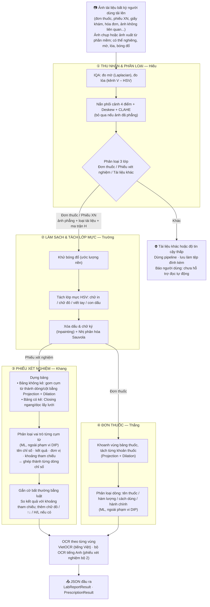

# TỔNG HỢP PIPELINE, DỮ LIỆU & PHÂN CÔNG — ĐỒ ÁN XỬ LÝ ẢNH

> **Nhóm:** Hiếu (nhóm trưởng), Trường, Khang, Thắng  
> **Áp dụng cho:** Đồ án Xử lý ảnh số (DIP, hạn 11/11/2026)  
> **Đề tài chi tiết (đã chốt):** [DeTai_XuLyAnh_ChiTiet.md](../docs/DeTai_XuLyAnh_ChiTiet.md)  
> **Kế hoạch chi tiết từng người:** [Hiếu](KeHoach_Hieu.md) · [Trường](KeHoach_Truong.md) · [Khang](KeHoach_Khang.md) · [Thắng](KeHoach_Thang.md)

Nguyên tắc chia việc: mỗi người sở hữu **trọn một mắt xích** của pipeline, từ code, thí nghiệm đến phần báo cáo tương ứng.

---

## 1. PIPELINE

### 1.1. Đầu vào và đầu ra của từng mắt xích

Đây là **hợp đồng dữ liệu** giữa các thành viên, cần chốt trong Đợt 1 (29/10–01/11). Sau khi chốt, mỗi người có thể làm song song bằng dữ liệu giả lập mà không phải chờ người trước.

| Mắt xích | Người | Nhận vào | Trả ra |
| :--- | :--- | :--- | :--- |
| **① Thu nhận & Phân loại** | Hiếu | Ảnh gốc, **mọi loại tài liệu** | Ảnh đã nắn phẳng; ma trận homography `H`; nhãn `prescription` / `lab_report` / `other` kèm độ tin cậy; điểm mờ, điểm lóa. **Chỉ `prescription` và `lab_report` có độ tin cậy vượt ngưỡng mới được chuyển sang ②** |
| **② Làm sạch & Tách lớp mực** | Trường | Ảnh phẳng + loại tài liệu | Ảnh nhị phân sạch; mask từng lớp mực; danh sách thành phần liên thông kèm nhãn |
| **③ Phiếu xét nghiệm** | Khang | Ảnh sạch + mask | JSON các dòng chỉ số: bbox, tên, giá trị, đơn vị, khoảng tham chiếu, cờ `HIGH` / `LOW` / `NORMAL` |
| **④ Đơn thuốc** | Thắng | Ảnh sạch + mask | JSON các khoản thuốc: bbox, tên thuốc, hàm lượng, liều sáng/trưa/chiều/tối, số ngày |

---

## 2. DỮ LIỆU

### 2.1. Các nguồn dữ liệu

| # | Bộ dữ liệu | Loại tài liệu | Nguồn gốc & dạng ảnh | Nhãn có sẵn | Quy mô |
| :---: | :--- | :--- | :--- | :--- | :---: |
| **1** | [VAIPE Pill 2022](https://www.kaggle.com/datasets/tommyngx/vaipepill2022) (Kaggle) | Đơn thuốc | Việt Nam, tiếng Việt; ảnh chụp. **Chỉ dùng phần ảnh đơn thuốc**, bỏ ảnh viên thuốc | *Cần kiểm tra:* có file nhãn kèm ảnh đơn không; nhãn theo vùng hay theo từng dòng chữ (tên thuốc, cách dùng...) | *cần xác nhận* |
| **2** | [Report Keywords Detection](https://universe.roboflow.com/world-of-ai/report-keywords-detection) (Roboflow) | Phiếu xét nghiệm | Ấn Độ, tiếng Anh; **ảnh chụp** phiếu máu (CBC), có nghiêng, có ảnh chụp màn hình; bảng **không kẻ lưới**; không thấy chữ đỏ hay cờ H/L | Bounding box theo **từng cụm từ**: `Report Type`, `parameter`, `value`, `unit`, `reference value` | **57 ảnh gốc** (train 39 / valid 11 / test 7); chỉ xử lý trên ảnh gốc, 78 bản tăng cường để riêng ở `2_roboflow_report_keywords_augmented/` |
| **3** | **Tài liệu khác** | Lớp `other` | Tập con bộ tài liệu công khai **RVL-CDIP** (form, invoice, letter, scientific report...) | Nhãn lớp tài liệu | 1.000 ảnh |
| **4** | **Ảnh nhóm tự chụp** | Cả 3 lớp | Đơn thuốc, phiếu xét nghiệm Việt Nam; giấy khám, hóa đơn, giấy tờ hành chính. Che thông tin cá nhân, có sự đồng ý | Nhóm tự gán | 83 ảnh (48 phiếu XN, 18 đơn thuốc, 17 khác) |
| **5** | **Benchmark tổng hợp** *(Thắng sinh)* | Đơn thuốc | Sinh từ ảnh sạch của bộ 1 (VAIPE): nghiêng, phối cảnh, mờ, bóng đổ, lóa flash, dấu đỏ giả, mỗi loại nhiều mức | **Ground truth chính xác tuyệt đối:** ảnh sạch gốc, ma trận biến dạng, bounding box đã biến đổi, mức độ hỏng | 1.000 mẫu (v1) + biến thể v2, không phải vẽ tay |

> Bộ 5 là nguồn ground truth chính cho các độ đo DIP (PSNR, SSIM, F-measure, sai số nắn, IoU) và cho đường cong "độ đo theo mức độ hỏng". Bộ 4 **không dùng để huấn luyện**. Nó là **tập test độc lập** của cả nhóm, và là bằng chứng duy nhất cho thấy hệ thống chạy được trên tài liệu Việt Nam thật.
>
> **Cập nhật 08/11:** bỏ bộ Roboflow đơn thuốc Ấn Độ (bộ 2 cũ) và đánh số lại 1–5. Bộ 2 hiện là Report Keywords, chỉ dùng 57 ảnh gốc.

### 2.2. Ai dùng bộ nào

| | **Hiếu** | **Trường** | **Khang** | **Thắng** |
| :--- | :--- | :--- | :--- | :--- |
| **Bộ dùng để phát triển / chọn tham số** | 1 (đơn thuốc), 2 (phiếu XN), 3 (khác) | 1 (chính: có dấu, viết tay), 2 | 2 | 1 |
| **Bộ dùng để test** | Tập test của 1–3 (chia theo cụm ảnh gần trùng) + **bộ 4** + **bộ 5** (sai số nắn) | Tập test của 1, 2 + **bộ 4** + **bộ 5** (F-measure) | Tập test của 2 (chia theo phiếu) + **bộ 4** (phiếu VN) | Tập test của 1 (chia theo mẫu đơn) + **bộ 4** + **bộ 5** (IoU) |
| **Ground truth có sẵn** | Nhãn lớp suy ra từ nguồn; ma trận biến dạng của bộ 5 | Ảnh sạch của bộ 5 làm ảnh nhị phân chuẩn | **Vai trò từng cụm từ** của bộ 2 | Nhãn dòng `drugname`/`usage`/`quantity` (bộ 1); bounding box đã biến đổi của bộ 5 |
| **Phải tự gán thêm** | Nhãn lớp cho bộ 4 | Nhãn 4 lớp mực: luật HSV gán sơ bộ, sửa tay tập test | Transcript cụm từ để đo CER (`data/dataset2_50/`); box + vai trò cho ~10 phiếu bộ 4 | Bounding box **từng khoản thuốc** trên ~30 ảnh; viết bộ sinh bộ 5 |

### 2.3. Đặc điểm dữ liệu cần lưu ý

1. **Học thuộc nguồn (Hiếu).** Đơn thuốc bộ 1 là ảnh chụp/ảnh phẳng màu tiếng Việt, phiếu xét nghiệm bộ 2 là ảnh chụp tiếng Anh ép 640×640, tài liệu khác từ RVL-CDIP (bộ 3) là ảnh scan đen trắng. Mô hình có thể học "kiểu ảnh của từng nguồn" thay vì loại tài liệu. Bắt buộc báo cáo kết quả trên **bộ 4** (ảnh tự chụp, cả 3 lớp cùng điều kiện chụp).
2. **Bảng không kẻ lưới (Khang).** Cách tách lưới bằng closing ngang/dọc không chạy được trên bộ 2. Phương pháp chính là gom cụm từ thành dòng và cột bằng projection profile và dilation thích nghi; cách tách theo đường kẻ dùng cho phiếu Việt Nam có kẻ lưới trong bộ 4.
3. **Không có cờ màu (Khang).** Bộ 2 không có chữ đỏ hay H/L. Cờ bất thường là **luật so sánh số** (kết quả so với khoảng tham chiếu), không cần học; cờ chữ đỏ HSV chỉ là phần mở rộng trên phiếu Việt Nam của bộ 4.
4. **Thiếu dấu và chữ viết tay (Trường).** Bộ 2 gần như không có con dấu, chữ ký hay chữ đỏ. Dữ liệu cho bài toán tách lớp mực chủ yếu đến từ **bộ 1**, bộ 4 và dấu giả của bộ 5.
5. **Chưa có nhãn từng khoản thuốc (Thắng).** Bộ 1 chỉ có nhãn theo dòng (`drugname`, `usage`, `quantity`...), chưa gom thành khoản. Ground truth từng khoản suy ra từ nhãn dòng hoặc tự vẽ trên một tập con (đủ để tính IoU); bộ 5 có sẵn box từng khoản.
6. **Hai ngôn ngữ.** Bộ 1 và bộ 4 là tiếng Việt, bộ 2 là tiếng Anh. OCR phải xử lý cả hai ngôn ngữ; báo cáo phải nói rõ phần xét nghiệm chủ yếu được kiểm chứng trên dữ liệu tiếng Anh.

### 2.4. Quy tắc dùng dữ liệu

- **Kho dữ liệu chung (Bắt buộc):** Toàn bộ dataset của nhóm được lưu trữ và chia sẻ chính thức tại [Google Drive Folder MedTrack Dataset](https://drive.google.com/drive/folders/1PtO0ret01AW0mF504ayRFE7GoE2Ez4_G?usp=drive_link). **Mọi thành viên bắt buộc tải dữ liệu từ link Drive này về và đưa vào thư mục `data/` ở gốc repo**, không tải riêng lẻ từ các nguồn khác để tránh lệch phiên bản dữ liệu.
- **Trường** giữ bộ dữ liệu gốc và một cách chia Train/Val/Test **70/15/15 cố định** (cùng seed, chia theo ảnh) cho cả nhóm. Không ai tự chia lại.
- Mọi bước chuẩn hóa, chọn đặc trưng, PCA chỉ fit trên tập Train (chống rò rỉ dữ liệu).
- Ảnh trùng hoặc gần trùng giữa các tập phải loại trước khi chia.
- Ghi lại license của từng bộ trong `data/README.md`; ảnh tự chụp phải che họ tên, ngày sinh, mã bệnh nhân, số điện thoại.

### 2.5. Việc cần làm ngay về dữ liệu

| Việc | Người | Hạn |
| :--- | :--- | :--- |
| Tải 3 bộ, ghi số ảnh, danh sách nhãn, license vào `data/README.md`; tạo split chung | Trường | 01/11 |
| Kiểm tra bộ 1 có ảnh đơn thuốc và file nhãn kèm theo không, nhãn theo vùng hay theo dòng | Thắng | 31/10 |
| Xác nhận tên nhãn chính xác của bộ 2; viết script OCR từng cụm từ và ghép cụm thành dòng | Khang | 01/11 |
| Viết bộ sinh **bộ 5** (benchmark tổng hợp) và sinh bản đầu tiên cho cả nhóm dùng | Thắng | 02/11 |
| Lấy tập con RVL-CDIP cho lớp `other` | Hiếu | 01/11 |
| Thu bộ 4: mỗi người chụp ≥ 15 ảnh (đơn thuốc, phiếu xét nghiệm, giấy tờ khác), che thông tin cá nhân | Cả nhóm | 03/11 |

---

## 3. PHÂN CÔNG CHI TIẾT

| | **Hiếu** | **Trường** | **Khang** | **Thắng** |
| :--- | :--- | :--- | :--- | :--- |
| **DIP** *(Xử lý ảnh)* | **Tiền xử lý & Phân loại** *(Chương 2, 3, 8)* • Đo mờ (phương sai Laplacian), đo lóa (kênh V – HSV) • Tìm 4 góc giấy, nắn phối cảnh, xuất ma trận `H`; bỏ qua khi ảnh đã phẳng • So sánh 3 cách chỉnh nghiêng: Hough, Radon, projection • CLAHE; phân loại 3 lớp HOG + k-NN, chặn tài liệu khác • Đường cong sai số nắn theo góc nghiêng 0°→30° trên bộ 5 • Bảng tham số & lý do chọn (ngưỡng mờ, ngưỡng lóa, tham số CLAHE) 📦 `src/preprocessing/`, `src/classification/` 📏 Sai số góc (px), PSNR, SSIM, Macro-F1 | **Làm sạch & Tách lớp mực** *(Chương 3, 4, 5, 7)* • Khử bóng đổ bằng ước lượng nền (Median / Closing kích thước lớn) • Tách mực HSV: dấu đỏ, bút xanh, chữ in đen; Inpainting, giữ chữ đỏ cảnh báo • So sánh 4 cách nhị phân hóa: Otsu, Niblack, Sauvola, Wolf • Đường cong F-measure theo mức bóng đổ / dấu trên bộ 5 • Bảng tham số & lý do chọn (cửa sổ và hệ số k của Sauvola, ngưỡng HSV) 📦 `src/cleaning/` 📏 F-measure, PSNR, CER trước/sau 📝 **Thêm:** ghép báo cáo & slide DIP; **ablation toàn pipeline** (tắt từng bước, đo CER cuối); gom video demo, đóng gói `.zip` | **Dựng bảng phiếu xét nghiệm** *(Chương 5, 7)* • Nhị phân hóa, Dilation ngang gom cụm từ thành dòng; Projection Profile dọc tìm cột • Ghép dòng × cột thành ô; chịu được ảnh nghiêng nhẹ và chụp màn hình • So sánh 3 cách: gom theo khoảng cách cố định, Connected Components + XY-cut, Projection + Dilation thích nghi • Bảng tham số & lý do chọn (kích thước SE theo chiều cao chữ) • Mở rộng nếu kịp: bảng có kẻ (Closing ngang/dọc), cờ chữ đỏ HSV trên phiếu Việt Nam 📦 `src/table_extraction/` 📏 IoU dòng/ô so với nhãn cụm từ của bộ 2 (57 ảnh gốc), CER | **Bóc tách đơn thuốc & Benchmark tổng hợp** *(Chương 2, 4, 7)* • Khoanh vùng bảng thuốc; Projection ngang tách dòng, Dilation gom thành từng khoản • Vẽ ground truth từng khoản trên ~30 ảnh • Đối chứng: OCR cả trang vs OCR từng khoản • ⭐ **Bộ sinh bộ 5:** từ ảnh sạch bộ 1 sinh nghiêng, phối cảnh, mờ, bóng, lóa, dấu đỏ theo nhiều mức; lưu ảnh sạch, ma trận biến dạng, box đã biến đổi cho cả nhóm • Đường cong IoU / CER theo mức độ hỏng 📦 `src/prescription_segmentation/`, `src/synthetic/` 📏 IoU khoản thuốc, CER |

### 3.1. Kiểm tra cân bằng

Thang điểm ước lượng độ nặng: 1 = nhẹ, 2 = vừa, 3 = nặng.

| | Hiếu | Trường | Khang | Thắng |
| :--- | :---: | :---: | :---: | :---: |
| **DIP** | 2,5 *Tiền xử lý + so sánh chỉnh nghiêng + sai số nắn (2) + phân loại 3 lớp (0,5)* *+ nhóm trưởng: khung, ghép báo cáo / slide / video, đóng gói, nộp* | 2,5 *Làm sạch + so sánh 4 cách nhị phân hóa (2) + ablation toàn pipeline (0,5)* | 2,5 *Dựng bảng không kẻ + so sánh 3 cách* | 2,5 *Bóc tách đơn + ground truth (1,5) + bộ sinh benchmark tổng hợp (1)* |
| **Thu bộ 4** | ≥ 15 ảnh | ≥ 15 ảnh | ≥ 15 ảnh | ≥ 15 ảnh |
| **Báo cáo** | Tự viết Phương pháp, Kết quả, Phân tích lỗi của phần mình | ← | ← | ← |

> Điểm là ước lượng ban đầu. Sau Đợt 1 (01/11), cả nhóm xem lại tiến độ thực tế; ai chậm do phần việc khó hơn dự kiến (dễ xảy ra nhất: dựng bảng không kẻ của Khang, tách lớp mực của Trường) thì chuyển bớt phần "mở rộng nếu kịp".
