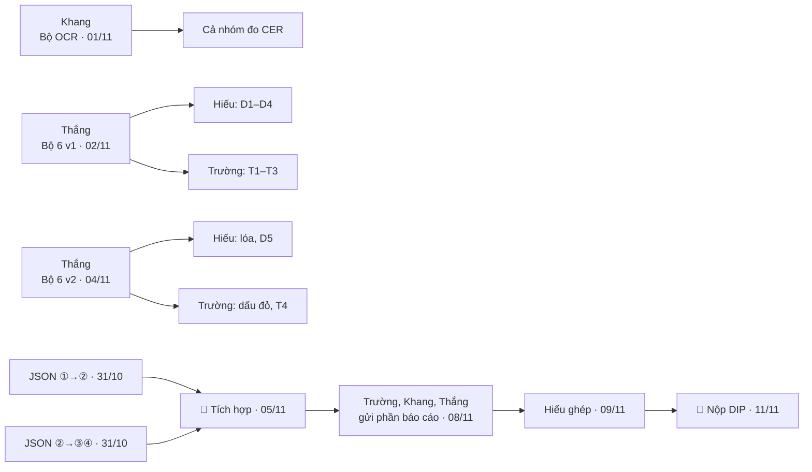

# BẢNG TIẾN ĐỘ CHUNG — NHÓM MEDTRACK

> **Thành viên:** Hiếu (nhóm trưởng) · Trường · Khang · Thắng  
> **Cách cập nhật:** sửa cột **Trạng thái** (⬜ Chưa làm · 🔄 Đang làm · ⛔ Bị chặn · ✅ Xong), ghi đường dẫn kết quả hoặc lý do bị chặn vào cột **Ghi chú**, rồi commit lên nhánh `dip`.  
> **Kế hoạch chi tiết:** [Tổng hợp](PhanCong_TongHop.md) · [Hiếu](KeHoach_Hieu.md) · [Trường](KeHoach_Truong.md) · [Khang](KeHoach_Khang.md) · [Thắng](KeHoach_Thang.md)  
> **Khung code:** [code/README.md](../code/README.md). Mỗi người có sẵn module với tên hàm theo kế hoạch, test và file thí nghiệm mẫu; hợp đồng JSON ở `code/src/common/contracts.py`.

**Loại việc:** 🔁 Giao nhận (chuyển kết quả cho người khác) · 🎯 Mốc (cả nhóm cùng phải đạt) · 📮 Nộp bài (hạn chót bên ngoài) · 📝 Việc riêng

---

## Hạn chót quan trọng

| Ngày | Hạn | Ghi chú |
| :---: | :--- | :--- |
| **05/11** | 🎯 **Mốc tích hợp:** pipeline chạy đầu-cuối | Hiếu → Trường → Khang / Thắng trên 5 ảnh |
| **05/11** | 📮 Đăng ký đội NEXUS (23:59) | |
| **07/11** | 📮 Nộp đề xuất NEXUS vòng 1 | Tiếng Anh, 2–4 trang, ẩn danh, khai báo AI |
| **11/11** | 📮 **Nộp đồ án Xử lý ảnh** | Email `uyenvnb@ptit.edu.vn` |
| *Chưa rõ* | 📮 Nộp bài tập lớn ML | Chờ thầy Đức công bố — các mốc ML bên dưới là dự kiến |

---

## Chuỗi giao nhận (ai chờ ai)

---

## 31/10 (Thứ bảy) — Chuẩn bị & chốt hợp đồng dữ liệu

| Loại | Việc | Người làm | Giao cho | Môn | Trạng thái | Ghi chú |
| :---: | :--- | :--- | :--- | :---: | :---: | :--- |
| 📝 | Hỏi thầy Đức hạn nộp bài tập lớn ML | Hiếu | Cả nhóm | ML | 🔄 | Đã hỏi 31/10, chờ thầy trả lời |
| 🔁 | Kiểm tra VAIPE: có ảnh đơn thuốc + file nhãn không, nhãn theo vùng hay theo dòng | Thắng | Cả nhóm | Chung | ✅ | 31/10: 1.345 ảnh đơn (1.173 ảnh train có nhãn, 41.208 bbox dòng con 6 lớp `drugname/usage/quantity/diagnose/date/other`; 172 ảnh test). Loại trừ 1 cặp trùng SHA-256 (TRAIN_1172 == TEST_32), khóa 981 cụm pHash. Xem `results/t02/`, `results/t03/` |
| 🔁 | Xác nhận tên nhãn chính xác và số ảnh của bộ 3 (Report Keywords) | Khang | Cả nhóm | Chung | ✅ | 31/10: 135 ảnh (117 train, 11 val, 7 test), 8.198 box thuộc 5 class: `Report Type` (113), `parameter` (2.170), `reference value` (1.751), `unit` (2.011), `value` (2.153). Phát hiện 1 file nhãn val rỗng cần xác nhận. Xem chi tiết `team/KeHoach_Khang.md` mục 11.1 |
| 📝 | Thử nghiệm sinh ground-truth cấu trúc dòng/cột từ Bộ 3 (`k0_dataset3_ground_truth.py`) | Khang | | DIP | 🔄 | 31/10: K0 khảo sát 20 ảnh, 397 dòng ứng viên; pilot 4 ảnh dễ đã được review, xem `team/KeHoach_Khang.md` mục 11.2. |
| 🔁 | Chốt JSON ① → ②: ảnh phẳng, ma trận H, loại tài liệu, điểm chất lượng | Hiếu, Trường | Hiếu ↔ Trường | DIP | ✅ | 31/10: ảnh BGR đã nắn + chỉnh nghiêng, **chưa CLAHE**; `H` gồm cả xoay. Xem `contracts.py`, KeHoach_Hieu mục 1 |
| 🔁 | Chốt JSON ② → ③④: ảnh sạch, ảnh nhị phân, mask lớp mực, thành phần liên thông | Trường, Khang, Thắng | Trường ↔ Khang, Thắng | DIP | ✅ | Đã chốt & kiểm thử khớp 100% qua handoff fixture `code/examples/cleaning_handoff_v1/`: Trường cung cấp fixture `8bca272c`; Thắng và Khang đã nghiệm thu đạt PASS 100% (mẫu `handoff_lab_report_001`: ảnh nhị phân 1100×800 mực=255/nền=0 và crop mẫu đạt chuẩn hợp đồng CleaningResult) |
| 🔁 | Gửi yêu cầu cho bộ 6: mức độ hỏng, mask lóa, mask dấu, ảnh nhị phân chuẩn | Hiếu, Trường | Thắng | DIP | ✅ | Đã chốt và hoàn tất Bộ 6 v1 (1.000 mẫu) tại `data/6_synthetic/`: có đủ 4 góc `corners`, ma trận `H_degraded_to_clean`, ảnh nhị phân Otsu chuẩn `clean_binary.png`, `shadow_mask.png`, `gt.json` |
| 🔁 | Gửi khung báo cáo DIP (4–10 trang, mỗi người 1,5–2 trang) | Hiếu | Cả nhóm | DIP | ✅ | 01/11: khung LaTeX ở `dip/report/latex/`; ai viết file nào xem [guidelines.md](../dip/report/guidelines.md) mục 2 |
| 📝 | Lấy tập con RVL-CDIP ~500 ảnh cho lớp "khác" | Hiếu | | ML | ✅ | 8 lớp × 100 = 800 ảnh (400/200/200) + 200 ảnh open-set (`budget`, `resume`); `code/scripts/fetch_rvl_cdip.py` → `data/4_other_rvl_cdip/` |
| 🔁 | Dựng khung code chung `code/`: module từng người, hợp đồng dữ liệu, test, file thí nghiệm mẫu, `run_pipeline.py` | Hiếu | Cả nhóm | Chung | ✅ | [code/README.md](../code/README.md) |
| 🎯 | Mỗi người: pull nhánh dip, cài môi trường theo code/README.md mục 1, chạy pytest xanh; đọc file module của mình, báo nếu tên hàm / tham số cần đổi | Cả nhóm | | Chung | ✅ | Thắng: môi trường code/.venv Python 3.13.1, chạy pytest 78 passed 42 skipped xanh 100%. **Trường 01/11:** `.venv` độc lập Python 3.13.7, đủ thư viện lõi, `pip check` đạt; lần chạy toàn bộ suite **233 passed, 32 skipped, 0 failed/errors**. **Khang 01/11:** môi trường `.venv` dùng chung (uv, Python 3.11.18), test OCR metrics + table: **19 passed, 2 skipped** (`char_height`, `rows_fixed` chưa triển khai). **Hiếu 02/11:** `code/.venv` Python 3.13.15, toàn bộ suite trên `dip` **102 passed, 23 skipped, 0 failed**. |

## 01/11 (Chủ nhật)

| Loại | Việc | Người làm | Giao cho | Môn | Trạng thái | Ghi chú |
| :---: | :--- | :--- | :--- | :---: | :---: | :--- |
| 🔁 | Bộ OCR dùng chung `src/ocr/`: Tesseract hoặc PaddleOCR (tiếng Anh), VietOCR (tiếng Việt), hàm `cer` / `wer` | Khang | Cả nhóm | Chung | ✅ | 01/11: Hoàn thành wrapper `code/src/ocr/engines.py` và metrics `code/src/ocr/metrics.py`; lazy import, cache model/predictor (không cache OCR từng crop). Tesseract 5.5.4 trên 50 crop `data/dataset3_50/` đạt corpus CER 0.2543 / WER 0.7011; PaddleOCR 2.10.0 đạt CER 0.3839 / WER 0.8276. Tesseract tốt hơn về CER/WER; Paddle nhanh hơn theo median (6.4 ms so với 108.7 ms/crop, sau warm-up). Benchmark: `code/experiments/k0_ocr_benchmark.py`; kết quả local tại `results/ocr_benchmark_dataset3_50_line/`. Thử OCR trước đó: crop mẫu confidence 0.91; tiếng Việt CER=0.0, WER=0.0. Làm sớm `code/src/table_extraction/flags.py`: 14/14 test parse_number/range/flag đạt. Test liên quan hiện tại: 19 passed, 2 skipped (`char_height`, `rows_fixed`, do phần trích xuất bảng chưa triển khai). VietOCR hỗ trợ OCR dòng; `ocr_page` chỉ áp dụng Tesseract/PaddleOCR. |
| 📝 | `data/README.md`: số ảnh, danh sách nhãn, license của 3 bộ dữ liệu | Trường | Cả nhóm | Chung | ✅ | 01/11: hoàn thiện [data/README.md](../data/README.md) và [nguồn/license](../data/SOURCES_AND_LICENSES.md): kiểm kê 10.841 ảnh, đủ tên lớp/số vùng/định dạng nhãn, ghi riêng nhãn rỗng và ảnh trùng; đối chiếu nguồn và kiểm tra tài liệu/quy tắc Git đạt. Kaggle khai báo VAIPE `DbCL-1.0`; bộ ③ khớp CC BY 4.0. Bộ ②: trang v1 ghi CC BY 4.0 nhưng YAML ghi `Private`, còn cần người cung cấp làm rõ; không ghi nhận mâu thuẫn đã giải quyết. Split chung đã xong theo xác nhận của Trường, không chia lại. |
| 📝 | Bản đầu tiền xử lý: đo chất lượng, tìm góc, nắn phẳng, CLAHE chạy trên 10 ảnh | Hiếu | | DIP | ✅ | 31/10: `quality`, `corners` (contour → Hough → minAreaRect), `rectify` (tỉ lệ Zhang–He), `enhance`; 7/10 ảnh bộ 2–3 tốt. Lỗi đã thấy: trang gập (chọn nhầm nếp gập), giấy xoay 90°, ảnh chụp màn hình bị báo lóa giả. Xem `results/preview_0111/` (`scripts/preview_preprocess.py`). Hiếu xem lại 01/11: thêm 2 lỗi (giấy tràn khung, tứ giác bám tờ phía sau) → còn 5/10 tốt; đã sửa ở dòng 02/11 |
| 📝 | Bản đầu làm sạch: khử bóng + 5 cách nhị phân hóa chạy trên 10 ảnh | Trường | | DIP | ✅ | 01/11: đã có Median, Closing, Closing + Median và đủ Otsu/Niblack/Sauvola/Wolf/Gaussian adaptive. Kiểm tra 200 đầu ra trên 10 ảnh phát triển (4 cấu hình đầu vào × 5 cách), đúng uint8/kích thước/mực 255/nền 0. Mốc này chưa bao gồm tách mực, xóa dấu, components hoặc `cleaning.pipeline.clean`. |

## 02/11 (Thứ hai)

| Loại | Việc | Người làm | Giao cho | Môn | Trạng thái | Ghi chú |
| :---: | :--- | :--- | :--- | :---: | :---: | :--- |
| 📝 | Code tách mực, phân biệt ứng viên dấu/chữ đỏ và 3 phương án inpainting | Trường | | DIP | ✅ | Hoàn thành `ink_masks()`, bản cơ bản `split_stamp_vs_text()` nhận vành dấu kín tròn/elip và `remove_marks()` đủ Telea/NS/tô trắng. **433 test liên quan trong phạm vi chia sẻ code đạt**, không skip/fail (không bao gồm metric/script T1/T2). Đã xem ảnh và kiểm tra không đổi pixel ngoài mask. Chưa nghiệm thu T4/T5/OCR hoặc xóa toàn bộ dấu; `components` và `cleaning.pipeline.clean()` còn cần làm cho mốc tích hợp 05/11. Chi tiết tại [kế hoạch Trường](KeHoach_Truong.md#71-đến-hạn-dip-1111). |
| 🔁 | **Bộ 6 v1 (Cập nhật v1.1 theo review của Hiếu):** phối cảnh, nghiêng, mờ, bóng đổ + ảnh sạch, ma trận H, box, ảnh nhị phân chuẩn | Thắng | Cả nhóm | DIP | ✅ | **Hiếu nghiệm thu độc lập 02/11: đạt** (lưới D3 15/15 ô, D4 đủ ±2/±5/±10/±15°; thiếu 0° → đo trên ảnh sạch; chi tiết KeHoach_Hieu mục 2). Thắng tự nghiệm thu v1.1 (01/11): ĐẠT CHUẨN 100%: Lưới D3 đủ 15/15 ô (3 mức phối cảnh × 5 góc) × 10 ảnh độc lập; Tập D4 đủ 9/9 góc (đã bổ sung ±2° và ±15°) × 10 ảnh độc lập; 1.000 mẫu tại `data/6_synthetic/`, audit 6.003 file 0 lỗi; nén sẵn `6_synthetic_v1.zip` (956 MB) trên Drive; đồng bộ T04 items_gt 100%. README hướng dẫn & code mẫu: `data/6_synthetic/README.md` |
| 📝 | Bản đầu dựng bảng: gom dòng (K1) trên bộ 3 | Khang | | DIP | ✅ | Hoàn thành bản đầu `geometry.py`, `rows.py`, `experiments/k1_rows.py`; pilot 4 ảnh đạt pairwise F1 1.00 cho projection và fixed-y. Kết quả/giới hạn ghi ở `team/KeHoach_Khang.md` mục 11.5. |
| 📝 | Tiền xử lý đầu-cuối: chỉnh nghiêng 3 cách (`deskew.py`), khử lóa (`glare.py`), `preprocess()` theo hợp đồng ① → ② | Hiếu | Trường | DIP | ✅ | Xong sớm 01/11; 51 test đạt. Sửa 4 lỗi ảnh thật: loại tứ giác cắt mất chữ (nếp gập, khung bảng, tờ phía sau), giấy tràn khung → `full_image`, trang xoay 90°, lóa giả ảnh chụp màn hình. Bộ 6: tìm góc 120/120 mẫu phối cảnh. Xem `results/preview_0111_v2/`. **Trường chạy được ngay:** `python run_pipeline.py <ảnh> --doc-type prescription` → `out/`. Còn tồn: chưa nhận diện trang lộn ngược 180° |

## 03/11 (Thứ ba)

| Loại | Việc | Người làm | Giao cho | Môn | Trạng thái | Ghi chú |
| :---: | :--- | :--- | :--- | :---: | :---: | :--- |
| 🎯 | Gom và chuẩn bị bộ 5: ảnh tự chụp theo phân công | Cả nhóm | | Chung | 🔄 | Bản hiện tại có 83 ảnh (48 lab, 18 prescription, 17 other), đã chuẩn hóa thư mục/tên file và tải lên Drive cùng manifest. Mỗi người tiếp tục review, ẩn danh và gán nhãn đúng task; chưa xác nhận trạng thái ẩn danh. Chưa chia train/valid/test. |
| 📝 | Hai bảng đầu T1–T2 làm sạch | Trường | Cả nhóm | DIP | ✅ | **03/11: hoàn thành, sẵn sàng bàn giao.** T1–T2 v2 tại `results/t1_v2/`, `results/t2_v2/`; 100 nguồn, giữ split 60/10/30, sinh bóng đơn từ clean v2 vì mẫu bóng đơn có sẵn không phủ test. Chọn trên val: Closing 81; Closing 81 → Otsu. Test: T1 PSNR 49,810762 dB/SSIM 0,999489; T2 F1 0,998123 theo Otsu tự sinh, không phải nhãn thủ công/OCR. Sau sửa lóa `fed83ebc`, đã tái tính 120 + 300 dòng test khớp, không đổi số liệu/config/selection lịch sử. Gói `results/t1_t2_repro_audit/t1_t2_v2_1_handoff.zip` đã kiểm CRC/SHA-256 và chạy từ bản giải nén: 173 test liên quan + kiểm chứng 420 dòng đạt. Hướng dẫn: `HANDOFF_V2_1.md` cùng thư mục; dataset chia sẻ riêng, không nằm trong gói ZIP. |
| 🔁 | Chốt JSON đầu ra ③④: dòng chỉ số xét nghiệm, khoản thuốc | Khang, Thắng | Trường (component xác nhận) | DIP | 🔄 | 02/11 Thắng: bản đề xuất tại `code/examples/output_handoff_v1/` — JSON mẫu ③④ viết đúng theo ảnh fixture `cleaning_handoff_v1`, `verify_output_handoff.py` kiểm tra hợp đồng + bbox khớp chữ trên ảnh. **Chờ Khang xác nhận phần ③, Trường xác nhận bên nhận.** Cần nhóm quyết: thêm buổi chiều (`afternoon`) và số lượng (`quantity`) vào hợp đồng đơn thuốc (README mục 4). |
| 📝 | Bản đầu tách khoản thuốc + vẽ ground truth ~30 ảnh | Thắng | | DIP | ✅ | **Tách khoản:** `region.py`, `lines.py`, `items.py` (Projection tách dòng + Dilation gom khoản); unit test xanh (`test_prescription.py` 9/9 passed).  **GT ~30 ảnh:** 15 bộ 1 + 15 bộ 2, 107 khoản, file `t04_gt_30_images.json` trên Drive nhóm, thư mục `results/t04/` (chạy S1: tải về đặt vào `results/t04/` trên máy); Thắng đã duyệt overlay 02/11.  **Bộ 6:** box khoản thuốc đã biến đổi theo `H` cho 1.000 mẫu (`items_degraded`, sai lệch ≤ 0,005 px). |
| 🔁 | Gửi khung báo cáo ML | Hiếu | Cả nhóm | ML | ✅ | 03/11: khung LaTeX ở `ml/report/latex/` (cùng kiểu DIP, mỗi bài toán 1 file); ai viết file nào xem [guidelines.md](../ml/report/guidelines.md) mục 2. Số trang chờ thầy Đức |
| 🔁 | **Bộ 6 v2 — sửa lóa theo nghiệm thu của Hiếu** | Thắng | Hiếu | DIP | ✅ | Hiếu phát hiện: giấy scan VAIPE = 255 nên lóa không làm giấy sáng thêm, bộ phát hiện lóa ra IoU = 0. Đã sửa: v10, v14 nhân ảnh 0,80–0,92 trước khi thêm lóa (`exposure_gain` trong gt.json, manifest), thêm `clean_exposed/` làm ảnh tham chiếu cho D5. Chỉ 200 ảnh hỏng đổi; mọi mask và v11–v13 giữ nguyên từng byte → Trường không cần nghiệm thu lại. IoU `quality.glare_mask` v10 mức 1/2/3: 0 → 0,16/0,76/0,83. Zip mới `6_synthetic_v2.zip` (2,07 GB, sha256 `bc150cec3ec136f0…`) thay bản cũ trên Drive. **Hiếu chạy được D1 phần lóa, D5.** |

### Bộ 5 — việc từng người cần làm sau khi gom ảnh

Ảnh hiện đã có trên Drive và trong `data/5_self_captured/` ở bản local Khang; các ảnh **chưa được review nội dung hoặc gán nhãn chi tiết**. Mỗi người tải cùng một bản từ Drive, kiểm tra/ẩn danh ảnh mình phụ trách, rồi tạo nhãn riêng theo task:

| Người | Phần review / gán nhãn bộ 5 |
|---|---|
| **Hiếu** | Xác nhận nhãn loại tài liệu cho từng ảnh (`prescription`, `lab_report`, `other`); bổ sung/kiểm tra nhóm `other` theo yêu cầu phân loại và đánh giá tài liệu lạ. |
| **Trường** | Review thành phần mực trên tập test được chọn; sửa nhãn `printed`, `handwritten`, `stamp`, `other`, chú ý dấu và chữ đỏ. |
| **Khang** | Trên khoảng 10 phiếu xét nghiệm tiếng Việt, gán box/role cho `report_type`, `parameter`, `result`, `unit`, `range`; chép nội dung độc lập cho crop dùng đo OCR. |
| **Thắng** | Trên khoảng 10 đơn thuốc tiếng Việt, gán box từng khoản thuốc để kiểm chứng tách khoản/OCR. |

**Split:** bộ 5 hiện chưa có train/valid/test. Sau review và gán nhãn, nhóm cần chốt cấu trúc theo từng task và tránh để ảnh chụp cùng tài liệu lọt sang nhiều tập. Theo quy định ban đầu, bộ 5 là tập kiểm thử độc lập, không dùng train/tinh chỉnh; mặc định giữ vai trò này, trừ khi nhóm thống nhất sửa quy định.

## 04/11 (Thứ tư)

| Loại | Việc | Người làm | Giao cho | Môn | Trạng thái | Ghi chú |
| :---: | :--- | :--- | :--- | :---: | :---: | :--- |
| 🔁 | **Bộ 6 v2:** lóa + mask lóa, dấu đỏ + mask dấu, bút xanh, nén & nhiễu | Thắng | Hiếu, Trường | DIP | ✅ | Bản hoàn chỉnh v2 = **1.500 mẫu** (giữ nguyên 1.000 mẫu v1, thêm 500 mẫu v10–v14: chỉ lóa / chỉ dấu / chỉ bút / chỉ nén + nhiễu / tổ hợp). Mask mới `glare_mask/`, `stamp_mask/`, `pen_mask/`; danh sách mẫu `manifest_v2.csv`; mọi mức có ở cả train / val / test. Kiểm tra `code/scripts/audit_synthetic_v2.py` PASS, `test_synthetic.py` 35/35 passed. Tham số, định nghĩa mask: `data/6_synthetic/README.md`. File `6_synthetic_v2.zip` (2,07 GB, bản 03/11) trên Drive thay `6_synthetic_v1.zip`. **Hiếu nghiệm thu 03/11:** mask lóa, dấu, bút, checksum v1 đạt; lóa trên giấy scan 255 "vô hình" (bộ phát hiện IoU = 0). **Đã sửa 03/11:** v10, v14 giảm phơi sáng 0,80–0,92 trước khi thêm lóa, thêm `clean_exposed/` cho D5; chỉ 200 ảnh hỏng đổi, mọi mask và v11–v13 giữ nguyên từng byte; IoU bộ phát hiện v10 mức 1/2/3 = 0,2/0,8/0,8; file checksum chuyển sang LF (`sha256sum -c` chạy được trên Colab). Zip mới thay bản cũ. **Chờ Trường (dấu, bút) nghiệm thu.** **Hiếu nghiệm thu độc lập 03/11 (v2.1): đạt** — mask lóa đúng, mẫu âm/dương đủ, v1 không đổi; chi tiết KeHoach_Hieu mục 2. |
| 📝 | T3: nhị phân hóa theo mức bóng, mờ và dấu | Trường | Cả nhóm | DIP | ✅ | 04/11: nghiệm thu phạm vi biến thể đơn hỏng có kiểm soát từ clean bộ 6 v2, giữ split 60/10/30. Đủ 6.600 dòng, 220 ô × cùng 30 nguồn test; giữ 10 cấu hình T2 và Closing81, không chọn lại theo test. Kết quả/hướng dẫn: `results/t3/README.md`, `figure.png/pdf`, `summary.csv`; 234 test liên quan đạt. Tái chạy 660 dòng trên 3 nguồn định trước khớp SHA/điểm (atol 1e-12), không tuyên bố chạy lại toàn bộ. F1 theo Otsu tự sinh, chưa suy ra OCR; dấu thay cả radius/opacity, template T3 dẫn xuất. Không đánh dấu T4/T5 hoàn thành; không dùng bộ 5. |
| 📝 | T4: phát hiện và xóa dấu/nét bút | Trường | Cả nhóm | DIP | ✅ | 04/11: nghiệm thu **phạm vi thí nghiệm bộ6 v2**, chưa phải chất lượng detector triển khai. Đủ30 dấu,16 bút xanh,14 bút đen (GT chẩn đoán, chưa detector đen);76 hàng detection,90 negative,424 hàng xóa và240 đối chứng riêng. CER thật Tesseract vie+eng trên15 val/47 test do Trường duyệt,140/430 hàng; cùng crop/ref/config, tổng lỗi/tổng ký tự. 401 test liên quan đạt; replay metadata định trước5 val+7 test crop,105 variant rows/72 gọi OCR thật khớp; không rerun toàn bộ. Ứng viên dấu rỗng24/30, inpaint có thể mất chữ; không gọi GT upper bound. Báo cáo: `results/t4/acceptance_v1/README.md`. **T5 chưa hoàn thành**, không suy ra an toàn chữ đỏ/ảnh thực hoặc tích hợp. |

## 05/11 (Thứ năm)

| Loại | Việc | Người làm | Giao cho | Môn | Trạng thái | Ghi chú |
| :---: | :--- | :--- | :--- | :---: | :---: | :--- |
| 🎯 | **MỐC TÍCH HỢP:** pipeline chạy đầu-cuối trên 5 ảnh (Hiếu → Trường → Khang / Thắng) | Cả nhóm | | DIP | ⬜ | |
| 📮 | Đăng ký đội NEXUS 2026 (hạn 23:59), chọn đội trưởng | Cả nhóm | BTC NEXUS | NEXUS | ⬜ | |

## 07/11 (Thứ bảy)

| Loại | Việc | Người làm | Giao cho | Môn | Trạng thái | Ghi chú |
| :---: | :--- | :--- | :--- | :---: | :---: | :--- |
| 📮 | Nộp đề xuất NEXUS vòng 1 (2–4 trang tiếng Anh) | Cả nhóm | BTC NEXUS | NEXUS | ⬜ | |

## 08/11 (Chủ nhật)

| Loại | Việc | Người làm | Giao cho | Môn | Trạng thái | Ghi chú |
| :---: | :--- | :--- | :--- | :---: | :---: | :--- |
| 🔁 | Gửi phần báo cáo của mình (1,5–2 trang) cho Hiếu ghép | Trường, Khang, Thắng | Hiếu | DIP | ⬜ | |
| 🔁 | Gửi slide phần mình (2–3 slide) cho Hiếu ghép | Trường, Khang, Thắng | Hiếu | DIP | ⬜ | |
| 🔁 | Gửi đoạn demo 30 giây chạy trên ảnh thật cho Hiếu ghép | Trường, Khang, Thắng | Hiếu | DIP | ⬜ | |

## 09/11 (Thứ hai)

| Loại | Việc | Người làm | Giao cho | Môn | Trạng thái | Ghi chú |
| :---: | :--- | :--- | :--- | :---: | :---: | :--- |
| 🔁 | Gửi bản thảo báo cáo hoàn chỉnh cho cả nhóm đọc | Hiếu | Cả nhóm | DIP | ⬜ | |
| 🔁 | Gửi slide hoàn chỉnh cho cả nhóm duyệt | Hiếu | Cả nhóm | DIP | ⬜ | |
| 🎯 | Chốt nội dung demo, ghép video demo hoàn chỉnh (2–3 phút) | Cả nhóm | | DIP | ⬜ | |

## 10/11 (Thứ ba)

| Loại | Việc | Người làm | Giao cho | Môn | Trạng thái | Ghi chú |
| :---: | :--- | :--- | :--- | :---: | :---: | :--- |
| 🎯 | Tập thuyết trình theo slide, khớp thời gian (mỗi người 2–3 phút) | Cả nhóm | | DIP | ⬜ | |
| 🎯 | Hỏi đáp thử các câu phản biện (xem mục "Chuẩn bị hỏi đáp" trong kế hoạch từng người) | Cả nhóm | | DIP | ⬜ | |

## 11/11 (Thứ tư) — HẠN NỘP BÁO CÁO DIP

| Loại | Việc | Người làm | Giao cho | Môn | Trạng thái | Ghi chú |
| :---: | :--- | :--- | :--- | :---: | :---: | :--- |
| 📮 | **Nộp báo cáo DIP hoàn chỉnh qua email cô Uyên** (kèm link Drive code + data + demo) | Hiếu | Cô Uyên | DIP | ⬜ | |
